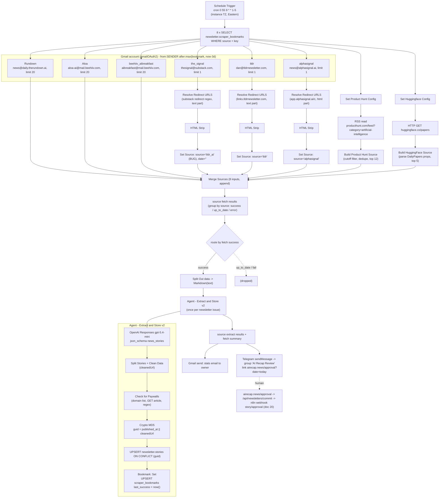

# 10 — Story ingestion pipeline (n8n, active)

> **Historical.** This describes the n8n system that native code replaced in November 2026 ([ADR 0003](../adr/0003-n8n-retired-kept-as-record.md)). It is not the current system: see [../architecture.html](../architecture.html).

Scope: `1. Fetch Stories` [hdEUV8VFZbI13VpV], `Resolve Redirect URLS from Emails` [ELtnV1av7bg8hxCz],
`HTML Strip` [QizlCbiLwCn4fGRf], `Agent - Extract and Store v2` [vVPv9aMjTwYBFKqb], `Check for Paywalls`
[NbNTNmXoOJ81jYlf], `Bookmark: Get` [rAkhmEe8L07nYMfq], `Bookmark: Set` [AL1bSOW4DwLHcStx].

Evidence base: workflow JSON exports (active version == saved draft for all 7), execution metadata, full
payloads of the 10 most recent `Fetch Stories` runs (2026-10-21 .. 2026-11-03), all 63 `Agent - Extract and
Store v2` runs in that window, their child runs, and read-only queries against prod Neon (2026-11-03).

## At a glance

- **One cron, no human in the loop until approval.** `1. Fetch Stories` runs at **09:55 Mon–Fri, US Eastern**
  (instance default timezone). It pulls 8 sources one after another (6 Gmail newsletters, the Product Hunt AI
  Atom feed, the Hugging Face daily-papers page), turns each newsletter issue into Markdown, and calls
  `Agent - Extract and Store v2` once per issue.
- **One LLM call per issue.** OpenAI Responses API, model **`gpt-5.4-mini`**, strict `json_schema` output.
  It returns `stories[]` with `category`, `headline`, `summary`, `story_detail`, `published_at`, `url`,
  `importance_score`. The web-search tool is enabled but was never used in 63 runs.
- **Writes to `newsletter.stories`.** Postgres upsert `ON CONFLICT (guid)`, where
  `guid = md5("{published_at} || {cleanedUrl}")` (the `||` is literal text). Last writer wins on
  headline/summary/category/source. Approval-state columns are never touched.
- **What counts as "new".** Each source has a row in `newsletter.scraper_bookmarks`. A Gmail search only
  returns mail received after `max(last_success, now − 3 days)`. Product Hunt uses the same cutoff. Hugging
  Face ignores it. The bookmark is set to *processing time*, and only when at least one story was upserted.
- **Volume and timing.** About 30–65 stories per run (440 across the last 10 runs). A run takes 52–157 s
  (median 62 s). An LLM call takes 2.7–21.7 s and uses about 6.6k–19k input tokens. Every execution in the
  window succeeded.
- **What happens after.** Fetch Stories does **not** start drafting. It sends one Telegram message to the
  "AI Recap Review" group with the link `https://airecap.news/approval?date=YYYY-MM-DD`, and emails a stats
  summary to the owner. A human then approves on the website, which starts the next stage (see doc 20).
- **The one `waiting` execution (12947)** is an orphan from a manual run on 2026-03-26. Back then this
  workflow called `2. Create Issue Draft` directly. That child (12954) has since been deleted (GET returns 404).
  The parent's `waitTill` is `3000-01-01`, so it waits forever. It is harmless.
- **Bug: The Signal gets the wrong label.** Its stories are stored as `source = 'tldr_ai'` with an empty
  date. Its own bookmark (`the_signal`) has been frozen since 2026-06-29, so each Sunday issue is re-extracted
  on Mon/Tue as new duplicate rows. The real TLDR branch is stored as `'tldr'`.
- **Bug: stories without a URL collide.** All of them for a given day hash to the same guid
  (`md5("YYYY-MM-DD || ")`) and overwrite each other.
- **Bug: issues get dropped.** `limit 1` on three Gmail sources means only the newest issue is read. TLDR
  was missing on all three Mondays observed. Aloa has been dead since 2026-04-27.
- **Paywall detection is weak.** The `paywall_detected` value comes from a hardcoded domain list plus a regex
  over the article HTML. In the last 60 days it was 70% `unknown` and 23% `error` (Product Hunt is always
  403).



## Workflow inventory

| Workflow | Id | Status | Last updated | Nodes | Runs in metadata window | Called by |
|---|---|---|---|---|---|---|
| 1. Fetch Stories | hdEUV8VFZbI13VpV | active | 2026-10-20 | 48 | 10 success + 1 waiting (orphan from 2026-03-26) | cron |
| Resolve Redirect URLS from Emails | ELtnV1av7bg8hxCz | active | 2026-07-02 | 6 | 30 success | Fetch Stories (3 call nodes) |
| HTML Strip | QizlCbiLwCn4fGRf | active | 2026-07-02 | 2 | 26 success | Fetch Stories (3 call nodes) |
| Agent - Extract and Store v2 | vVPv9aMjTwYBFKqb | active | 2026-06-30 | 11 | 63 success | Fetch Stories |
| Check for Paywalls | NbNTNmXoOJ81jYlf | active | 2026-06-29 | 12 | 63 success | Agent v2 |
| Bookmark: Set | AL1bSOW4DwLHcStx | active | 2026-01-30 | 2 | 63 success | Agent v2 (also inactive legacy agents) |
| Bookmark: Get | rAkhmEe8L07nYMfq | active | 2026-01-30 | 2 | 0 | **nobody** (orphan; Fetch Stories reads the table directly) |

Resolve Redirect ran 30 times but HTML Strip only 26. In 4 runs a redirect-based Gmail source returned no
email, the resolver produced zero items, and that branch silently died (details below).

None of the 7 workflows sets `settings.timezone` or `settings.errorWorkflow`. The `Error Handler` workflow
exists but is not attached.

---

## 1. `1. Fetch Stories` [hdEUV8VFZbI13VpV]

### 1.1 Purpose and status
This is the daily ingestion orchestrator. It is active (`activeVersionId == versionId`) and was last
updated 2026-10-20. Settings: `executionOrder: v1`, `binaryMode: separate`. No timezone and no error workflow.
`pinData` exists only on `Schedule Trigger`, which affects manual editor runs only.

### 1.2 Trigger
- `Schedule Trigger` (scheduleTrigger v1.3), cron **`0 55 9 * * 1-5`**. The fields are sec, min, hour, dom,
  mon, dow, so this fires 09:55:00 Monday–Friday.
- Timezone: `settings.timezone` is unset, so the n8n instance default applies. The evidence says that
  default is Eastern (America/New_York or America/Toronto):
  - Runs started at 13:55Z while EDT was in effect and at 14:55Z after DST ended on 2026-11-01.
  - `$now` rendered as `2026-11-02T09:55:36.682-05:00` inside the run.
- There are no other callers or webhooks. The weekday-only schedule means weekend newsletters wait until
  Monday.

### 1.3 Source catalog (exact filters as deployed)

Every Gmail node is `n8n-nodes-base.gmail` v2.2 with `operation: getAll`, `simple: false` (full MIME parse
returning `html`, `text`, `textAsHtml`, `headers`, `subject`, `date`, `from`, `to`, `messageId`, `labelIds`, …),
credential **`Gmail account`**, `onError: continueRegularOutput`, `alwaysOutputData: true`. The only
filters are `sender` and `receivedAfter`. The node turns them into the Gmail search
`from:<sender> after:<unix-seconds>`. No labels are used, spam and trash are excluded (default), and messages
are never marked read or relabelled. `receivedAfter` is the same expression in every Gmail node:

```js
DateTime.max(
  $json.last_success ? DateTime.fromISO($json.last_success) : $now.minus({ years: 100 }),
  $now.minus({ days: 3 })
).toISO()
```

where `$json.last_success` comes from the preceding `Get Bookmark: …` node.

| # | Branch (node) | Source type / filter | Limit | Bookmark row **read** | Content part sent to LLM | Link unwrapping | `stories.source` written | Bookmark row **written** |
|---|---|---|---|---|---|---|---|---|
| 0 | `Rundown` | Gmail `from:news@daily.therundown.ai` | 20 | `rundown_ai` | Gmail `text` (plain-text part) | none | `rundown_ai` | `rundown_ai` |
| 1 | `Aloa` | Gmail `from:aloa-ai@mail.beehiiv.com` | 20 | `aloa_ai` | `text` | none | `aloa_ai` | `aloa_ai` |
| 2 | `the_signal` | Gmail `from:thesignal@substack.com` | **1** | `the_signal` | `text`, with redirects resolved | regex `https:\/\/substack\.com\/redirect\/[0-9a-f]{8}-[0-9a-f]{4}-[0-9a-f]{4}-[0-9a-f]{4}-[0-9a-f]{12}\?j=[A-Za-z0-9_.-]+` | **`tldr_ai` (bug)** | **`tldr_ai`** |
| 3 | `beehiiv_aibreakfast` | Gmail `from:aibreakfast@mail.beehiiv.com` | 20 | `ai_breakfast` | `text` | none | `ai_breakfast` | `ai_breakfast` |
| 4 | `tldr` | Gmail `from:dan@tldrnewsletter.com` | **1** | **`tldr_ai`** | `text`, with redirects resolved | `/https:\/\/links\.tldrnewsletter\.com\/[A-Za-z0-9]+/gi` | `tldr` | `tldr` (never read) |
| 5 | Product Hunt | RSS `https://www.producthunt.com/feed?category=artificial-intelligence` | top 12 after filter | `product_hunt_ai` | synthesized text (below) | n/a | `product_hunt_ai` | `product_hunt_ai` |
| 6 | `alphasignal` | Gmail `from:news@alphasignal.ai` | **1** | `alphasignal` | `html`, with redirects resolved, then stripped | `/https:\/\/app\.alphasignal\.ai\/c\?[^"'<> \t\r\n]+/gi` | `alphasignal` | `alphasignal` |
| 7 | Hugging Face | HTTP GET `https://huggingface.co/papers` | first 5 papers | `huggingface` (**read but unused**) | JSON string of page props | n/a | `huggingface` | `huggingface` |

There are no Gmail label/query filters, no web search, and no other sources. airecap.news is never called
over HTTP from here. It only appears as the link inside the Telegram message.

Current bookmark rows in prod (2026-11-03):

| source | last_success (UTC) | Notes |
|---|---|---|
| ai_breakfast | 2026-11-03 14:55:43 | |
| aloa_ai | 2026-04-27 13:45:23 | Aloa has sent nothing since; reported `up_to_date` every day |
| alphasignal | 2026-11-03 14:56:04 | |
| huggingface | 2026-11-03 14:56:15 | not used for gating |
| product_hunt_ai | 2026-11-03 14:55:56 | |
| rundown_ai | 2026-11-03 14:55:20 | |
| the_signal | **2026-06-29 13:45:24** | frozen: no branch writes `the_signal` any more |
| tldr | 2026-11-03 14:55:51 | written by TLDR branch, never read |
| tldr_ai | 2026-11-03 14:55:28 | written by The Signal branch, read by TLDR branch |

### 1.4 How the bookmark gates "new"
1. `Get Bookmark: <key>` (Postgres v2.6, credential `Newsletter Neon Production`, `alwaysOutputData: true`):
   ```sql
   SELECT * FROM "newsletter"."scraper_bookmarks" WHERE "source" = '<key>' LIMIT 1;
   -- (Get Bookmark: the_signal has no LIMIT; source is the PK so it is equivalent)
   ```
2. Window start = `max(last_success, now − 72h)`. If the bookmark row is missing, the result is `now − 72h`.
   The window never reaches back more than 72 h, however long ago the last success was. After an outage of
   more than 3 days, older mail is never ingested.
3. The bookmark is advanced inside `Agent - Extract and Store v2`, by `Bookmark: Set`, to **`$now` at upsert
   time**. It is not set to the email's received time. It only advances when at least one story row was
   upserted for that newsletter issue.
4. Consequences:
   - A failed or empty extraction leaves the bookmark alone, so the same email is retried on the next run
     while it is still within 72 h. That is safe because the upsert is idempotent per guid.
   - An email that lands between the Gmail query and the bookmark write (a few seconds) is skipped forever.
   - With `limit 1`, only the newest email in the window is processed. Older ones in the same window are
     skipped forever, because the bookmark then moves past them.
   - Because The Signal's bookmark is frozen, its weekly Sunday issue is re-read on every run within 72 h
     (Mon, Tue, sometimes Wed).
   - TLDR reads the `tldr_ai` bookmark, which The Signal branch updates about 20 s earlier in the same run.
     This works by accident.
   - Product Hunt uses the same `cutoff_iso` in code (it keeps feed items with `published >= cutoff`).
   - Hugging Face ignores the cutoff completely.

### 1.5 Node-level logic

Execution order is v1: branches run one after another in canvas order, which is rundown, aloa, the_signal,
ai_breakfast, tldr, product_hunt, alphasignal, huggingface. All of them feed `Merge Sources`.

**Plain Gmail branches (Rundown, Aloa, AI Breakfast).** `Gmail getAll` passes the full message to
`Set Source - <x>` (Set v3.4, `includeOtherFields: true`, adds `source`). That goes to `Merge Sources` on
input 0, 1 or 3. With no mail, `alwaysOutputData` emits `{}`, and Set turns it into `{source}`, which later
means "up_to_date".

**Redirect branches (The Signal, TLDR, AlphaSignal).** The Gmail result goes to a `Define … config` Set node,
which outputs only `url_regex`, `source`, `date = $json.date`, and `html`:
- The Signal: `html = $json.text` (the plain-text part, despite the name), `source = "thesignal"`, regex
  without slashes.
- TLDR: `html = $json.text`, `source = "tldr"`.
- AlphaSignal: `html = $json.html` (real HTML), `source = "alphasignal"`.

Next comes `Call Parse Redirect URLS from Emails{1,2,}` (executeWorkflow v1.2, default mode once), which
returns `{text, source, date}`. Then `Call 'HTML Strip'{1,,2}` (v1.3, input `html = $json.text`) returns
`{cleanedHtml}`. Then `Set Source - …` (includeOtherFields):
- `Set Source - the_signal`: **`source = "tldr_ai"`, `text = cleanedHtml`, `date = ""`**. This is a
  copy-paste bug. The real source and date coming back from the call are thrown away.
- `Set Source - tldr`: `source` and `date` taken from `$('Call Parse Redirect URLS from Emails2')`, and
  `text = cleanedHtml`.
- `Set Source - alpha_signal1`: `source` and `date` taken from `$('Call Parse Redirect URLS from Emails')`,
  and `text = cleanedHtml`.

These feed `Merge Sources` on inputs 2, 4 and 6. **If Gmail returns no email**, the resolver gets an empty
`html`. Its regex matches nothing and it returns 0 items, so the rest of the branch never runs. The source
is then missing from the stats email instead of showing "up_to_date". This happened for The Signal on 10-21
and 10-22, and for TLDR on 10-26 and 11-02.

**Product Hunt branch.** `Get Bookmark: product_hunt_ai` feeds `Set Product Hunt Config`, which sets:
- `source = product_hunt_ai`
- `feed_url = https://www.producthunt.com/feed?category=artificial-intelligence`
- `target_date = $now.setZone('America/Toronto').toFormat('yyyy-MM-dd')`
- `cutoff_iso = max(last_success, now − 3d)`

Next, `Product Hunt AI Feed` (rssFeedRead v1.2, `onError: continueRegularOutput`, `alwaysOutputData`) returns
about 50 items with `title, link, pubDate, isoDate, content, contentSnippet, id, author`.
`Build Product Hunt Source` (Code) then:
- returns `{source, error}` if the config is missing or any feed item has an `error`, and `{source}` if the
  feed is empty;
- maps each item to `{rank, name: title, tagline: text of the first <p> in content (HTML-entity decoded, tags
  stripped), product_hunt_url: link || first producthunt href, author, published_at (Toronto date),
  published_at_raw}` and drops items missing a name or URL;
- keeps items with `cutoff <= published <= now`, dedupes by `product_hunt_url`, and takes the first 12 in
  feed order;
- emits `{source, date: target_date, text, feed_url, feed_item_count, ai_product_count, cutoff_iso}`, where
  `text` is:

```text
Source: Product Hunt AI category feed

Target date: 2026-11-03

Feed URL: https://www.producthunt.com/feed?category=artificial-intelligence

Lookback cutoff: 2026-11-02T14:55:36.682Z

Selection method: Product Hunt artificial-intelligence Atom feed filtered to items published after the max of the last successful bookmark time or 3 days ago.

## Product 1
Name: Flockbay
Tagline: Free AI game maker built on Godot
Product Hunt URL: https://www.producthunt.com/products/flockbay
...
```
That item goes to `Merge Sources` input 5.

**Hugging Face branch.** `Get Bookmark: huggingface` feeds `Set Huggingface Config`
(`feed_url = https://huggingface.co/papers`, plus `target_date` and `cutoff_iso` computed the same way;
`cutoff_iso` is unused). `Get Hugging Face URL` (httpRequest v4.4) sends a GET with a Chrome User-Agent,
`followRedirects: false` and `neverError: true`. `Build HuggingFace Source` (Code) then:

```js
const match = html.match(/data-target="DailyPapers"[^>]*data-props="([^"]+)"/);
const props = JSON.parse(match[1].replace(/&quot;/g, '"'));   // throws -> whole run fails
props.dailyPapers = props.dailyPapers.slice(0, 5).map(entry => {
  const { githubRepo, projectPage, ...rest } = entry;
  const { githubRepo: _a, projectPage: _b, ...paperRest } = entry.paper;
  return { paper_url: `https://huggingface.co/papers/${entry.paper.id}`, ...rest, paper: paperRest };
});
return { text: JSON.stringify(props), source: 'huggingface', date: target_date };
```
- With no HTML, or no match, it emits `{error: …}` with **no `source`**. That item is grouped as "unknown"
  with status error and is dropped.
- The text is about 28–42k chars. It holds `canSubmit, dateString, dailyPapers[5], prevDate, publisher,
  periodType, query, isTrending`, and each paper carries `publishedAt, title, summary, ai_summary,
  ai_keywords, upvotes, authors, organization, githubStars, …`.
- The result goes to `Merge Sources` input 7.

**Merge, classify, extract.**
- `Merge Sources` (merge v3.2, `numberInputs: 8`, append) feeds `source fetch results` (Code). That node
  groups items by `source`:
  - `status = 'error'` if the first item of the group has `error`;
  - `'up_to_date'` if the first item has exactly one key (`source`);
  - otherwise `'success'`.
  It outputs one item per source: `{source, status, num_newsletters_fetched, data: [valid items]}`. The sort
  `.sort((x) => x.date)` is a no-op bug.
- `route by fetch success` (Switch v3.4) has outputs `success` / `up_to_date` / `fail`. Only `success` is
  wired.
  - `Split Out1` splits `data`, giving one item per newsletter issue.
  - `Markdown` (v1, HTML→Markdown of `$json.text` into `markdown`) runs on everything, including the
    plain-text and JSON sources. Escapes such as `\[`, `\_` and `\*\*` show up in the output.
  - `Agent - Extract and Store` (executeWorkflow v1.3, **mode `each`**, `waitForSubWorkflow: true`,
    `retryOnFail: true` (n8n default 3 tries, 1 s apart), `onError: continueRegularOutput`,
    `alwaysOutputData: true`) receives:
    - `source_text = $json.markdown`
    - `source_json = $json.source_json || null` (never set by any branch)
    - `source_date = $json.date`
    - `source = $json.source`
    - Settings `convertFieldsToString: true`.
- `source extract results1` (Code) groups the Agent outputs by `source`:
  - `status = error` if all items have `error`, `partial_success` if some do, else `success`;
  - `num_stories_extracted` is summed;
  - it outputs one item, `{sources_summary: [...]}`.
- `Combine the results into one item` (Code, fed from `source fetch results`) outputs
  `{results: [{source, status, num_newsletter_fetched}], total_sources, timestamp}`.
- `Consolidate Sources` (merge combineByPosition) joins those two items. It feeds two nodes:
  - `Generate Email Body`, then `Send Emails to admin on status message`;
  - `Send a text message to inform of approval readiness` (Telegram).

### 1.6 Notifications

**Telegram** (`Send a text message to inform of approval readiness`, telegram v1.2, credential
**`AI Recap Review Telegram Bot`** (bot username `airecap_review_bot`)):
- operation sendMessage, `chatId: -5261405581` (a Telegram *group* named "AI Recap Review");
- no parse mode set;
- the default attribution footer is left on.

The text template is reproduced exactly, including its typos:
```text
Hiii There

Stories from today have been successfully extracted. YOu can go to 

https://airecap.news/approval?date={{ $now.format('yyyy-MM-dd') }} to approve stories and publish.

Thank you.
```
Telegram appends "This message was sent automatically with n8n". The message is sent **every run,
unconditionally**: no story-count check and no error check. `$now` is instance time (Eastern), so the date
matches the website's `?date=` key.

**Admin email** (`Send Emails to admin on status message`, gmail v2.2 send, credential `Gmail account`):
- `sendTo` is hardcoded to the owner's work address;
- subject `Newsletter Stats Update - {{ $now }}`;
- body `Run: {{ $now.toISO().toDateTime().toLocal().format("dd LLL yy HH':'mm") }}\n\n{{ $json.email_body }}`;
- `appendAttribution: false`.

`email_body` is HTML with one block per source. The title comes from `source` split on `_` and title-cased
(e.g. "Tldr Ai"):
```html
<p><b>{Title} Status Update</b></p>
<b>Newsletters fetched status:</b> {success|up_to_date|error|N/A} <br>
<b>Num of newsletters fetched:</b> {n} <br>
<b>Extract stories status:</b> {success|partial_success|error|N/A} <br>
<b>Number of stories extracted:</b> {n} <br>
<hr style="border: 0; border-top: 1px solid #eee; margin: 15px 0;">
```

### 1.7 Data contract
- Input: none (cron).
- Output: none consumed by anyone. The last node is Telegram.
- Side effects:
  - `newsletter.stories` upserts and `newsletter.scraper_bookmarks` upserts, both via Agent v2;
  - one admin email;
  - one Telegram group message.
- DB reads: `newsletter.scraper_bookmarks` (8 SELECTs above).

### 1.8 Error handling
- No `errorWorkflow`. Failures are visible only as status lines in the admin email, and the Telegram message
  still says "successfully extracted".
- Gmail nodes use `continueRegularOutput` plus `alwaysOutputData`. An API error becomes `{error}`, which is
  status `error`, and the branch is dropped from extraction.
- The Product Hunt RSS read uses `continueRegularOutput`. Hugging Face uses `neverError`.
- **Hard-failure points** (Code nodes and sub-workflow calls without `onError`). Any exception here stops
  the **whole** run, and with v1 sequential order it may stop before `Merge Sources`, so no source gets
  extracted:
  - `Build HuggingFace Source` (`JSON.parse`);
  - the `Call Parse Redirect …` / `Call 'HTML Strip'` nodes;
  - `source fetch results` and the summary Code nodes.
- The Agent call retries up to 3 times and then emits the error as data.
- Not observed, but likely: if no source is `success`, `source extract results1` never runs. In that case
  `Consolidate Sources` (combine by position) may emit nothing, and no email or Telegram is sent.
- Observed: all 10 runs from 2026-10-21 to 11-03 succeeded. The only non-success is the waiting orphan below.

### 1.9 Observed runtime (last 10 runs)

Stories per source come from the Agent return value `num_stories_extracted`, which counts upserted rows,
duplicates included. "Rows created" counts DB rows whose `createdAt` falls on that Eastern date. The
difference is guid collisions (same URL and date across sources, empty URLs, duplicates within a run).
"miss" means the redirect branch died because there was no email. "utd" means up_to_date.

| Date (run id) | Duration | rundown_ai | aloa_ai | tldr_ai (= The Signal) | ai_breakfast | tldr | product_hunt_ai | alphasignal | huggingface | Extracted | Rows created |
|---|---|---|---|---|---|---|---|---|---|---|---|
| 11-03 (21406) | 77.1 s | 3 | utd | 5 | 11 | 7 | 11 | 7 | 5 | 49 | 44 |
| 11-02 (21352) | 55.9 s | 4 | utd | 5 | 8 | **miss** | 11 | 6 | 5 | 39 | 38 |
| 10-30 (21243) | 52.5 s | 2 | utd | 1 | utd | 13 | 4 | 7 | 5 | 32 | 32 |
| 10-29 (21186) | 95.3 s | 9 | utd | 1 | 6 | 15 | 6 | 9 | 5 | 51 | 46 |
| 10-28 (21131) | 59.4 s | 3 | utd | 6 | utd | 14 | 7 | 7 | 5 | 42 | 33 |
| 10-27 (21072) | 156.9 s | 3 | utd | 6 | 15 | 8 | 5 | 7 | 5 | 49 | 40 |
| 10-26 Mon (21019) | 65.5 s | 4 + 5 (two issues) | utd | 7 | utd | **miss** | 10 | 3 | 5 | 34 | 30 |
| 10-23 (20914) | 52.1 s | 2 | utd | 1 | 6 | 10 | 6 | 8 | 5 | 38 | 36 |
| 10-22 (20865) | 56.7 s | 10 | utd | **miss** | utd | 12 | 6 | 8 | 5 | 41 | 36 |
| 10-21 (20812) | 70.7 s | 7 | utd | **miss** | 21 | 19 | 6 | 7 | 5 | 65 | 58 |

- Duration: min 52 s, median 62 s, max 157 s. The 157 s run was a slow paywall HTTP fetch that hit
  `ETIMEDOUT` after about 72 s.
- The Agent sub-run takes 45–68 s in total.
- The Signal re-reads: "Open Books, Locked Models, and Picky Investors" (received Sun 11-01) was processed on
  11-02 **and** 11-03. "AI's Achilles heel" on 10-29 and 10-30. "Old Holes, New Helpers…" on 10-26, 10-27
  and 10-28.
- TLDR found no email at 09:55 on any of the three observed Mondays (10-19, 10-26, 11-02), and there are no
  `tldr` rows for those days. If those issues arrived later, `limit 1` means the Tuesday run only reads
  Tuesday's issue. Either way, Monday TLDR is lost.
- **Arrival times vs the 09:55 cron** (Gmail `date` of each processed issue, converted to Eastern):

  | Source | Typical arrival (ET) | Note |
  |---|---|---|
  | TLDR | 09:36–09:54 (e.g. 09:54:28 on 10-21, 09:54:44 on 10-22, 09:53:11 on 10-29) | Often under 2 minutes before the cron, so a slightly late send misses the run |
  | AlphaSignal | 09:04–09:14 | |
  | Rundown | about 06:05–06:11 | Sunday issue also sent; picked up Monday (limit 20) |
  | AI Breakfast | varies: 08:36–09:41, or 10:07–12:22 (after the run) | Late sends are processed the next weekday, about 1 day stale |
  | The Signal | Sunday | `source_date` blank because of the bug |
- Sample Gmail item keys: `id, threadId, labelIds, sizeEstimate, headers, html, text, textAsHtml, subject,
  date, to, from, messageId, replyTo`. `html` is about 56–127k chars and `text` about 6–19k.

### 1.10 The `waiting` execution
- Execution `12947`: mode `manual`, started 2026-03-26 16:44:58Z, `status: waiting`,
  `waitTill: 3000-01-01T00:00:00Z` (n8n's sentinel for an indefinite wait).
- Its saved `workflowData` is an **old** version of this workflow (28 nodes). After the stats email, that
  version called `Call '2. Create Issue Draft'` (executeWorkflow, mode once, input `date = $now`) and waited
  for it.
- The child, sub-execution `12954`, paused on a human approval form. The output shows `formFields` with an
  HTML "PREVIOUSLY PUBLISHED" review block.
- The child no longer exists (GET `/executions/12954` returns 404), so the parent can never resume.
- It has no effect on the current pipeline. It can be cancelled or deleted in n8n (not done: read-only).
- It shows that drafting used to be started directly from ingestion, before the website approval flow
  replaced it.

---

## 2. `Resolve Redirect URLS from Emails` [ELtnV1av7bg8hxCz]

1. **Purpose and status.** Active, updated 2026-07-02. It replaces newsletter click-tracking URLs with their
   first redirect target. 30 successful runs, typical 0.02–2.1 s.
2. **Trigger.** `Start` (executeWorkflowTrigger v1.1) with inputs `url_regex`, `source`, `html`, `date`
   (all `any`). Called by Fetch Stories for The Signal, TLDR and AlphaSignal.
3. **Logic.**
   - `Get the raw url` (Code):
     - `getHtml` takes the first string among `json.html`, `.body`, `.data`, `.text` and truncates it to
       2,000,000 chars.
     - `buildRegex` accepts `/pattern/flags` or a bare pattern and always adds `g`.
     - It loops `exec` over the text (at most 10,000 iterations) and dedupes by exact match.
     - It emits one item per unique match, `{raw_url, decoded_url}`. `decoded_url` decodes `&amp; &quot;
       &#39; &apos; &lt; &gt;`.
     - No matches means 0 items, and the workflow ends with an empty result.
   - `HTTP Request` (v4.4) sends a GET to `decoded_url` with a Chrome UA, `followRedirects: false`,
     `fullResponse: true` and `neverError: true`. Requests run sequentially.
   - `Merge` (combineByPosition) pairs each HTTP response with its `{raw_url, decoded_url}`.
     `Return all items as an array` wraps them into `{results: [...]}`.
   - `Replace links with redrect URL` (Code):
     ```js
     lookup[r.raw_url] = r.headers?.location || r.data;   // one hop only
     const updatedHtml = html.replace(new RegExp(pattern, flags), raw => lookup[raw] || raw);
     return [{ json: { text: updatedHtml, source: $('Start').first().json.source, date: $('Start').first().json.date } }];
     ```
     Only one redirect hop is resolved. If there is no `Location` header, the response **body** (`data`) is
     substituted, which can inject HTML text into the content.
4. **Data contract.** In: `{url_regex, source, html, date}`. Out: `{text, source, date}`.
5. **External calls.** Plain GETs to `substack.com/redirect/...`, `links.tldrnewsletter.com/...` and
   `app.alphasignal.ai/c?...`. No credentials. Per run: The Signal about 24 links, TLDR about 2, AlphaSignal
   about 15.
6. **Error handling.** No `onError`. `neverError` means HTTP failures fall back to the raw URL or the body. A
   Code exception fails the caller.
7. **Observed behaviour.** Responses are 301/302 with a `location` header. Unwrapped results include
   `https://openai.com/index/lifeval/?utm_source=tldrai` and some subscribe/typeform/X links.
8. **Migration notes.** Keep the unwrapping behaviour but follow redirects up to N hops and strip tracking
   parameters. Run requests concurrently with a timeout. Never substitute the body.

## 3. `HTML Strip` [QizlCbiLwCn4fGRf]

Active, updated 2026-07-02, 26 runs of about 20 ms each. The trigger takes the input `html`. `Strip HTML`
(Code, runOnceForEachItem) returns `{cleanedHtml}`:

```js
html.replace(/<style\b[^>]*>[\s\S]*?<\/style>/gi, '')
    .replace(/]*\/?>/gi, '')
    .replace(/\s+style\s*=\s*"[^"]*"/gi, '')
    .replace(/\s+style\s*=\s*'[^']*'/gi, '')
    .replace(/<a\b[^>]*>\s*<\/a>/gi, '')
    .replace(/\n\s*\n\s*\n+/g, '\n\n');
```
For The Signal and TLDR the input is already plain text, so this only collapses blank lines. It only really
does anything for AlphaSignal. It has no error handling and makes no external calls.

---

## 4. `Agent - Extract and Store v2` [vVPv9aMjTwYBFKqb]

### 4.1 Purpose and status
Active, updated 2026-06-30. It runs once per newsletter issue: LLM extraction, URL normalisation, paywall
tagging, guid hashing, upsert into `newsletter.stories`, and advancing the source bookmark. 63/63 runs
succeeded. Duration: min 3.0 s, median 8.6 s, max 97.8 s.

There is `pinData` on `When Executed by Another Workflow`, `Extract Stories`, `Split Stories`, `Crypto`,
`Clean Data` and `Call Check for Paywalls`. It only applies to manual editor runs, but a manual run would
**upsert the pinned stories into prod**.

The older `Agent - Extract and Store` [KSuYi2U9fYllUK9E] is still active but has no callers among active
workflows. It is called only by the inactive legacy `1. Fetch Newsletters*` workflows.

### 4.2 Trigger and inputs
`When Executed by Another Workflow` (executeWorkflowTrigger v1.1) takes:
- `source_text` (string: Markdown of the issue);
- `source_json` (object, always null);
- `source_date` (string: Gmail ISO datetime such as `2026-11-03T14:12:19.000Z`, a `YYYY-MM-DD` for PH/HF,
  or `''` for The Signal);
- `source` (string).

The only caller is Fetch Stories.

### 4.3 Node-level logic

| # | Node | Type | Settings | What it does |
|---|---|---|---|---|
| 1 | `Limit` | limit v1 | **disabled** (pass-through) | — |
| 2 | `Extract Stories` | `@n8n/n8n-nodes-langchain.openAi` v2.1 (Text, Responses API) | `executeOnce: true`, `retryOnFail: true` (default 3 tries, 1 s), `onError: continueErrorOutput`; credential `Newsletter OpenAI Key` | LLM call (4.4). Output 0 is the success path. Output 1 (error) goes to `Output Error`. |
| 3 | `Split Stories` | Code | — | `return $input.first().json.output[0].content[0].text.stories` — **assumes `output[0]` is the message item**. A web-search call would put `web_search_call` first and break this. It returns one item per story; zero stories means the rest of the workflow does not run. |
| 4 | `Clean Data` | Code | — | Adds `cleanedUrl` to every story and wraps them as a single item `{stories: [...]}` (algorithm below). |
| 5 | `Call Check for Paywalls` | executeWorkflow v1.2 | mode once; mapping `story = {{$json}}` (the target trigger field is actually named `stories`; the full `{stories: [...]}` arrives as `stories`) | Returns one item per story: `{story: {...story, cleanedUrl, hasPaywall, error}}`. |
| 6 | `Crypto` | crypto v1 | action hash (default), type **MD5** (default), hex | `guid = MD5("{{story.published_at}} \|\| {{story.cleanedUrl}}")` |
| 7 | `Upsert Stories` | postgres v2.6 upsert | credential `Newsletter Neon Production`, `queryBatching: single` | SQL in 4.6 |
| 8 | `Call 'Bookmark: Set'` | executeWorkflow v1.3 | mode once | `source = $('When Executed by Another Workflow').item.json.source` for every upserted row |
| 9 | `output` | set v3.4 | `executeOnce: true` (wired from both Upsert and Bookmark, so it runs twice; the last run is returned) | `{num_stories_extracted: $('Upsert Stories').all().length, source_date, source}` |
| 10 | `Output Error` | set v3.4 | `executeOnce: true` | `{num_stories_extracted: 0, source_date: $('When Executed…').item.json.newsletter_date /* field does not exist, so blank */, source}` |

`Clean Data` URL canonicalisation (string-only, no `URL` object):
1. trim, Unicode NFC, full-width `？` to `?`;
2. replace a lone `%` with `%25`, then `decodeURI` up to 3 rounds;
3. force `https://` (add it when there is no scheme, upgrade `http`);
4. drop `#…` and `?…` and any trailing `?`;
5. lowercase the host, collapse `//` in the path, remove a trailing `/`;
6. rebuild as `https://{host}{path}`.

An empty or missing URL becomes `''`. Example:
`https://alignment.anthropic.com/2026/anthropic-residency/` becomes
`https://alignment.anthropic.com/2026/anthropic-residency`.

### 4.4 The LLM call
- Endpoint: OpenAI **Responses API** via the n8n OpenAI node v2.1 ("Message a model"). Credential
  **`Newsletter OpenAI Key`**.
- Model: **`gpt-5.4-mini`**. No temperature, reasoning effort or max tokens set, so API defaults apply.
- Messages: `system` and `user`, verbatim below.
- Built-in tool: `web_search` with `searchContextSize: medium`. **It was never invoked in 63 runs**: every
  `output` array held exactly one `message` item. As far as observed, the alphasignal "use websearch"
  instruction is dead.
- Response format: `text.format = {type: "json_schema", name: "news_stories", strict: true, schema: …}`,
  with the description "Wrapper object containing all news stories extracted from a single input (e.g., a
  newsletter issue or article). Each story should represent one coherent piece of news and must come
  directly from the input, not be invented."
- The n8n node parses the JSON text into an object, so
  `output[0].content[0].text` is already `{stories: [...]}`.
- Observed usage per call:
  - latency 2.7–21.7 s (median 7.2 s);
  - input tokens about 6.6k (Product Hunt) to 19k (Hugging Face), typically 10–11.7k for newsletters;
  - output tokens 0.2k–4.1k;
  - 440 stories across 63 calls (0–21 per call).

The n8n expressions inside the user prompt evaluate as follows:
- `{{ $json.source }}` is the source key, so the line reads e.g. "FOLLOW THESE RULES IF tldr is alphasignal".
- `{{ $('When Executed by Another Workflow').item.json.source_date }}` is the raw `source_date`. It is a full
  ISO timestamp for Gmail and **empty** for The Signal.
- The final expression inlines `source_text`, falling back to `source_json` as JSON.

<details>
<summary>System prompt (verbatim)</summary>

```text
You are an information extraction engine. Your only job is to extract news stories from newsletter text and return structured JSON. You do not editorialize. You do not summarize loosely. You apply rules mechanically. 

```
</details>

<details>
<summary>User prompt (verbatim, including n8n expressions)</summary>

```text
Extract all qualifying news stories from the source text below.

---

## Step 1 — Filter Out

Discard any item that matches one or more of the following. Never extract these:

- Sponsored content: marked as "Presented By", "Together with", "SPONSOR", or "In partnership with"
- Sponsored events or webinars
- Tools or links marked with an asterisk (*) indicating sponsorship
- Lead magnets: demos, ebook downloads, free guides, whitepapers, waitlists with no news
- Newsletter self-promotion, referral links, or "how to use this newsletter" content
- Recurring sections with no news story (e.g. "Community workflow of the week", "tip of the day")
- Negative news: Any negative story about the effect or consequences of AI. For example a story on how AI would take the jobs of humans.

---

## Step 2 — Extract Each Qualifying Story


For each story, populate every field as follows:

### Headline
- Stay close to the original headline text if one exists
- If no headline exists, write a tight news headline (max 12 words) describing the event
- Never start with "How", "Why", or "What" — those are analysis framings, not news headlines
- Format in Title Case with the obvious exceptions like:
  - OpenAI,ChatGPT, macOS, iOS, xAI, AI,RAG, etc.th

### Summary
- 1–2 sentences. What happened and why it matters.
- If a story covers multiple items (e.g. a list of tools), use markdown with inline links for each item
- Do not pad. Do not editorialize.


### Story Detail
- The full explanatory detail available in the source text, preserved faithfully
- Include any specific numbers, quotes, named parties, or technical specifics mentioned
- If, despite your best attempts with web search, the story details are vague is brief, story_detail may equal summary. Do not invent detail.
- Provide the output as a short editorial blurb without mentioning the source, page, listing, etc

### URL
- Prefer the direct link to the original source over the newsletter permalink
- If the story has a single clear source URL, use it
- If the story has multiple URLs (e.g. a roundup), leave url as empty string "" and embed links in summary using markdown
- If no external URL is present, use empty string ""
FOLLOW THESE RULES IF {{ $json.source }} is alphasignal
- Use the inbuilt websearch tool to search the URL. Read the contents or response of the web search to find the original or redirect URL of this site. If it doesn't work, use 'https://example.com' for the URL instead

### Published At
- Use the article's own publication date if visible
- Otherwise use: {{ $('When Executed by Another Workflow').item.json.source_date }}
- Format: YYYY-MM-DD

### Category

Assign exactly one. Apply the **first rule that matches** — do not use a later rule if an earlier one fits:

1. **Launches** — A genuinely new product, model, or market entry that is publicly available for the first time today. Must meet ALL of the following:
   - It is live and usable today (not just announced)
   - It did not previously exist — it is a new surface, not an update or feature addition to something already shipping
   - Examples that qualify: new model release, new standalone product, a known company entering a new market category for the first time (e.g. health AI, enterprise tier)
   - Examples that do NOT qualify: isolated feature additions or UX improvements to an existing product (these might go to tools instead)


2. **Research** — A paper, benchmark, technical finding, or dataset is the primary subject. Source is a lab, university, or technical publication. Use for:
- Academic or lab papers on new techniques, architectures, or findings
- Independent benchmark results from neutral third parties
- New public datasets released for research purposes
- Technical safety or alignment research from named institutions


3. **Funding** — Primary subject is a funding round, acquisition, valuation milestone, or IPO filing.

4. **Industry** — A strategic move, decision, or development from within the AI industry that is not a product launch, funding event, or policy action. Use this for:
   - Product shutdowns or discontinuations
   - Major partnerships or integrations between named companies
   - Leadership changes or high-profile hires at major companies
   - A company publicly reversing or contradicting a prior position
   - Competitive moves (one company directly responding to another)
   - Anouncement of strategic direction from a major company
   - Internal controversies, leaks, or public disputes involving named organizations

5. **Policy** — A government body, regulator, or court has taken or announced a formal action regarding AI.

6. **Analysis** — Pure opinion, commentary, or market interpretation with no underlying news event. Use this only when there is no product launch, funding, industry move, or policy action driving the story. Use for:
- Opinion pieces and editorials
- Market forecasts and trend interpretations
- Explainers and "how X works" articles
- Interviews where the subject's views are the main content
- Commentary reacting to or interpreting an existing news event

7. **Tools** — A developer tool, library, API, or open-source repo. Also use for feature updates and minor changes to existing tools and products, only if they are live and usable today. If the change is announced, planned, previewed, rumored, or not yet shipped, do not use Tools. Consider using Industry.
Use for:
- New features added to existing consumer or developer products
- New APIs, SDKs, libraries, or open-source repos
- UX or quality-of-life improvements to existing tools
- Minor model updates or fine-tunes to already-shipping models
- New integrations between two existing products


8. **Community** — User stories, social moments, surveys, grassroots usage, or "how people are using AI" content.

9. **Culture** — Broader societal impact stories: AI and jobs, AI and creativity, AI and education, AI ethics debates without a specific policy action.

### Importance Score

Importance score measures newsworthiness within the AI industry. Assign a single integer 1–5. Use the **first level that fully matches**:

**Tier 1 company examples (for scoring):** OpenAI, Anthropic, Google/DeepMind, Meta AI, NVIDIA, Microsoft, Apple, Amazon/AWS, xAI

**5** — Assign if ANY of the following are true:
- A Tier 1 company ships a new standalone model, new product line, or enters a new market category today — where "new" means it did not previously exist, not an update or feature addition to something already shipping
- A benchmark or event that resets the field's narrative (e.g. a model leapfrogs all others, ARC-AGI release)
- A Tier 1 company dramatically pivots a significant product or strategy (shutdown, U-turn, public contradiction of prior position)
- A government body takes formal AI action affecting a major company or the industry broadly (ban, court ruling, executive order)
- A major safety incident, scandal, or public controversy involving a Tier 1 company

**4** — Assign if ANY of the following are true:
- A Tier 1 company makes a significant announcement about future plans for a new model, new product, or new market
- A Tier 1 company ships a meaningful capability expansion that is not a UI, QoL, or isolated feature update
- A well-known AI-native company (Cursor, Mistral, Perplexity, Cohere, Harvey, Hugging Face, Runway, ElevenLabs, Stability AI, Groq) ships something notable
- Funding or acquisition >$500M
- A well-known AI-native company kills or pivots a significant product
- A government action affecting a specific company but not the industry broadly
- A notable public disagreement, leak, or internal controversy from a named major player

**3** — A known AI-native company makes an announcement not yet shipped, OR a research paper with clear practical implications, OR funding $50M–$500M, OR a policy development with a named enforcement mechanism

**2** — Incremental update or new isolated feature added to an existing product (regardless of company tier), minor model release, small funding round, tooling from an unknown company, or analysis piece with no news event anchor

**1** — Opinion, evergreen explainer, job move, minor integration, event recap, or no clear news event


## Step 3 — Output

Return valid JSON matching the schema exactly. No explanation, no markdown wrapper, no commentary.

# Source Text:
{{ $('When Executed by Another Workflow').item.json.source_text ? $('When Executed by Another Workflow').item.json.source_text : $('When Executed by Another Workflow').item.json.source_json.toJsonString() }}
```
</details>

<details>
<summary>Structured output schema `news_stories` (strict, verbatim; note "Launches" appears twice in the enum)</summary>

```json
{
  "title": "NewsStoriesWrapper",
  "type": "object",
  "properties": {
    "stories": {
      "type": "array",
      "items": {
        "type": "object",
        "properties": {
          "category": {
            "type": "string",
            "enum": [
              "Launches",
              "Tools",
              "Analysis",
              "Funding",
              "Launches",
              "Industry",
              "Policy",
              "Research",
              "Community",
              "Culture"
            ]
          },
          "headline": { "type": "string" },
          "summary": { "type": "string" },
          "story_detail": { "type": "string" },
          "published_at": {
            "type": "string",
            "pattern": "^\\d{4}-\\d{2}-\\d{2}$"
          },
          "url": { "type": "string" },
          "importance_score": {
            "type": "integer",
            "minimum": 1,
            "maximum": 5
          }
        },
        "required": [
          "category",
          "headline",
          "summary",
          "story_detail",
          "published_at",
          "url",
          "importance_score"
        ],
        "additionalProperties": false
      }
    }
  },
  "required": ["stories"],
  "additionalProperties": false
}
```
</details>

**How each field is produced.** Every field is produced by the LLM in a single pass. There is no
post-validation beyond the schema:
- `category` and `importance_score` follow the rule ladders in the prompt.
- `summary` goes to `stories.summary`.
- `story_detail` goes to `stories.story_details`.
- `published_at` goes to `stories.day`. It is the article's own date if one is visible, otherwise the issue
  date. For Hugging Face it is the paper's arXiv `publishedAt`, often 1–14 days before the run.

Observed over the last 30 days (836 rows):

| category | Tools | Research | Industry | Launches | Analysis | Policy | Funding | Community | Culture |
|---|---|---|---|---|---|---|---|---|---|
| rows | 389 | 225 | 89 | 62 | 32 | 29 | 27 | 18 | 6 |
| avg importance | 2.29 | 3.09 | 3.92 | 3.53 | 1.16 | 3.97 | 3.96 | 1.78 | 1.67 |

| importance_score | 1 | 2 | 3 | 4 | 5 |
|---|---|---|---|---|---|
| rows | 40 | 377 | 225 | 190 | 45 |

### 4.5 Paywall flag mapping
In `Upsert Stories`:
```js
paywall_detected = story.hasPaywall === null ? 'unknown'
                 : story.hasPaywall === 'error' ? 'error'
                 : story.hasPaywall ? 'yes' : 'no'
error = story.error   // '' | '403+ERR_BAD_REQUEST' | undefined (domain-list hits)
```

### 4.6 SQL — every write to `newsletter.stories`
This node is the **only** ingestion write to the table. n8n Postgres v2.6 `upsert`, with matching column
`guid` and `queryBatching: single`, builds one `INSERT … ON CONFLICT` statement **per story**. It sends them
as one multi-statement round trip, so two items with the same guid in one batch do not raise "cannot affect
row a second time"; the second statement updates the row. The statement is equivalent to:

```sql
INSERT INTO "newsletter"."stories"
  ("guid", "day", "headline", "url", "summary", "category", "source",
   "story_details", "importance_score", "paywall_detected", "error")
VALUES
  (:guid,            -- md5('<published_at> || <cleanedUrl>')
   :published_at,    -- 'YYYY-MM-DD' -> date
   :headline, :cleanedUrl, :summary, :category,
   :source,          -- $('When Executed by Another Workflow').first().json.source
   :story_detail, :importance_score, :paywall_detected, :error)
ON CONFLICT ("guid") DO UPDATE SET
  "day" = :published_at, "headline" = :headline, "url" = :cleanedUrl,
  "summary" = :summary, "category" = :category, "source" = :source,
  "story_details" = :story_detail, "importance_score" = :importance_score,
  "paywall_detected" = :paywall_detected, "error" = :error
RETURNING *;
```
- **Not set by ingestion:** `id` (serial), `createdAt` (default `now()`), `updatedAt` (default `now()` and
  the trigger `stories_updatedat BEFORE UPDATE … update_updatedat_column()`),
  `used_in_publication_date`, `queued_for_publication_date`, `exclude_from_candidates` (default false), and
  `note`. Re-ingesting a story therefore **does not reset** approval or publication state. It does
  overwrite headline, summary, category, source and URL.
- Constraints: `stories_pkey (id)` and `stories_guid_key UNIQUE (guid)`. There is also an index on
  `queued_for_publication_date`.
- Other writers of `stories` exist outside this area: `2. Create Issue Draft`, `2.1 Sub: Compile Draft
  Stories`, `2. Public approval page`, and `3. Gmail Listen - Publish`. Some rows have URLs with query
  strings, which ingestion cannot produce, and those come from them. See docs 20 and 30.

Sample row returned by `RETURNING *` (run 21428, AlphaSignal):
```json
{ "id": 11023, "guid": "38925db8b1d1fb26fdd9640651b399dc", "day": "2026-11-03",
  "headline": "Anthropic Opens Paid AI Safety Residency",
  "url": "https://alignment.anthropic.com/2026/anthropic-residency",
  "summary": "Anthropic has launched a paid residency for people with strong technical backgrounds but no machine learning experience, focused on AI safety research. ...",
  "category": "Industry", "source": "alphasignal",
  "story_details": "Anthropic just opened a paid research residency ... Apply by November 22.",
  "importance_score": 4, "paywall_detected": "unknown", "error": "",
  "used_in_publication_date": null, "queued_for_publication_date": null,
  "exclude_from_candidates": false, "note": null,
  "createdAt": "2026-11-03T14:56:04.362Z", "updatedAt": "2026-11-03T14:56:04.362Z" }
```
`day` comes back from n8n as `2026-11-03T05:00:00.000Z`. That is the pg driver turning a `date` into local
midnight; the stored value is the plain date.

### 4.7 Dedup: what exactly is hashed, and what that implies
- `guid = md5_hex(published_at + " || " + cleanedUrl)`. This was verified:
  `md5("2026-11-03 || https://openai.com/index/lifeval") = 95047d0d8318482c8a1679aeee661123`, which matches
  row 10987.
- **Same URL, same day, any source:** one row, last writer wins. Example: row 10987 (LifeVal) was inserted by
  `rundown_ai`, overwritten by `tldr` 31 s later, then by `alphasignal`. The row's `source` is now
  `alphasignal`. Processing order is rundown, signal, ai_breakfast, tldr, product_hunt, alphasignal, HF.
- **Empty URL** (roundups, or stories with no link): every one on the same day hashes to
  `md5("YYYY-MM-DD || ")`, for example `015b5c206dad2f94c052ae6de44cf208` for 2026-11-03. In run 21416 three
  different stories were written to row 10990 one after another, and only the last survives. 27 empty-URL
  rows survive from the last 60 days. The website excludes empty-URL stories from candidates anyway.
- **Same URL, different day:** separate rows, because the date comes from the LLM. Prod had 20+ such URLs in
  the last 21 days. For example the Gemini 4 Carbon announcement appears on 10-29, 10-30 and 11-02 from three
  sources, and the Anthropic S-1 on 10-26, 11-02 and 11-03. The Signal re-reads are the worst case, because
  their `source_date` is empty and the LLM picks the run date.
- No content hash and no Gmail `messageId` is stored, so there is no record of which emails were processed.

### 4.8 Error handling
- `Extract Stories` retries 3 times. Its error output goes to `Output Error`, which returns
  `num_stories_extracted: 0`, does not advance the bookmark, and leaves `source_date` blank because of the
  bug.
- Any exception in `Split Stories`, `Clean Data` or `Crypto`, or a DB error, fails the sub-execution.
  The parent retries the whole sub-workflow up to 3 times (the LLM call is repeated), then passes the error
  through as data.
- Observed: 0 errors and 0 error-branch hits in 63 runs. `https://example.com` was never emitted (0 rows).

### 4.9 Observed runtime
- Per-source medians: Product Hunt about 3–7 s; newsletters about 6–11 s. The worst case was 97.8 s (run
  21085: the paywall HTTP step took 72 s and timed out on one host).
- Stories per call by source:
  - Product Hunt 4–11
  - Hugging Face always 5
  - TLDR 7–19
  - AI Breakfast 6–21
  - AlphaSignal 3–9
  - Rundown 2–10
  - The Signal 1–7
- Intermediate shapes:
  - after `Clean Data`: `{stories: [{category, headline, summary, story_detail, published_at, url,
    importance_score, cleanedUrl}]}`;
  - after the paywall check: `{story: {..., hasPaywall: null|true|false|"error", error: ""|"403+ERR_BAD_REQUEST"}}`;
  - after `Crypto`: `{story, guid}`;
  - return value: `{num_stories_extracted: 7, source_date: "2026-11-03T14:12:19.000Z", source: "alphasignal"}`.

---

## 5. `Check for Paywalls` [NbNTNmXoOJ81jYlf]

1. **Purpose and status.** Active, updated 2026-06-29. Tags each story with `hasPaywall`. 63 runs: median
   0.74 s, max 74.5 s.
2. **Trigger.** `Start` (executeWorkflowTrigger) with input `stories` (any). It also has a
   `When clicking 'Execute workflow'` manual trigger, which leads to `Read URL content1` (Jina AI reader,
   credential `Jina AI account`) on a hardcoded WSJ test URL. That path is test-only and not part of
   production.
3. **Logic.**
   - `Edit Fields` is **disabled** (pass-through).
   - `URLS check` (Code) tags every story in `item.json.stories` with `hasPaywall: checkPaywall(story.url)`.
     It looks at the LLM's raw `url`, not `cleanedUrl`. The check is true when the hostname equals, or ends
     with `.` plus, one of these domains:
     ```text
     adweek.com americanbanker.com barrons.com bloomberg.com businessinsider.com caixinglobal.com cen.acs.org
     chronicle.com computerweekly.com darkreading.com digiday.com economist.com financialpost.com fnlondon.com
     foreignaffairs.com foreignpolicy.com fortune.com forbes.com ft.com genomeweb.com hbr.org inc.com
     insidehighered.com latimes.com marketwatch.com medscape.com nationalgeographic.com newscientist.com
     newyorker.com nytimes.com qz.com reuters.com science.org scientificamerican.com seekingalpha.com slate.com
     sloanreview.mit.edu spglobal.com statista.com techinasia.com techtarget.com technologyreview.com
     theatlantic.com theglobeandmail.com theinformation.com theverge.com timeshighereducation.com
     washingtonpost.com wired.com wsj.com
     ```
   - `Split Out1` splits `stories` into `story`, with `include: allOtherFields`, so each item also carries the
     whole `stories` array.
   - `Switch` output 0 (`hasPaywall` is false) goes to `HTTP Request`. Output 1 (`hasPaywall` is true) goes
     straight to `Merge1`.
   - `HTTP Request` (v4.4) sends a GET to `story.cleanedUrl` with a Chrome UA, `fullResponse: true`,
     redirects followed (default) and no timeout set. It uses `onError: continueRegularOutput`, so an error
     becomes an `{error}` item. Requests run sequentially.
   - `Check if there is a paywall` (Code, per item):
     - status ≠ 200 gives `{hasPaywall: 'error', paywallSource: 'http_error', error: $json.error.status + '+' + $json.error.code}`;
     - otherwise it scans the body: `FREE_PATTERNS` (`isAccessibleForFree: true`,
       `"article.access": "free"`) give `false`;
     - else `PAYWALL_PATTERNS` (`isAccessibleForFree: false`, `"article.access": "paid"`,
       `class="…paywall…"`, `subscriber[- ]only`,
       `subscribe to (continue|read|access)`, `this content is available to subscribers`,
       `already a subscriber?`, `create an account to read`) give `true`;
     - else `null` (`not_detected`).
   - `Merge` (combineByPosition) joins the check result with its story item. `Restructure the output` emits
     `{story: {...story, hasPaywall, error: error || ''}}`.
   - `Merge1` (append) combines the fetched stories with the domain-list hits.
4. **Data contract.** In: `{stories: [...]}`. Out: N items `{story: {...}}`. The order may change, because
   domain hits are appended last.
5. **External calls.** One GET per non-listed story to the article URL. No credentials.
6. **Observed.** Over the last 60 days: 1,150 `unknown`, 368 `error`, 65 `yes`, 51 `no`.
   - All-time error strings: `403+ERR_BAD_REQUEST` 600, `undefined+undefined` 59, `400+…` 12,
     `undefined+HPE_HEADER_OVERFLOW` 12 (finance.yahoo.com), `404` 4, `ETIMEDOUT` 2, and single cases of 429,
     401, 503, 500, `ERR_FR_TOO_MANY_REDIRECTS` and `EAI_AGAIN`.
   - **Every Product Hunt story is `error`** (Cloudflare 403).
   - For newsletter sources about 85% are `unknown`.
7. **Migration notes.** The signal value is low. The website normalises and displays `paywall_detected`
   (`curation.service.ts`, `ApprovalBoard.tsx`). If it is kept, run it with a timeout and concurrency, and
   preferably use a reader service or structured-data parse. Skip known-free hosts.

---

## 6. `Bookmark: Get` [rAkhmEe8L07nYMfq] and `Bookmark: Set` [AL1bSOW4DwLHcStx]

Both are active, last updated 2026-01-30, and use the credential id of `Newsletter Neon Production`. The node
still shows the stale cached name "Newsletter Production Bot"; the credential id is the same one.

- **Bookmark: Get.** Input `source`. Runs
  `SELECT * FROM "newsletter"."scraper_bookmarks" WHERE "source" = :source;`. **No callers**: it is dead
  code.
- **Bookmark: Set.** Input `source`. Postgres upsert, one statement per input item:
  ```sql
  INSERT INTO "newsletter"."scraper_bookmarks" ("source", "last_success")
  VALUES (:source, :now_iso)               -- $now.toISO() at execution time (Eastern offset)
  ON CONFLICT ("source") DO UPDATE SET "last_success" = :now_iso
  RETURNING *;
  ```
  Agent v2 calls it once per issue with all upserted rows, so it runs N identical upserts. Typical run
  70 ms.
- **Table.** `newsletter.scraper_bookmarks(source text PK, last_success timestamptz NOT NULL)`. Prisma
  model `ScraperBookmark`. The website never reads it.

---

## 7. What happens after ingestion (handoff to doc 20)

- The current Fetch Stories **does not call** any drafting or approval workflow. It ends with the admin email
  and the Telegram notice.
- A human opens `https://airecap.news/approval?date=<today>`, the link in the Telegram message.
- The website (`/api/approval/outline` and `src/features/newsletter/curation.service.ts`) builds candidates
  directly from `newsletter.stories`. Candidates must have:
  - `importance_score >= 2`;
  - `day` between `date − 3` and `date`;
  - `used_in_publication_date IS NULL`;
  - `exclude_from_candidates = false`;
  - a non-empty `url` that does not contain `tldr`, `rundown` or `beehiiv`.

  Candidates are deduped by guid.
- On commit, `/api/newsletters/commit` posts a signed JWT to `https://n8n.velocityalpha.com/webhook/story/approval`
  (overridable with `OUTLINE_COMMIT_WEBHOOK_URL`). That hits `2. Public approval page`, which calls
  `2. Create Issue Draft`.
- Implications for ingestion:
  - `day` must be the date the story should be eligible from. Hugging Face papers dated more than 3 days
    back never become candidates.
  - Duplicates across days, and URLs that point at newsletter domains, are filtered or deduped only partly.

---

## 8. Consolidated defects and risks found

| # | Severity | Finding | Evidence |
|---|---|---|---|
| 1 | High | `Set Source - the_signal` hardcodes `source = 'tldr_ai'` and `date = ''`. Since about July 2026, The Signal stories are stored as `tldr_ai` and real TLDR as `tldr`. Before that, TLDR was stored as `tldr_ai` and The Signal as `the_signal`, so the historic meaning of `tldr_ai` flipped. | Monthly counts: May–Jun `tldr_ai` 184/205 and `the_signal` 7/6; Jul–Oct `tldr` 162–244/month and `tldr_ai` 38–60/month |
| 2 | High | The `the_signal` bookmark has been frozen since 2026-06-29, so the Sunday issue is re-extracted on 2–3 consecutive runs. An empty `source_date` makes the LLM date stories with the run date, which gives a new guid and duplicate rows. | Same issue processed on 11-02 and 11-03; `thesignal.substack.com/p/ais-achilles-heel` stored for both 10-29 and 10-30 |
| 3 | High | `limit: 1` on The Signal, TLDR and AlphaSignal, plus the bookmark set to processing time: if two issues fall in the window, the older one is silently lost. TLDR is missing every observed Monday. The Signal and TLDR die silently when there is no email. | `tldr` rows absent for 10-19, 10-26, 11-02; Gmail `tldr` returned `{}` on 10-26 and 11-02 |
| 4 | Medium | The guid includes the LLM-chosen date: cross-day duplicates of the same URL. Empty URLs collide into one row per day. | Row 10990 overwritten 3 times in one run; 20+ multi-day URLs in 21 days |
| 5 | Medium | Cross-source upsert overwrites `source`, headline, summary and category (last writer wins). There is no record of which newsletters covered a story, though "covered by N sources" would be a strong importance signal. | Row 10987: rundown_ai, then tldr, then alphasignal |
| 6 | Medium | No error workflow. Telegram always says success. Hard failures in `Build HuggingFace Source` (`JSON.parse` on scraped HTML) or the redirect sub-workflows abort the entire run. | Workflow settings |
| 7 | Medium | Aloa source has been dead since 2026-04-27, and Hugging Face ignores its cutoff. | Bookmark table |
| 8 | Low | `Split Stories` assumes `output[0]` is the message. Enabling web search, or a model that emits a reasoning item first, would break every extraction. | Code |
| 9 | Low | `Output Error` reads a nonexistent `newsletter_date`. `source fetch results` sort is a no-op. The enum has "Launches" twice. Prompt typos ("etc.th", "Anouncement", "vague is brief"). The alphasignal conditional renders as "IF tldr is alphasignal". | Code and prompt |
| 10 | Low | Redirect resolver follows one hop, substitutes the response body when there is no `Location` header, and has no timeout. The paywall HTTP fetch has no timeout (72 s stall observed). | Runs 21085/21086 |
| 11 | Low / privacy | Rundown, AI Breakfast and Aloa are sent to OpenAI as the Gmail plain-text part, including beehiiv "Read Online" links that carry a subscriber-specific `jwt_token`. Tracking links in these sources are not unwrapped. | Markdown sample from run 21406 |
| 12 | Low | `pinData` on Agent v2 nodes: a manual editor run would upsert pinned stories into prod. `Bookmark: Get` and the old `Agent - Extract and Store` are active but unused. | Workflow JSON |

---

## 9. Migration notes (native rebuild)

**What a native implementation needs.**
1. **Scheduler.** 09:55 America/Toronto, Mon–Fri. Make the timezone explicit. Consider moving later (about
   10:15) or adding a second pass, because TLDR and AlphaSignal arrive about 09:04–09:54 ET and the race
   loses Monday TLDR. A run takes 1–3 min of sequential LLM and HTTP work. That exceeds a synchronous Netlify
   function, so use a background or scheduled function plus a job queue, or a worker.
2. **Source adapters**, one per source with a shared interface `fetchNew(cursor) -> RawDocument[]`:
   - **GmailNewsletterSource(sender, contentPart = text|html, linkUnwrapRegex?)**:
     - use the Gmail API `users.messages.list(q="from:<sender> after:<ts>")`, then `messages.get(format=raw)`
       and a MIME parse;
     - process **all** messages in the window, not `limit 1`;
     - store each `messageId` in an `ingested_documents` table (unique `(source, external_id)`) for
       idempotency.

     Current senders: `news@daily.therundown.ai`, `aloa-ai@mail.beehiiv.com` (dead), `thesignal@substack.com`,
     `aibreakfast@mail.beehiiv.com`, `dan@tldrnewsletter.com`, `news@alphasignal.ai`. The OAuth mailbox is
     the owner's work inbox (credential "Gmail account"). A dedicated ingestion mailbox would be cleaner.
   - **ProductHuntSource:** the Atom feed `https://www.producthunt.com/feed?category=artificial-intelligence`;
     filter `published >= cursor`, dedupe by link, keep the top 12, and build the text block shown in 1.5.
   - **HuggingFaceDailyPapersSource:** GET `https://huggingface.co/papers` and parse the
     `data-target="DailyPapers"` `data-props` JSON, or better, use HF's JSON API if it is available. Take the
     top 5. Decide whether `day` should be the paper date or the listing date (`submittedOnDailyAt`).
   - New sources (web search, queries) fit the same interface.
3. **Normalisation.**
   - Unwrap tracking links, following up to N redirects and stripping `utm_*`.
   - Strip HTML and convert to Markdown.
   - Canonicalise URLs with the `Clean Data` rules (keep them, they are tested in production).
4. **Extraction.**
   - Same prompt and schema (section 4.4), model `gpt-5.4-mini` through the OpenAI Responses API with strict
     `json_schema`.
   - Pass a real `source_date` for every source.
   - Remove or fix the alphasignal web-search clause.
   - Parse the output by finding the `type: "message"` item, not by `output[0]`.
   - Validate with zod.
5. **Persistence.**
   - Keep the `newsletter.stories` columns, but derive the dedup key from the canonical URL only. Fall back
     to `hash(source, external_id, headline)` when there is no URL.
   - Add a `story_sources` (story_id, source, document_id, headline, extracted_at) join table so that
     cross-source coverage is kept, not overwritten.
   - Never overwrite rows that are already queued or used.
   - Keep the guid uniqueness constraint. If the website's `dedupeStoriesByGuid` or other workflows depend
     on the current guid formula, migrate carefully (open question 4).
6. **Cursoring.** Replace `scraper_bookmarks.last_success = now()` with the max processed `received_at` per
   source, plus the per-document idempotency table. Then the "now − 3 days" clamp and the `limit 1` hacks
   are no longer needed.
7. **Paywall check.** Optional and asynchronous, with a timeout and concurrency limit. Keep the domain list
   (section 5) and the regex patterns, and write `paywall_detected` / `error` with the same vocabulary
   (`yes|no|unknown|error`), because the website reads them.
8. **Notifications.**
   - Telegram Bot API `sendMessage` to group chat `-5261405581`, using the bot token now in credential
     "AI Recap Review Telegram Bot". Send it **only** when stories were ingested. Include counts and errors.
   - Optionally keep the owner stats email.
   - Wire a real failure alert.
9. **Ops data.** Persist a `ingestion_runs` / `ingestion_source_runs` record with status, counts, token
   usage and durations. Today this exists only in the n8n execution history and the admin email.

**Hidden coupling and implicit state to preserve or retire.**
- The `stories.source` values (`rundown_ai`, `tldr`, `tldr_ai`, `ai_breakfast`, `alphasignal`,
  `product_hunt_ai`, `huggingface`, plus legacy `the_signal`, `aloa_ai`, `rundown`, `aloa`, `beehiiv`,
  `beehiiv_ai_breakfast`, `Rundown`, `bytesizedata`) may be shown or filtered downstream. Decide on a
  canonical set, and backfill `tldr_ai` rows created on or after 2026-06-29 to `the_signal`.
- The website candidate filter excludes URLs containing `tldr`, `rundown` or `beehiiv`, and empty URLs. This
  is implicit ingestion quality control that lives in the website.
- The website's approval date key is the UTC `YYYY-MM-DD` of the `?date=` param. Ingestion's `day` is an
  Eastern-ish date chosen by the LLM. Keep both in one timezone.

**Open questions.**
1. Is TLDR AI actually sent on Mondays, and if so when? The data shows no email by 09:55 on three Mondays
   and nothing later is ever ingested.
2. Was the `the_signal`→`tldr_ai` relabel intentional, perhaps to merge editorial sources? Everything in the
   node suggests a copy-paste error.
3. Should Aloa be removed, and should Hugging Face respect a cursor or use a listing date?
4. Do any other workflows or the website rely on the exact guid formula, e.g. by recomputing
   `md5(day || url)`? None was found in the website code (it only dedupes on stored `guid`), but docs 20/30
   should confirm.
5. Is the "Negative news" exclusion in Step 1 still an editorial requirement? It silently drops policy and
   safety-critical stories that the importance ladder would otherwise score 5.
6. Who is in the "AI Recap Review" Telegram group, and is it the only approval notification channel?
