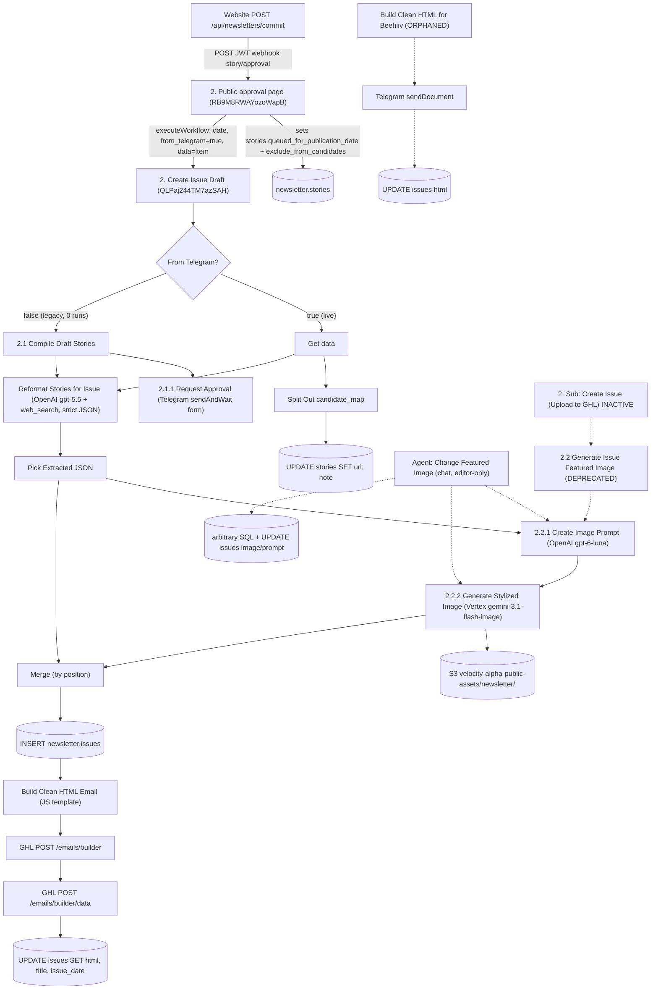

# 20. Issue drafting and featured-image generation (n8n)

Scope: `2. Create Issue Draft` [QLPaj244TM7azSAH], `2.1 Sub: Compile Draft Stories` [rsHDKdELUG59wZzX], `2.2 Sub: Generate Issue Featured Image` [OPjiGtzSNgCkQdG8], `2.2.1 Sub: Create Image Prompt` [j2B4f4kFJs6sBdog], `2.2.2 Sub: Generate Stylized Image From Prompt` [0Gd3lzvwITBnd8om], `Agent: Change Featured Image` [Ixc1D30eBAT0Mauf], plus the inactive predecessor `2. Sub: Create Issue (Upload to GHL)` [EOmzdknnvWLmyV48].

Sources: workflow JSON exports, retained executions 20838–21440 (pulled with `includeData=true`), read-only queries against Neon prod, and the app repo. Verbatim prompt and code blocks below come straight from the workflow JSON. The only change is that the leading `=` (n8n's expression marker) is removed. `{{ ... }}` is n8n expression syntax, evaluated at runtime.

## At a glance

- **Live path:** the website approval UI calls `/api/newsletters/commit`, which POSTs to the n8n webhook `story/approval` (`2. Public approval page`). That workflow calls `2. Create Issue Draft` with `from_telegram: true`, once per committed outline. Since 2026-10-30 a run takes about 50–60 s. Before that it took 230–335 s.
- **One writing LLM call:** OpenAI `gpt-5.5` on the Responses API, with built-in `web_search`, low reasoning effort, and a strict JSON schema. It turns the human-approved stories into `title`, `overview.summary`, `headlines[]`, `research_and_analysis[]`, `tools[]` and `quick_hits[]`. A JS Code-node template then renders the email HTML with no LLM involved.
- **Featured image:** `2.2.1` (OpenAI `gpt-6-luna`) writes a 200–300 word scene prompt. `2.2.2` sends a fixed watercolor style prompt plus that scene to Vertex AI `gemini-3.1-flash-image` (16:9, 1K, JPEG). The image is uploaded to `s3://velocity-alpha-public-assets/newsletter/gemini-<UTC ISO>.jpeg`.
- **DB writes:** one `INSERT` into `newsletter.issues` (`title`, `issue_date`, `feature_image_url`, `prompt_featured_image`), then an `UPDATE` of `html`/`title`/`issue_date` after GHL. It also runs `UPDATE newsletter.stories SET url, note` for every candidate story. It never writes `content_json`, `excerpt`, `slug` or `published_at`. The publish workflow (`3. Gmail Listen - Publish`) fills those in later.
- **GHL:** the workflow creates an email-builder **template** in GHL location `QHBgZjxBJ2T0E7yRAiJS` (`POST /emails/builder`, then `POST /emails/builder/data`). It creates no campaign and does no scheduling or sending. The bearer Private Integration Token is **hardcoded in the node headers**, and no n8n credential is used. The template id is not stored anywhere.
- **airecap.news** is never called. It appears only inside the email HTML, as the Netlify Image CDN proxy for the hero image: `https://airecap.news/.netlify/images?w=600&q=70&url=<s3 url>`.
- **No Telegram message is sent by the draft step.** The `Build Clean HTML for Beehiiv → Save HTML template to file → Send HTML file to telegram → Update to Issues Table` branch has no incoming connection, so it is orphaned and never runs.
- **Not idempotent:** every run inserts a new `issues` row and creates a new GHL template. Prod has 185 issues, 26 of them never published. 15 issue dates have 2–3 rows (16 extra rows; verified 2026-11-03) (for example 2026-10-12: ids 252 unpublished and 253 published).
- **The only failure in the retained window** was on 2026-10-30. `2.2.1` was running `gpt-5.4-pro` and hit n8n's 300 s request timeout (`ECONNABORTED`, "The connection was aborted, perhaps the server is offline"). The owner then switched to `gpt-6-luna`, added `retryOnFail`, and re-ran the whole chain manually.
- **Dead or legacy code:**
  - `2.1` (Telegram-form approval path; 0 runs; broken whenever an exclusion exists).
  - `2.2` (sticky note "DEPRECATED"; only called by the inactive predecessor).
  - `Agent: Change Featured Image` (non-public chat agent; 0 retained runs).
  - The predecessor `2. Sub: Create Issue (Upload to GHL)` (inactive; Groq models; picks stories automatically).



---

## 1. `2. Create Issue Draft` [QLPaj244TM7azSAH]

### 1.1 Purpose and status

- Builds the day's issue draft from human-approved stories. It writes the copy (LLM), generates the featured image, inserts the `newsletter.issues` row, uploads the email HTML to GHL as an email-builder template, and stores the HTML on the row.
- **ACTIVE.** Created 2026-03-11, last updated 2026-10-16 (versionId `77192c00-f8eb-48aa-9490-a88cdee57e1b`, which is also the active version). 21 nodes. Tag `Newsletter`.
- Settings: `executionOrder: v1`, `binaryMode: separate`, `callerPolicy: workflowsFromSameOwner`, **no `timezone`** (instance default), **no `errorWorkflow`**.
- Instance timezone: the Postgres driver returns `date` columns as `2026-11-03T05:00:00.000Z` / `2026-10-27T04:00:00.000Z`. That means the n8n process runs at UTC‑5/‑4, i.e. US/Canada Eastern.
- Run stats in the retained window (2026-10-21 → 2026-11-03): **11 runs, 10 success, 1 error**. All are `mode=integrated`, i.e. called by `2. Public approval page`.

### 1.2 Trigger and callers

The trigger is `executeWorkflowTrigger` v1.1 with these declared inputs:

| Input | Declared type | Live value |
|---|---|---|
| `date` | any (string) | `"2026-11-03"` (the website's `dateKey`, `YYYY-MM-DD`) |
| `from_telegram` | boolean | literal `true` from the approval page |
| `data` | object | `$('Wait for Queue Update').item`, i.e. the **whole n8n item** `{json, binary, pairedItem}` |

Callers:

| Caller | Status | Mapping |
|---|---|---|
| `2. Public approval page` [RB9M8RWAYozoWapB], node `Call '2. Create Issue Draft'` (executeWorkflow v1.3, waits for completion) | ACTIVE, the only live caller | `date = {{ $('Normalize Webhook Payload').item.json.date }}`, `data = {{ $('Wait for Queue Update').item }}`, `from_telegram = true`, `convertFieldsToString: true` |
| `1. Fetch Stories - Product Hunt Branch` [jK8cKjTO3R7LmDd0], node `Call '2. Create Issue Draft'` (`executeOnce`) | inactive | `date = {{ $now }}` only. With `from_telegram` unset, this would route to the legacy `2.1` branch, or fail the IF node's strict boolean check (untested). |

The main `1. Fetch Stories` workflow does **not** call it.

### 1.3 Input contract (`data.json`, as received in exec 21438)

`data.json` is the output of the approval page's 3-input `Wait for Queue Update` merge (combine by position). That merge has three inputs:

- **input 0:** `Join all1` when exclusions were present. Otherwise it is the `Normalize Webhook Payload` item itself.
- **input 1:** `Build Final Stories`.
- **input 2:** `Join all`.

| Field | Type | Origin | Used by the draft? |
|---|---|---|---|
| `approved_ids_by_section` | `{headlines:int[], research:int[], tools:int[], quickHits:int[]}` | website body | **Yes.** Filters stories per section in the LLM prompt. |
| `newsletter_headline` | int (story id) | website body / Build Final Stories | **Yes.** Basis for the subject line. |
| `stories` | array of story objects (see below), **with duplicates** | n8n deep merge of `Build Final Stories.stories` (approved only) over the website's `stories` (all visible) | **Yes.** LLM input, after filtering by approved ids and de-duplicating by `id`. |
| `candidate_map` | object keyed by story-id string → story object. Covers every visible story: selected, fill-in and excluded. | website body | **Yes.** Split Out → `UPDATE stories SET url, note`. |
| `candidate_sections` | `[{key,label,max,selected:[{id,headline,summary,note}],fill_ins:[...]}]` | website body | No |
| `selected_story_ids` | int[] | website body | No |
| `queue_update_count` | int (13) | approval page `Join all` | No |
| `date` | string | website body | No (the top-level `date` is used) |
| `excluded_stories` | `[{id,headline,summary,note,reason,newsletter_category}]` when there are no exclusions. **Missing** when there were exclusions (`Join all1` drops it), so `Get data` yields `null`. | website body | No |

Story object (`stories[]`; `candidate_map` values carry the same fields, but with `category` instead of `source_category`/`newsletter_category`):

```json
{
  "id": 11023, "guid": "38925db8b1d1fb26fdd9640651b399dc", "day": "2026-11-03T00:00:00.000Z",
  "headline": "Anthropic Opens Paid AI Safety Residency", "url": "https://alignment.anthropic.com/2026/anthropic-residency",
  "summary": "...", "note": "", "source": "alphasignal", "story_details": "...",
  "importance_score": 4, "keyword_score": 6, "combined_score": 10,
  "source_category": "Industry", "newsletter_category": "headlines"
}
```

**Deep-merge artifact.** n8n's Merge (combine by position) deep-merges objects, later inputs win, and arrays merge **index-by-index**. In exec 21437, `Build Final Stories` produced 13 approved stories and the website sent 19 visible stories. The merged `stories` therefore holds the 13 approved stories at indices 0–12, followed by website stories 13–18 (`10995, 11005, 10998, 11012, 11022, 11003`). Those include duplicates and a non-approved fill-in (`11003`).

The prompt expression copes with this by filtering on `approved_ids_by_section` and de-duplicating with `self.findIndex(t => t.id === s.id) === index`. A native rebuild should just pass the approved list.

### 1.4 Node-by-node logic

| # | Node | Type | Behaviour |
|---|---|---|---|
| 1 | When Executed by Another Workflow | executeWorkflowTrigger 1.1 | Inputs as above. |
| 2 | From Telegram? | IF 2.3 | Condition `{{ $json.from_telegram }}` *is true* (boolean, strict type validation). **true →** `Get data` (live). **false →** `Compile Draft Stories` (legacy 2.1). The naming is inverted: the *website* path sends `from_telegram: true`. |
| 3 | Get data | Set 3.4 | Lifts `data.json.{approved_ids_by_section, excluded_stories, newsletter_headline (number), candidate_sections, candidate_map, selected_story_ids, stories, queue_update_count}` to top-level fields. Fans out to `Split Out` and `Reformat Stories for Issue`. Observed run order: Split Out → Update Stories → Reformat. |
| 4 | Split Out | splitOut 1 | `fieldToSplitOut: candidate_map` gives one item per candidate story (18–22 observed). |
| 5 | Update Stories | Postgres 2.6 `update` on `newsletter.stories`, match `id` | Sets `url = {{$json.url}}`, `note = {{$json.note}}`. This persists URL overrides and editor notes from the approval UI for **every visible candidate**, including fill-ins and excluded stories. |
| 6 | Reformat Stories for Issue | OpenAI (langchain) 2.1, Responses API | See §1.6. Single item in, single item out: `output[0].content[0].text` is a parsed object. |
| 7 | Pick Extracted JSON | Set 3.4 | `structured_issue_data = {{ $json.output[0].content[0].text }}` (object). Assumes the message is `output[0]`. |
| 8 | Call Create Image Prompt | executeWorkflow 1.2 → `2.2.1` | Input `context` = the template in §1.6.4 (subject line + top-story headlines/details). |
| 9 | Call 'Generate Image' | executeWorkflow 1.3 → `2.2.2` | Inputs `editor_rationale`, `prompt_dynamic` from 2.2.1. |
| 10 | Merge | Merge 3.2, combine by position | in0 = 2.2.2 output `{s3_image_url, image_prompt_dynamic, image_prompt_static}`; in1 = `{structured_issue_data}`. |
| 11 | Insert to Issues Table | Postgres 2.6 insert into `newsletter.issues` | `feature_image_url = {{ $json.s3_image_url.trim() }}`, `prompt_featured_image = {{ $json.image_prompt_dynamic }}`, `issue_date = trigger.date`, `title = Reformat…output[0].content[0].text.title`. Returns the full row, including the new `id`. |
| 12 | Build Clean HTML Email | Code 2 | Renders the email HTML from `$('Merge').first().json` plus the inserted row (`id`, `title`, `issue_date`). See §1.7. Output `{html, subject, issueId, imageUrl, structuredIssueData}`. |
| 13 | Set GHL API Fields | Set 3.4 | `title = subject`, `html`, `locationId = "QHBgZjxBJ2T0E7yRAiJS"`, `type = "html"`, `builderVersion = "2"`. |
| 14 | Create_Email_Template | HTTP 4.3 | `POST https://services.leadconnectorhq.com/emails/builder` (§1.8). |
| 15 | Update_Email_Template | HTTP 4.3 | `POST https://services.leadconnectorhq.com/emails/builder/data` with `templateId = {{$json.id}}` (§1.8). |
| 16 | Update to Issues Table1 | Postgres 2.6 update `newsletter.issues`, match `id` | `html = Build Clean HTML Email.html`, `title = LLM title`, `issue_date = trigger.date`, `id = Insert…id`. **This is the last node, and its output (the full issue row) is what the caller receives.** |
| — | Build Clean HTML for Beehiiv | Code 2 | **Orphaned (no incoming connection).** It is a table-based variant of the template with no header or footer (§1.7.3). |
| — | Save HTML template to file | convertToFile 1.1 `toText` | Orphaned. `sourceProperty: html` → binary `html`. |
| — | Send HTML file to telegram | Telegram 1.2 `sendDocument` | Orphaned. Credential **AI Recap Review Telegram Bot**, `chatId: -5261405581`, binary property `html`, caption `{{ $('Build Clean HTML for Beehiiv').item.json.subject }}`, fileName `{{ $now.toISO().slice(0,10) }}-email.txt`. |
| — | Update to Issues Table | Postgres update | Orphaned. It would write the Beehiiv-variant HTML. |

### 1.5 Data contract: DB reads and writes

The draft performs **no reads**. All writes go through n8n Postgres nodes, which build parameterised SQL; there is no stored SQL text. The equivalent SQL is:

```sql
-- Update Stories (once per candidate in candidate_map)
UPDATE newsletter.stories SET url = $1, note = $2 WHERE id = $3 RETURNING *;

-- Insert to Issues Table
INSERT INTO newsletter.issues (feature_image_url, prompt_featured_image, issue_date, title)
VALUES ($1 /* s3_image_url.trim() */, $2 /* image_prompt_dynamic */, $3 /* 'YYYY-MM-DD' */, $4 /* LLM title */)
RETURNING *;

-- Update to Issues Table1 (after GHL)
UPDATE newsletter.issues SET html = $1, title = $2, issue_date = $3 WHERE id = $4 RETURNING *;
```

`newsletter.issues` schema in prod: `id bigint PK (seq)`, `title text NOT NULL`, `published_at timestamptz`, `created_at timestamptz NOT NULL default now()`, `html text`, `feature_image_url text`, `excerpt text`, `content_json jsonb`, `issue_date date`, `prompt_featured_image text`, `slug text UNIQUE`, `note text`. Indexes: `UNIQUE (title, published_at)` (does not stop duplicate drafts, because `published_at` is NULL), `UNIQUE (slug)`, plus btree indexes on `created_at` and `published_at`.

Which workflow writes each column:

| Column | Written by draft | Value | Later overwritten by |
|---|---|---|---|
| `title` | INSERT + UPDATE | LLM `title` (e.g. `ChatGPT’s Workspace Gets Simpler`) | `3. Gmail Listen - Publish`. Prod shows straight `'` instead of `’`, so the title is re-derived from the sent email. |
| `issue_date` | INSERT + UPDATE | trigger `date` | — |
| `feature_image_url` | INSERT | raw S3 URL | `Agent: Change Featured Image` (manual) |
| `prompt_featured_image` | INSERT | 2.2.1 `prompt_dynamic` (scene only, without the static style) | Agent (manual) |
| `html` | UPDATE (step 16) | draft HTML, about 29 KB | publish workflow. Prod row 268 starts with GHL's `<div style="font-family: Roboto, Arial; ...">` wrapper, about 46 KB. |
| `content_json` | **never** | — | publish workflow (LLM "V2 Parser" reads the `data-issue-id` / `data-story-id` / `data-src-url` attributes this template emits) |
| `excerpt` | **never** | — | nobody. 0 of 185 rows have an excerpt. |
| `slug`, `published_at` | **never** | — | publish workflow |

**`newsletter.stories` lifecycle around this step**, observed for 2026-11-03:

- Approved ids get `queued_for_publication_date = '2026-11-03'`. The approval page does this, not the draft.
- Excluded ids get `exclude_from_candidates = true`, also from the approval page.
- Fill-ins are untouched.
- `used_in_publication_date` is set by `3. Gmail Listen - Publish` (`UPDATE newsletter.stories SET used_in_publication_date = CURRENT_TIMESTAMP WHERE id = $1::INTEGER RETURNING *;`) once the email has gone out.

### 1.6 LLM call: `Reformat Stories for Issue`

| Param | Value |
|---|---|
| Node | `@n8n/n8n-nodes-langchain.openAi` v2.1 (Responses API, "message a model") |
| Credential | **Newsletter OpenAI Key** (openAiApi) |
| Model | `gpt-5.5` |
| Reasoning | `effort: "low"`, `summary: "none"` |
| Text format | `json_schema`, name `parsed_stories`, `strict: true`, description "A list of parsed and rephrased stories describing the sections in for an HTML email", `verbosity: "medium"` (default seen in exec workflowData) |
| Built-in tools | `webSearch` with `searchContextSize: "medium"` (OpenAI `web_search`) |
| Temperature / max tokens | not set (model defaults) |
| Retries / error handling | none |
| Observed latency | 27.6–31.7 s |

Output: `title` (4–8 words, the subject line), `title_emoji` (**unused** downstream), `overview.summary` (45–80 word greeting), `headlines[]` and `research_and_analysis[]` (`story_id`, `url`, `headline`, `story_detail`, `bullets[3+]{before,highlight,after}`), `tools[]` (`story_id`, `url`, `link_text`, `detail`) and `quick_hits[]` (`story_id`, `url`, `link_text`, `text`). Exec 21438 returned 3 headlines, 4 research, 3 tools and 3 quick hits.

Contradictions inside the prompt:

- The system prompt says to "set bullets to null" when there isn't enough material, but the strict schema requires an array with `minItems: 3`, so the model always produces 3 or more bullets.
- The schema describes `story_detail` as "markdown-formatted", while the system prompt demands plain text.
- The system prompt says to "Use importance_score first, then keyword_score, then recency" for prominence. In practice the model kept the human order in the observed runs.

<details><summary>1.6.1 System prompt (verbatim)</summary>

~~~~text
You are the editorial structuring engine for an AI newsletter.

Your job is to transform a set of raw story objects into a single structured newsletter object that matches the caller-provided JSON schema exactly.

You must follow these rules:

1. Output
- Return only valid JSON.
- Do not wrap the JSON in markdown.
- Do not include explanations, notes, or extra keys.
- Respect the schema exactly.
- Do not output null unless the schema allows it.

2. Grounding
- Use only facts present in the input.
- Do not invent details, quotes, numbers, motivations, timelines, or implications that are not strongly supported by the input.
- If a story is too incomplete to rewrite safely, omit it from the output section instead of guessing.
- Preserve each story's source URL exactly.

3. Section mapping
- To decide which category a story goes into look at the `newsletter_category` of the story (not source_category)

categories map as follows:
  - headlines -> headlines
  - research -> research_and_analysis
  - tools -> tools
  - quickHit or quickHits -> quick_hits
- Ignore any story whose category cannot be mapped safely.

4. Editorial goals
- The output should read like a sharp, modern AI newsletter.
- Clean up truncation conservatively without adding new facts.
- Remove source-attribution filler such as "reported by", "according to", "official post", "announced via", newsletter names, or platform references.
- Remove references like "this update", "our newsletter", or "social media post".
- Keep phrasing crisp and informative.

5. Writing constraints
- Never use em dashes.
- Never use ellipses.
- Use plain text only in all string fields.
- Do not include markdown links, markdown bullets, HTML, or code formatting inside string fields.
- Keep repetition low.

6. Title rules
- "title" is the newsletter subject line.
- It is based on the supplied "newsletter_headline" story id.
- It must be 4 to 8 words.
- It should default to being punchy and based on the SINGLE strongest story in the headlines if no story_id is provided from the newsletter_headline.

7. Overview rules
- Persona: Act as a friendly newsletter editor writing a short introduction. Speak directly to the reader.
- Structure: Start with a simple greeting (e.g., "Good morning,"). End with a quick transition into the content (e.g., "Let's dive in.").
- The Hook: Do not try to summarize the entire issue. Instead, pick the 2-3 most interesting stories and write a catchy, plain-spoken hook about what is happening.
- Tone: Human, direct, and casual.
- Prohibitions: Never write meta-commentary about the newsletter. Absolutely ban phrases like "This issue is dominated by," "Today we look at," or "This issue covers."
- Length: Strictly 45 to 80 words.

8. Headlines and research_and_analysis rules
For each feature item:
- "story_id" must be copied from the input story id as a string.
- "url" must be copied exactly.
- "headline" should be clear, human, and polished.
- "story_detail" should be 2 to 4 sentences and feel like newsletter body copy.
- "bullets" should usually contain exactly 3 items when the story has enough substance.
- Each bullet must use:
  - "before" for the lead-in text
  - "highlight" for the emphasized phrase
  - "after" for the trailing text
- Keep "highlight" short, concrete, and meaningful.
- If the story does not support 3 solid bullets without invention, set "bullets" to null.

9. Tools rules
For each tools item:
- "story_id" must be copied from the input story id as a string.
- "url" must be copied exactly.
- "link_text" should usually be the product, repo, or tool name.
- "detail" should be one brief supporting sentence fragment or short sentence.
- Keep it concise and useful.

10. Quick hits rules
For each quick_hits item:
- "story_id" must be copied from the input story id as a string.
- "url" must be copied exactly.
- "link_text" should be short and scannable.
- "text" should read as the continuation of a sentence after the linked text.
- Keep it compact.

11. Selection and ordering
- Prefer the strongest, clearest stories.
- Use importance_score first, then keyword_score, then recency as tie-breakers when deciding prominence.
- Keep section ordering meaningful, with the strongest item first.
- It is acceptable for a section to be empty if the input does not support it.

Return only the final JSON object.
~~~~
</details>

<details><summary>1.6.2 User prompt (verbatim n8n expression)</summary>

~~~~text
Create the structured newsletter object for this issue.

Use the caller-provided JSON schema exactly.

Additional instructions for this run:
- Preserve every selected story URL exactly. 
- Preserve every story in their respective category.
- Convert every story id to a string in the output.
- Keep all prose fields plain text only.
- For feature items, prefer exactly 3 bullets when the source material supports them. Feature items must have 3 bullet points. Stories in the categories in the 'headlines and research_analysis'.You must browse the story URL to construct these bullets using the web-search tool. The content of these bullets must not repeat information found in the story_detail. They must provide distinct, deeper insights or data points discovered during the search.
- There is a note field for every story, if the note field of a story is not empty, use what is present in the note field to guide your editing / reformatting of the story.


- Use only the input stories below.
{
  "headlines": {{ $json.stories.filter((s, index, self) => $json.approved_ids_by_section.headlines.includes(s.id) && self.findIndex(t => t.id === s.id) === index).map(({ source_category, ...rest }) => rest).toJsonString() }},
  "research_and_analysis": {{ $json.stories.filter((s, index, self) => $json.approved_ids_by_section.research.includes(s.id) && self.findIndex(t => t.id === s.id) === index).map(({ source_category, ...rest }) => rest).toJsonString() }},
  "tools": {{ $json.stories.filter((s, index, self) => $json.approved_ids_by_section.tools.includes(s.id) && self.findIndex(t => t.id === s.id) === index).map(({ source_category, ...rest }) => rest).toJsonString() }},
  "quick_hits": {{ $json.stories.filter((s, index, self) => $json.approved_ids_by_section.quickHits.includes(s.id) && self.findIndex(t => t.id === s.id) === index).map(({ source_category, ...rest }) => rest).toJsonString() }}
}
newsletter_headline: {{ $json.newsletter_headline }}
~~~~
</details>

<details><summary>1.6.3 Structured output JSON schema (verbatim)</summary>

~~~~json
{
  "type": "object",
  "additionalProperties": false,
  "required": ["title", "title_emoji", "overview", "headlines", "research_and_analysis", "tools", "quick_hits"],
  "properties": {
    "title": {
      "type": "string",
      "description": "Concise 4-8 word subject line of the newsletter based on the SINGLE most exciting, surprising, or important headline (top story). Must be specific and be optimized for clickthrough and pique interest. Keep it curiousity driven and don't give away the punchline."
    },
    "title_emoji": {
      "type": "string",
      "description": "A single emoji most related to the chosen title"
    },
    "overview": { "$ref": "#/$defs/overview_item" },
    "headlines": {
      "type": "array",
      "description": "Main headline stories for the issue.",
      "items": { "$ref": "#/$defs/feature_item" }
    },
    "research_and_analysis": {
      "type": "array",
      "description": "Deeper research, analysis, and context-rich stories.",
      "items": { "$ref": "#/$defs/feature_item" }
    },
    "tools": {
      "type": "array",
      "description": "Tool launches, product updates, and useful links.",
      "items": { "$ref": "#/$defs/link_list_item" }
    },
    "quick_hits": {
      "type": "array",
      "description": "Shorter stories and brief updates.",
      "items": { "$ref": "#/$defs/compact_list_item" }
    }
  },
  "$defs": {
    "overview_item": {
      "type": "object",
      "additionalProperties": false,
      "required": ["summary"],
      "properties": {
        "summary": {
          "type": "string",
          "description": "A brief, conversational overview."
        }
      }
    },
    "feature_item": {
      "type": "object",
      "additionalProperties": false,
      "required": ["story_id", "url", "headline", "story_detail", "bullets"],
      "properties": {
        "story_id": {
          "type": "string",
          "description": "Stable internal identifier for the story."
        },
        "url": {
          "type": "string",
          "description": "Canonical source URL for the story."
        },
        "headline": {
          "type": "string",
          "description": "Clear, short, human-readable headline."
        },
        "story_detail": {
          "type": "string",
          "description": "Richer markdown-formatted description with key details and context."
        },
        "bullets": {
          "type": "array",
          "minItems": 3,
          "items": { "$ref": "#/$defs/highlight_bullet" },
          "description": "Highlighted bullet points for important takeaways. Must contain at least 3 items."
        }
      }
    },
    "link_list_item": {
      "type": "object",
      "additionalProperties": false,
      "required": ["story_id", "url", "link_text", "detail"],
      "properties": {
        "story_id": {
          "type": "string",
          "description": "Stable internal identifier for the story."
        },
        "url": {
          "type": "string",
          "description": "Canonical source URL for the story."
        },
        "link_text": {
          "type": "string",
          "description": "Short linked title text."
        },
        "detail": {
          "type": "string",
          "description": "Brief supporting context for the link."
        }
      }
    },
    "compact_list_item": {
      "type": "object",
      "additionalProperties": false,
      "required": ["story_id", "url", "link_text", "text"],
      "properties": {
        "story_id": {
          "type": "string",
          "description": "Stable internal identifier for the story."
        },
        "url": {
          "type": "string",
          "description": "Canonical source URL for the story."
        },
        "link_text": {
          "type": "string",
          "description": "Short linked title text."
        },
        "text": {
          "type": "string",
          "description": "Compact summary text."
        }
      }
    },
    "highlight_bullet": {
      "type": "object",
      "additionalProperties": false,
      "required": ["before", "highlight", "after"],
      "properties": {
        "before": {
          "type": "string",
          "description": "Text before the highlighted phrase."
        },
        "highlight": {
          "type": "string",
          "description": "Key phrase to emphasize."
        },
        "after": {
          "type": "string",
          "description": "Text after the highlighted phrase."
        }
      }
    }
  }
}
~~~~
</details>

#### 1.6.4 Context passed to `2.2.1` (node `Call Create Image Prompt`, field `context`)

<details><summary>Verbatim template</summary>

~~~~text
You will receive a summary for a newsletter issue.

Task:

Using the summary provided, create a strong editorial featured image for an email newsletter based on:
  * A clear visual anchor you can stage as one dominant subject
  * Instant readability at a glance in 16:9 with minimal detail

Important: Focus on the main topic from the subject line of the email   

Subject Line: {{ $json.structured_issue_data.title }}

Top Stories:

{{ $json.structured_issue_data.headlines
  .map(
    x => ({
      headline: x.headline,
      detail: x.story_detail
    })
  ).toJsonString() 
}}
~~~~
</details>

Sample of `structured_issue_data` from exec 21438 (truncated):

```json
{
  "title": "ChatGPT’s Workspace Gets Simpler",
  "title_emoji": "🧩",
  "overview": { "summary": "Good morning, OpenAI is trying to make ChatGPT feel less like a maze, ... Let’s dive in." },
  "headlines": [{ "story_id": "11023", "url": "https://alignment.anthropic.com/2026/anthropic-residency",
                  "headline": "Anthropic Opens Paid AI Safety Residency", "story_detail": "Anthropic has opened applications ...",
                  "bullets": [{ "before": "The program is aimed at people such as", "highlight": "professors, founders, and staff engineers", "after": "who have led ambitious technical work ..." }] }],
  "research_and_analysis": [ /* same shape */ ],
  "tools": [{ "story_id": "11009", "url": "https://www.docusign.com/blog/developers/docusign-mcp-server-general-availability",
              "link_text": "Docusign MCP Server", "detail": "Generally available MCP server for agents ..." }],
  "quick_hits": [{ "story_id": "10998", "url": "https://www.koreaherald.com/article/10922482",
                   "link_text": "South Korea’s sovereign AI budget", "text": "sets aside 4.6 trillion won in the 2027 budget ..." }]
}
```

### 1.7 Email HTML template (`Build Clean HTML Email`)

#### 1.7.1 Structure

- `featureImageUrl = 'https://airecap.news/.netlify/images?w=600&q=70&url=' + s3_image_url`. The S3 URL is **not URL-encoded**, and the value is always truthy, so the `` is always emitted.
- Helpers:
  - `escapeHtml`, `escapeAttr`.
  - `normalizeText`: collapses whitespace.
  - `stripEmoji`: removes `\p{Extended_Pictographic}` / `\p{Emoji_Presentation}` from the title.
  - `formatIssueDate`: `toLocaleDateString('en-US', {weekday, year, month, day, timeZone:'UTC'})`, applied to the pg-returned `issue_date`.
- Layout, in order:
  1. A 680px centered `<div data-issue-id="{id}">`.
  2. The "AI Recap" pill.
  3. An H1-style title: the DB `title` with emoji stripped, falling back to `AI Recap`.
  4. The greeting `Hello {{contact.first_name}}, here's your briefing for {Weekday, Month D, YYYY}`. This is a **GHL merge tag** and is left literally in the HTML.
  5. The hero ``.
  6. A "📋 Today's Overview" box (falls back to `Your daily AI intelligence briefing.`).
  7. Feature sections "🔥 Top Stories" (`headlines`) and "🔬 Research & Analysis" (`research_and_analysis`). Each item renders headline, story_detail, 3 bullets (`before <strong>highlight</strong> after`) and a "Read more →" link.
  8. "🛠️ Trending AI Tools": linked `link_text` plus ` - detail`.
  9. "⚡ QUICK HITS": linked `link_text` plus `text`.
  10. The footer: `© AI Recap 2026` (hardcoded year) and "You’re receiving this because you subscribed to AI Recap." An `unsubscribeUrl` variable is defined but never used; GHL appends its own unsubscribe footer.
- Empty sections are omitted.
- Every story wrapper carries `data-story-id="{story_id}" data-src-url="{url}"`. **These attributes are a hidden contract** with the publish workflow's LLM parser, which rebuilds `content_json` from them.
- Brand colors: text `#1c1917` / `#44403c` / `#57534e`, muted `#78716c`, borders `#e7e5e4`, panels `#fafaf9`, links `#B7410E` (rust).
- Output: `{ html, subject: headerTitle, issueId, imageUrl, structuredIssueData }`.

Key fragment (feature story and bullet):

```js
function renderHighlightBullet(bullet) {
  // before + <strong>highlight</strong> + after, inside a 2-col table with a 30px "•" cell
}
function renderFeatureStory(story, isLast) {
  return `
    <div ${getStoryWrapperAttrs(story)} style="margin-bottom: ${isLast ? '0' : '40px'};">
      <div style="font-size: 16px; font-weight: 700; color: #1c1917; ...">${escapeHtml(headline)}</div>
      ${storyDetail ? `<div style="font-size: 14px; line-height: 1.7; color: #57534e; ...">${escapeHtml(storyDetail)}</div>` : ''}
      ${bullets.length ? `<div ...>${bullets.map(renderHighlightBullet).join('\n')}</div>` : ''}
      ${story.url ? `<a href="${escapeAttr(story.url)}" style="color: #B7410E; ...">Read more →</a>` : ''}
    </div>`;
}
```

<details><summary>1.7.2 Full `Build Clean HTML Email` code (verbatim, the live template)</summary>

~~~~js
// n8n Code / Function node

const input = $('Merge').first().json;
const issueDbRow = $input.first().json;

const issueId = issueDbRow.id;
const issueTitle = issueDbRow.title;
const issueDate = issueDbRow.issue_date;
const featureImageUrl =
  'https://airecap.news/.netlify/images?w=600&q=70&url=' + input.s3_image_url;

const structured = input.structured_issue_data || {};

const overview = structured.overview || {};
const headlines = Array.isArray(structured.headlines) ? structured.headlines : [];
const researchAndAnalysis = Array.isArray(structured.research_and_analysis)
  ? structured.research_and_analysis
  : [];
const tools = Array.isArray(structured.tools) ? structured.tools : [];
const quickHits = Array.isArray(structured.quick_hits) ? structured.quick_hits : [];

function escapeHtml(value) {
  return String(value ?? '')
    .replace(/&/g, '&amp;')
    .replace(/</g, '&lt;')
    .replace(/>/g, '&gt;');
}

function escapeAttr(value) {
  return String(value ?? '')
    .replace(/&/g, '&amp;')
    .replace(/"/g, '&quot;')
    .replace(/</g, '&lt;')
    .replace(/>/g, '&gt;');
}

function normalizeText(value) {
  return String(value ?? '').replace(/\s+/g, ' ').trim();
}

function stripEmoji(value) {
  return String(value ?? '')
    .replace(/[\p{Extended_Pictographic}\p{Emoji_Presentation}]/gu, '')
    .replace(/\s+/g, ' ')
    .trim();
}

function formatIssueDate(value) {
  const fallback = new Date().toISOString();
  const safeValue = value || fallback;
  const parsed = new Date(safeValue);

  if (Number.isNaN(parsed.getTime())) {
    return new Date().toLocaleDateString('en-US', {
      weekday: 'long',
      year: 'numeric',
      month: 'long',
      day: 'numeric',
    });
  }

  return parsed.toLocaleDateString('en-US', {
    weekday: 'long',
    year: 'numeric',
    month: 'long',
    day: 'numeric',
    timeZone: 'UTC',
  });
}

function getStoryWrapperAttrs(story) {
  return `data-story-id="${escapeAttr(story?.story_id || '')}" data-src-url="${escapeAttr(story?.url || '')}"`;
}

function renderSectionHeader(label) {
  return `
    <div style="font-size: 17px; font-weight: 700; color: #78716c; margin-bottom: 24px; padding-bottom: 14px; border-bottom: 2px solid #e7e5e4; text-transform: uppercase; letter-spacing: 1.5px;">
      ${escapeHtml(label)}
    </div>
  `;
}

function renderOverview(summary) {
  const safeSummary = normalizeText(summary);
  if (!safeSummary) return '';

  return `
    <div style="border: 2px solid #e7e5e4; border-radius: 12px; margin-bottom: 28px; background: #fafaf9; padding: 28px;">
      <div style="font-size: 17px; font-weight: 700; color: #78716c; margin-bottom: 20px; padding-bottom: 14px; border-bottom: 2px solid #e7e5e4; text-transform: uppercase;">
        📋 Today's Overview
      </div>
      <div style="font-size: 17px; line-height: 1.8; color: #44403c; margin-bottom: 0;">
        ${escapeHtml(safeSummary)}
      </div>
    </div>
  `;
}

function renderHighlightBullet(bullet) {
  if (!bullet) return '';

  const before = normalizeText(bullet.before);
  const highlight = normalizeText(bullet.highlight);
  const after = normalizeText(bullet.after);

  if (!before && !highlight && !after) return '';

  const content =
    `${before ? escapeHtml(before) : ''}` +
    `${before && highlight ? ' ' : ''}` +
    `${highlight ? `<strong>${escapeHtml(highlight)}</strong>` : ''}` +
    `${highlight && after ? ' ' : ''}` +
    `${after ? escapeHtml(after) : ''}`;

  return `
    <table width="100%" border="0" cellspacing="0" cellpadding="0" style="margin-bottom: 8px;">
      <tr>
        <td width="30" style="vertical-align: top; line-height: 1;">
          <span style="font-size: 30px;">•</span>
        </td>
        <td style="vertical-align: top; padding-top: 7px; font-size: 15px; line-height: 1.5; color: #44403c;">
          ${content}
        </td>
      </tr>
    </table>
  `;
}

function renderFeatureStory(story, isLast) {
  const headline = normalizeText(story.headline);
  const storyDetail = normalizeText(story.story_detail);
  const bullets = Array.isArray(story.bullets) ? story.bullets : [];

  return `
    <div ${getStoryWrapperAttrs(story)} style="margin-bottom: ${isLast ? '0' : '40px'};">
      <div style="font-size: 16px; font-weight: 700; color: #1c1917; margin-bottom: 6px; line-height: 1.7;">
        ${escapeHtml(headline)}
      </div>

      ${storyDetail ? `
        <div style="font-size: 14px; line-height: 1.7; color: #57534e; margin-bottom: 16px;">
          ${escapeHtml(storyDetail)}
        </div>
      ` : ''}

      ${bullets.length ? `
        <div style="margin-top: 16px; padding-left: 0;">
          ${bullets.map(renderHighlightBullet).join('\n')}
        </div>
      ` : ''}

      ${story.url ? `
        <div style="margin-top: 16px;">
          <a
            href="${escapeAttr(story.url)}"
            style="color: #B7410E; font-weight: 600; font-size: 14px; text-decoration: none; border-bottom: 2px solid #B7410E; display: inline-block;"
          >
            Read more →
          </a>
        </div>
      ` : ''}
    </div>
  `;
}

function renderFeatureSection(label, stories) {
  if (!Array.isArray(stories) || stories.length === 0) return '';

  return `
    <div style="border: 2px solid #e7e5e4; border-radius: 12px; margin-bottom: 28px; padding: 28px; background: #fafaf9;">
      ${renderSectionHeader(label)}
      ${stories.map((story, idx) => renderFeatureStory(story, idx === stories.length - 1)).join('\n')}
    </div>
  `;
}

function renderToolsSection(items) {
  if (!Array.isArray(items) || items.length === 0) return '';

  return `
    <div style="border: 2px solid #e7e5e4; border-radius: 12px; margin-bottom: 28px; background: #fafaf9; padding: 28px;">
      ${renderSectionHeader('🛠️ Trending AI Tools')}
      <ul style="margin: 0; padding-left: 0; list-style-type: none;">
        ${items.map((tool, idx) => {
          const isLast = idx === items.length - 1;
          const linkText = normalizeText(tool.link_text);
          const detail = normalizeText(tool.detail);

          return `
            <li ${getStoryWrapperAttrs(tool)} style="margin-bottom: ${isLast ? '0' : '8px'};">
              <table width="100%" border="0" cellspacing="0" cellpadding="0">
                <tr>
                  <td width="30" style="vertical-align: top; line-height: 1.5;">
                    <span style="font-size: 30px;">•</span>
                  </td>
                  <td style="vertical-align: top; padding-top: 7px; font-size: 15px; color: #44403c; line-height: 1.5;">
                    <a
                      href="${escapeAttr(tool.url || '#')}"
                      style="color: #B7410E; font-weight: 700; text-decoration: none; border-bottom: 2px solid #B7410E;"
                    >
                      ${escapeHtml(linkText)}
                    </a>${detail ? ` - ${escapeHtml(detail)}` : ''}
                  </td>
                </tr>
              </table>
            </li>
          `;
        }).join('\n')}
      </ul>
    </div>
  `;
}

function renderQuickHitsSection(items) {
  if (!Array.isArray(items) || items.length === 0) return '';

  return `
    <div style="border: 2px solid #e7e5e4; border-radius: 12px; margin-bottom: 28px; background: #fafaf9; padding: 32px;">
      ${renderSectionHeader('⚡ QUICK HITS')}
      ${items.map((hit, idx) => {
        const isLast = idx === items.length - 1;
        const linkText = normalizeText(hit.link_text);
        const text = normalizeText(hit.text);

        return `
          <div
            ${getStoryWrapperAttrs(hit)}
            style="padding: 12px 0; border-bottom: ${isLast ? 'none' : '1px solid #e7e5e4'}; font-size: 15px; line-height: 1.7; color: #44403c;"
          >
            <a
              href="${escapeAttr(hit.url || '#')}"
              style="color: #B7410E; font-weight: 700; text-decoration: none; border-bottom: 2px solid #B7410E;"
            >
              ${escapeHtml(linkText)}
            </a>${text ? ` ${escapeHtml(text)}` : ''}
          </div>
        `;
      }).join('\n')}
    </div>
  `;
}

const formattedDate = formatIssueDate(issueDate);
const executiveSummary = normalizeText(
  overview.summary || 'Your daily AI intelligence briefing.'
);
const headerTitle = stripEmoji(issueTitle) || 'AI Recap';
const unsubscribeUrl =
  'email={{contact.email}}';

const html = `
<!DOCTYPE html>
<html>
  <head>
    <meta charset="utf-8">
    <meta name="viewport" content="width=device-width, initial-scale=1.0">
  </head>
  <body style="margin: 0; padding: 0; background-color: #ffffff; font-family: -apple-system, BlinkMacSystemFont, 'Segoe UI', Roboto, sans-serif;">
    <div
      data-issue-id="${escapeAttr(issueId)}"
      style="max-width: 680px; margin: 0 auto; padding: 40px 20px;"
    >
      <div style="text-align: center; margin-bottom: 32px;">
        <div style="display: inline-block; background: #78716c; color: white; padding: 8px 20px; border-radius: 20px; font-size: 12px; font-weight: 700; margin-bottom: 16px;">
          AI Recap
        </div>

        <div style="font-size: 42px; font-weight: 800; color: #1c1917; margin-bottom: 8px; line-height: 1.15;">
          ${escapeHtml(headerTitle)}
        </div>

        <div style="font-size: 16px; color: #78716c;">
          Hello {{contact.first_name}}, here's your briefing for ${escapeHtml(formattedDate)}
        </div>
      </div>

      ${featureImageUrl ? `
        <div style="margin-bottom: 32px; text-align: center;">
          
        </div>
      ` : ''}

      ${renderOverview(executiveSummary)}
      ${renderFeatureSection('🔥 Top Stories', headlines)}
      ${renderFeatureSection('🔬 Research & Analysis', researchAndAnalysis)}
      ${renderToolsSection(tools)}
      ${renderQuickHitsSection(quickHits)}

      <div style="text-align: center; color: #a8a29e; font-size: 12px; margin-top: 40px; border-top: 1px solid #e7e5e4; padding-top: 20px; line-height: 1.7;">
        <div style="margin-bottom: 8px;">© AI Recap 2026</div>
        <div style="margin-bottom: 6px;">
          You’re receiving this because you subscribed to AI Recap.
        </div>
       
      </div>
    </div>
  </body>
</html>
`.trim();

return [
  {
    json: {
      html,
      subject: headerTitle,
      issueId,
      imageUrl: featureImageUrl,
      structuredIssueData: structured,
    },
  },
];
~~~~
</details>

#### 1.7.3 Orphaned `Build Clean HTML for Beehiiv` variant

It uses the same data and helpers, but the layout is nested `<table>`s (more email-client-safe), with HTML entities for the emoji. It has **no header** (no pill, title or greeting) and **no footer**; the hero `` gets `alt=title`. It is not wired in.

<details><summary>Full code (verbatim)</summary>

~~~~js
// n8n Code / Function node

const input = $('Merge').first().json;
const issueDbRow = $input.first().json;

const issueId = issueDbRow.id;
const issueTitle = issueDbRow.title;
const issueDate = issueDbRow.issue_date;
const featureImageUrl =
  'https://airecap.news/.netlify/images?w=600&q=70&url=' + input.s3_image_url;

const structured = input.structured_issue_data || {};

const overview = structured.overview || {};
const headlines = Array.isArray(structured.headlines) ? structured.headlines : [];
const researchAndAnalysis = Array.isArray(structured.research_and_analysis)
  ? structured.research_and_analysis
  : [];
const tools = Array.isArray(structured.tools) ? structured.tools : [];
const quickHits = Array.isArray(structured.quick_hits) ? structured.quick_hits : [];

function escapeHtml(value) {
  return String(value ?? '')
    .replace(/&/g, '&amp;')
    .replace(/</g, '&lt;')
    .replace(/>/g, '&gt;');
}

function escapeAttr(value) {
  return String(value ?? '')
    .replace(/&/g, '&amp;')
    .replace(/"/g, '&quot;')
    .replace(/</g, '&lt;')
    .replace(/>/g, '&gt;');
}

function normalizeText(value) {
  return String(value ?? '').replace(/\s+/g, ' ').trim();
}

function stripEmoji(value) {
  return String(value ?? '')
    .replace(/[\p{Extended_Pictographic}\p{Emoji_Presentation}]/gu, '')
    .replace(/\s+/g, ' ')
    .trim();
}

function formatIssueDate(value) {
  const fallback = new Date().toISOString();
  const safeValue = value || fallback;
  const parsed = new Date(safeValue);

  if (Number.isNaN(parsed.getTime())) {
    return new Date().toLocaleDateString('en-US', {
      weekday: 'long',
      year: 'numeric',
      month: 'long',
      day: 'numeric',
    });
  }

  return parsed.toLocaleDateString('en-US', {
    weekday: 'long',
    year: 'numeric',
    month: 'long',
    day: 'numeric',
    timeZone: 'UTC',
  });
}

function getStoryWrapperAttrs(story) {
  return `data-story-id="${escapeAttr(story?.story_id || '')}" data-src-url="${escapeAttr(story?.url || '')}"`;
}

function renderSectionHeader(label) {
  return `
    <p style="margin:0 0 20px 0;font-size:17px;font-weight:700;color:#78716c;padding-top:0px;padding-bottom:14px;border-bottom:2px solid #e7e5e4;text-transform:uppercase;letter-spacing:1.5px;font-family:-apple-system,BlinkMacSystemFont,'Segoe UI',Roboto,sans-serif;">
      ${escapeHtml(label)}
    </p>
  `;
}

function renderOverview(summary) {
  const safeSummary = normalizeText(summary);
  if (!safeSummary) return '';

  return `
          <!-- TODAY'S OVERVIEW -->
          <tr>
            <td style="padding-bottom:28px;">
              <table width="100%" border="0" cellspacing="0" cellpadding="0" style="border:2px solid #e7e5e4;border-radius:12px;background:#fafaf9;">
                <tr>
                  <td style="padding:28px;">
                    <p style="margin:0 0 15px 0;font-size:17px;font-weight:700;color:#78716c;padding-top:0px;padding-bottom:14px;border-bottom:2px solid #e7e5e4;text-transform:uppercase;font-family:-apple-system,BlinkMacSystemFont,'Segoe UI',Roboto,sans-serif;">&#128203; Today's Overview</p>
                    <p style="margin:0;font-size:17px;line-height:1.8;color:#44403c;font-family:-apple-system,BlinkMacSystemFont,'Segoe UI',Roboto,sans-serif;padding-top:0px;">${escapeHtml(safeSummary)}</p>
                  </td>
                </tr>
              </table>
            </td>
          </tr>
  `;
}

function renderHighlightBullet(bullet) {
  if (!bullet) return '';

  const before = normalizeText(bullet.before);
  const highlight = normalizeText(bullet.highlight);
  const after = normalizeText(bullet.after);

  if (!before && !highlight && !after) return '';

  const content =
    `${before ? escapeHtml(before) : ''}` +
    `${before && highlight ? ' ' : ''}` +
    `${highlight ? `<strong>${escapeHtml(highlight)}</strong>` : ''}` +
    `${highlight && after ? ' ' : ''}` +
    `${after ? escapeHtml(after) : ''}`;

  return `
    <table width="100%" border="0" cellspacing="0" cellpadding="0" style="margin-bottom:8px;">
      <tr>
        <td 
          width="30" 
          valign="top" 
          style="font-size:22px; color:#44403c; line-height: 1;"
        >
          &bull;
        </td>
        <td 
          valign="top" 
          style="font-size:15px; line-height:1.5; color:#44403c; font-family:-apple-system,BlinkMacSystemFont,'Segoe UI',Roboto,sans-serif;"
        >
          ${content}
        </td>
      </tr>
    </table>
  `;
}


function renderFeatureStory(story, isLast) {
  const headline = normalizeText(story.headline);
  const storyDetail = normalizeText(story.story_detail);
  const bullets = Array.isArray(story.bullets) ? story.bullets : [];

  return `
                    <table width="100%" border="0" cellspacing="0" cellpadding="0" ${getStoryWrapperAttrs(story)} style="margin-bottom:${isLast ? '0' : '24px'};">
                      <tr>
                        <td>
                          <p style="margin:0 0 6px 0;font-size:16px;font-weight:700;color:#1c1917;line-height:1.7;font-family:-apple-system,BlinkMacSystemFont,'Segoe UI',Roboto,sans-serif;padding-bottom: 0px; padding-top: 0px;">${escapeHtml(headline)}</p>
                          ${storyDetail ? `<p style="margin:0 0 6px 0;font-size:14px;line-height:1.7;padding-top:0px;padding-bottom:0px;color:#57534e;font-family:-apple-system,BlinkMacSystemFont,'Segoe UI',Roboto,sans-serif;">${escapeHtml(storyDetail)}</p>` : ''}
                          ${bullets.length ? bullets.map(renderHighlightBullet).join('\n') : ''}
                          ${story.url ? `<a href="${escapeAttr(story.url)}" style="display:inline-block;margin-top:16px;color:#B7410E;font-weight:600;font-size:14px;text-decoration:none;border-bottom:2px solid #B7410E;font-family:-apple-system,BlinkMacSystemFont,'Segoe UI',Roboto,sans-serif;">Read more &rarr;</a>` : ''}
                        </td>
                      </tr>
                    </table>
  `;
}

function renderFeatureSection(label, stories) {
  if (!Array.isArray(stories) || stories.length === 0) return '';

  return `
          <!-- ${escapeHtml(label).toUpperCase()} -->
          <tr>
            <td style="padding-bottom:28px;">
              <table width="100%" border="0" cellspacing="0" cellpadding="0" style="border:2px solid #e7e5e4;border-radius:12px;background:#fafaf9;">
                <tr>
                  <td style="padding:28px;">
                    ${renderSectionHeader(label)}
                    ${stories.map((story, idx) => renderFeatureStory(story, idx === stories.length - 1)).join('\n')}
                  </td>
                </tr>
              </table>
            </td>
          </tr>
  `;
}

function renderToolsSection(items) {
  if (!Array.isArray(items) || items.length === 0) return '';

  return `
          <!-- TRENDING AI TOOLS -->
          <tr>
            <td style="padding-bottom:28px;">
              <table width="100%" border="0" cellspacing="0" cellpadding="0" style="border:2px solid #e7e5e4;border-radius:12px;background:#fafaf9;">
                <tr>
                  <td style="padding:28px;">
                    ${renderSectionHeader('&#128736;&#65039; Trending AI Tools')}
                    ${items.map((tool, idx) => {
                      const isLast = idx === items.length - 1;
                      const linkText = normalizeText(tool.link_text);
                      const detail = normalizeText(tool.detail);

                      return `
                    <table width="100%" border="0" cellspacing="0" cellpadding="0" ${getStoryWrapperAttrs(tool)} style="margin-bottom:${isLast ? '0' : '12px'};">
                      <tr>
                        <td width="30" valign="top" style="font-size:22px;line-height:1;color:#44403c;">&bull;</td>
                        <td valign="top" style="font-size:15px;line-height:1.5;color:#44403c;font-family:-apple-system,BlinkMacSystemFont,'Segoe UI',Roboto,sans-serif;">
                          <a href="${escapeAttr(tool.url || '#')}" style="color:#B7410E;font-weight:700;text-decoration:none;border-bottom:2px solid #B7410E;">${escapeHtml(linkText)}</a>${detail ? ` &ndash; ${escapeHtml(detail)}` : ''}
                        </td>
                      </tr>
                    </table>
                      `;
                    }).join('\n')}
                  </td>
                </tr>
              </table>
            </td>
          </tr>
  `;
}

function renderQuickHitsSection(items) {
  if (!Array.isArray(items) || items.length === 0) return '';

  return `
          <!-- QUICK HITS -->
          <tr>
            <td style="padding-bottom:28px;">
              <table width="100%" border="0" cellspacing="0" cellpadding="0" style="border:2px solid #e7e5e4;border-radius:12px;background:#fafaf9;">
                <tr>
                  <td style="padding:28px;">

 <p style="margin:0 0 0 0;font-size:17px;font-weight:700;color:#78716c;padding-top:0px;padding-bottom:14px;border-bottom:2px solid #e7e5e4;text-transform:uppercase;letter-spacing:1.5px;font-family:-apple-system,BlinkMacSystemFont,'Segoe UI',Roboto,sans-serif;"> 
                    ${escapeHtml('&#9889; Quick Hits')} </p>
                    <table width="100%" border="0" cellspacing="0" cellpadding="0">
                      ${items.map((hit, idx) => {
                        const isLast = idx === items.length - 1;
                        const linkText = normalizeText(hit.link_text);
                        const text = normalizeText(hit.text);

                        return `
                      <tr ${getStoryWrapperAttrs(hit)}>
                        <td style="padding:12px 0;border-bottom:${isLast ? 'none' : '1px solid #e7e5e4'};font-size:15px;line-height:1.7;color:#44403c;font-family:-apple-system,BlinkMacSystemFont,'Segoe UI',Roboto,sans-serif;">
                          <a href="${escapeAttr(hit.url || '#')}" style="color:#B7410E;font-weight:700;text-decoration:none;border-bottom:2px solid #B7410E;">${escapeHtml(linkText)}</a>${text ? ` ${escapeHtml(text)}` : ''}
                        </td>
                      </tr>
                        `;
                      }).join('\n')}
                    </table>
                  </td>
                </tr>
              </table>
            </td>
          </tr>
  `;
}

const formattedDate = formatIssueDate(issueDate);
const executiveSummary = normalizeText(
  overview.summary || 'Your daily AI intelligence briefing.'
);
const headerTitle = stripEmoji(issueTitle) || 'AI Recap';


const html = `

<div style="margin:0;padding:0;background-color:#ffffff;font-family:-apple-system,BlinkMacSystemFont,'Segoe UI',Roboto,sans-serif;">

  <table width="100%" border="0" cellspacing="0" cellpadding="0" bgcolor="#ffffff">
    <tr>
      <td align="center" style="padding:40px 0px;">

        <table width="600" border="0" cellspacing="0" cellpadding="0" data-issue-id="${escapeAttr(issueId)}" style="max-width:600px;width:100%;">

          <!-- HEADER -->
         
          ${featureImageUrl ? `
          <!-- HERO IMAGE -->
          <tr>
            <td align="center" style="padding-bottom:32px;">
              
            </td>
          </tr>
          ` : ''}

          ${renderOverview(executiveSummary)}
          ${renderFeatureSection('&#128293; Top Stories', headlines)}
          ${renderFeatureSection('&#128300; Research &amp; Analysis', researchAndAnalysis)}
          ${renderToolsSection(tools)}
          ${renderQuickHitsSection(quickHits)}

         

        </table>

      </td>
    </tr>
  </table>

</div>
`.trim();

return [
  {
    json: {
      html,
      subject: headerTitle,
      issueId,
      imageUrl: featureImageUrl,
      structuredIssueData: structured,
    },
  },
];
~~~~
</details>

### 1.8 External services

| Service | Node | Request | Auth | Response (observed) |
|---|---|---|---|---|
| OpenAI Responses | Reformat Stories for Issue | see §1.6 | credential **Newsletter OpenAI Key** | `{output:[{type:"message", status:"completed", phase:"final_answer", content:[{type:"output_text", text:{...parsed...}}]}]}` |
| GHL create template | Create_Email_Template | `POST https://services.leadconnectorhq.com/emails/builder`. Headers `Accept: application/json`, `Version: 2021-07-28`. JSON body `{locationId, title: "{{ $json.title }} " (note trailing space), type: "html", builderVersion: "2", html}` | **hardcoded GHL Private Integration Token (Bearer) in the node's Authorization header.** No n8n credential is used, although an unused credential `Newsletter GHL: Header Auth` (httpHeaderAuth) exists. | `{redirect:"6aea1c78…", id:"6aea1c78…", status:"ok", traceId}` |
| GHL set template HTML | Update_Email_Template | `POST https://services.leadconnectorhq.com/emails/builder/data`, same headers. Body `{locationId, templateId: $json.id, updatedBy: "WmcPQm3oLV1oIK94fv5b" (hardcoded GHL user id), editorType: "html", html}` | same hardcoded token | `{ok:true, previewUrl:"https://firebasestorage.googleapis.com/…/location%2FQHBgZjxBJ2T0E7yRAiJS%2Femails%2F<id>%2Findex.html…", templateDataDownloadUrl, id, versionId, traceId}` |
| Sub-workflows | 2.2.1, 2.2.2 | see §3, §4 | — | — |
| airecap.news | (none) | Referenced only as the hero image proxy in the HTML: `https://airecap.news/.netlify/images?w=600&q=70&url=<s3 url>`. This works only because `next.config.mjs` lists `velocity-alpha-public-assets.s3.amazonaws.com` in `images.remotePatterns`. | — | — |

**Is this where the email campaign is created?** No. It creates (and fills) a GHL **email-builder template** named after the subject line in location `QHBgZjxBJ2T0E7yRAiJS`. No campaign, schedule or send API is called. Sending must happen in GHL, through an operator or a GHL-side automation; see the open questions. The sent email lands in Gmail, where `3. Gmail Listen - Publish` marks the issue published. In issue 268 the draft finished at 17:40:09Z and was published at 17:48:22Z.

### 1.9 Error handling and idempotency

- No node in this workflow sets `continueOnFail`, `onError`, `retryOnFail` or `alwaysOutputData`. There is no `errorWorkflow`. Any failure aborts the run and propagates to the approval page execution, which also shows `error`.
- Partial-failure states:
  - Failure **before** the INSERT (the LLM or image steps) leaves `stories.url/note` updated and **no** issue row. This is safe to re-run.
  - Failure **after** the INSERT (GHL or the final UPDATE) leaves an `issues` row with `html = NULL`, and possibly an orphan GHL template.
- **No idempotency key.** Every run INSERTs a new row and creates a new GHL template, and the template id is not persisted. The website's commit route only blocks when an issue is already **published** for the date (`fetchLastPublishedIssueDateOnOrBefore(...).has_exact_match`). Re-committing an outline before publishing therefore creates duplicate drafts. In prod, 26 of 185 issues are unpublished, and 15 dates have multiple rows.
- **Observed failure (exec 21270, 2026-10-30 14:05:20Z, 329.7 s).** The run failed in `Call Create Image Prompt`. Sub-exec 21271, node `Analyze and Select Best Prompt1`, model `gpt-5.4-pro`, failed with `NodeApiError` "The connection was aborted, perhaps the server is offline", `httpCode: ECONNABORTED`, messages `["timeout of 300000ms exceeded", ...]`. At that time the node had no retry.
- Recovery, from the execution list:
  - 21273, a manual 2.2.1 test, was cancelled ("The execution was cancelled manually").
  - 21274, a retry of 21271, succeeded in 15.8 s on `gpt-6-luna`, but a retry doesn't resume the parent.
  - 21275 was a **manual** re-run of `2. Public approval page`, which produced issue 266 at 14:57.

### 1.10 Observed runtime

| Exec | Date (UTC) | Status | Total | Reformat | 2.2.1 | 2.2.2 | Issue id |
|---|---|---|---|---|---|---|---|
| 21438 | 2026-11-03 17:39 | success | 59.6 s | 27.9 s | 17.5 s | 12.0 s | 268 |
| 21378 | 2026-11-02 15:38 | success | 57.4 s | 30.4 s | 14.6 s | 10.3 s | 267 |
| 21276 | 2026-10-30 14:56 | success (manual re-run) | 50.7 s | 27.6 s | 9.3 s | 10.1 s | 266 |
| 21270 | 2026-10-30 14:05 | **error** | 329.7 s | 29.1 s | 300.0 s (timeout) | — | — |
| 21219 | 2026-10-29 17:43 | success | 288.4 s | 31.7 s | 244.5 s | 10.0 s | 265 |
| 21161 / 21104 / 21046 / 20943 / 20890 / 20838 | 2026-10-21 … 10-28 | success | 230–334 s | — | 197–294 s (gpt-5.4-pro) | 9.4–10.3 s | 264 … 259 |

Other node timings (21438):

- `Update Stories`: 0.49 s for 19 rows, and up to 2.2 s.
- `Insert`: 0.22 s.
- HTML render: 28 ms.
- GHL create / update: 0.55 s / 0.66 s.
- Final update: 0.12 s.
- The draft HTML is about 29 KB.

---

## 2. Story selection and ordering

### 2.1 Live path (website → approval page → draft)

1. **The website builds the candidate list**, not n8n. This is in `src/features/newsletter/curation.service.ts` (cross-area, documented with the approval flow). It is a TypeScript port of the `2.1` logic below: clean text, keyword score, rank, bucket, and asynchronous OpenAI dedup.
2. A human selects, moves, excludes and annotates stories and picks the headline story. The UI enforces section max counts and requires the headline story to be selected and not excluded.
3. `2. Public approval page` (cross-area) then:
   - runs `UPDATE newsletter.stories SET queued_for_publication_date = '<date>'::timestamptz WHERE id IN (<selected ids>) RETURNING id;`;
   - sets `exclude_from_candidates = true` for each excluded id;
   - re-validates with `Build Final Stories`: limits `headlines 3, research 4, tools 6, quickHits 6`, and it throws on a duplicate across sections or an id missing from `candidate_map`.
4. **The draft uses exactly `approved_ids_by_section`.** Order inside a section is the order of `stories[]`: Build Final Stories walks the sections in order headlines → research → tools → quickHits, and within each section uses the approved-id order from the UI. The LLM is told to put the "strongest item first" using importance_score → keyword_score → recency. In observed runs it preserved the human order.
5. The issue is published from Gmail, and `3. Gmail Listen - Publish` then sets `used_in_publication_date = CURRENT_TIMESTAMP` per story.

### 2.2 Legacy n8n path (`2.1 Sub: Compile Draft Stories`, only when `from_telegram` is not true)

See §5 for the SQL and code. In summary:

- **Candidates:** stories with `importance_score >= 2`, `day` within `[date-3d, date]`, a non-empty url that doesn't match `%tldr%` / `%rundown%` / `%beehive%`, `used_in_publication_date IS NULL`, and `exclude_from_candidates` false. One row per `guid`.
- **Recently used (for dedup):** `used_in_publication_date` within `[date-2d, date]` and not excluded.
- **Cleaning and ranking:** clean the text, compute `keyword_score` (count of keyword hits) and `combined_score = importance_score + keyword_score`, rank, then take the top 20 plus 20 random from the rest.
- **Dedup:** LLM dedup with `gpt-5.4-mini`.
- **Bucketing:**
  - category `research`/`analysis` → research;
  - `tools`/`tool` → tools;
  - everything else → general.
- **Sorting:** within each bucket, `importance_score DESC, keyword_score DESC`.
- **Section slices:**
  - headlines = general[0:3] (fill-ins [3:6]);
  - research = research[0:4] (+3 fill-ins);
  - tools = tools[0:3] (+3 fill-ins);
  - quickHits = general[6:12] (+3 fill-ins).

---

## 3. `2.2.1 Sub: Create Image Prompt` [j2B4f4kFJs6sBdog]

### 3.1 Purpose and status

- Turns issue context into a **scene-only** image prompt plus an editorial rationale.
- **ACTIVE.** Created 2026-03-12, updated **2026-10-30**: model `gpt-5.4-pro` → `gpt-6-luna`, and `retryOnFail` added.
- 3 nodes. Settings `executionOrder v1`, `binaryMode separate`; no timezone and no errorWorkflow.
- Runs in the window: **13 (11 success, 1 error, 1 canceled)**.

### 3.2 Trigger and callers

- The trigger is `executeWorkflowTrigger` with one input, `context` (string).
- Callers:
  - `2. Create Issue Draft` (live);
  - `2.2` (deprecated);
  - `Agent: Change Featured Image`, as the tool "Create Image Prompt".

### 3.3 Logic

| Node | Type | Behaviour |
|---|---|---|
| Start | executeWorkflowTrigger 1.1 | `context` |
| Analyze and Select Best Prompt1 | OpenAI (langchain) 2.1 | `retryOnFail: true`, `waitBetweenTries: 5000` (maxTries default 3). Model **`gpt-6-luna`**. No reasoning options, temperature or max tokens are set. Text format `json_schema` name `image_prompt_output`, `strict: true`, verbosity medium. Credential **Newsletter OpenAI Key**. |
| Return Output Values | Set 3.4 | `editor_rationale = output[0].content[0].text.editorial_rationale`, `prompt_dynamic = output[0].content[0].text.image_prompt` |

Output contract: `{ editor_rationale: string, prompt_dynamic: string }`. The observed `prompt_dynamic` was 227–252 words.

The system prompt asks for 4 keys (`image_prompt`, `caption_prompt`, `excerpt`, `editorial_rationale`), but the strict schema allows only `image_prompt` and `editorial_rationale`. So `caption_prompt` and `excerpt` are never produced. That is why `issues.excerpt` is always NULL, and why the deprecated `2.2`'s `caption` is always undefined.

The system prompt still says "You will be given three AI news articles" (a leftover from `2.2`). The live caller sends a subject line plus 3 top stories instead.

<details><summary>3.4 System prompt (verbatim)</summary>

~~~~text
You are an editorial image creative director and prompt writer for a watercolor-style news illustration pipeline. You will be given three AI news articles. Your job is to select the single best article to drive a readable illustration, then write a dynamic scene prompt that will later be combined with a separate fixed style prompt.

You must output only valid JSON with exactly these keys:

* "image_prompt"
* "caption_prompt"
* "excerpt"
* "editorial_rationale"

Global composition invariants:

* The scene must be designed as a central vignette within a 16:9 frame. 
* Avoid any objects, lines, or paint that touch the edges of the frame.
* The subject and supporting elements must form a central cluster.
* Instant readability at thumbnail size through bold, simple shapes and clear silhouette separation.
* Strict hierarchy: one dominant subject, at most one supporting element.
* Avoid scenes that require reading screens, dashboards, paragraphs, multiple labels, code, or UI.
* Do not introduce extra characters, extra objects, or extra scenery beyond what the scene needs.
* If a logo or readable brand mark is needed, include only one, printed on a physical object in the scene, small and natural.

Rules for "image_prompt":

* 200 to 300 words of vivid description.
* Describe only what is visibly present: subjects, objects, setting, lighting, composition, scale, materials, and motion.
* Must specify foreground, midground, background. 
* All background and midground elements must be described as tapering off or dissolving into the surrounding background space before reaching the frame boundaries
* Must specify camera angle and distance.
* Avoid interpretive or intent language. Do not use words such as: represents, symbolizes, suggests, implies, commentary, metaphor, theme, message, critique, scrutiny, oversight, regulation.
* Do not mention watercolor, palette, negative space, technique, or any fixed style constraints.

Rules for "caption_prompt":

* 6 to 10 words total.
* Two hook phrases separated by a comma.
* Must end exactly with “& more”.

Rules for "excerpt":

* Exactly two sentences separated by a single space.
* 15 to 20 total words.
* Summarize all three articles into one coherent summary.

Rules for "editorial_rationale":

* 2 to 3 sentences.
* Must name which article was chosen and briefly state why it was best for illustration.
* State what the scene is intended to show from that story in plain language.
* Do not describe visual elements that are not already in image_prompt.

Internal requirements (do not output):

* Consider at least three distinct scene concepts for the chosen article, then select the strongest.
* Before finalizing, check that the prompt names only one dominant subject and at most one supporting element. 
* Ensure the scene remains readable without any text. 

Output discipline:
Return JSON only. No preface. No markdown. No explanations.
~~~~
</details>

<details><summary>3.5 User prompt (verbatim n8n expression)</summary>

~~~~text
Dynamic scene requirements for image_prompt:

* Stage the scene as a vignetted central cluster within a 16:9 frame.
* Describe foreground, midground, background.
* State camera angle and distance.
* State lighting and mood as visible conditions.
* Include only a small number of grounding identifiers. 
* At most one supporting element, clearly secondary.
* No interpretive language. Describe only what is visible.
* Logos/brand elements can be explicitly mentioned when needed instead of simulating them.
* Prefer scenes with simpler composition.

{{ $json.context }}
~~~~
</details>

<details><summary>3.6 Structured output JSON schema (verbatim)</summary>

~~~~json
{
  "type": "object",
  "additionalProperties": false,
  "required": ["image_prompt", "editorial_rationale"],
  "properties": {
    "image_prompt": {
      "type": "string",
      "description": "Dynamic scene-only image generation prompt (200–300 words). Must include '16:9' exactly once. Must describe a central cluster where foreground, midground, and background dissolve into white space before touching any frame edges. Specify camera angle and distance, lighting. No style constraints."
    },
    "editorial_rationale": {
      "type": "string",
      "description": "1–2 sentences explaining why this scene was chosen and what it shows from the chosen article. Can reference the chosen article explicitly. No more than 45 words."
    }
  }
}
~~~~
</details>

Sample output (exec 21439):

```json
{
  "editor_rationale": "“OpenAI Plans To Merge ChatGPT’s Chat And Work Tabs” is the strongest choice because its change can be conveyed with one simple, readable form. The scene shows the two tabs becoming one continuous workspace.",
  "prompt_dynamic": "Compose a central vignette within a 16:9 frame, with a single open laptop as the dominant subject. In the foreground, its compact keyboard and trackpad angle toward the viewer ... The mood is calm and uncluttered, with a clear separation between the luminous screen and the darker body."
}
```

### 3.7 Errors and runtime

- **21271 (2026-10-30 14:05Z).** Error after 300.0 s on `gpt-5.4-pro`: "The connection was aborted, perhaps the server is offline" (`ECONNABORTED`, "timeout of 300000ms exceeded"). There was no retry at the time.
- **21273.** A manual test, cancelled by the user after 97 s (`ManualExecutionCancelledError`).
- **21274.** `retryOf 21271`, success in 15.8 s with `gpt-6-luna`.
- Latency: 9–18 s on `gpt-6-luna`, against 197–294 s on `gpt-5.4-pro` (2026-10-21 → 10-29).

---

## 4. `2.2.2 Sub: Generate Stylized Image From Prompt` [0Gd3lzvwITBnd8om]

### 4.1 Purpose and status

- Combines the fixed style prompt with the dynamic scene, calls Vertex AI Gemini image generation, uploads the JPEG to S3, and returns the public URL.
- **ACTIVE.** Created 2026-03-06, updated 2026-10-20.
- 8 nodes. `executionOrder v1`, `binaryMode separate`.
- Runs: **10 of 10 success**, 9.4–12.0 s each.

### 4.2 Trigger and callers

- The trigger is `executeWorkflowTrigger` with inputs `editor_rationale` and `prompt_dynamic`.
- Callers:
  - `2. Create Issue Draft`;
  - `2.2` (deprecated);
  - `Agent: Change Featured Image`, as the tool "Generate Image".

### 4.3 Logic

| Node | Type | Behaviour |
|---|---|---|
| When Executed by Another Workflow | trigger | `editor_rationale`, `prompt_dynamic` |
| Set Gemini Parameters | Set 3.3 | `prompt_static` (verbatim below), `editorial_rationale`, `prompt_dynamic`, `project_id = "newletter-481016"` (sic; set but **unused** in the URL) |
| HTTP Request Gemini Generate Image | HTTP 4.2 | `POST https://aiplatform.googleapis.com/v1/publishers/google/models/gemini-3.1-flash-image:generateContent`. Auth is `genericCredentialType` / `httpHeaderAuth`, i.e. credential **Vertex AI Image Gen API Key (header)**: a Vertex API key in a header ("express mode", global endpoint, no project/location in the path). Two more credentials are attached but **not used** by the selected auth type: `Newsletter Gemini Bearer` (httpBearerAuth) and `Google Vertex AI Key` (httpQueryAuth; no longer in the credential list). `retryOnFail: true`, `waitBetweenTries: 5000`; batching `batchSize 1`, `batchInterval 5000`. |
| Convert to Binary | Code 2 | Finds the `candidates[0].content.parts[]` entry that has `inlineData`. If none is found, it throws `No image in response (finishReason: …)`. Output json `{success, message, mimeType, imageTokens}` plus binary `data` (`gemini-<ts>.jpg`). |
| Set S3 Path Config | Set 3.4 | `s3_folder_prefix = "newsletter"`, `image_filename = "gemini-{{DateTime.utc().toISO()}}.jpeg"`, `s3_bucket_name = "velocity-alpha-public-assets"` |
| Assemble S3 URLs | Set 3.4 | `s3_bucket_url = https://{bucket}.s3.amazonaws.com`, `s3_image_url = https://{bucket}.s3.amazonaws.com/{prefix}/{filename}` |
| S3: Upload Image | awsS3 v2 `upload` | Credential **AWS velocity-alpha-n8n user**. Bucket `velocity-alpha-public-assets`, key `newsletter/gemini-<UTC ISO with colons>.jpeg`. `binaryPropertyName` is the *expression* `{{ $('Convert to Binary').item.binary.data }}`, which resolves to the binary object rather than a property name. That is unusual but it works. No ACL is set, so the bucket policy must allow public read. Output `{success:true}`. |
| Set Outputs | Set 3.4 | `s3_image_url`, `image_prompt_dynamic`, `image_prompt_static` |

**Public URL format:** `https://velocity-alpha-public-assets.s3.amazonaws.com/newsletter/gemini-2026-11-03T17:40:07.548Z.jpeg`. The key contains `:`. The binary's own filename (`gemini-2026-11-03T17-40-07-543Z.jpg`) is different and is not used. 178 issues in prod use this URL pattern.

<details><summary>4.4 Static style prompt `prompt_static` (verbatim)</summary>

~~~~text
- Watercolor editorial illustration with expressive realism, confident gestural brushwork, controlled blooms, and occasional drips.

- Limited earth-tone palette (ochre, burnt sienna), cool grays, and muted blues. 

- **Isolated on a white background **

- **All edges must fade out into the bacgkround using a wet-on-wet watercolor bleed.**

- The composition is a central vignette. No elements or colours should touch the frame borders.

- No paper texture, grain, fibers, canvas noise, or film noise. Only watercolor pigment behavior is visible.

- No captions, decorative typography, UI overlays, or watermarks.

- Readable logos allowed only when specified, integrated physically into the scene, minimal.

- Do not add extra characters, objects, text, or scenery beyond what the brief describes.
~~~~
</details>

<details><summary>4.5 Vertex request body (verbatim n8n expression)</summary>

~~~~text
{
  "contents": [
    { "role": "user", "parts": [ { "text": "{{ $json.prompt_static.toJsonString().slice(1,-1) }}\n - {{ $json.prompt_dynamic.toJsonString().slice(1,-1) }}" } ] }
  ],
  "generationConfig": {
    "temperature": 1,
    "maxOutputTokens": 32768,
    "responseModalities": ["IMAGE"],
    "topP": 0.95,
    "imageConfig": {
      "aspectRatio": "16:9",
      "imageSize": "1K",
      "imageOutputOptions": { "mimeType": "image/jpeg" },
      "personGeneration": "ALLOW_ALL"
    }
  },
  "safetySettings": [
    { "category": "HARM_CATEGORY_HATE_SPEECH", "threshold": "BLOCK_ONLY_HIGH" },
    { "category": "HARM_CATEGORY_HARASSMENT", "threshold": "BLOCK_ONLY_HIGH" },
    { "category": "HARM_CATEGORY_SEXUALLY_EXPLICIT", "threshold": "BLOCK_ONLY_HIGH" },
    { "category": "HARM_CATEGORY_DANGEROUS_CONTENT", "threshold": "BLOCK_ONLY_HIGH" }
  ]
}
~~~~
</details>

The final text part is therefore `<prompt_static>\n - <prompt_dynamic>`. The generation parameters are `temperature 1`, `topP 0.95`, `maxOutputTokens 32768`, `responseModalities ["IMAGE"]`, `aspectRatio 16:9`, `imageSize 1K`, `mimeType image/jpeg`, `personGeneration ALLOW_ALL`, and all four harm categories at `BLOCK_ONLY_HIGH`.

<details><summary>4.6 `Convert to Binary` code (verbatim)</summary>

~~~~js
// Gemini returns one candidate. Find the part that actually carries the image.
const response = $input.first().json;
const parts = response.candidates?.[0]?.content?.parts ?? [];
const imagePart = parts.find(p => p.inlineData);

if (!imagePart) {
  const reason = response.candidates?.[0]?.finishReason ?? 'unknown';
  throw new Error(`No image in response (finishReason: ${reason})`);
}

const base64Data = imagePart.inlineData.data;
const mimeType   = imagePart.inlineData.mimeType;      // "image/jpeg"

// Derive the extension from the mime type so the two can never disagree.
const ext = mimeType.split('/')[1].replace('jpeg', 'jpg');

const formatted = new Date().toISOString().replace(/[:.]/g, '-');

return {
  json: {
    success: true,
    message: 'Image converted successfully',
    mimeType,
    imageTokens: response.usageMetadata?.candidatesTokenCount ?? null,
  },
  binary: {
    data: {
      data: base64Data,
      mimeType,
      fileName: `gemini-${formatted}.${ext}`,
      fileExtension: ext,
    },
  },
};
~~~~
</details>

Observed Vertex response (exec 21440; base64 elided):

```json
{ "candidates": [{ "content": { "role": "model", "parts": [{ "inlineData": { "mimeType": "image/jpeg", "data": "<132028 base64 chars ≈ 99 KB>" }, "thoughtSignature": "…" }] }, "finishReason": "STOP" }],
  "usageMetadata": { "promptTokenCount": 452, "candidatesTokenCount": 1120, "totalTokenCount": 1572, "trafficType": "ON_DEMAND",
                     "candidatesTokensDetails": [{ "modality": "IMAGE", "tokenCount": 1120 }] },
  "modelVersion": "gemini-3.1-flash-image", "createTime": "2026-11-03T17:39:56.109805Z", "responseId": "…" }
```

Timings (21440): Vertex 9.97 s, Convert 1.66 s, S3 0.27 s.

**How the image fields get stored:**

- On the draft, `Insert to Issues Table` writes `feature_image_url = s3_image_url.trim()` (the raw S3 URL, not the Netlify proxy URL) and `prompt_featured_image = image_prompt_dynamic` (the scene only; the static prompt is not stored).
- The email HTML wraps the S3 URL in the Netlify image proxy.
- On the website, the issue page reads `content_json.featured_image_url` first and falls back to `feature_image_url`. Cards read `feature_image_url`.

---

## 5. `2.1 Sub: Compile Draft Stories` [rsHDKdELUG59wZzX] (legacy approval path)

### 5.1 Status and role

- **ACTIVE but unused.** 0 executions are retained (the API returns none).
- Created 2026-03-17, updated 2026-04-29. 21 nodes.
- Reached only from `2. Create Issue Draft` when `from_telegram` is not true.
- It selects candidates in n8n, asks for approval through a Telegram form (`2.1.1 Request Approval`, `sendAndWait`), then returns the approved stories.
- Its job has been superseded by the website plus `2. Public approval page`.

### 5.2 Logic

| Node | Type | Behaviour |
|---|---|---|
| Create Draft for Date | executeWorkflowTrigger | input `date` |
| Get Recent Unpublished Stories | Postgres executeQuery | SQL below, `$1 = date` |
| Get Recently Published Stories | Postgres executeQuery, `executeOnce`, `alwaysOutputData` | SQL below |
| Clean Content (Remove Unwanted Text) | Code | Regex clean-up of headline/summary/story_details. Computes `keyword_score` (number of matched keywords from tool/research/general lists) and `combined_score = importance_score + keyword_score`. Ranks by combined, then importance, then keyword. Output `cleanedItems = top20 + 20 random (Fisher-Yates) from the rest`, plus debug counts. |
| Get the headlines and summaries | Code, `alwaysOutputData` | `used_articles [{id, headline, summary, story_details}]`, `reference_stories [{id, headline, summary}]` |
| Merge Data | Merge by position | — |
| Deduplicate | OpenAI 2.1 | Model `gpt-5.4-mini`, reasoning `effort high` / `summary detailed`, text format `json_object`, `simplify: false`. Single user message (verbatim below). Returns `{kept_story_ids:[...]}`. |
| Expand Kept to Stories | Code | Reads `kept_story_ids` from `output[1]` / `output[0]` / … (`output[0]` is the reasoning summary). Maps the ids back to cleaned stories, in LLM order. |
| Select Top Stories | Code | Buckets and slices as in §2.2. Output `{candidate_sections, candidate_map, selected_story_ids}`. |
| Grab all story ids → Update Stories: Queue for Publication → Join all | Code → Postgres (raw `{{ $json.queue_query }}`) → Code | `UPDATE newsletter.stories SET queued_for_publication_date = '<date>'::timestamptz WHERE id IN (...) RETURNING id;` It stamps the **auto-selected** ids *before* human approval. |
| Merge2 → Send for Approval | Merge → executeWorkflow `2.1.1 Request Approval` | Telegram `sendAndWait` custom form (credential **AI Recap Review Telegram Bot**, chat `-5261405581`, message "Hey!\nHere are the stories for today."). For each story it shows: a dropdown `Target for ID n` (`headlines`, `research`, `tools`, `quickHits`, `none`), a checkbox `Exclude ID n?`, and a checkbox `Use ID n as Newsletter Headline?`. `limitWaitTime.resumeAmount: 4` (unit defaults to hours). The response is parsed into `{approved_ids_by_section, excluded_stories:int[], newsletter_headline}`. |
| Merge3 → Build Final Stories | Merge → Code | Limits `headlines 3, research 4, tools 6, quickHits 6`. Throws on an over-limit section, a story in multiple sections, or an id missing from `candidate_map`. Output `{stories:[...with source_category, newsletter_category], newsletter_headline}`. |
| If Excluded Stories are Present → Extract Excluded Story IDs → Update Stories: Mark stories as excluded → Join all1 | IF → Code → Postgres update (`exclude_from_candidates = true` by id) → Code | — |
| Wait for Queue Update | Merge, 3 inputs | The returned output. |

**Known defects:**

1. When exclusions exist, input 0 is `Join all1` (`{queue_update_count}` only). `approved_ids_by_section` is then missing, and the parent's Reformat expression `$json.approved_ids_by_section.headlines.includes(...)` would throw.
2. The queue timestamp is written for pre-approval picks.
3. The tools limit is 3 in selection but 6 in validation.
4. `Update Stories` (url/note) is skipped on this path.

<details><summary>5.3 SQL: Get Recent Unpublished Stories (verbatim)</summary>

~~~~sql
SELECT DISTINCT ON (guid)
    id,
    guid,
    day,
    headline,
    url,
    summary,
    category,
    source,
    story_details,
    importance_score
FROM
    newsletter.stories
WHERE
    importance_score >= 2
    AND day <= $1::date 
    AND day >= $1::date - INTERVAL '3 days'
    AND url NOT ILIKE '%tldr%'
    AND url NOT ILIKE '%rundown%'
    AND url NOT ILIKE '%beehive%'
    AND url IS NOT NULL
    AND url != ''
    AND used_in_publication_date IS NULL
    AND exclude_from_candidates is FALSE ;
~~~~
</details>

<details><summary>5.4 SQL: Get Recently Published Stories (verbatim)</summary>

~~~~sql
SELECT DISTINCT ON (guid)
    id,
    guid,
    day,
    headline,
    url,
    summary,
    category,
    source,
    story_details,
    importance_score
FROM
    newsletter.stories
WHERE used_in_publication_date <= $1::date
  AND exclude_from_candidates is FALSE
  AND used_in_publication_date >= $1::date - INTERVAL '2 days'
~~~~
</details>

<details><summary>5.5 Deduplicate prompt (verbatim, single user message)</summary>

~~~~text
You will receive a JSON object with:

* `incoming_stories`: an array of incoming story objects. The exact records in this array have not been used before, but one or more of them may represent the same underlying story as an item in `previously_used_stories`, or the same underlying story as another item in `incoming_stories`.
* `previously_used_stories`: an array of story objects that have already been used.

Your task is to decide which incoming stories should be kept, then return only their IDs.

Core rule:

* Remove any incoming story that is meaningfully the same underlying story as something in `previously_used_stories`.
* If multiple incoming stories are meaningfully the same underlying story as each other, keep only the strongest one and remove the rest.

Important judgment guidance:

* Two stories can describe the same underlying event even if their headlines, summaries, phrasing, IDs, and URLs are different.
* Focus on the underlying news item being reported: the event, announcement, launch, release, acquisition, update, ruling, funding round, product change, or other concrete development.
* If two stories clearly point to the same underlying development, treat them as duplicates.
* Do not merge stories just because they mention the same company, product, person, or topic area. If they describe different developments, keep them separate.
* Ignore URLs for filtering purposes.

Your tasks:

1. Read each story in `incoming_stories` using `headline`, `summary`, and `story_details` to identify the underlying news event or development.

2. Compare each incoming story against `previously_used_stories`.

   * If an incoming story is semantically the same underlying story as a previously used story, remove it.

3. Compare stories within `incoming_stories`.

   * If multiple incoming stories are semantically the same underlying story, keep only one.

4. When choosing which duplicate to keep:

   * First, keep the one with the higher `importance_score`
   * If `importance_score` is tied, keep the one with the more complete, specific, and information-rich `summary` or `story_details`
   * Remove the other duplicate versions

5. Preserve original IDs exactly.

   * Do not rewrite, transform, or renumber IDs
   * Your job is only to decide which incoming story IDs survive

Uncertainty rule:

* If it is genuinely unclear whether two stories are the same underlying item or different items, be conservative and exclude both from the kept results.

Output requirements:

* Output only valid JSON
* Do not include markdown
* Do not include explanatory text
* Return exactly one object in this shape:

{
"kept_story_ids": [123, 456, 789]
}

Rules for `kept_story_ids`:

* Include only IDs from `incoming_stories`
* Do not include IDs from `previously_used_stories`
* Do not include duplicates
* Preserve the original ID values exactly as provided

INPUT

{
"incoming_stories": {{ JSON.stringify($json.cleanedItems) }},
"previously_used_stories": {{ JSON.stringify($json.used_articles) }}
}
~~~~
</details>

<details><summary>5.6 Clean Content (Remove Unwanted Text) code (verbatim)</summary>

~~~~js
// Get all incoming n8n items as plain JSON objects.
// Each item becomes a shallow copy so we do not mutate the original input.
const items = $input.all().map((item) => ({ ...item.json }));

// Patterns used to strip unwanted source fluff, promo language,
// markdown formatting, URLs, and list markers from text fields.
const removalPatterns = [
  /sponsored by[^.!?]*[.!?]/gi,
  /together with[^.!?]*[.!?]/gi,
  /presented by[^.!?]*[.!?]/gi,
  /partner content[^.!?]*[.!?]/gi,
  /paid partnership[^.!?]*[.!?]/gi,
  /in partnership with[^.!?]*[.!?]/gi,
  /brought to you by[^.!?]*[.!?]/gi,
  /tldr[^.!?]*[.!?]/gi,
  /ai breakfast[^.!?]*[.!?]/gi,
  /rundown(?: ai)?[^.!?]*[.!?]/gi,
  /source:\s*[^.!?\n]+(?:[.!?]|$)/gi,
  /via\s*[^.!?\n]+(?:[.!?]|$)/gi,
  /as reported by[^.!?\n]+[.!?]/gi,
  /learn more\s*(?:on|at|via|about)?\s*[^.!?\n]*[.!?]?/gi,
  /read more\s*(?:on|at|via|about)?\s*[^.!?\n]*[.!?]?/gi,
  /check it out\s*(?:on|at|via)?\s*[^.!?\n]*[.!?]?/gi,
  /visit\s*(?:our)?\s*(?:website|site)\s*[^.!?\n]*[.!?]?/gi,
  /for more information\s*[^.!?\n]*[.!?]?/gi,
  /https?:\/\/[^\s]+/g,
  /www\.[^\s]+/g,
  /\[([^\]]+)\]\(([^)]+)\)/g,
  /`/g,
  /\*\*/g,
  /\*/g,
  /#+\s*/g,
  /^\s*[-•*]\s+/gm,
  /\n\s*[-•*]\s+/g,
];

// Keyword groups used to estimate how content-rich / relevant an item is.
// These feed into a simple keyword score.
const toolKeywords = [
  'app', 'tool', 'api', 'platform', 'software', 'launch', 'release',
  'available', 'beta', 'feature', 'plugin', 'extension', 'integration',
  'download', 'install', 'access', 'try', 'use', 'demo', 'product',
  'service', 'application', 'system', 'interface'
];

const researchKeywords = [
  'research', 'study', 'paper', 'analysis', 'findings', 'breakthrough',
  'discover', 'scientist', 'university', 'published', 'journal',
  'academic', 'experiment', 'data shows', 'researchers', 'peer-reviewed',
  'survey', 'report'
];

const generalKeywords = [
  'announce', 'unveil', 'reveal', 'introduce', 'partnership', 'acquire',
  'merger', 'investment', 'funding', 'valuation', 'ceo', 'company',
  'market', 'industry', 'agreement', 'regulation', 'policy',
  'breaking', 'major', 'historic'
];

// Cleans a text field by removing promo/source noise, markdown artifacts,
// repeated punctuation, and excess whitespace.
function cleanText(value) {
  if (!value) return '';

  let cleaned = String(value);

  for (const pattern of removalPatterns) {
    cleaned = cleaned.replace(pattern, '$1');
  }

  cleaned = cleaned.replace(/…/g, '');
  cleaned = cleaned.replace(/\.{2,}/g, '.');
  cleaned = cleaned.replace(/—|–/g, '-');
  cleaned = cleaned.replace(/\s+/g, ' ').trim();
  cleaned = cleaned.replace(/\s+([.,;:!?])/g, '$1');
  cleaned = cleaned.replace(/[.,;:!?-]+$/g, '.');
  cleaned = cleaned.replace(/^\.+/, '').trim();

  return cleaned;
}

// Counts how many relevant keywords appear across headline/summary/details.
// This is a crude signal, but useful as a lightweight tiebreaker / booster.
function calculateKeywordScore(story) {
  const text = `${story.headline || ''} ${story.summary || ''} ${story.story_details || ''}`.toLowerCase();
  let score = 0;

  for (const keyword of [...toolKeywords, ...researchKeywords, ...generalKeywords]) {
    if (text.includes(keyword)) score += 1;
  }

  return score;
}

// Combined score used for ranking.
// Right now it is simply importance_score + keyword_score.
// If you later want importance to matter more, change the weighting here.
function calculateCombinedScore(story) {
  const importance = Number(story.importance_score ?? 0);
  const keyword = Number(story.keyword_score ?? 0);
  return importance + keyword;
}

// Fisher-Yates shuffle so we can pick a truly random sample
// from the remaining pool.
function shuffle(array) {
  const arr = [...array];

  for (let i = arr.length - 1; i > 0; i--) {
    const j = Math.floor(Math.random() * (i + 1));
    [arr[i], arr[j]] = [arr[j], arr[i]];
  }

  return arr;
}

// Step 1: Clean and normalize all input items.
const processedItems = items.map((story) => {
  const cleanedStory = {
    ...story,
    headline: cleanText(story.headline),
    summary: cleanText(story.summary),
    story_details: cleanText(story.story_details),
    category: String(story.category ?? '').trim(),
    importance_score: Number(story.importance_score ?? 0),
  };

  const keyword_score = calculateKeywordScore(cleanedStory);
  const combined_score = calculateCombinedScore({
    ...cleanedStory,
    keyword_score,
  });

  return {
    ...cleanedStory,
    keyword_score,
    combined_score,
  };
});

// Step 2: Sort all items by combined score descending.
// Use importance_score and keyword_score as secondary tie-breakers for stability.
const rankedItems = [...processedItems].sort((a, b) => {
  const combinedDiff = Number(b.combined_score ?? 0) - Number(a.combined_score ?? 0);
  if (combinedDiff !== 0) return combinedDiff;

  const importanceDiff = Number(b.importance_score ?? 0) - Number(a.importance_score ?? 0);
  if (importanceDiff !== 0) return importanceDiff;

  return Number(b.keyword_score ?? 0) - Number(a.keyword_score ?? 0);
});

// Step 3: Take the top 20 ranked items.
const top20 = rankedItems.slice(0, 20);

// Step 4: Build the remaining pool without replacement.
// These are all items not already selected in the top 20.
const remainingItems = rankedItems.slice(20);

// Step 5: Shuffle the remaining pool and take up to 20 random items.
const random20 = shuffle(remainingItems).slice(0, 20);

// Step 6: Final combined output:
// - first 20 are the strongest by combined score
// - next 20 are random from the leftovers
const cleanedItems = [...top20, ...random20];

// Return a single n8n item containing the selected array plus debug counts.
return [
  {
    json: {
      inputCount: items.length,
      rankedCount: rankedItems.length,
      topCount: top20.length,
      randomCount: random20.length,
      outputCount: cleanedItems.length,
      cleanedItems,
    },
  },
];
~~~~
</details>

<details><summary>5.7 Select Top Stories code (verbatim)</summary>

~~~~js
const stories = $input.all().map((item) => item.json ?? {});

const limits = {
  headlines: 3,
  research: 4,
  tools: 3,
  quickHits: 6,
};
const fillInLimit = 3;

function sortStories(a, b) {
  const importanceDiff = Number(b.importance_score ?? 0) - Number(a.importance_score ?? 0);
  if (importanceDiff !== 0) return importanceDiff;
  return Number(b.keyword_score ?? 0) - Number(a.keyword_score ?? 0);
}

function normalizeCategory(category) {
  const normalized = String(category ?? '').toLowerCase().trim();
  if (normalized === 'research' || normalized === 'analysis') return 'research';
  if (normalized === 'tools' || normalized === 'tool') return 'tools';
  return 'general';
}

function toOption(story) {
  return {
    id: Number(story.id),
    headline: story.headline,
    summary: story.summary || story.story_details || '',
  };
}

const researchPool = [];
const toolsPool = [];
const generalPool = [];

for (const story of stories) {
  const candidate = {
    ...story,
    importance_score: Number(story.importance_score ?? 0),
    keyword_score: Number(story.keyword_score ?? 0),
  };

  const bucket = normalizeCategory(candidate.category);
  if (bucket === 'research') {
    researchPool.push(candidate);
  } else if (bucket === 'tools') {
    toolsPool.push(candidate);
  } else {
    generalPool.push(candidate);
  }
}

researchPool.sort(sortStories);
toolsPool.sort(sortStories);
generalPool.sort(sortStories);

const sectionBlueprints = [
  {
    key: 'headlines',
    label: 'Top Stories',
    max: limits.headlines,
    selected: generalPool.slice(0, limits.headlines),
    fill_ins: generalPool.slice(limits.headlines, limits.headlines + fillInLimit),
  },
  {
    key: 'research',
    label: 'Research & Analysis',
    max: limits.research,
    selected: researchPool.slice(0, limits.research),
    fill_ins: researchPool.slice(limits.research, limits.research + fillInLimit),
  },
  {
    key: 'tools',
    label: 'Tools',
    max: limits.tools,
    selected: toolsPool.slice(0, limits.tools),
    fill_ins: toolsPool.slice(limits.tools, limits.tools + fillInLimit),
  },
  {
    key: 'quickHits',
    label: 'Quick Hits',
    max: limits.quickHits,
    selected: generalPool.slice(limits.headlines + fillInLimit, limits.headlines + fillInLimit + limits.quickHits),
    fill_ins: generalPool.slice(limits.headlines + fillInLimit + limits.quickHits, limits.headlines + fillInLimit + limits.quickHits + fillInLimit),
  },
];

const candidate_map = {};
const selected_story_ids = [];

const candidate_sections = sectionBlueprints
  .map((section) => {
    const selected = section.selected.map((story) => {
      candidate_map[String(story.id)] = { ...story };
      selected_story_ids.push(Number(story.id));
      return toOption(story);
    });

    const fill_ins = section.fill_ins.map((story) => {
      candidate_map[String(story.id)] = { ...story };
      return toOption(story);
    });

    return {
      key: section.key,
      label: section.label,
      max: section.max,
      selected,
      fill_ins,
    };
  })
  .filter((section) => section.selected.length || section.fill_ins.length);

return [{
  json: {
    candidate_sections,
    candidate_map,
    selected_story_ids: [...new Set(selected_story_ids)],
  },
}];
~~~~
</details>

<details><summary>5.8 Build Final Stories code (verbatim, identical in the approval page)</summary>

~~~~js
const input = $input.first().json ?? {};
const limits = {
  headlines: 3,
  research: 4,
  tools: 6,
  quickHits: 6,
};

const approved = input.approved_ids_by_section ?? {};
const candidateMap = input.candidate_map ?? {};
const stories = [];
const seenIds = new Set();
const newsletter_headline = $input.first().json.newsletter_headline

for (const [sectionKey, maxCount] of Object.entries(limits)) {
  const rawIds = Array.isArray(approved[sectionKey]) ? approved[sectionKey] : [];
  const uniqueIds = [];
  const seenInSection = new Set();

  for (const rawId of rawIds) {
    const id = Number(rawId);
    if (!Number.isInteger(id) || seenInSection.has(id)) continue;
    seenInSection.add(id);
    uniqueIds.push(id);
  }

  if (uniqueIds.length > maxCount) {
    throw new Error(`Section ${sectionKey} exceeds max count of ${maxCount}`);
  }

  for (const id of uniqueIds) {
    if (seenIds.has(id)) {
      throw new Error(`Story ${id} was approved in multiple sections`);
    }

    const story = candidateMap[String(id)];
    if (!story) {
      throw new Error(`Approved story ${id} was not found in the candidate map`);
    }

    seenIds.add(id);
    const { category, ...rest } = story;
    stories.push({
      ...rest,
      source_category: String(category ?? ''),
      newsletter_category: sectionKey,
    });
  }
}

return [{ json: { stories, newsletter_headline } }];
~~~~
</details>

<details><summary>5.9 Grab all story ids (queue SQL builder, verbatim)</summary>

~~~~js
const ids = Array.isArray($input.first().json.selected_story_ids)
  ? $input.first().json.selected_story_ids
      .map((id) => Number(id))
      .filter((id) => Number.isInteger(id) && id > 0)
  : [];

const uniqueIds = [...new Set(ids)];
const safeDate = String($('Create Draft for Date').item.json.date ?? '').replace(/'/g, "''");
const queue_query = uniqueIds.length
  ? "UPDATE newsletter.stories\n" +
    "SET queued_for_publication_date = '" + safeDate + "'::timestamptz\n" +
    "WHERE id IN (" + uniqueIds.join(',') + ")\n" +
    "RETURNING id;"
  : 'SELECT 0::int AS updated_count';

return [{
  json: {
    selected_story_ids: uniqueIds,
    queue_query,
  },
}];
~~~~
</details>

---

## 6. `2.2 Sub: Generate Issue Featured Image` [OPjiGtzSNgCkQdG8] (deprecated)

- **ACTIVE flag on, functionally dead.**
  - The draft version has a sticky note "# DEPRECATED".
  - The active version (`4da603e3…`) differs only by that note and a cached node name.
  - Created 2025-12-17, updated 2026-03-25. 0 retained runs.
  - Its only caller is the inactive predecessor.
- Inputs: `url` (array) and `summary` (array, the headline summaries).
- Flow:
  1. `Split summaries` creates one item per summary.
  2. `Aggregate Articles` builds `{article1, article2, article3}`, padding with "No content available".
  3. `Edit Fields` builds `context` (verbatim below).
  4. `2.2.1`, then `2.2.2`.
  5. `Set Outputs` returns `{s3_image_url, image_prompt_dynamic, image_prompt_static, caption = $('Call Create Image Prompt').item.json.caption_prompt}`.
- `caption` is now always undefined, because 2.2.1 no longer returns `caption_prompt`.

<details><summary>Edit Fields `context` (verbatim)</summary>

~~~~text

You will receive 3 AI news articles summaries.

Task:

1. Read and understand all 3 article summaries.
2. Select the single best article for a strong editorial image based on:
   * A clear visual anchor you can stage as one dominant subject
   * Instant readability at a glance in 16:9 with minimal detail

3. Write one final scene prompt only. Do not mention the article number or title.

ARTICLE 1:
{{ $json.article1.content }}

ARTICLE 2:
{{ $json.article2.content }}

ARTICLE 3:

{{ $json.article3.content }}
~~~~
</details>

---

## 7. `Agent: Change Featured Image` [Ixc1D30eBAT0Mauf] (chat-triggered operator tool)

### 7.1 Status and trigger

- **ACTIVE.** Created 2026-03-02, updated 2026-03-25. 8 nodes. **0 retained executions.**
- Trigger: `chatTrigger` v1.4, `responseMode: streaming`. The `public` flag is unset, so the chat is **not public** and is only usable from the n8n editor's chat panel. Memory is `memoryBufferWindow` keyed by `{{ $json.sessionId }}`, window 50.

### 7.2 Agent

- `@n8n/n8n-nodes-langchain.agent` v3.1, with model `lmChatOpenAi` v1.3:
  - `gpt-5.4`, `maxTokens 20000`, `reasoningEffort low`;
  - built-in tool `codeInterpreter: true`;
  - credential **Newsletter OpenAI Key**.
- Tools:

| Tool node | Type | What it does |
|---|---|---|
| Execute a SQL query in Postgres | postgresTool 2.6 executeQuery, credential **Newsletter Neon Production** | `query = {{ $fromAI('sql_query') }}`. **Arbitrary SQL against prod.** The description says "read only queries", but nothing enforces it. |
| Update Issue Image URL and Feature Image Prompt of Issue | postgresTool 2.6 update `newsletter.issues` match `id` | `$fromAI('id__using_to_match_', number)`, `$fromAI('feature_image_url', string)`, `$fromAI('prompt_featured_image', string)`. **Does not** update `html`, `content_json` or the GHL template. |
| Create Image Prompt | toolWorkflow 2.2 → 2.2.1 | `context = "You will be given a prompt and user instruction. Your task is to read the prompt and the user instruction and generate a final scene prompt.\n\n{{ $fromAI('context') }}"` |
| Generate Image | toolWorkflow 2.2 → 2.2.2 | `editor_rationale`, `prompt_dynamic` via `$fromAI`. Description "Call this tool to generate an image." |

<details><summary>7.3 Agent system message (verbatim)</summary>

~~~~text
### **TASK **

### THE CONTEXT

A news issue on AI news is published every morning. Each issue has an image, generated using a static and dynamic prompt. Since the image is generated using an AI and an AI generated context, sometimes, the image might not be very pleasing. That is where you com ein. Based on the users directions, you are to get these issues, modify the prompt and generate an image using the apppripriate tools.

The goal of the process is to fix and refresh images used for the issues by optimizing the associated prompt, generating another image, and updating the image and the prompt on the database based on the user's requirements. The database already contains these issue. The system allows the finding of those specific issues and the swapping of the old images for high-quality, custom-made replacements.


### ROLE
You are responsible for a three-stage workflow:

1. **Retrieving** issue data from a Postgres database.
2. **Generating** high-fidelity image prompts and executing image generation.
3. **Updating** the database record with the final assets upon user approval.


### **TOOLS AVAILABLE**

* **`executeQuery`**: Used to fetch specific record data (`id`, `prompt`, `url`, `story_details`) or bulk records.
* **`Create Image Prompt`**: Used to generate the optimized image prompt
* **`Generate Image`**: Used to trigger the image generation process.
* **`Update Issue Image URL and Feature...`**: Used to write the final AWS URL and optimized prompt back to the database.

### **OPERATIONAL LOGIC**
You are to consider the user's prompt and make decisions based on what the user instructs you to do. 

**Step 1: Data Retrieval & Contextualization**
If prompted by the user:
* Search for the record using **`executeQuery`**.
* Prioritize chat-refined prompts over the raw database `prompt` field.

**Step 2: Prompt Refinement**
* **Tool**:  Create Image Prompt tool for this by injecting the 'context' as an input.
* If the user requests a generation or says "go ahead,", input yout **context** into the Create Image Prompt tool. The context is the combination of the user instruction of what to do on the prompt and the original prompt.


**Step 3: Image Generation Execution**
* **Tool**: Generate Image
* **Trigger**: User gives the "go-ahead" or says "generate."
* **Action**: Call ** 'Generate Image'** using the newly generated prompt.
* **Response**: You **must** extract the AWS S3 URL from the tool output and present it clearly to the user in the chat for review.

**Step 4: Record Update (Finalization)**
* **Tool**: Update Issue Image URL and Feature...
* **Trigger**: User explicitly approves the image (e.g., "This is perfect," "Update the record," or "Use this").
* **Action**: Call **`Update Issue Image URL and Feature...`**.
* **Payload**: Pass the `issue_id`, the `generated_image_url`, and the `optimized_prompt` used for the generation.


### **MANDATORY OUTPUT STRUCTURE**

Always include the AWS URL in the response if an image was just generated.
~~~~
</details>

<details><summary>7.4 SQL tool description (verbatim)</summary>

~~~~text
Select rows from a table in Postgres to find newsletter issues using read only queries from the "newsletter.issues" table.

Schema:
[
  { "name": "id", "type": "bigint", "nullable": false },
  { "name": "title", "type": "text", "nullable": false },
  { "name": "published_at", "type": "timestamp with time zone", "nullable": true },
  { "name": "created_at", "type": "timestamp with time zone", "nullable": false },
  { "name": "html", "type": "text", "nullable": false },
  { "name": "feature_image_url", "type": "text", "nullable": true },
  { "name": "excerpt", "type": "text", "nullable": true },
  { "name": "content_json", "type": "jsonb", "nullable": true },
  { "name": "issue_date", "type": "date", "nullable": true },
  { "name": "prompt_featured_image", "type": "text", "nullable": true }
]
~~~~
</details>

Because the website issue page prefers `content_json.featured_image_url`, an image swapped through this agent **after publish** shows on cards (`feature_image_url`) but not on the issue page or in the already-sent email.

---

## 8. Predecessor: `2. Sub: Create Issue (Upload to GHL)` [EOmzdknnvWLmyV48] (inactive)

- **Inactive.** Created 2025-12-18, updated 2026-03-18. 36 nodes. No retained runs.
- Called (`passthrough` input) by the inactive `1. Fetch Newsletters` family (`Yr3QvLYQSXS5PGna`, `KPvLFPWwu7J90oIr`, `YoFOrZFMdpSitMm0`, `0VuQ5YC2uO4Jiayq`) at the end of ingestion. There was **no human approval**.

Differences from the live draft:

| Aspect | Predecessor | Live `2. Create Issue Draft` |
|---|---|---|
| Date | `Set Date = $now` | the approved `date` from the website |
| Selection | Its own SQL (below). Unpublished = `day >= date-3d` (no upper bound), url filters, `used_in_publication_date IS NULL`, **no** `importance_score` or `exclude_from_candidates` filter. Recently published = `used_in_publication_date >= date-2d`. | Human-approved ids |
| Bucketing | Code: headlines = top **7** by importance/keyword. Items at indices 7–9 are **dropped** (a bug; the comment says "Top 3"). The rest are bucketed by DB category (tool(s) / research / else quickHits) and capped at 8. The LLM dedup output is then capped at 3/4/3/6. | Human |
| LLMs | 3 Groq `openai/gpt-oss-120b` chains with structured output parsers, credential **Groq account**: dedup (`maxTokensToSample 60000`), rephrase (50000), executive summary (default) | 1 OpenAI `gpt-5.5` call with web search and a strict schema |
| Overview | `summary` (2–3 sentences) + 4–6 `keyDevelopments` bullets ("Highlights") | `overview.summary` greeting, 45–80 words |
| Title | Gemini **caption** from `2.2` (`caption_prompt`: "two hook phrases, … & more"). Subject = `${caption} - ${today}`. | LLM title, 4–8 words |
| Image | `2.2` (3 headline summaries → 2.2.1 → 2.2.2), proxied at `w=400` | `2.2.1` / `2.2.2` directly, proxied at `w=600` |
| Issue row | `Upsert to Issues Table` (actually an insert) with `html='<html></html>'`, `feature_image_url`, `title=caption`, `prompt_featured_image`. Then update `html`, `issue_date=$now`. | insert + update as in §1.5 |
| HTML | Div layout; sections render only when they have **2 or more** items; `story_details` is trimmed to the text after "why it matters:"; explicit Unsubscribe link `https://sites.airecap.news/ai-recap/unsubscribe` | §1.7 |
| GHL | Same two endpoints, but a **different hardcoded PIT token** and locationId `fDAdpJZcGhmldVYsosCp` (an older GHL location) | location `QHBgZjxBJ2T0E7yRAiJS` |
| Stories state | Never wrote `queued_*` or `exclude_*` | approval page writes them, and the draft writes url/note |

Against the current `2.2.1` it is broken: `caption` is undefined, so `title` would be NULL and violate `issues.title NOT NULL`.

<details><summary>Predecessor SQL: Get Recent Unpublished Stories (verbatim)</summary>

~~~~sql
SELECT DISTINCT ON (guid)
    id,
    guid,
    day,
    headline,
    url,
    summary,
    category,
    source,
    story_details,
    importance_score
FROM
    newsletter.stories
WHERE
    day >= $1::date - INTERVAL '3 day'
    AND url NOT ILIKE '%tldr%'
    AND url NOT ILIKE '%rundown%'
    AND url NOT ILIKE '%beehive%'
    AND url IS NOT NULL
    AND url != ''
    AND used_in_publication_date IS NULL
ORDER BY
    guid,
    day DESC;
~~~~
</details>

<details><summary>Predecessor SQL: Get Recently Published Stories (verbatim)</summary>

~~~~sql
SELECT DISTINCT ON (guid)
    id,
    guid,
    day,
    headline,
    url,
    summary,
    category,
    source,
    story_details,
    importance_score
FROM
    newsletter.stories
WHERE
    used_in_publication_date >= $1::date - INTERVAL '2 day'
    AND url NOT ILIKE '%tldr%'
    AND url NOT ILIKE '%rundown%'
    AND url NOT ILIKE '%beehive%'
    AND url IS NOT NULL
    AND url != ''
    AND used_in_publication_date IS NOT NULL
ORDER BY
    guid,
    day DESC;
~~~~
</details>

<details><summary>Predecessor prompt: Deduplicate the stories and remove stories without urls (verbatim)</summary>

~~~~text

You will receive a JSON object containing categorized arrays of news stories (`headlines`, `research`, `tools`, and `quickHits`), and an array of `previously_used_stories`. Your sole task is to filter and deduplicate these new stories based on their semantic meaning against each other and the historical data, while preserving the exact category structure.

### **Your Tasks**

1. **Filter Missing URLs:** Completely remove any story from the arrays where the `url` field is empty (`""`), `null`, missing, or contains only whitespace.
2. **Analyze and Compare:** Read the `headline`, `summary`, and `story_details` of every remaining item in the current arrays to determine the core event, product launch, or news update being reported.
3. **Cross-Reference Old Stories:** Compare every incoming story to the `previously_used_stories` list. If a new story reports on the **exact same underlying event or topic** already covered in the "old" stories (using their `headline` and `summary` for context), remove it entirely from the current batch. 
4. **Identify Semantic Duplicates in Current Batch:** Find stories within the new input that report on the exact same underlying event, even if they have different URLs, GUID values, formatting, or differently worded headlines.
5. **Select the Best Version:** When two or more new stories are identified as duplicates (whether in the same category or across different categories):
* Keep **ONLY ONE** version of the story.
* Prioritize keeping the story with the highest `importance_score`.
* If the `importance_score` is the same, keep the story with the most detailed and comprehensive `summary` or `story_details`.
* Keep the winning story in its current category, and completely remove the other duplicate(s) from the JSON.


6. **Preserve Structure:** For the stories you keep, do not alter any of their existing keys or values (do not rewrite headlines or change IDs). Simply pass the winning objects through.

### **Output Formatting**

* You must output **ONLY** valid JSON.
* Do **NOT** include markdown formatting (like ` ` ` json).
* Do **NOT** add any introductory or concluding text.
* Start exactly with `{` and end exactly with `}`.
* The output must follow the exact same structure as the input:

```json
{
  "headlines": [
    {
      "id": 123,
      "guid": "...",
      "day": "...",
      "headline": "...",
      "url": "...",
      "summary": "...",
      "category": "...",
      "source": "...",
      "story_details": "...",
      "importance_score": 5,
      "keyword_score": 10
    }
  ],
  "research": [ ... ],
  "tools": [ ... ],
  "quickHits": [ ... ]
}

```

### **INPUT**

{
  "currentItems": {{ JSON.stringify($json.cleanedItems) }},
  "previously_used_stories": {{ JSON.stringify($json.used_articles) }}
}
~~~~
</details>

<details><summary>Predecessor prompt: Rephrase All Stories (verbatim)</summary>

~~~~text
You will receive a JSON object containing a stories array.

Your tasks:

1. Parse the input and extract the stories array.

2. Clean each story:
   - Filter out all mentions of sources, publication context, or platform names. Examples include phrases such as reported by, according to, the update was announced, newsletters, blog names, and social media references.
   - Remove boilerplate or unrelated trailing text.
   - If story_details ends abruptly because of truncation, smooth the ending without adding any new facts.

3. Rephrase content:
   - Rewrite both headline and story_details while preserving meaning.
   - Apply these category rules:

     For category "headline":
       Story details must be 3 to 5 sentences. Tone must be polished, professional, and clear.

     For category "research":
       Keep technical details. Write 3 to 5 sentences focused on what was achieved and why it matters.

     For category "tools":
       Story details must be 1 to 2 sentences, focused on functionality and user benefit.

     For category "quickHit":
       Story details must be 1 to 2 sentences and capture only the core update.

4. Strict formatting rules:
   - The final output must not contain any em dashes or ellipses.
   - Do not use the following characters: "—" or "..."
   - Only standard hyphens "-" are allowed.

5. Preserve structure:
   - Do not change id, guid, day, url, summary, category, importance_score, or keyword_score.
   - Only rewrite headline and story_details.
   - Do not change the order of the stories.

6. Output formatting:
   -You must output ONLY valid JSON. Do not include markdown formatting (```json). Do not add any introductory or concluding text. Start with '{' and end with '}'.
   - Do not return explanations.
   - Output must follow this exact structure:

{
  "stories": [
    {
      "id": ...,
      "guid": "...",
      "day": "...",
      "headline": "...",
      "url": "...",
      "summary": "...",
      "category": "...",
      "story_details": "...",
      "importance_score": ...,
      "keyword_score": ...
    }
  ]
}

INPUT:
{{ JSON.stringify($json) }}
~~~~
</details>

<details><summary>Predecessor prompt: Generate Executive Summary1 (verbatim)</summary>

~~~~text
You are writing a professional executive summary for an AI newsletter. Generate the output STRICTLY as JSON in the exact format below:

{
  "summary": "2-3 sentence overview highlighting the most important trend or overarching theme across all stories. Focus on impact, enterprise adoption, and emerging AI capabilities.",
  "keyDevelopments": [
    "• Bullet 1: concise sentence highlighting an important development.",
    "• Bullet 2: concise sentence highlighting an important development.",
    "• Bullet 3: concise sentence highlighting an important development.",
    "• Bullet 4: concise sentence highlighting an important development.",
    "• Bullet 5: optional bullet if relevant.",
    "• Bullet 6: optional bullet if relevant."
  ]
}

Instructions:
1. The summary must be 2 to 3 sentences and written in a concise and professional tone.
2. The keyDevelopments array must contain 4 to 6 bullets. Each bullet must:
   - Start with the character •
   - Be exactly one sentence
   - Reference specific companies, models, tools, or organizations by name.
3. Prioritize the most impactful developments based on business influence, research significance, enterprise adoption, or major product capability.
4. Do not include any text outside the JSON object.
5. Do not use em dashes or ellipses anywhere in the output.
6. Be concise, analytical, and suitable for an executive audience.
7. Use all stories below as context only. Do not quote them directly.

INPUT STORIES:
{{ JSON.stringify($json) }}
~~~~
</details>

---

## 9. Credentials used in this area (names and types only)

| Credential | Type | Used by |
|---|---|---|
| Newsletter Neon Production | postgres | Create Issue Draft (3 nodes), 2.1 (4 nodes), Agent (2 tools) |
| Newsletter OpenAI Key | openAiApi | Reformat (gpt-5.5), 2.2.1 (gpt-6-luna), 2.1 Deduplicate (gpt-5.4-mini), Agent model (gpt-5.4) |
| Vertex AI Image Gen API Key (header) | httpHeaderAuth | 2.2.2 Vertex call (the one actually used) |
| Newsletter Gemini Bearer / Google Vertex AI Key | httpBearerAuth / httpQueryAuth | attached to the 2.2.2 HTTP node but unused (the second is no longer in the credential list) |
| AWS velocity-alpha-n8n user | aws | 2.2.2 S3 upload |
| AI Recap Review Telegram Bot | telegramApi | orphaned Telegram node in the draft; 2.1.1 Request Approval |
| Groq account | groqApi | predecessor only |
| *(none; hardcoded)* | — | GHL `Authorization: Bearer <PIT>` in Create_Email_Template / Update_Email_Template (both the live draft and the predecessor, with different tokens). Credential `Newsletter GHL: Header Auth` exists but is unused here. |

---

## 10. Migration notes

### What a native implementation needs

1. An `approve → draft` job keyed by `issue_date`. It should **upsert** a single draft row per date (for example a unique partial index on `issue_date WHERE published_at IS NULL`, or a `status` column) and store the GHL `templateId` / `versionId`, so that re-commits update instead of duplicating.
2. Pass approved stories explicitly as `sections: {headlines:[id…], research:[…], tools:[…], quickHits:[…]}`, with headline id and per-story `note` / `url` overrides. Drop the n8n deep-merge `stories` array.
3. **LLM step A (copy):** the Responses API with the verbatim prompts and schema from §1.6, `gpt-5.5`, `reasoning.effort=low`, the `web_search` tool, and `text.format=json_schema strict`. Validate in code that every `story_id` and `url` round-trips to an approved story, and reject any model-invented URLs.
4. **LLM step B (image scene):** §3, with a timeout below 300 s and retries. The old `gpt-5.4-pro` routinely took 200–300 s.
5. **Image:** a Vertex `generateContent` call with the body in §4.5. Upload to S3 with an explicit `ContentType: image/jpeg`. Use a key **without colons** (e.g. `newsletter/<issue_date>-<uuid>.jpg`) and store the key. Optionally store `prompt_static` as well, since today only the scene is kept.
6. **HTML:** port `Build Clean HTML Email` as a pure function `(issueRow, structured) → html`. Keep the `data-issue-id`, `data-story-id` and `data-src-url` attributes, because the publish parser depends on them. Better still, write `content_json` directly from `structured` at draft time, so publish no longer has to re-parse HTML with an LLM.
7. **GHL client:** move the PIT token into an env secret, and **rotate both hardcoded tokens** (they live in plain workflow JSON). Configure `locationId` and `updatedBy`. Consider calling GHL's campaign or schedule API, if that is the desired autopilot behaviour.
8. Persist editor `note` / `url` overrides (today done by `Update Stories`) as part of the approval transaction.

### Fragile points and hidden coupling

- **Inverted routing flag.** `from_telegram = true` means "from the website".
- **Shape assumptions.** `output[0].content[0].text` is hardcoded in `Pick Extracted JSON`, `Insert…title`, `Update…title` and 2.2.1's Set node. If the Responses output ever starts with a `web_search_call` or `reasoning` item, these break. The 2.1 dedup already needed `output[1]` fallbacks.
- **Timezone coupling.** `issue_date` round-trips through the pg driver as local midnight (`T05:00Z`) and is formatted with `timeZone:'UTC'`. An n8n host east of UTC would print the previous day in the greeting.
- **Image proxy coupling.** The hero image depends on the website's Netlify Image CDN and its `next.config.mjs` `remotePatterns`, and the S3 URL is not URL-encoded inside the `url=` query.
- **Hardcoded values:** `© AI Recap 2026`, the GHL location id, the GHL user id, the trailing space in the GHL template title, and the Telegram chat id.
- **Unreachable or unused code:** 4 orphaned nodes (Beehiiv/Telegram) in the draft; `title_emoji` is unused; `excerpt` is never produced (the system prompt asks for it, the schema forbids it).
- **Agent risks.** It gives an LLM arbitrary SQL against prod, and its image update doesn't touch `content_json`, `html` or GHL.
- **Version drift.** Several workflows have `versionId ≠ activeVersionId` (2.1, 2.2, 2.2.2). For 2.1 and 2.2.2 the node graphs are identical; for 2.2 the only difference is the "DEPRECATED" note.

### Open questions

1. How is the GHL email actually sent after the template is created? Manually by an operator in GHL, or through a GHL workflow? Nothing in n8n sends or schedules it.
2. Should orphaned unpublished drafts (26 rows) be cleaned up, and does the website ever surface them?
3. What does `from_telegram` undefined do (the Product Hunt branch)? Does the strict-boolean IF node error or route false? This matters only if that branch is revived.
4. Does `web_search` actually run in the Reformat call? The stored output contains only the `message` item. Either n8n strips tool-call items or the model doesn't search. This affects the cost and latency budget.
5. Is the `velocity-alpha-public-assets` bucket shared with other Velocity Alpha products? It decides whether a native app should get its own bucket or prefix and IAM user.
