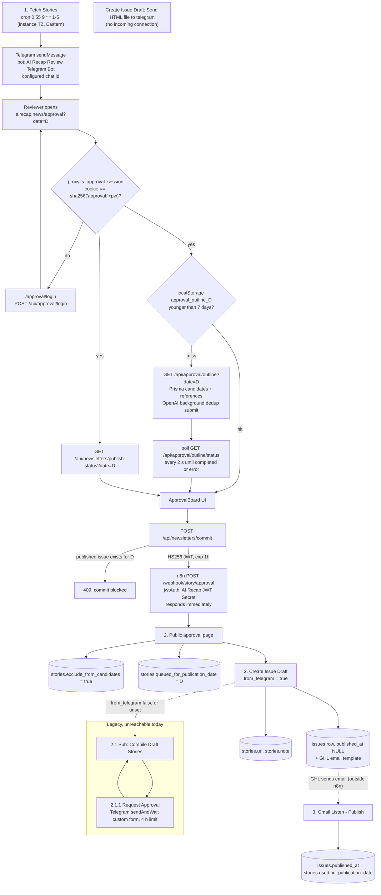
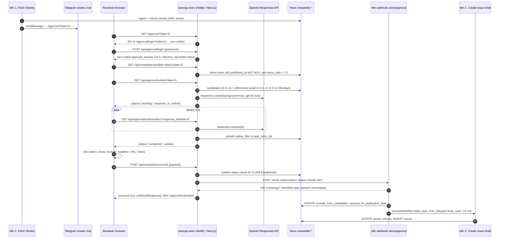
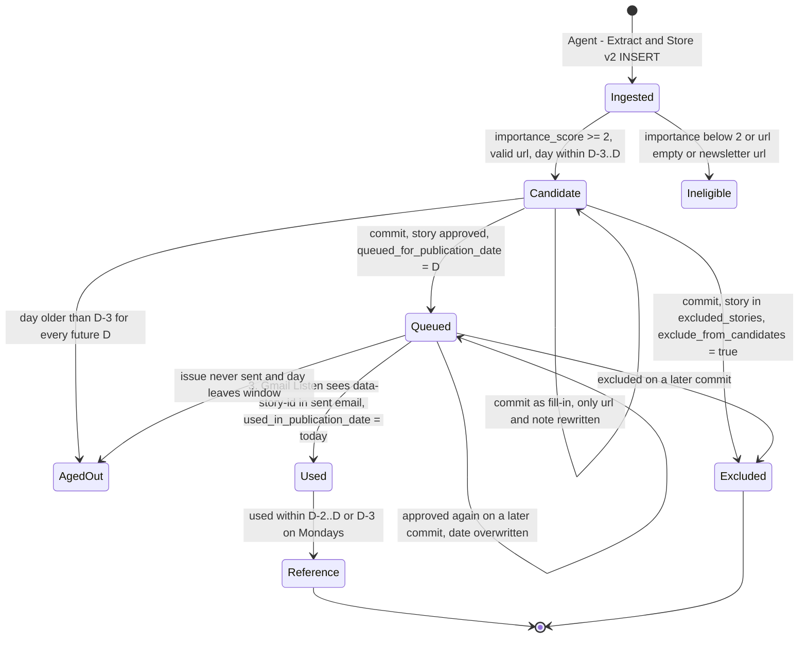
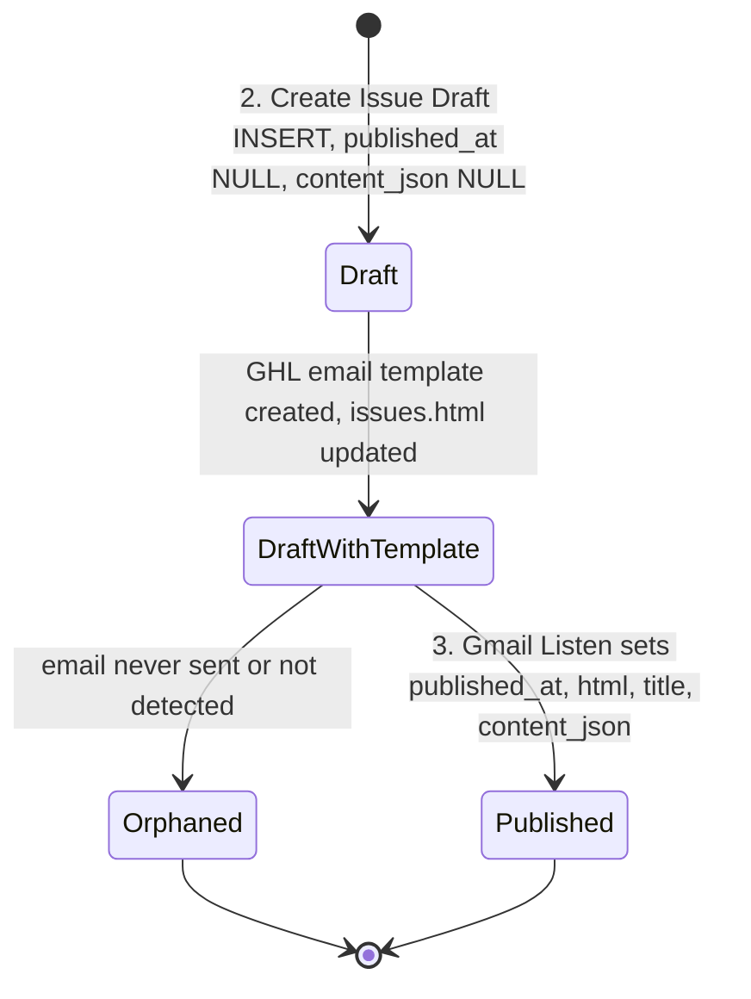
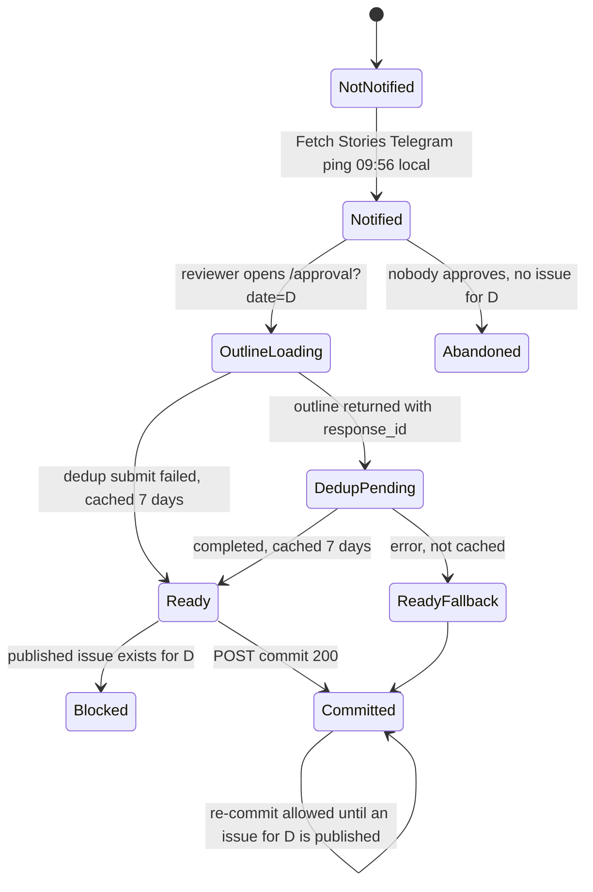

# 30: Human-in-the-loop approval flow and Telegram touchpoints

> **Historical.** This describes the n8n system that native code replaced in November 2026 ([ADR 0003](../adr/0003-n8n-retired-kept-as-record.md)). It is not the current system: see [../architecture.html](../architecture.html).

Scope: everything between "stories are in `newsletter.stories`" and "an approved outline is handed to `2. Create Issue Draft`", plus every Telegram node in the n8n instance. It covers both the n8n side and the website side (Next.js routes, UI, auth).

Sources: n8n workflow exports (draft `nodes` and published `activeVersion`), execution payloads pulled with `includeData=true`, read-only queries against prod Neon, and the website code at the worktree's commit. Secret values, chat ids, tokens, IPs and email addresses are left out on purpose.

---

## At a glance

- **Today the only live Telegram touchpoint is one plain-text ping.** `1. Fetch Stories` sends it at the end of its weekday 09:55 run. It goes to the configured chat id via the bot credential **"AI Recap Review Telegram Bot"** and carries a link to `https://airecap.news/approval?date=YYYY-MM-DD`. There are no buttons and no wait. The workflow ends right after sending.
- **Approval happens on the website, not in Telegram.** `/approval` is protected by one shared password (`APPROVAL_PASSWORD`). The reviewer can select or demote stories, move them between sections, exclude them (with an optional reason), pick the headline, edit the URL and add notes. Then they hit **Commit**.
- **Commit is `POST /api/newsletters/commit`.** It checks the session, normalises `date` to `YYYY-MM-DD`, blocks with 409 if a *published* issue already exists for that date, saves the normalised outline to `approval_outlines` (#75), signs an **HS256 JWT** (`{scope:"story-approval", payloadType:"object", issuedFor:"n8n-story-approval-webhook", iat, exp=iat+1h}`) with `N8N_WEBHOOK_JWT_SECRET`, and forwards the client JSON to `POST https://n8n.velocityalpha.com/webhook/story/approval`. The forwarded body is unchanged except for the normalised `date`. In n8n mode a failed outline save is logged and the commit still goes to n8n.
- **`2.  Public approval page` (RB9M8RWAYozoWapB) handles the webhook.** n8n checks the JWT using credential **"AI Recap JWT Secret"** (signature and expiry only; the custom claims are never checked) and replies `200` right away. It then sets `exclude_from_candidates=true` on excluded stories and `queued_for_publication_date=<date>` on approved stories. It re-validates the section limits and calls `2. Create Issue Draft` with `from_telegram: true`. That flag is a legacy name: it now means "approval already done".
- **Story state lives in three columns:** `exclude_from_candidates`, `queued_for_publication_date` (set at commit) and `used_in_publication_date` (set by `3. Gmail Listen - Publish` when the GHL email arrives). `queued_for_publication_date` is **write-only**: nothing reads it, so queued-but-unpublished stories stay candidates.
- **The Telegram `sendAndWait` form approval is dead code.** That is `2.1.1 Request Approval`, reached via `2.1 Sub: Compile Draft Stories`. No active caller reaches it, and it has zero runs in the export. The `waiting` Fetch Stories execution (12947, 2026-03-26, manual) is a zombie: its child execution 12954 was pruned (HTTP 404) and its `waitTill` is `3000-01-01`.
- **If the reviewer never approves, nothing happens.** There is no reminder, timeout, escalation or auto-publish. The stories roll into the next day's 3-day candidate window. The legacy form had a 4-hour wait limit (see section 5).
- **The single error run of `2. Public approval page` (21269, 2026-10-30) was not an approval bug.** The nested `2.2.1 Sub: Create Image Prompt` OpenAI call (`gpt-5.4-pro`) hit `ECONNABORTED` after 300,014 ms. The operator switched the model and re-ran the workflow by hand from pinned webhook data (execution 21275, `mode: manual`).
- **Reliability weaknesses:**
  - The webhook has no idempotency, so duplicate drafts have happened.
  - The webhook URL was hard-coded as the default, so a preview or dev deploy would post to **prod** n8n. Fixed in #49: outside production the route refuses the prod webhook.
  - Security findings for this area are kept in private notes and private GitHub security advisories, because this repo is public.
- **`Telegram MCP` (2IA2fRXEZx6Nr1ye) has nothing to do with AI Recap.** It is a July-2025 demo bot (`borna_va_test_bot`, Groq Kimi-K2, "business jargon" persona) that calls the instance's MCP server, which exposes a KAI Airtable tool. It was still **active** at the time of research; it was deactivated on 2026-11-04, together with the `MCP` server workflow. `My workflow 3` is an inactive "Yo!" connectivity test for the review chat.

## Area flowchart



## End-to-end sequence (current production path)



---

## 1. Telegram touchpoint in `1. Fetch Stories` (hdEUV8VFZbI13VpV)

Only the Telegram and approval parts are covered here. Ingestion is documented elsewhere.

### 1.1 Purpose and status

- **ACTIVE.** Last updated 2026-10-20. Published version = draft (`07698114…`).
- Runs in export: 10 `success` (2026-10-21 to 2026-11-03, `mode: trigger`), median 62 s (52–157 s). There is also 1 `waiting` run (12947, see 1.7).
- The workflow's last action is the reviewer notification.

### 1.2 Trigger

- Schedule Trigger with cron `0 55 9 * * 1-5` (6-field cron with seconds): **09:55:00 Monday to Friday**.
- `settings.timezone` is not set, so the instance default applies. Observed fire times were 13:55Z before 2026-11-01 and 14:55Z after, so the instance runs on **US/Canada Eastern** time. Postgres `date` values also render as `T04:00Z` or `T05:00Z`.

### 1.3 Node-level logic (notification path)

| Node | Type | What it does |
|---|---|---|
| `source fetch results` → `route by fetch success` (switch: `success` / `up_to_date` / `fail`) | code / switch | Groups the fetched items per source. Only `success` items go on to extraction. |
| `Agent - Extract and Store` | executeWorkflow → `Agent - Extract and Store v2`, `mode: each`, `waitForSubWorkflow: true`, `retryOnFail`, `alwaysOutputData`, `onError: continueRegularOutput` | Extraction and DB insert (other area). It is synchronous, so the stories are already in the DB before the ping goes out. |
| `source extract results1` | code | Per-source `{status: success\|partial_success\|error, num_stories_extracted, source}` as one item `{sources_summary:[…]}`. |
| `Combine the results into one item` | code | `{results:[{source,status,num_newsletter_fetched}], total_sources, timestamp}`. |
| `Consolidate Sources` | merge, combineByPosition (2 inputs) | Joins the two summaries into one item. Fans out to the admin stats email **and** the Telegram node. |
| **`Send a text message to inform of approval readiness`** | telegram v1.2, resource message / op `sendMessage` (default) | Sends the ping below. `additionalFields: {}` means no `parse_mode` and the n8n attribution footer is left on. |

Message text, verbatim from the node. `chatId` is a hard-coded literal, referred to here as "the configured chat id":

```text
=Hiii There

Stories from today have been successfully extracted. YOu can go to 

https://airecap.news/approval?date={{ $now.format('yyyy-MM-dd') }} to approve stories and publish.

Thank you.
```

As delivered on 2026-11-03 (execution 21406), Telegram's response `result.text` was:

```text
Hiii There\n\nStories from today have been successfully extracted. YOu can go to \n\nhttps://airecap.news/approval?date=2026-11-03 to approve stories and publish.\n\nThank you.\n\nThis message was sent automatically with n8n
```

- Telegram auto-detected the URL as a `url` entity. The footer comes as `italic` and `text_link` entities pointing to n8n.io.
- There is **no inline keyboard, no buttons and no reply handling**.

### 1.4 Data contract

- **Input:** the merged per-source summary (not used in the text).
- **Output:** Telegram `{ok, result:{message_id, date, text, entities[], link_preview_options}}`. Nothing is stored.
- **Date in the link:** `$now` in instance TZ, so the Eastern calendar date.

### 1.5 External services

| Service | Call | Credential |
|---|---|---|
| Telegram Bot API | `sendMessage` to the configured chat id | `AI Recap Review Telegram Bot` (telegramApi, created 2026-03-16) |

### 1.6 Error handling

- No `errorWorkflow` (the `Error Handler` workflow exists but is not attached).
- The Telegram node has no retry or continueOnFail. A Telegram failure fails the run *after* stories are stored, so data is safe but the reviewer gets no ping.
- **The message always says "successfully extracted".** It fires even if every source extraction errored, because the Agent node outputs on error.
- **Inferred edge case:** if *no* source returns `success` (all `up_to_date`), the extraction branch never runs. `Consolidate Sources` (combineByPosition) then has an empty input 0 and outputs nothing, so **no Telegram ping and no stats email**. In practice Product Hunt and HF nearly always produce a `success` item.

### 1.7 The `waiting` execution 12947

| Field | Value |
|---|---|
| Workflow at the time | Named `1. Fetch Newsletter`, versionId `8619a32b…`, 28 nodes |
| Run | `mode: manual`, started 2026-03-26T16:44:58Z |
| `status` / `waitTill` | `waiting` / `3000-01-01T00:00:00Z` (i.e. "wait for sub-workflow indefinitely") |
| Stuck node | `Call '2. Create Issue Draft'` (`metadata.subExecution.executionId = 12954`) |
| Child 12954 | Pruned: `GET /executions/12954` returns 404 |

At that time Fetch Newsletter called `2. Create Issue Draft` directly with only `{date: $now}`. With no `from_telegram`, that took the legacy branch into `2.1 Compile Draft Stories`, then `2.1.1 Request Approval` (Telegram `sendAndWait`). The parent can never resume. It is harmless clutter and should be deleted in the n8n UI. That was not done here because this work is read-only.

### 1.8 Observed runtime

Typical day (21406):

- 8 sources: 7 `success`, `aloa_ai` `up_to_date`.
- 49 stories extracted (rundown_ai 3, tldr_ai 5, ai_breakfast 11, tldr 7, product_hunt_ai 11, alphasignal 7, huggingface 5).
- Telegram ping at 14:56:17Z.

Reviewer latency from ping to commit over the last 10 weekdays: 3, 10, 30, 43, 107, 116, 136, 164, 189, 228 minutes. **Median about 110 minutes.**

---

## 2. Website approval board (Next.js)

### 2.1 Purpose and status

- **Live, primary HITL surface** since about May 2026:
  - JWT credential created 2026-04-30.
  - Public approval page published version created 2026-05-14.
- Files:

| Concern | File |
|---|---|
| Route guard | `proxy.ts` (Next 16 "proxy" = middleware), matcher `/approval/:path*` |
| Session helpers | `src/server/approval-auth.ts` |
| Login API | `app/api/approval/login/route.ts` |
| Login page | `app/approval/login/page.tsx` |
| Board page (client) | `app/approval/page.tsx`, `app/approval/layout.tsx`, `app/approval/loading.tsx` |
| Board component | `src/components/approval/ApprovalBoard.tsx` |
| Success page | `app/approval/submitted/page.tsx` |
| Outline + dedup submit | `app/api/approval/outline/route.ts` |
| Dedup polling | `app/api/approval/outline/status/route.ts` |
| Publish-date guard | `app/api/newsletters/publish-status/route.ts` |
| Commit → n8n | `app/api/newsletters/commit/route.ts` |
| Legacy outline (no dedup) | `app/api/newsletters/outline/route.ts` (not called by the UI or by any n8n workflow) |
| Public issue by id | `app/api/newsletters/[id]/route.ts` |
| Curation logic | `src/features/newsletter/curation.service.ts` |
| Section config (shared) | `src/features/newsletter/section-config.ts` |
| Dedup client | `src/features/newsletter/openai-dedup.ts` |
| Client cache | `src/features/newsletter/approval-outline-cache.ts` |
| Publish lookup | `src/features/newsletter/repository.ts` → `fetchLastPublishedIssueDateOnOrBefore` |

### 2.2 Authentication

**`APPROVAL_PASSWORD` is the only credential.** `SESSION_SECRET` is *not* used by approval; it belongs to subscriber sessions in `src/features/subscriber/*`.

**Login: `POST /api/approval/login` `{password}`**

- Compares the submitted password with `APPROVAL_PASSWORD`.
- Wrong password, or no password configured, returns `401 {"error":"Password incorrect."}`.
- On success it sets the cookie and returns `{success:true}`.

**Cookie**

- `approval_session` = `hex(SHA-256("approval:" + APPROVAL_PASSWORD))`.
- `httpOnly`, `secure` in production, `SameSite=Strict`, `path=/`, `maxAge=86400`.
- It is deterministic. It never expires server-side (only the browser drops it after 24 h). Every reviewer and every session shares the same token. Only a password rotation revokes it.

**Page guard (`proxy.ts`)**

- Exempts `/approval/login` and `/api/approval/login`.
- If `APPROVAL_PASSWORD` is unset it lets everything through, in **any** environment.
- Otherwise it compares the cookie and redirects to `/approval/login?redirect=<path+search>`.
- The login page only follows same-origin relative redirects (`/…` but not `//…`).

**API guard (`hasValidApprovalSession`)**

- Every approval API route calls it itself, because the proxy matcher does not cover `/api/*`.
- If the password is unset, access is allowed only when `NODE_ENV !== "production"`.

### 2.3 How the outline is built (`createOutlineCandidateStories(date)`)

**Date parsing.** `date` comes from the query string. It goes through `new Date(value)` and falls back to "now" if invalid. Everything is computed on the UTC date (`toISOString().slice(0,10)`).

**Candidates (Prisma).** Equivalent SQL:

```sql
SELECT id, guid, day, paywall_detected, error, headline, url, summary, category, source,
       story_details, importance_score
FROM newsletter.stories
WHERE importance_score >= 2
  AND day IS NOT NULL AND day <= :D AND day >= :D - INTERVAL '3 days'
  AND used_in_publication_date IS NULL
  AND exclude_from_candidates = false
  AND url IS NOT NULL AND url <> ''
  AND NOT (url ILIKE '%tldr%' OR url ILIKE '%rundown%' OR url ILIKE '%beehiiv%')
ORDER BY day DESC, id DESC;
-- then de-duplicated by guid in JS (first row wins; id used when guid is null)
```

Note: `queued_for_publication_date` is **not** a filter.

**References (already-used stories).** Equivalent SQL, with lookback 3 days when D is a Monday (UTC) and 2 otherwise:

```sql
SELECT id, guid, day, used_in_publication_date, paywall_detected, error, headline, url, summary,
       category, source, story_details, importance_score
FROM newsletter.stories
WHERE used_in_publication_date BETWEEN :D - :lookback AND :D
  AND exclude_from_candidates = false
ORDER BY used_in_publication_date DESC, id DESC;   -- then guid-dedup
```

**Cleaning.** `cleanText()` strips:

- sponsor phrases ("sponsored by", "together with", "presented by", …)
- newsletter names (tldr, ai breakfast, rundown)
- `source:` / `via` / "as reported by" clauses
- markdown links (the text is kept), bare URLs, "learn/read more", "check it out", "visit our website", "for more information"
- backticks, `**`, `*`, `#`, bullets
- ellipses; it also normalizes dashes and whitespace, and forces a single trailing period

**Ranking.**

- `keyword_score` = number of keywords present as substrings in headline + summary + details. The list is 24 tool keywords (app, tool, api, platform, …, use, try, access) plus 18 research keywords (research, study, paper, …).
- `combined_score = importance_score + keyword_score`.
- Sort by combined desc, then importance desc, then keyword desc.

**Buckets.** `category` maps as follows: `research`/`analysis` go to research, `tools`/`tool` go to tools, everything else goes to general.

**Sections.** From `section-config.ts`, with `FILL_IN_LIMIT = 3`:

| key | label | max | selected | fill_ins |
|---|---|---|---|---|
| `headlines` | Top Stories | 3 | general[0:3] | general[3:6] |
| `research` | Research & Analysis | 4 | research[0:4] | research[4:7] |
| `tools` | Tools | 3 | tools[0:3] | tools[3:6] |
| `quickHits` | Quick Hits | 6 | general[6:12] | general[12:15] |

**Output (`ApprovalOutlineData`):**

```ts
{
  reference_stories: { id; usedInPublicationDate: "YYYY-MM-DD"|null; paywall_detected: "yes"|"no"|"unknown"|"error"; error?; headline; summary }[];
  candidate_sections: { key; label; max; selected: {id; headline; summary}[]; fill_ins: {id; headline; summary}[] }[];
  candidate_map: Record<string /*id*/, { id; guid; day; headline; summary; story_details; category; source; url;
                   importance_score; paywall_detected?; error?; keyword_score; combined_score }>;
  selected_story_ids: number[];
}
```

### 2.4 `GET /api/approval/outline?date=` (outline plus async dedup submit)

1. Auth (401). Build the outline as in 2.3.
2. Submit dedup with `submitDeduplication()`.
   - Input is **all** ranked candidates, not just the 15–27 shown, plus all references (only those with headline and summary).
   - Call: `client.responses.create({ model: "gpt-4o-mini", background: true, store: true, … strict json_schema })`.
3. Return `{status: "pending", response_id, outline}`.
   - If the submit throws (for example no `OPENAI_API_KEY`), it logs and returns `{status:"ready", response_id:null, outline}`.
   - 500 `{error:"Failed to load approval outline data."}` on DB errors.

<details><summary>Dedup prompt (verbatim, <code>src/features/newsletter/openai-dedup.ts</code>)</summary>

`instructions` (system):

```text
You identify duplicate news stories by comparing the underlying event being reported. Return only valid JSON.
```

`input` (user). `${…}` is the JSON-stringified input:

````text
You will receive a JSON object with:

* `incoming_stories`: an array of incoming story objects that have not been used before.
* `previously_used_stories`: an array of story objects that have already been used.

Your task is to decide which incoming stories should be kept, then return only their IDs.

Core rule:
* Remove any incoming story that is meaningfully the same underlying story as something in `previously_used_stories`.
* If multiple incoming stories are meaningfully the same underlying story as each other, keep only the strongest one and remove the rest.

Important judgment guidance:
* Two stories can describe the same underlying event even if their headlines, summaries, phrasing, IDs, and URLs are different.
* Focus on the underlying news item being reported: the event, announcement, launch, release, acquisition, update, ruling, funding round, product change, or other concrete development.
* If two stories clearly point to the same underlying development, treat them as duplicates.
* Do not merge stories just because they mention the same company, product, person, or topic area. If they describe different developments, keep them separate.

Your tasks:
1. Compare each incoming story against `previously_used_stories`.
   - If an incoming story is semantically the same underlying story as a previously used story, remove it.

2. Compare stories within `incoming_stories`.
   - If multiple incoming stories are semantically the same underlying story, keep only one.

3. When choosing which duplicate to keep, keep the one with the more complete, specific, and information-rich `summary` or `story_details`.

Output exactly one JSON object:
{
  "kept_story_ids": [123, 456, 789]
}

Rules:
* Include only IDs from `incoming_stories`
* Do not include IDs from `previously_used_stories`
* Do not include duplicates
* Preserve the original ID values exactly as provided

INPUT:
${JSON.stringify({ incoming_stories: [{id, headline, summary, story_details}], previously_used_stories: [{id, headline, summary, story_details}] })}
````

Structured output schema (`text.format`):

```json
{ "type": "json_schema", "name": "deduplication_result", "strict": true,
  "schema": { "type": "object",
              "properties": { "kept_story_ids": { "type": "array", "items": { "type": "integer" } } },
              "required": ["kept_story_ids"], "additionalProperties": false } }
```
</details>

### 2.5 `GET /api/approval/outline/status?response_id=&date=` (dedup polling)

- 400 if `response_id` is missing.
- `responses.retrieve(id)`:
  - `queued` or `in_progress` returns `{status:"processing"}`.
  - `failed`, `cancelled`, `incomplete`, empty output or unparsable output returns **500** `{status:"error", error}`.
  - Any unknown status counts as pending.
- On `completed` it **re-queries the DB** with `createOutlineCandidateStories(date)` and filters to `kept_story_ids`:
  - `selected` and `fill_ins` per section
  - `candidate_map` entries
  - `selected_story_ids`
- **There is no backfill.** If dedup removes 2 of the 3 Top Stories, the section shows 1 selected and the editor has to promote fill-ins by hand.
- Returns `{status:"completed", outline}`.

**Client behaviour (`app/approval/page.tsx`)**

- Polls every 2 s, with no maximum duration.
- While pending it shows "Getting stories… can take up to 30 seconds".
- On error it falls back to the un-deduplicated outline and shows a red banner "Deduplication failed. Using original candidate set. Reason: …".
- **Caching:** the result of `completed` *and* of `ready` (dedup never submitted) goes into `localStorage["approval_outline_<date>"]` for **7 days** (`APPROVAL_OUTLINE_CACHE_TTL_MS`). Normalization happens on read.
- The cache has three problems:
  - A transient OpenAI submit failure gets cached un-deduped for a week.
  - There is no refresh control.
  - Stories ingested after the first load never appear.
- **Reviewer edits are React state only.** A reload discards them.

### 2.6 `GET /api/newsletters/publish-status?date=` (publish guard)

`fetchLastPublishedIssueDateOnOrBefore(D)` runs this query:

```sql
SELECT id, slug, title, issue_date, published_at FROM newsletter.issues
WHERE published_at IS NOT NULL AND issue_date IS NOT NULL AND issue_date <= :D
ORDER BY issue_date DESC, published_at DESC LIMIT 1;
```

- Returns `{success, target_date, has_exact_match: issue_date == D, issue|null}`.
- The board shows a header strip: either "An issue is already published for …" in red (Commit disabled) or "Latest published before D: …".
- **Draft issues (`published_at` NULL) are ignored.** That is why double commits for an unpublished day are possible (section 7).

### 2.7 What the reviewer can do (`ApprovalBoard.tsx`)

| Action | UI | Effect in the payload / DB |
|---|---|---|
| Select / demote | "Select" / "Selected" pill; "Mark as fill-in" / "Select for issue" | `selected` vs `fill_ins` per section → `approved_ids_by_section`, `selected_story_ids`. Selected ids get `queued_for_publication_date`. |
| Move between sections | Drag-and-drop between section drop zones, or "Move to: <section>" buttons | The story is **appended to the end** of the target section. **There is no reordering inside a section.** Order downstream = initial rank order plus moved stories at the end. |
| Exclude / reject | Trash icon (desktop) or checkbox (mobile); optional "Reason for exclusion…" text | The story is demoted to fill-in and added to `excluded_stories[{id, headline, summary, note, reason, newsletter_category}]`. n8n then sets `exclude_from_candidates=true`, which is **permanent**: no UI un-excludes a story later. **The `reason` is not persisted anywhere** (it only shows up in the n8n execution log). |
| Un-exclude (same session) | Click again, or select the story | Clears the excluded flag. |
| Pick headline | "Set as headline" star, **only for stories in Top Stories** | `newsletter_headline` (single id). Required. |
| Edit URL | Pencil → preview modal → "Story Link" Edit | `urlOverrides` → `candidate_map[id].url` and `stories[].url`. `2. Create Issue Draft` writes `stories.url` for **every visible story**, fill-ins included. |
| Notes | Preview modal textarea | `note` on every sectional entry. Create Issue Draft writes `stories.note` for every visible story; an empty note overwrites an existing one with `""`. |
| Not editable | Headline text, summary, category, date (only via `?date=`), adding stories outside the outline | |

**Client-side validation (Commit disabled)**

- No headline chosen.
- Any section's selected count is above `max` (3/4/3/6).
- The headline story is excluded or is a fill-in.
- A published issue exists for D. This check is on the **desktop** button only; the mobile bar ignores it, but the server's 409 still catches it.
- **Gap:** the headline may be moved out of Top Stories after being chosen. Nothing checks for that.

**Paywall indicator.** Each row shows `paywall_detected` (lock icon, green open lock, orange error with the `error` text as tooltip, grey unknown). This comes from `stories.paywall_detected` / `stories.error` (set by `Check for Paywalls`, which is another area).

### 2.8 `POST /api/newsletters/commit` (commit to n8n)

**Steps**

1. **Session.** If invalid → `401 {"error":"Unauthorized."}`.
2. **JSON body.** Invalid → `400 {success:false, error:"Request body must be valid JSON."}`.
3. **Secret.** `N8N_WEBHOOK_JWT_SECRET` must be set. Missing → **500**, because it throws.
4. **Normalize the payload.** An object is accepted; a single-element array of an object is unwrapped. Anything else → 400.
5. **Date check.** `parseCommitDate(payload.date)` takes the calendar date as written (`YYYY-MM-DD`, optionally followed by a time). Invalid → `400 "Commit payload is missing a valid date."` (Before #49 it used `new Date(str).toISOString().slice(0,10)`, which could shift the day.)
6. **Publish guard.** `fetchLastPublishedIssueDateOnOrBefore(targetDate)`. On `has_exact_match` → `409 {success:false, error:"An issue is already published for this day - D.", target_date}`.
7. **Sign the JWT.** `jwt.sign({scope:"story-approval", payloadType:"object", issuedFor:"n8n-story-approval-webhook"}, N8N_WEBHOOK_JWT_SECRET, {algorithm:"HS256", expiresIn:"1h"})`, using the `jsonwebtoken` package.
   - Header: `{"alg":"HS256","typ":"JWT"}`.
   - Claims: the three above plus `iat` and `exp = iat + 3600`. Confirmed in the n8n `jwtPayload` of the received request.
8. **POST to n8n.**
   - URL: `OUTLINE_COMMIT_WEBHOOK_URL`, or the prod webhook as the default in production only. Outside production the route needs `OUTLINE_COMMIT_WEBHOOK_URL` and refuses the prod webhook (503) (#49).
   - Headers: `Content-Type: application/json`, `Authorization: Bearer <jwt>`.
   - Body: the client's object, with `date` replaced by its `YYYY-MM-DD` form. Nothing else changes.
9. **Response handling.** Non-2xx from n8n → 500 with `"Webhook returned <status>: <text>"`. Otherwise `{success:true, message:"Outline committed to generation webhook.", receivedAt, webhookResponse:<n8n JSON>}`, where the n8n JSON is `{"message":"Workflow was started"}` because the webhook uses the default `onReceived` mode.
10. **UI.** Navigates to `/approval/submitted` ("Successfully submitted."). **There is no generation status after this point.** The reviewer never learns whether the draft was created.

Before n8n, the route saves one `approval_outlines` row: the normalised outline, its hash, and the draft owner (#75). `forwarded_at` is set when n8n answers 2xx. There is still no record of who committed.

**Commit payload schema** (built in `ApprovalBoard.commitPayload`; observed size about 45–52 KB):

| Field | Type | Notes |
|---|---|---|
| `date` | `"YYYY-MM-DD"` | From `?date=`, or today's UTC date in the browser. |
| `approved_ids_by_section` | `{headlines:number[], research:number[], tools:number[], quickHits:number[]}` | Selected ids, in display order. **This is what n8n actually uses.** |
| `excluded_stories` | `{id, headline, summary, note, reason, newsletter_category}[]` | Objects, not bare ids. |
| `newsletter_headline` | `number` | Required by the UI. |
| `candidate_sections` | `{key, label, max, selected:[{id, headline, summary, note}], fill_ins:[…]}[]` | Full board state. |
| `candidate_map` | `Record<id, {id, guid, day, headline, url(override), summary, note, category, source, story_details, importance_score, keyword_score, combined_score}>` | **Every visible story** (selected, fill-in, excluded). |
| `selected_story_ids` | `number[]` | Flattened `approved_ids_by_section`. |
| `stories` | `{id, guid, day, headline, url, summary, note, source, story_details, importance_score, keyword_score, combined_score, source_category, newsletter_category}[]` | Every visible story, in section order. |
| `queue_update_count` | `number` | = `selected_story_ids.length` (informational). |

Example (2026-11-03): 19 visible stories, 13 approved (headlines 3, research 4, tools 3, quickHits 3), 1 excluded, `newsletter_headline: 11007`, 0 notes.

### 2.9 Tests (Vitest)

**Covered:**

- `app/api/newsletters/commit/route.test.ts`: 401, webhook forwarding with body passthrough, 409 same-day guard, 400 missing date, 400 invalid date.
- `app/api/approval/outline/route.test.ts`: 401, pending + response_id, ready on submit failure, 500.
- `app/api/approval/outline/status/route.test.ts`: 401, 400, processing, failed, fallback error message, completed + filtered, unknown status 500, thrown 500.
- `app/api/newsletters/publish-status/route.test.ts`, `app/api/newsletters/outline/route.test.ts`, `app/api/newsletters/[id]/route.test.ts`.
- `src/features/newsletter/openai-dedup.test.ts`, `approval-outline-cache.test.ts`, `curation.service.test.ts`.

**Not covered:**

- `/api/approval/login`, `proxy.ts`, `ApprovalBoard` (validation and payload building), and JWT claim contents.
- Nothing tests the contract with n8n (field names n8n reads).

---

## 3. `2.  Public approval page` (RB9M8RWAYozoWapB)

The name has a double space.

### 3.1 Purpose and status

- **ACTIVE.** Last updated 2026-10-30T14:56 (the pin-data save during the manual recovery). Published version `fc346382…`, created 2026-05-14 and equal to the draft.
- Settings: `callerPolicy: workflowsFromSameOwner`, `binaryMode: separate`. **No `errorWorkflow`. No timezone.**
- Runs in export: 11 total, all since 2026-10-21.
  - 9 `webhook` success, 1 `manual` success (21275, the recovery), 1 `webhook` error (21269).
  - Duration median 248 s (51–337 s). Duration is dominated by the synchronous `2. Create Issue Draft` call.
- **Despite its name it renders no page.** It is the webhook receiver for the website's commit.
- It is a near-verbatim port of the tail of `2.1 Sub: Compile Draft Stories` (section 5), wired to a webhook instead of a Telegram form.

### 3.2 Trigger

| Property | Value |
|---|---|
| Node | `Webhook` (n8n-nodes-base.webhook v2.1) |
| Method / path | `POST` `story/approval` → `https://n8n.velocityalpha.com/webhook/story/approval` |
| Auth | `jwtAuth` with credential **"AI Recap JWT Secret"** (type jwtAuth, created 2026-04-30). n8n verifies the Bearer token's signature (HS256 secret; inferred from the website's signing) and `exp`. **It does not check `scope`, `issuedFor` or `payloadType`.** The verified claims are exposed as `$json.jwtPayload`. |
| Response | Default `responseMode: onReceived` → immediate `200 {"message":"Workflow was started"}`. Processing errors are **never** returned to the website. |
| Callers | The website `/api/newsletters/commit` only. Requests arrive through Netlify → Caddy (`via: 1.1 Caddy`, `cdn-loop: netlify`). |
| Pinned data | `pinData.Webhook` holds the full 2026-10-30 request: headers including the (expired) `authorization: Bearer …` JWT and client IP headers, plus the body. It is used only for manual runs (hygiene issue, see section 9). |

### 3.3 Node-level logic

Execution order (v1, observed): Webhook → Normalize → If → Extract excluded → Update excluded → Join all1 → Build Final Stories → Grab all story ids → Update queue → Join all → Merge → Call Create Issue Draft.

| # | Node | Type / settings | Logic |
|---|---|---|---|
| 1 | `Webhook` | webhook v2.1, jwtAuth | Output `{headers, params, query, body, webhookUrl, executionMode, jwtPayload}`. |
| 2 | `Normalize Webhook Payload` | set v3.4 | Copies `body.{approved_ids_by_section(object), excluded_stories(array), newsletter_headline(number), candidate_sections(array), candidate_map(object), selected_story_ids(array), stories(array), queue_update_count(number), date(string)}` to the top level. |
| 3a | `If Excluded Stories are Present` | if v2.3, strict | `{{ $json.excluded_stories.length }} > 0`. A missing array would throw. True → 4. False → straight into Merge input 0 (the Normalize item). |
| 4 | `Extract Excluded Story IDs` | code, alwaysOutputData | One item per excluded entry: `{excluded_id: <the whole excluded object>}`. |
| 5 | `Update Stories: Mark stories as excluded` | postgres v2.6 `update`, alwaysOutputData | `newsletter.stories` matching `id = {{ $json.excluded_id.id }}`, set `exclude_from_candidates = true`. Returns the full row. |
| 6 | `Join all1` | code, alwaysOutputData | One item: `{queue_update_count: rows-with-id count, approved_ids_by_section, candidate_sections, candidate_map, selected_story_ids, stories, date}` read back from `$('Normalize Webhook Payload')`. **It drops `excluded_stories` and `newsletter_headline`.** Feeds Merge input 0. |
| 3b | `Build Final Stories` | code | Server-side validation and the approved story list (below). Feeds Merge input 1. |
| 3c | `Grab all story ids` | code, alwaysOutputData | Builds the queue SQL (below). |
| 7 | `Update Stories: Queue for Publication` | postgres v2.6 `executeQuery`, query `{{ $json.queue_query }}`, alwaysOutputData | Returns one `{id}` row per queued story. |
| 8 | `Join all` | code, alwaysOutputData | `{queue_update_count: rows-with-id count}`. Feeds Merge input 2. |
| 9 | `Wait for Queue Update` | merge v3.2, combineByPosition, 3 inputs, default options | Barrier plus field merge (see the deep-merge hazard below). |
| 10 | `Call '2. Create Issue Draft'` | executeWorkflow v1.3 → QLPaj244TM7azSAH; waits for the sub-workflow (default) | Inputs: `date = $('Normalize Webhook Payload').item.json.date`, `data = $('Wait for Queue Update').item` (the **whole item**, hence `data.json.*` downstream), `from_telegram = true`. `convertFieldsToString: true`. Output is the inserted `newsletter.issues` row, which goes nowhere because the webhook already answered. |

**`Grab all story ids`.** Coerces `selected_story_ids` to unique positive integers. Then it builds
`UPDATE newsletter.stories SET queued_for_publication_date = <date>::timestamptz WHERE id IN (<ids>) RETURNING id;`,
or `SELECT 0::int AS updated_count` when no ids are left. (The verbatim code is kept out of the public docs.)

**`Build Final Stories` (verbatim).** Its limits differ from the website's: **tools 6 here vs 3 on the website**.

```js
const input = $input.first().json ?? {};
const limits = { headlines: 3, research: 4, tools: 6, quickHits: 6 };
const approved = input.approved_ids_by_section ?? {};
const candidateMap = input.candidate_map ?? {};
const stories = [];
const seenIds = new Set();
const newsletter_headline = $input.first().json.newsletter_headline
for (const [sectionKey, maxCount] of Object.entries(limits)) {
  const rawIds = Array.isArray(approved[sectionKey]) ? approved[sectionKey] : [];
  const uniqueIds = []; const seenInSection = new Set();
  for (const rawId of rawIds) {
    const id = Number(rawId);
    if (!Number.isInteger(id) || seenInSection.has(id)) continue;
    seenInSection.add(id); uniqueIds.push(id);
  }
  if (uniqueIds.length > maxCount) throw new Error(`Section ${sectionKey} exceeds max count of ${maxCount}`);
  for (const id of uniqueIds) {
    if (seenIds.has(id)) throw new Error(`Story ${id} was approved in multiple sections`);
    const story = candidateMap[String(id)];
    if (!story) throw new Error(`Approved story ${id} was not found in the candidate map`);
    seenIds.add(id);
    const { category, ...rest } = story;
    stories.push({ ...rest, source_category: String(category ?? ''), newsletter_category: sectionKey });
  }
}
return [{ json: { stories, newsletter_headline } }];
```

**Merge deep-merge hazard (verified in execution 21437)**

- `Wait for Queue Update` uses default clash handling: deep merge, last input wins.
- `queue_update_count` therefore comes from input 2 (13). `newsletter_headline` comes from input 1.
- `stories` is **merged index-by-index**:

| Index | Content after merge |
|---|---|
| 0–12 | The 13 approved stories from `Build Final Stories`, overwriting the first 13 of the 19 visible stories |
| 13–18 | The raw tail of the visible list: 5 duplicates of approved stories and one *unapproved* fill-in (id 11003) |

- It is harmless today only because `Reformat Stories for Issue` (in Create Issue Draft) filters `stories` by `approved_ids_by_section[section].includes(s.id)` and drops repeat ids.
- Any new consumer of `data.json.stories` would receive wrong data.
- `Build Final Stories` is effectively used **only as a validator**.

### 3.4 Data contract

**Input.** The commit payload (section 2.8). Fields n8n reads:

- `date`
- `approved_ids_by_section`
- `excluded_stories[].id`
- `selected_story_ids`
- `candidate_map` (for validation and for `url`/`note` writes)
- `newsletter_headline`
- `candidate_sections` and `stories` (passed through)

**DB writes (prod, credential "Newsletter Neon Production")**

```sql
-- per excluded story (n8n Postgres "update" operation, match column id)
UPDATE newsletter.stories SET exclude_from_candidates = true WHERE id = $1 RETURNING *;

-- once, for all approved ids (string-built, see above)
UPDATE newsletter.stories
SET queued_for_publication_date = '<date>'::timestamptz   -- column is DATE, so the date in DB session TZ
WHERE id IN (<id,id,…>)
RETURNING id;
```

**Hand-off to `2. Create Issue Draft`:** `{date: "YYYY-MM-DD", from_telegram: true, data: {json: <merged item>, binary?, pairedItem}}`.

Merged item keys: `queue_update_count, approved_ids_by_section, candidate_sections, candidate_map, selected_story_ids, stories, date, newsletter_headline`. `excluded_stories` is absent.

**Returned to the HTTP caller:** only `{"message":"Workflow was started"}`.

### 3.5 External services

None besides Postgres and the sub-workflow.

### 3.6 Error handling and incidents

- No node has `retryOnFail`. `alwaysOutputData` is on the code and postgres nodes so the barrier always fires.
- No `errorWorkflow`. **Failures are silent.** Nobody is alerted, and the website already showed "Successfully submitted".
- **Partial failure is possible:**
  - Exclusions are written *before* `Build Final Stories` validates. A validation throw leaves excluded flags set but nothing queued.
  - A failure inside Create Issue Draft leaves stories queued and exclusions set, but no issue.
  - Re-running repeats all the UPDATEs, which are idempotent, and **creates another issue row and GHL template**, which is not idempotent.
- There is no dedup key per date. Observed duplicates: `issue_date` 2026-10-12 (ids 252, 253) and 2026-09-07 (227, 228), with one published each.

**Error execution 21269 (2026-10-30 14:05:17Z, webhook)**

- Every node up to `Call '2. Create Issue Draft'` succeeded:
  - 2 stories marked excluded (`excluded_stories` included story 10773 "Anthropic Files For An IPO", demoted from Top Stories).
  - 13 queued.
- The call failed after 329,693 ms with **`NodeApiError: The connection was aborted, perhaps the server is offline`**.
- Root cause, traced through child 21270 (Create Issue Draft) to grandchild 21271 (`2.2.1 Sub: Create Image Prompt`): node `Analyze and Select Best Prompt1` (OpenAI Responses, model **`gpt-5.4-pro`**) returned `httpCode: "ECONNABORTED"` after **300,014 ms**. That is the OpenAI node's 300 s request timeout. Only one attempt is recorded, even though `retryOnFail` is set on that node.
- Before the failure, Create Issue Draft had already run `Update Stories` (url/note for 18 stories) and `Reformat Stories for Issue` (22,507 input / 2,393 output tokens).

**Recovery (reconstructed from timestamps)**

| Time (UTC) | Event |
|---|---|
| 14:26 | 2.2.1 manual test, `canceled` (21273) |
| 14:27 | 2.2.1 updated; model is now `gpt-6-luna` |
| 14:28 | 2.2.1 `retry` success (21274) |
| 14:56 | This workflow saved with the failed request pinned, then run **manually** (21275), creating issue 266 |
| 17:10 | Issue 266 published |

The pinned JWT's `iat` matches the failed execution's `establishedAt`.

### 3.7 Observed runtime (2026-11-03, execution 21437)

- Payload 52 KB. 1 excluded, 13 queued (`RETURNING` 13 rows).
- Create Issue Draft took 59.6 s and returned issue row `{id: "268", title: "ChatGPT's Workspace Gets Simpler", published_at: null, issue_date: 2026-11-03, slug: "chatgpts-workspace-gets-simpler", feature_image_url: <S3 URL>, …}`.

Sample merged item (trimmed):

```json
{ "queue_update_count": 13,
  "approved_ids_by_section": { "headlines": [11023, 11007, 10994], "research": [10996, 11033, 11031, 11032],
                               "tools": [11009, 10995, 11005], "quickHits": [10998, 11012, 11022] },
  "candidate_sections": [ { "key": "headlines", "label": "Top Stories", "max": 3,
      "selected": [ { "id": 11023, "headline": "Anthropic Opens Paid AI Safety Residency", "summary": "…", "note": "" } ],
      "fill_ins": [ { "id": 10989, "headline": "Anthropic Files To Go Public", "summary": "…", "note": "" } ] } ],
  "candidate_map": { "10989": { "id": 10989, "guid": "7e68…", "day": "2026-11-03T00:00:00.000Z",
      "headline": "Anthropic Files To Go Public", "url": "https://www.sec.gov/…", "summary": "…", "note": "",
      "category": "Funding", "source": "tldr_ai", "story_details": "…", "importance_score": 4,
      "keyword_score": 5, "combined_score": 9 } },
  "selected_story_ids": [ "…13 ids…" ], "stories": [ "…19 entries, see deep-merge hazard…" ],
  "date": "2026-11-03", "newsletter_headline": 11007 }
```

---

## 4. Approval and Telegram parts of `2. Create Issue Draft` (QLPaj244TM7azSAH)

The rest of this workflow is documented elsewhere.

### 4.1 Status

- ACTIVE. Updated 2026-10-16.
- Runs in export: 10 success + 1 error (21270, cascaded from section 3.6). All are `mode: integrated` children of the Public approval page.

### 4.2 Trigger

`executeWorkflowTrigger` with inputs `date`, `from_telegram` (boolean) and `data` (object).

### 4.3 Approval-related nodes

| Node | Logic |
|---|---|
| `From Telegram?` (if v2.3, strict boolean `{{ $json.from_telegram }}` is true) | **True → `Get data`** (website path, always taken today). **False → `Compile Draft Stories`**, which goes to 2.1 Sub, then the legacy Telegram form (section 5). |
| `Get data` (set) | Unwraps `data.json.{approved_ids_by_section, excluded_stories (always null now), newsletter_headline, candidate_sections, candidate_map, selected_story_ids, stories, queue_update_count}`. Does not copy `date`, which is read later from the trigger. Fans out to `Reformat Stories for Issue` and `Split Out`. |
| `Split Out` on `candidate_map` | One item per visible story (19 on 11-03). |
| `Update Stories` (postgres `update`, match `id`) | `UPDATE newsletter.stories SET url = $url, note = $note WHERE id = $id` for **every visible story**. This persists the reviewer's URL overrides and notes. |
| `Reformat Stories for Issue` (OpenAI `gpt-5.5`) | Other area. Consumes `$json.stories.filter(s => approved_ids_by_section.<section>.includes(s.id) && first occurrence)` per section, plus `$json.newsletter_headline`. |
| **`Send HTML file to telegram`** (telegram v1.2 `sendDocument`, bot "AI Recap Review Telegram Bot", configured chat id; binary `html`; caption `{{ $('Build Clean HTML for Beehiiv').item.json.subject }}`; file name `{{ $now.toISO().slice(0,10) }}-email.txt`) | **Dead.** Its chain `Build Clean HTML for Beehiiv` → `Save HTML template to file` → this node → `Update to Issues Table` has **no incoming connection** (only pin data). It never ran in the sampled executions. It is a leftover from the Beehiiv era, when the HTML was sent to Telegram for manual pasting. |

### 4.4 Telegram summary across Create Issue Draft

No live Telegram output. In particular, the reviewer is **not** notified when the draft is ready, when GHL got the template, or when generation fails.

---

## 5. Legacy Telegram form approval: `2.1 Sub: Compile Draft Stories` + `2.1.1 Request Approval` (+ v2)

### 5.1 Status

| Workflow | Id | Active | Updated | Runs in export | Callers |
|---|---|---|---|---|---|
| 2.1 Sub: Compile Draft Stories | rsHDKdELUG59wZzX | yes | 2026-04-29 (published version differs from draft only in versionId) | 0 | `2. Create Issue Draft` (false branch) |
| 2.1.1 Request Approval | m6oCt1cUcJHuPgeR | yes | 2026-05-06 (draft); **published version is from 2026-04-21** | 0 | `2.1 Compile Draft Stories` → `Send for Approval`; inactive `Backfill Article` |
| 2.1.1 Request Approval v2 | 013WaHICXxBPpZUA | no | 2026-03-27 | 0 | none |

- The only path into this code is `2. Create Issue Draft` with `from_telegram` false or unset. No active workflow does that today:
  - Active `1. Fetch Stories` no longer calls Create Issue Draft.
  - The inactive `1. Fetch Stories - Product Hunt Branch` does.
- **Conclusion: Telegram `sendAndWait` is not used in production.** It was the HITL mechanism from about 2026-03-17 until the website flow replaced it (April–May 2026).

### 5.2 `2.1.1 Request Approval`, node level (draft = the connected part of the published version)

Settings: `callerPolicy: workflowsFromSameOwner`, `binaryMode: separate`, no timezone, no errorWorkflow.

| Node | Logic |
|---|---|
| `Start` | executeWorkflowTrigger, `inputSource: passthrough`. Receives the Compile Draft item `{reference_stories, candidate_sections, candidate_map, selected_story_ids, …}`. |
| `Develop JSON form` (code) | Builds an n8n custom-form definition (`formFields[]`), described below. |
| `Send a text message` (telegram v1.2, **`operation: sendAndWait`**, `responseType: customForm`, `defineForm: json`, `jsonOutput: {{ $json.formFields }}`, `options.limitWaitTime.values.resumeAmount: 4`) | Sends `"Hey!\nHere are the stories for today."` to the configured chat id with bot "AI Recap Review Telegram Bot". n8n appends its default response button and attribution footer (no options override them). The button opens an **n8n-hosted form** on the instance's waiting-webhook URL for this execution. The execution **pauses** until the form is submitted, or until **4 time units pass (unit not set, so the n8n default of hours)**. |
| `Parse Approval Response` (code) | Maps the submitted form (keyed by field *labels*) to `{approved_ids_by_section, excluded_stories:number[], newsletter_headline}`. |

**Form layout** (from `Develop JSON form`):

- An HTML block "📰 PREVIOUSLY PUBLISHED" listing `reference_stories[].headline`.
- For each section: an HTML header `📂 <LABEL> (n Sel | m Fill)`.
- For each story (SELECTED first, then FILL-IN):
  - An HTML preview: status badge, `ID:<id> | <headline>`, and a "🔗 View Article" link to `candidate_map[id].url`.
  - A dropdown **"Target for ID <id>"**: `headlines` / `research` / `tools` / `quickHits` / `none`. The default is the section key for selected stories and `none` for fill-ins.
  - A checkbox **"Exclude ID <id>?"** with option "Confirm Exclude".
  - A checkbox **"Use ID <id> as Newsletter Headline?"** with option "Set as Main Headline".

<details><summary><code>Parse Approval Response</code> (verbatim)</summary>

```js
const response = $input.first().json ?? {};
const data = response.data ?? {};
const sectionKeys = ['headlines', 'research', 'tools', 'quickHits'];
const approved_ids_by_section = {};
const excluded_stories = [];
let newsletter_headline = null; // Variable to store the final headline ID

// Initialize section arrays
for (const key of sectionKeys) {
  approved_ids_by_section[key] = [];
}

// 1. Identify excluded IDs and the chosen Headline
const excludedSet = new Set();
for (const [key, value] of Object.entries(data)) {
  
  // Handle Exclusions
  if (key.startsWith('Exclude ID')) {
    const match = key.match(/Exclude ID\s*(\d+)/i);
    if (match && Array.isArray(value) && value.includes("Confirm Exclude")) {
      const id = Number(match[1]);
      excludedSet.add(id);
      excluded_stories.push(id);
    }
  }

  // Handle Newsletter Headline (Updates continuously, so the last one found wins)
  if (key.startsWith('Use ID') && key.includes('Newsletter Headline')) {
    const match = key.match(/Use ID\s*(\d+)/i);
    if (match && Array.isArray(value) && value.length > 0) {
      newsletter_headline = Number(match[1]);
    }
  }
}

// 2. Map Target Sections for non-excluded stories
for (const [key, targetSection] of Object.entries(data)) {
  if (key.startsWith('Target for ID')) {
    const match = key.match(/Target for ID\s*(\d+)/i);
    if (match) {
      const storyId = Number(match[1]);
      // Only process if the story is NOT in the excluded list AND not 'none'
      if (!excludedSet.has(storyId)) {
        if (targetSection !== 'none' && sectionKeys.includes(targetSection)) {
          approved_ids_by_section[targetSection].push(storyId);
        }
      }
    }
  }
}

return [{ 
  json: { 
    approved_ids_by_section, 
    excluded_stories,
    newsletter_headline // Added to output
  } 
}];
```
</details>

**Published-version drift.** The *published* (running) version, from 2026-04-21, still contains a second, **disconnected** copy of the branch:

- `Develop JSON form1` → `Send a text message1` → `Parse Approval Response1`.
- It uses the Telegram credential **`franca-test-bot`** and a different chat id.
- Its form has "Action taken for ID" (No change / Category change / Excluded) and "Reason for ID" fields, and outputs an `action_log`.

It is never triggered because it is not connected to `Start`. The 2026-05-06 draft removed it but was never published.

**`2.1.1 Request Approval v2` (inactive)**

- An older form: one checkbox group per category with `[SELECTED] ID:… | headline` / `[FILL-IN] …` options, plus a "PREVIOUSLY PUBLISHED" block that includes summaries.
- Input shape: `used_articles`, `selected[cat]`, `fill_ins[cat]`.
- After the form it has a second `sendAndWait` node with default (approval) options.
- It has no parser.

### 5.3 How Compile Draft used the response

- `Send for Approval` (executeWorkflow → 2.1.1, empty input mapping, so passthrough) → `Merge3` (combineByPosition with `Select Top Stories`).
- Then the same tail as section 3:
  - `If Excluded Stories are Present` → `Extract Excluded Story IDs` → `Update Stories: Mark stories as excluded`. Here `id = {{ $json.excluded_id }}`, a number, because the Telegram parser outputs bare ids.
  - `Build Final Stories`, with the same limits including tools 6.
  - `Grab all story ids`. Here the date comes from `$('Create Draft for Date').item.json.date` and **is escaped**: `.replace(/'/g, "''")`.
  - `Wait for Queue Update` (3-input merge).
- Legacy candidate SQL (`Get Recent Unpublished Stories`) is the ancestor of the website query. Differences: it filters `url NOT ILIKE '%beehive%'` (sic) and uses `DISTINCT ON (guid)`. References use a fixed 2-day lookback.

### 5.4 Timeout and never-approved behaviour (legacy)

This is inferred from n8n `sendAndWait` semantics. It was never observed, because there are no runs in the window.

- After 4 hours without a submission, n8n resumes the node **without form data**. `Parse Approval Response` then gets `data = {}`:
  - `approved_ids_by_section` all empty
  - `excluded_stories` empty
  - `newsletter_headline` null
- Compile Draft would then:
  - queue nothing (`SELECT 0::int AS updated_count`)
  - pass `stories: []` on
  - make Create Issue Draft generate an issue from **zero stories**, wasting LLM, image and GHL calls and producing a broken draft
- Nothing guards against this.
- If the parent had been called synchronously (as in the old Fetch Newsletter), the parent waits with `waitTill = 3000-01-01` until the child resumes or is pruned. That is the zombie in section 1.7.

**Current flow:** nothing waits, so there is no timeout. An unapproved day simply produces no issue:

- The stories remain candidates (`day >= D-3`) and compete in the next outline.
- No Telegram reminder exists.
- The reviewer can open `/approval?date=<past date>` at any time. The outline is computed relative to that date and `has_exact_match` is checked for it.

---

## 6. Other Telegram workflows

### 6.1 `My workflow 3` (36UlFATMCT7LQfBM)

- Inactive, updated 2026-03-16 (the same day the bot credential was created).
- Manual Trigger → Telegram `sendMessage` `"Yo!"` to the review chat's configured chat id via "AI Recap Review Telegram Bot".
- A bot and chat connectivity smoke test. No runs. Safe to delete.

### 6.2 `Telegram MCP` (2IA2fRXEZx6Nr1ye): **not AI Recap**

- **ACTIVE.** Last changed 2025-07-29. No runs in the export.
- Credential `borna_va_test_bot` (created 2025-07-29). It is not the AI Recap bot, and there is no AI Recap data, chat or workflow reference.
- Flow:
  - `Telegram Trigger` (updates: `message`) registers a Telegram webhook on the n8n instance.
  - `Send a chat action` (typing).
  - `AI Agent` (langchain agent v2) with:
    - prompt = incoming message text
    - **system message** (verbatim): `You are a business strategist that sounds super smart but only answers back in incomprehensible business jargon and buzzwords.`
    - model: Groq `moonshotai/kimi-k2-instruct` (credential "Groq account")
    - memory: buffer window of 50, keyed by Telegram chat id
    - tool: `MCP Client` with SSE endpoint `https://n8n.velocityalpha.com/mcp/serve` (no auth configured on the client)
  - `Send a text message` back to the sender (`appendAttribution: false`).
- The MCP server it calls (`MCP` workflow ii0EBe3DzhfnHURQ, active) exposes a **KAI Airtable "Find User"** tool. This belongs to a different (KAI) project.
- **Recommendation:** deactivate it. Anyone who finds the test bot can trigger Groq spend and an Airtable lookup tool. It is out of scope for migration.

### 6.3 Telegram inventory

| Workflow | Node | Op | Bot credential | Live? |
|---|---|---|---|---|
| 1. Fetch Stories | Send a text message to inform of approval readiness | sendMessage | AI Recap Review Telegram Bot | **Yes**, daily |
| 2. Create Issue Draft | Send HTML file to telegram | sendDocument | AI Recap Review Telegram Bot | No (disconnected) |
| 2.1.1 Request Approval | Send a text message | sendAndWait (custom form, 4 h) | AI Recap Review Telegram Bot | No (unreachable) |
| 2.1.1 Request Approval (published version only) | Send a text message1 | sendAndWait | franca-test-bot | No (disconnected) |
| 2.1.1 Request Approval v2 | Send a text message, Send message and wait for response | sendAndWait ×2 | AI Recap Review Telegram Bot | No (inactive) |
| My workflow 3 | Send a text message | sendMessage "Yo!" | AI Recap Review Telegram Bot | No (inactive) |
| Telegram MCP | Telegram Trigger, chat action, text | trigger / sendChatAction / sendMessage | borna_va_test_bot | Active, unrelated |

Every AI Recap Telegram node hard-codes the same group chat id literal (a negative id, so a group chat). Nothing reads it from config.

---

## 7. State machines

### 7.1 Story (`newsletter.stories`)

Relevant columns:

| Column | Type | Meaning |
|---|---|---|
| `day` | date | Story date |
| `importance_score` | smallint | Must be 2 or more to be a candidate |
| `url` | text | |
| `exclude_from_candidates` | bool, default false | |
| `queued_for_publication_date` | date, indexed | Set at commit |
| `used_in_publication_date` | date | Set at publish |
| `note` | text | |
| `paywall_detected` | text | |
| `error` | text | |



**Notes**

- **"Queued" is not a gate.** The website's candidate query ignores `queued_for_publication_date`, so a queued story is still offered as a candidate until `used_in_publication_date` is set. The candidate query is the only thing that removes stories.
- **`used_in_publication_date` is set when the GHL email actually lands in the monitored inbox**, not at draft time. It is set for every `story_id` the parser finds in the email HTML. `CURRENT_TIMESTAMP` is cast to the column's `date`.
- Excluded is terminal. It also hides the story from reference lists, because `getReferencedStories` filters `exclude_from_candidates = false`.

**Prod counts on 2026-11-03** (queued, used, excluded):

| queued | used | excluded | rows |
|---|---|---|---|
| f | f | f | 4,065 |
| f | f | t | 76 |
| f | t | f | 631 (pre-queue era) |
| t | f | f | **210** (queued, never published) |
| t | f | t | 37 |
| t | t | f | 1,768 |
| t | t | t | 1 |

Since 2026-10-01 the queued date equals the used date for every published day. Exceptions:

- 10-15 (7 queued, 0 used) and 10-22 (11 queued, 0 used): issues 256 and 260 were drafted but never published.
- 10-12: 19 queued vs 16 used (double commit, issues 252 and 253).
- 10-02 and 10-05: used ≠ queued date.

### 7.2 Issue (`newsletter.issues`)



- The website treats only `published_at IS NOT NULL` as published, both for the publish-status guard and (in the other area) for listing.
- No "approved", "generating" or "failed" state exists anywhere. The only trace of an approval is `stories.queued_for_publication_date`.

### 7.3 Approval session (per date, UI)



---

## 8. Recent git history on approval code

`git log --oneline -20 -- app/api/approval app/api/newsletters`:

| Commit | Subject | Relevance |
|---|---|---|
| c54cbcd | Serve fresh newsletter lists without changing other caches | List caching (not approval) |
| 1d9bd38 | feat: surface paywall error messages in approval board | `error` tooltip on paywall icon |
| dfd2f83 | fix: Fixing PR review commits | |
| 0024eb1 | feat: block same-day publish and format publish-status dates | Added the 409 guard and the `publish-status` route |
| 8d20ded | fix: Github comments on deduplication logic | |
| 5d1fac4 | feat: Replacing OpenAI batch with OpenAI background mode | Current `background: true` + polling design |
| 473190b | feat: Using OpenAI batch to replace previous method due to timeout | Earlier synchronous dedup timed out on Netlify |
| 461ffba | Modifications | |
| 00a7f6c | Address code review: security hardening, logging, and error handling | |
| fc55435 | Rename JWT_SECRET to N8N_WEBHOOK_JWT_SECRET for clarity | |
| f15c360 | Rename approval draft flow to outline commit | |
| b6ad250 | Address approval flow review comments | |
| 69889d4 | Approval flow | Initial website approval flow |
| ffde0cb | chore: add structured backend observability | `logServerInfo` / request context |
| 71f162e | refactor: move backend to next routes | |

- The current HEAD, **60f1bf0 "Fix approval state resets and type OpenAI deduplication responses"**, does not appear in that path-filtered log. It therefore touched files outside `app/api/approval` and `app/api/newsletters`, presumably `src/components/approval/ApprovalBoard.tsx` and/or `app/approval/page.tsx`, plus `src/features/newsletter/openai-dedup.ts`.
- The diff was not inspected (one-git-command limit).
- Current behaviour relevant to "state resets":
  - `ApprovalPageForDate` is keyed by `dateKey`, so it remounts on date change.
  - `ApprovalBoard` re-initialises `sections` whenever the `candidateSections` prop identity changes. The board is only rendered after dedup settles, so in practice that happens once.
  - Edits are never persisted, so a reload still loses them.
- The README / `.env.local.example` still says "OpenRouter is used for approval outline deduplication" (`OPENROUTER_API_KEY`, `OPENROUTER_DEDUP_TIMEOUT_MS`). The code uses the **OpenAI SDK with `OPENAI_API_KEY`, `gpt-4o-mini`**, so the docs are out of date.

---

## 9. Trust chain and design weaknesses

Security findings are kept in private notes and private GitHub security advisories, because this repo is
public. This section keeps only the design facts the rebuild needs.

### 9.1 Trust chain

- Telegram group membership: anyone in the chat sees the link.
- → Knowledge of `APPROVAL_PASSWORD`.
- → Approval cookie.
- → Website holds `N8N_WEBHOOK_JWT_SECRET`.
- → n8n trusts a valid HS256 JWT.
- → n8n writes to **prod** Neon with the "Newsletter Neon Production" credential and triggers paid LLM, image and GHL actions.

### 9.2 Design weaknesses

1. **One shared password.** There is no per-user identity or audit trail. `SESSION_SECRET` is not involved.
2. **No idempotency per date**, so duplicate drafts and GHL templates have occurred.
3. **The prod webhook URL is the default.** If `OUTLINE_COMMIT_WEBHOOK_URL` is unset, any environment (preview deploys, local dev against the dev DB branch) posts to prod n8n, which writes the **prod** DB using story ids that may come from the dev DB.
4. **Hard-coded Telegram chat ids** in 5 nodes. The bot token itself is in the credential.
5. **`Telegram MCP` was active and unrelated.** It was deactivated on 2026-11-04.
6. **No CSRF token**, but `SameSite=Strict` on the cookie plus a JSON POST makes cross-site commits impractical.

---

## 10. Migration notes (native rebuild)

### 10.1 What a native implementation needs

1. **Notification.**
   - A scheduled job, run after ingestion completes rather than at a fixed time, sends one message to the reviewer channel with `/approval?date=D`.
   - Keep Telegram via the Bot API `sendMessage` (bot token and chat id in env), or swap the channel.
   - Make the text honest: include per-source counts and failures, which are already computed for the admin email.
   - Add an optional reminder if D is still uncommitted by a cutoff, and a "draft ready / failed" message after generation (both missing today).
2. **Outline service.** Reuse `curation.service.ts` as-is. Consider:
   - backfilling sections after dedup removals
   - excluding stories queued for a *different* unpublished date, or showing them flagged
   - server-side persistence of board edits (an approval draft table) instead of 7-day localStorage
3. **Commit as an in-process transaction** replacing the webhook. In one DB transaction:
   - validate (limits, uniqueness, membership in the server-computed outline, headline in the approved set)
   - `UPDATE stories SET exclude_from_candidates=true WHERE id = ANY($excluded)`
   - `UPDATE stories SET queued_for_publication_date=$D WHERE id = ANY($approved)`
   - `UPDATE stories SET url, note` for edited stories only, so empty notes stop clobbering existing ones
   - insert an `approvals` row (date, approved ids by section, headline, excluded ids **with reasons**, reviewer, created_at) with a **unique constraint per date** (or an explicit "supersede" action)

   Then enqueue issue generation as a background job keyed by date (idempotent), and expose its status to the UI (`queued → generating → drafted → template_uploaded → published / failed`).
4. **Section limits.** Unify them in one place. Today it is website tools = 3 vs n8n `Build Final Stories` tools = 6.
5. **Drop the 3-input merge entirely.** Pass a typed `ApprovedOutline { date, headlineId, sections: Record<SectionKey, StoryId[]>, stories: Record<StoryId, StorySnapshot> }` to the generator.
6. **Auth.**
   - Replace the shared-password cookie with per-user auth (magic link, or reuse the subscriber session machinery with an `editor` role), with server-side session expiry and audit.
   - If any external webhook survives, use HMAC over the body with timestamp and nonce.
7. **Timezone.** Pick one editorial timezone (today: n8n uses Eastern for the cron and the link date; the website uses UTC dates) and use it for `D` everywhere. Today the browser's "today" (UTC) can be tomorrow after 8 pm Eastern.
8. **Cleanup on the n8n side before cutover:**
   - delete zombie execution 12947
   - publish or delete the stale `2.1.1 Request Approval` version
   - deactivate `Telegram MCP`
   - remove the dead Telegram/Beehiiv branch and pin data
   - attach `Error Handler` to `2. Public approval page`

### 10.2 Hidden coupling to preserve or replace

- `from_telegram` is a legacy flag name. It means "outline already approved; skip compile + Telegram".
- `Create Issue Draft.Reformat Stories for Issue` relies on `approved_ids_by_section` filtering plus first-occurrence dedup to survive the merge hazard.
- `3. Gmail Listen - Publish` relies on `data-story-id` attributes in the email HTML to set `used_in_publication_date`. That ties the story state machine to the email renderer (another area).
- `paywall_detected` / `error` are written by `Check for Paywalls` (another area) and only displayed here.

### 10.3 Open questions

- Should un-excluding be possible? Exclusion is permanent today, and reasons are discarded.
- Should re-committing an already-drafted (unpublished) date be blocked, or should it replace the previous draft and GHL template? Today it creates a second one.
- What is the intended editorial timezone and cutoff for "today's" outline?
- Does anyone still read the Telegram HTML-file output or rely on the n8n form? The evidence says no.
- What exactly changed in HEAD 60f1bf0? It was not inspected because of the git restriction.
- Why did issues 256 (2026-10-15) and 260 (2026-10-22) never publish (GHL send skipped vs Gmail listener miss)? That belongs to the publish/GHL area.
