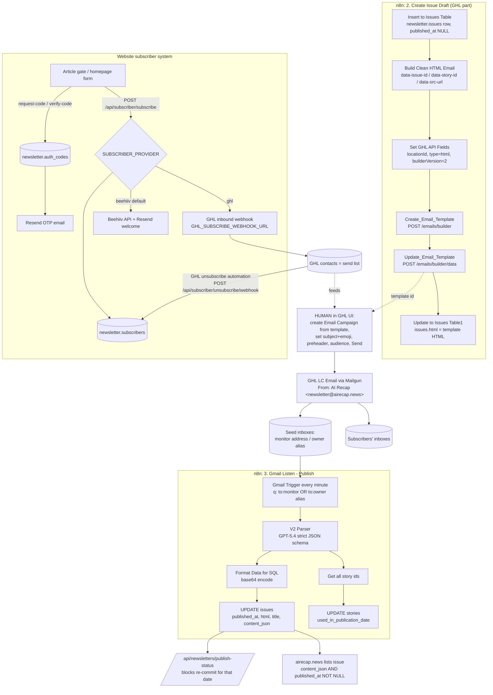

# 40: Publishing, email sending, and subscribers

> **Historical, written 2026-11-03.** The n8n parts describe a retired system ([ADR 0003](../adr/0003-n8n-retired-kept-as-record.md)). The website and subscriber parts may have changed since: trust the code and [../architecture.html](../architecture.html).

Scope: how an approved draft becomes a sent email and a published web issue (GHL template creation in
`2. Create Issue Draft`, the human GHL campaign step, `3. Gmail Listen - Publish`), the dead Beehiiv
unsubscribe webhook, and the website subscriber system (provider switch, GHL/Beehiiv/Resend calls,
OTP login, article gate, unsubscribe, for-brands, publish-status).

Sources: workflow exports `Tqon5VyPBEv9juF4`, `QLPaj244TM7azSAH`, `2nlY28NnPmOB2zGF`, `EOmzdknnvWLmyV48`;
executions 21101, 21109, 21185, 21223, 21282, 21382, 21387, 21441 (Gmail Listen) and 21438, 21270
(Create Issue Draft) pulled with `includeData=true` (copies are in the private archive);
read-only prod DB queries; repo code at the same commit as `main`.

---

## At a glance

- **n8n never sends or schedules the email.** `2. Create Issue Draft` only creates a GHL **email template**
  (`POST /emails/builder` then `POST /emails/builder/data`). A **human then creates and sends a GHL Email
  Campaign** from that template, typing the subject line (title plus an emoji) at send time. Evidence:
  GHL campaign object ids are created 7 to 330 minutes after the template, always about 1 minute before
  the email arrives, and the sent emoji differs from the draft's `title_emoji`.
- **"Publishing" works by detecting the newsletter in seed inboxes.** Two seed contacts
  (a monitor address and an owner alias, both redacted here) are on the GHL send list. They
  receive the real campaign email, and `3. Gmail Listen - Publish` polls Gmail every minute for mail to
  those addresses. It is not a confirmation email.
- Gmail Listen sends the **whole received HTML (about 46 KB) to GPT-5.4** with a strict JSON schema. It
  extracts the structured issue (`content_json`), reading `data-issue-id`, `data-story-id` and
  `data-src-url` attributes that the draft HTML embeds. It then `UPDATE`s `newsletter.issues`
  (`published_at`, `html`, `title`, `content_json`) and sets `newsletter.stories.used_in_publication_date`.
- **The website lists an issue only when `content_json IS NOT NULL AND published_at IS NOT NULL`.** Both
  are written only by Gmail Listen, so if it misses an email the issue never appears on airecap.news.
  The approval board's publish-status lock depends on it too.
- Unrelated email to the seed addresses (e.g. Beehiiv marketing) also triggers a GPT-5.4 call, which costs
  money and does nothing. Input-safety findings for this workflow are kept in private notes.
- **Subscribers live in three places:** GHL contacts (who actually gets email),
  `newsletter.subscribers` (38 rows, which controls website gate access), and Beehiiv (legacy, still the
  code default). Sync is one-way in each direction: site → GHL inbound webhook on subscribe, and GHL →
  site webhook on unsubscribe. No reconciliation job exists.
- **The live `SUBSCRIBER_PROVIDER` mode could not be confirmed.** The code defaults to `beehiiv`, and the
  AI Recap Netlify site is not visible to the local CLI account. If prod is still unset, new website
  signups go to Beehiiv and never reach the GHL send list. **Update 2026-11-04: the owner confirmed production is set to GHL.**
- Login uses email OTP: a 6-digit code sent through Resend, stored as SHA-256 in `newsletter.auth_codes`,
  10-minute TTL. Sessions are an HMAC-signed 30-day cookie. The article gate is
  **soft**: full content is server-rendered and clipped with CSS, and `/api/issues/[slug]` returns it
  unauthenticated.
- **Hardcoded GHL Private Integration Token (Bearer) in nodes `Create_Email_Template` and
  `Update_Email_Template`** (and a different one in the inactive legacy workflow). The credential
  "Newsletter GHL: Header Auth" exists but **no workflow uses it**.
- `Webhook: Unsuscribe event` (Beehiiv) is an inactive single-node stub with no downstream logic. It has
  never run.



---

## 1. End-to-end: approved draft to email to published issue

### 1.1 Who does what

| Step | Actor | Mechanism | Evidence |
|---|---|---|---|
| Approve outline | Human on `/approval` | `POST /api/newsletters/commit` → n8n `story/approval` → `2. Public approval page` → `2. Create Issue Draft` | Other agents' area |
| Create `issues` row | n8n `Insert to Issues Table` | `INSERT` title, feature_image_url, prompt_featured_image, issue_date | exec 21438 |
| Build email HTML | n8n `Build Clean HTML Email` (Code) | HTML with `{{contact.first_name}}` merge tag and data attributes | node code |
| Create GHL template | n8n `Create_Email_Template` | `POST https://services.leadconnectorhq.com/emails/builder` | response `{id, redirect, status:"ok", traceId}` |
| Fill template HTML | n8n `Update_Email_Template` | `POST https://services.leadconnectorhq.com/emails/builder/data` | response `{ok:true, previewUrl, templateDataDownloadUrl, id, versionId, traceId}` |
| Store template HTML | n8n `Update to Issues Table1` | `UPDATE issues SET html, title, issue_date WHERE id` | exec 21438 |
| **Create and send campaign** | **Human in GHL UI** (inferred) | GHL Marketing → Emails → Campaigns, using the template above | see 1.2 |
| Deliver | GHL LC Email (Mailgun, `mg.airecap.news`) | `From: AI Recap <newsletter@airecap.news>`, `Reply-To: newsletter@mg.airecap.news`, headers `Feedback-Id: campaign_…:location_owned:campaign:<locationId>`, `x-mailgun-variables.email_type = "campaign"`, `origin = "bulk-email"`, `provider = "leadconnector"` | received headers |
| Detect send / publish | n8n `3. Gmail Listen - Publish` | Gmail poll every minute, GPT-5.4 parse, two `UPDATE`s | executions |
| Show on site | Next.js | lists issues with `content_json IS NOT NULL AND published_at IS NOT NULL` | `src/features/newsletter/repository.ts` |

No n8n workflow, active or inactive, creates, schedules or sends a GHL campaign. The only GHL calls are the
two template calls above, which also appear in the inactive legacy `2. Sub: Create Issue (Upload to GHL)`.

### 1.2 Evidence that a human sends the campaign

GHL ids are MongoDB ObjectIds, and their first 4 bytes are a creation timestamp. The template id appears
in the received email's `List-Unsubscribe` header (`template_id=…`). The campaign id is
`x-mailgun-variables.email_type_id`.

| Issue | Template created (n8n) | Campaign created (GHL) | Email `Date` | Gmail Listen ran | Subject (sent) | Draft `title_emoji` |
|---|---|---|---|---|---|---|
| 268 (2026-11-03) | 17:40:08 | 17:47:29 | 17:48:21–22 | 17:49:02 | "ChatGPT's Workspace Gets Simpler 🤞🏼" | 🧩 |
| 267 (2026-11-02) | 15:39:13 | 16:30:16 | 16:31:07–35 | 16:32:03 | "AI Compute Hits The Ballot ☑️" | n/a |
| 266 (2026-10-30) | 14:57:16 | 17:09:23 | 17:10:06–07 | 17:11:01 | "Claude Hits The Road 🚗" | n/a |
| 265 (2026-10-29) | 17:48:13 | 18:17:30 | 18:18:27–28 | 18:19:00 | "Gemini Carbon Raises The Stakes 🏋🏽‍♀️" | n/a |

Draft-to-publish delay across the last 13 published issues ranged from **7 to 334 minutes** (DB
`published_at - created_at`). The irregular gaps and the hand-picked subject emoji point to manual
"create campaign → Send now" in GHL. A GHL-side preheader is also set; the email text starts with a
preheader line that the template does not contain.

### 1.3 Drafts that were never published

`newsletter.issues` has 185 rows: 159 have `published_at`, 160 have `content_json` (id 32 is a
Feb-2026 V1 legacy row with JSON but no `published_at`), and **26 are unpublished**. Recent unpublished
drafts with template HTML present: **256 (2026-10-15) and 260 (2026-10-22)**. No Gmail Listen execution
exists between 2026-10-21 19:58 and 2026-10-23 17:10, so no email reached the seed inboxes on 10-22.
Either the campaign was not sent that day, or it was sent to a list without the seed contacts. Some dates
also have duplicate drafts (e.g. 10-12 has ids 252 and 253, one published), which leave orphan GHL
templates. **Nothing alerts on "draft created but never sent".**

---

## 2. `2. Create Issue Draft` [QLPaj244TM7azSAH]: GHL part only

### 2.1 Purpose and status

- ACTIVE. Last updated 2026-10-16. Triggered by `executeWorkflowTrigger`, called by `2. Public approval page`.
- `settings`: `executionOrder: v1`, `callerPolicy: workflowsFromSameOwner`, **no timezone**, **no errorWorkflow**.
- Retained runs: 11 (10 success, 1 error). The error (21270, 2026-10-30 14:05) was in the image-prompt
  sub-workflow ("The connection was aborted, perhaps the server is offline", node
  `Analyze and Select Best Prompt1`, 300 s), **before** the GHL nodes, so no GHL template was created.
  It was re-run successfully at 14:56 (21276).
- The GHL segment takes about 1.3 s (`Create_Email_Template` 549 ms, `Update_Email_Template` 663 ms in 21438).

### 2.2 Node chain (GHL segment)

`Merge` → `Insert to Issues Table` → `Build Clean HTML Email` → `Set GHL API Fields` → `Create_Email_Template`
→ `Update_Email_Template` → `Update to Issues Table1` (end).

None of these nodes sets `continueOnFail`, `onError`, `retryOnFail` or `alwaysOutputData`.

Dead branch: `Build Clean HTML for Beehiiv` → `Save HTML template to file` → `Send HTML file to telegram` →
`Update to Issues Table` has **no incoming connection** and never runs. It used to post the HTML to the
Telegram review chat as a `.txt` file.

| Node | Type | Behaviour |
|---|---|---|
| Insert to Issues Table | postgres 2.6 insert into `newsletter.issues` | Sets `title` = `Reformat Stories for Issue` output title, `feature_image_url` = `s3_image_url.trim()`, `prompt_featured_image`, `issue_date` = caller's `date`. `html`, `content_json` and `published_at` stay NULL. `slug` comes from the DB default `COALESCE(newsletter.slugify_issue_title(title), id::text)`, so it is computed **once at insert** and never updated later. |
| Build Clean HTML Email | code | Builds email HTML from `$('Merge').first().json.structured_issue_data` plus the inserted row. Key contract below. Returns `{html, subject: stripEmoji(title) or 'AI Recap', issueId, imageUrl, structuredIssueData}`. |
| Set GHL API Fields | set | `title = subject`, `html`, `locationId = "QHBgZjxBJ2T0E7yRAiJS"` (hardcoded), `type = "html"`, `builderVersion = "2"`. |
| Create_Email_Template | httpRequest 4.3 | `POST https://services.leadconnectorhq.com/emails/builder`. Headers: `Accept: application/json`, `Version: 2021-07-28`, `Authorization: Bearer <hardcoded GHL PIT>`. JSON body `{locationId, title: "<title> " (note the trailing space in the expression), type: "html", builderVersion: "2", html}`. Response: `{redirect: <id>, id: <templateId>, status: "ok", traceId}`. |
| Update_Email_Template | httpRequest 4.3 | `POST https://services.leadconnectorhq.com/emails/builder/data`. Same headers. JSON body `{locationId, templateId: $json.id, updatedBy: "WmcPQm3oLV1oIK94fv5b" (hardcoded GHL user id), editorType: "html", html}`. Response: `{ok: true, previewUrl, templateDataDownloadUrl (firebasestorage), id, versionId, traceId}`. |
| Update to Issues Table1 | postgres 2.6 update by `id` | `html` = template HTML (about 29 KB, unpersonalised), `title`, `issue_date`. |

**The template id is not stored anywhere** (not in `issues` or any other table). The only link between a
GHL template and an issue is the `data-issue-id` attribute inside the HTML.

### 2.3 HTML contract consumed by publishing (from `Build Clean HTML Email`)

- Wrapper: `<div data-issue-id="{issues.id}" …>`
- Every story wrapper (`renderFeatureStory` `<div>`, tools `<li>`, quick-hits `<div>`) carries
  `data-story-id="{story_id}" data-src-url="{original url}"`.
  This exists because GHL/Mailgun click tracking rewrites every `href` to
  `https://email.mg.airecap.news/c/…`. In the received email all 14 hrefs are tracking links and the 13
  `data-src-url` attributes survive intact.
- Header: badge "AI Recap", `<div>` with the emoji-stripped title, then
  `Hello {{contact.first_name}}, here's your briefing for <Weekday, Month D, YYYY>` (GHL merge tag; date is
  formatted from `issue_date` in UTC).
- Hero `">`.
- Sections in order: "📋 Today's Overview" (`overview.summary`), "🔥 Top Stories" (`headlines`: headline,
  story_detail, bullets as `before <strong>highlight</strong> after`, "Read more →"), "🔬 Research & Analysis",
  "🛠️ Trending AI Tools" (`link_text - detail`), "⚡ QUICK HITS" (`link_text text`).
- Footer: "© AI Recap 2026" (hardcoded year) and "You're receiving this because you subscribed to AI Recap."
  **There is no unsubscribe link in the template.** `const unsubscribeUrl = 'email={{contact.email}}'` is
  dead code. GHL appends its own footer unsubscribe link (`services.msgsndr.com`) and RFC 8058
  `List-Unsubscribe` / `List-Unsubscribe-Post: List-Unsubscribe=One-Click` headers.

### 2.4 Migration notes (GHL part)

- Move the PIT into a secret store and **rotate it**: it is in plain text in workflow exports. The legacy
  workflow holds a second, different PIT, which should also be rotated or revoked.
- Persist `ghl_template_id` (and ideally `ghl_campaign_id`) on `issues`.
- Creating the template is the last automated step. To reach autopilot, a native app must also create and
  schedule the campaign. Check whether the GHL API version and scopes in use allow programmatic email
  campaign creation and scheduling; this is not verified here. Otherwise keep the human "send" step but
  record it explicitly (see §8).

---

## 3. `3. Gmail Listen - Publish` [Tqon5VyPBEv9juF4]

### 3.1 Purpose and status

- ACTIVE. Created 2025-12-24, last updated 2026-05-25. 6 nodes. Tag `Newsletter`.
- Purpose: when the sent newsletter lands in a seed inbox, mark the issue published and populate the
  website content from the email.
- Retained history: **13 executions, all `success`**, 2026-10-21 to 2026-11-03 (n8n prunes older runs).
  Of these, 9 were publish runs and 4 were no-op runs on unrelated emails. Empty polls do not create
  executions, so about 1,440 polls per day are invisible.
- Duration: publish runs 27–48 s (dominated by the LLM, 32–46 s for 2 emails). No-op runs 5–8 s.

### 3.2 Trigger

| Setting | Value |
|---|---|
| Node | `Gmail Trigger - Check Email` (`n8n-nodes-base.gmailTrigger` v1.1) |
| Poll | `everyMinute` (not a cron). Workflow `settings.timezone` is **unset** (instance default; DATE values render as `T05:00:00Z`, so the n8n process runs at UTC-5 in November) |
| Credential | **"Gmail account"** (gmailOAuth2, id `PXtipfaLbB2XMzki`). The same mailbox credential is used by `1. Fetch Stories` (ingestion) and `Error Handler` |
| Filter `q` | `to:<monitor address> OR to:<owner alias>` (both redacted; see the workflow JSON in the private archive) |
| Other filters | No label or read-status filter. The Gmail API excludes SPAM/TRASH by default |
| `simple` | `false`: full MIME parse. Each item has `id, threadId, labelIds, headers{…}, html, text, textAsHtml, subject, date, from, to, replyTo, messageId, sizeEstimate` |
| Dedup state | `staticData["node:Gmail Trigger - Check Email"] = {lastTimeChecked: 1793728102 (2026-11-03T17:48:22Z), possibleDuplicates: [2 message ids]}` |
| Stale state | `staticData` and `pinData` still hold entries for a **removed** node `Gmail Trigger - Check Email2` (pinned mail from a different personal mailbox, May 2026). Harmless, but it contains personal data and should be cleaned |

### 3.3 Node-level logic

Connections: Trigger → `V2 Parser` → (parallel) [`Get all story ids` → `Update stories table`] and
[`Format Data for SQL` → `Update Issue`]. With `executionOrder: v1` the story branch runs first. The two
branches are **not transactional**.

| # | Node | Type | Logic |
|---|---|---|---|
| 1 | Gmail Trigger - Check Email | gmailTrigger 1.1 | Emits one item per new matching message. Seed contacts get separate copies, so a publish poll usually has **2 items** (both copies arrived within 1 s in every observed run). |
| 2 | V2 Parser | `@n8n/n8n-nodes-langchain.openAi` 2.1 (Responses API) | Runs **once per item**. Model `gpt-5.4`, single user message (prompt below) with the full email HTML interpolated. `textFormat` = `json_schema`, name `ai_recap_issue_v2`, `strict: true`, `verbosity: low`. No built-in tools. `retryOnFail: true`, `waitBetweenTries: 5000` (n8n default maxTries 3). Credential "Newsletter OpenAI Key". Output: `json.output[0] = {id, type:"message", status:"completed", phase:"final_answer", role:"assistant", content:[{type, annotations, logprobs, text: <parsed object>}]}`. |
| 3a | Get all story ids | code | Reads **only `$input.first()`**. Parses `output[0].content[0].text` (string or object), iterates `headlines, research_and_analysis, tools, quick_hits`, and emits `{story_id}` for every non-null `story_id`. 13–14 items on publish runs, 0 on no-op runs. |
| 4a | Update stories table | postgres 2.6 executeQuery | SQL below, once per story id. Credential "Newsletter Neon Production". |
| 3b | Format Data for SQL | code | `html = $('Gmail Trigger - Check Email').first().json.html` (the **first** email copy, personalised). `parsed = $input.first().json.output[0].content[0].text`. `content_json = JSON.stringify(parsed)`, `title = parsed.title`, `issue_id = parsed.issue_id`. Each of html, title and content_json is **base64-encoded** with a custom UTF-8-safe encoder. |
| 4b | Update Issue | postgres 2.6 executeQuery | SQL below. Params: `$1` html_b64, `$2` title_b64, `$3` content_json_b64, `$4` = `headers.date.toDateTime().toISO()` of the current item (the raw header value is `"Date: Tue, 03 Nov 2026 17:48:22 +0000"`, including the `Date: ` prefix, and still parses), `$5` issue_id. |

Why base64: in Postgres node v2.5+, each `{{ }}` in `queryReplacement` is evaluated and then
**split on commas** into separate parameters. HTML, titles and JSON contain commas, so they are base64-encoded
and decoded in SQL. (The missing comma between the 4th and 5th expressions in `queryReplacement` is
harmless for the same reason.) A native implementation with real parameter binding does not need this.

### 3.4 Data contract and SQL (verbatim)

`Update stories table`:

```sql
UPDATE newsletter.stories
SET used_in_publication_date = CURRENT_TIMESTAMP
WHERE id = $1::INTEGER
RETURNING *;
```

`used_in_publication_date` is a `date` column, and the DB timezone is GMT, so the value is the UTC date of
processing. Other areas use it to exclude already-published stories from candidate selection.

`Update Issue`:

```sql
WITH
params AS (
  SELECT
    $1::text        AS email_html_b64,
    $2::text        AS issue_title_b64,
    $3::text        AS content_json_b64,
    $4::timestamptz AS email_received_at,
    $5::integer     AS issue_id 
),
target AS (
  SELECT i.id
  FROM newsletter.issues i
  CROSS JOIN params p
  WHERE i.id = p.issue_id
  ORDER BY
    ABS(EXTRACT(EPOCH FROM (i.published_at - p.email_received_at))) NULLS LAST,
    i.created_at DESC
  LIMIT 1
)
UPDATE newsletter.issues i
SET
  published_at = p.email_received_at,
  html = convert_from(decode(p.email_html_b64, 'base64'), 'UTF8'),
  title = convert_from(decode(p.issue_title_b64, 'base64'), 'UTF8'),
  content_json = (convert_from(decode(p.content_json_b64, 'base64'), 'UTF8'))::jsonb
FROM target t
JOIN params p ON TRUE
WHERE i.id = t.id
RETURNING i.*;
```

The `ORDER BY` in `target` is vestigial because `id` is unique. It dates from an earlier version that
matched by time.

| Table.column | Written value | Notes |
|---|---|---|
| `issues.published_at` | `Date` header of the item (the send time, not `issue_date`) | Overwritten on every later email that parses to the same issue |
| `issues.html` | **Received, personalised email HTML** of the first copy (about 46 KB) | Replaces the clean template HTML. Contains the seed contact's first name, Mailgun click-tracking links, an open pixel and the seed contact's personal GHL unsubscribe link. The website does not render this column |
| `issues.title` | LLM-extracted, emoji-free title | Can differ from the draft (curly `’` became straight `'` in 268). `slug` is **not** regenerated. Unique key `(title, published_at)` |
| `issues.content_json` | LLM output object (schemaVersion 2) | **This is what the website renders** (`NewsletterIssueV2`). 135 V2 issues since 2026-03-26 |
| `stories.used_in_publication_date` | `CURRENT_TIMESTAMP::date` | For every `story_id` found |

Sample `content_json` (issue 268, truncated; no PII):

```json
{
  "schemaVersion": 2,
  "featured_image_url": "https://airecap.news/.netlify/images?w=600&q=70&url=https://velocity-alpha-public-assets.s3.amazonaws.com/newsletter/gemini-2026-11-03T17:40:07.548Z.jpeg",
  "title": "ChatGPT's Workspace Gets Simpler",
  "date": "2026-11-03",
  "issue_id": 268,
  "overview": { "summary": "Good morning, OpenAI is trying to make ChatGPT feel less like a maze, ..." },
  "headlines": [{ "story_id": 11023, "url": "https://alignment.anthropic.com/2026/anthropic-residency",
                  "headline": "Anthropic Opens Paid AI Safety Residency", "story_detail": "Anthropic has opened ...",
                  "bullets": [{ "before": "The program is aimed at people such as ", "highlight": "professors, founders, and staff engineers", "after": " who have led ..." }] }],
  "research_and_analysis": [{ "story_id": 10996, "url": "https://arxiv.org/abs/2610.35835", "headline": "...", "story_detail": "...", "bullets": [...] }],
  "tools": [{ "story_id": 11009, "url": "https://www.docusign.com/blog/developers/docusign-mcp-server-general-availability", "link_text": "Docusign MCP Server", "detail": "..." }],
  "quick_hits": [{ "story_id": 10998, "url": "https://www.koreaherald.com/article/10922482", "link_text": "South Korea's sovereign AI budget", "text": "sets aside ..." }]
}
```

Section counts for 268: 3 headlines, 4 research, 3 tools, 3 quick hits (13 stories).

**Round-trip finding:** comparing the draft's `structured_issue_data` (exec 21438, `Pick Extracted JSON`)
with the published parse for 268 shows the **same stories, order, URLs and text**. The only differences are
`story_id` string→number, curly→straight apostrophes, and leading/trailing spaces in bullet `before`/`after`.
For this issue, the LLM re-extraction recreated data that already existed in structured form at draft time.
Human edits in the GHL editor would be captured by the parse, but there is no evidence of any.

### 3.5 External services

| Service | Call | Credential |
|---|---|---|
| Gmail API | Poll (list + get) with `q` above, every minute | "Gmail account" (OAuth2) |
| OpenAI Responses | `gpt-5.4`, `text.format = json_schema (strict)`, `verbosity: low`, 1 call per email item | "Newsletter OpenAI Key" |
| Neon Postgres | 2 queries above | "Newsletter Neon Production" |

The `velocity-alpha.com` host in the workflow map is only the schema `$id`. Nothing calls it.

### 3.6 LLM prompt (verbatim)

<details><summary>V2 Parser: user message (single message, no system prompt). Rule 6 is missing in the original.</summary>

```text
=You are an expert HTML parser. Extract information from the following HTML into JSON that exactly matches the provided JSON Schema.

Rules:
1. Output valid JSON only. No explanations or extra text.
2. Use only information present in the HTML. Do not invent or infer missing content.
3. Always set "schemaVersion" to 2.
4. Normalize "date" to ISO date-only format: YYYY-MM-DD.
5. Use the page header title for "title".
7. For all URL fields, use data-src-url instead of href. If data-src-url is missing, return "".
8. All returned stories must have a story_id, extracted as a number from data-story-id on the wrapper element for that story.
9. Remove the emojis from the titles if present. The title should contain no emojis.

HTML:
{{$json["html"]}}
```
(The leading `=` marks an n8n expression; `{{$json["html"]}}` is the full received email HTML.)
</details>

<details><summary>Structured output schema <code>ai_recap_issue_v2</code> (strict: true), verbatim</summary>

```json
{
  "$schema": "https://json-schema.org/draft/2020-12/schema",
  "$id": "https://velocity-alpha.com/schemas/newsletter-issue-v2.schema.json",
  "title": "Newsletter Issue V2",
  "type": "object",
  "additionalProperties": false,
  "required": [
    "schemaVersion",
    "featured_image_url",
    "title",
    "date",
    "issue_id",
    "overview",
    "headlines",
    "research_and_analysis",
    "tools",
    "quick_hits"
  ],
  "properties": {
    "schemaVersion": {
      "const": 2,
      "type": "number",
      "description": "Schema version for backwards-compatible parsing."
    },
    "featured_image_url": {
      "type": "string",
      "description": "Full URL of the Hero image for the issue."
    },
    "title": {
      "type": "string",
      "minLength": 1,
      "description": "Header title of the HTML page. The title/subject of the newsletter issue"
    },
    "date": {
      "type": "string",
      "format": "date",
      "description": "Issue date as ISO date-only in YYYY-MM-DD format."
    },
    "issue_id": {
      "type": "number",
      "description": "Value taken from the issue-level HTML data attribute, renamed from data-issue-id."
    },
    "overview": {
      "$ref": "#/$defs/overview_item"
    },
    "headlines": {
      "type": "array",
      "description": "Main headline stories for the issue.",
      "items": {
        "$ref": "#/$defs/feature_item"
      }
    },
    "research_and_analysis": {
      "type": "array",
      "description": "Deeper research, analysis, and context-rich stories.",
      "items": {
        "$ref": "#/$defs/feature_item"
      }
    },
    "tools": {
      "type": "array",
      "description": "Tool launches, product updates, and useful links.",
      "items": {
        "$ref": "#/$defs/link_list_item"
      }
    },
    "quick_hits": {
      "type": "array",
      "description": "Shorter stories and brief updates.",
      "items": {
        "$ref": "#/$defs/compact_list_item"
      }
    }
  },
  "$defs": {
    "overview_item": {
      "type": "object",
      "additionalProperties": false,
      "required": [
        "summary"
      ],
      "properties": {
        "summary": {
          "type": "string",
          "minLength": 1,
          "description": "Concise editorial summary of the issue in plain text."
        }
      }
    },
    "feature_item": {
      "type": "object",
      "additionalProperties": false,
      "required": [
        "story_id",
        "url",
        "headline",
        "story_detail",
        "bullets"
      ],
      "properties": {
        "story_id": {
          "type": "number",
          "description": "Stable internal identifier for the story, extracted from data-story-id."
        },
        "url": {
          "type": "string",
          "description": "Canonical source URL for the story."
        },
        "headline": {
          "type": "string",
          "minLength": 1,
          "description": "Clear human-readable headline."
        },
        "story_detail": {
          "type": "string",
          "minLength": 1,
          "description": "Richer story detail for rendering. Markdown is allowed when useful."
        },
        "bullets": {
          "description": "Optional highlighted bullet points that drive frontend emphasis styling. Must contain at least 3 items when present.",
          "anyOf": [
            {
              "type": "array",
              "minItems": 3,
              "items": {
                "$ref": "#/$defs/highlight_bullet"
              }
            },
            {
              "type": "null"
            }
          ]
        }
      }
    },
    "link_list_item": {
      "type": "object",
      "additionalProperties": false,
      "required": [
        "story_id",
        "url",
        "link_text",
        "detail"
      ],
      "properties": {
        "story_id": {
          "type": "number",
          "description": "Stable internal identifier for the story, extracted from data-story-id."
        },
        "url": {
          "type": "string",
          "description": "Canonical source URL for the story."
        },
        "link_text": {
          "type": "string",
          "minLength": 1,
          "description": "Short linked title text."
        },
        "detail": {
          "type": "string",
          "minLength": 1,
          "description": "Brief supporting context for the link in plain text."
        }
      }
    },
    "compact_list_item": {
      "type": "object",
      "additionalProperties": false,
      "required": [
        "story_id",
        "url",
        "link_text",
        "text"
      ],
      "properties": {
        "story_id": {
          "type": "number",
          "description": "Stable internal identifier for the story, extracted from data-story-id."
        },
        "url": {
          "type": "string",
          "description": "Canonical source URL for the story."
        },
        "link_text": {
          "type": "string",
          "minLength": 1,
          "description": "Short linked title text."
        },
        "text": {
          "type": "string",
          "minLength": 1,
          "description": "Compact summary text in plain text."
        }
      }
    },
    "highlight_bullet": {
      "type": "object",
      "additionalProperties": false,
      "required": [
        "before",
        "highlight",
        "after"
      ],
      "properties": {
        "before": {
          "type": "string",
          "description": "Text before the highlighted phrase."
        },
        "highlight": {
          "type": "string",
          "minLength": 1,
          "description": "Key phrase to emphasize."
        },
        "after": {
          "type": "string",
          "description": "Text after the highlighted phrase."
        }
      }
    }
  }
}
```
</details>

### 3.7 Error handling

| Aspect | Setting / behaviour |
|---|---|
| errorWorkflow | **None.** Failures alert nobody |
| Trigger | No retry. `lastTimeChecked` advances as soon as items are emitted, so **if a later node fails, that email is never re-polled** and the issue stays unpublished until someone fixes it by hand |
| V2 Parser | `retryOnFail: true`, `waitBetweenTries: 5000` ms (3 tries by default). No `continueOnFail` |
| Other nodes | No continueOnFail / onError / alwaysOutputData |
| Partial failure | Branches are independent. Stories can be marked used while the issue update fails, or the reverse |
| Multi-item | `Get all story ids` and `Format Data for SQL` use `.first()`. **Only the first email in a poll is used.** The second copy's LLM call is wasted. If an unrelated email sorts first in the same poll, the newsletter is ignored |
| Non-newsletter emails | LLM returns `issue_id: 0`, empty arrays, invented-looking fields (`date: "1970-01-01"`, `"2024-10-01"`). `Update Issue` matches no row and returns `{success: true}`; nothing is written. Safe only because ids start at 28 and the LLM chose 0 |
| Idempotency | Same email re-processed gives the same `published_at`; `content_json` and `title` may vary (LLM). **A different later send of the same template (GHL test send, resend to non-openers) re-publishes**: `published_at` moves and content is re-parsed. A GHL **test email to a seed address publishes the issue early** |
| Observed failures | None in retained history (13/13 success). Silent misses: issues 256 and 260 never got `published_at` (see §1.3) |

### 3.8 Observed runtime: publish run vs no-op run

| | Publish run (e.g. 21441, 2026-11-03 17:49) | No-op run (e.g. 21387, 2026-11-02 20:28) |
|---|---|---|
| Trigger items | 2 (one per seed address), `From: AI Recap <newsletter@airecap.news>`, labels `UNREAD, IMPORTANT, CATEGORY_UPDATES, INBOX`, html 46,019 to 46,082 chars, `data-issue-id="268"`, 13 `data-story-id` | 1. Beehiiv marketing/product email to the owner alias (21387 "🐝 October Recap - AI Recap", 21185 "4 ways to improve your deliverability", 21109 "Paid offers are waiting for AI Recap", 21101 "press play, get paid"). No data attributes |
| V2 Parser | 2 calls, 32–46 s total | 1 call, 3–4.5 s |
| Parsed | `issue_id: 268`, full sections | `issue_id: 0`, all arrays empty, title = email subject |
| Get all story ids → Update stories | 13 items → 13 rows updated | 0 items, node not executed |
| Update Issue | 1 row returned (`id 268`, `published_at 2026-11-03T17:48:22Z`, `slug chatgpts-workspace-gets-simpler`) | `{success: true}`, 0 rows |
| Duration | 27–48 s | 5–8 s |

Run list (retained): 20846 (10-21 pub), 20950 (10-23 pub), 21050 (10-26 pub), 21101 (10-27 no-op),
21109 (10-27 no-op), 21114 (10-27 pub), 21165 (10-28 pub), 21185 (10-29 no-op), 21223 (10-29 pub),
21282 (10-30 pub), 21382 (11-02 pub), 21387 (11-02 no-op), 21441 (11-03 pub). Each publish run matches
an `issues.published_at` in the DB to the second.

### 3.9 Migration notes (Gmail Listen)

- Store the structured issue JSON at draft time (it already exists as `structured_issue_data`) and write
  `content_json` **before** sending. Publishing then only needs to set `published_at`. This removes the
  LLM from the publish path (about 2 × 12k-token GPT-5.4 calls per publish, plus one per unrelated email).
- If the "detect from seed inbox" approach stays: filter `from:newsletter@airecap.news`, extract
  `data-issue-id` with a deterministic regex/DOM parse, process **all** items, ignore emails whose id does
  not exist or is already published, and use Gmail push (`users.watch` + Pub/Sub) or a GHL event instead
  of 1-minute polling.
- Better: make "sent" an explicit event. Options are a GHL workflow webhook on campaign send (if available),
  a "Mark sent" action on the approval board, or app-driven scheduling if the GHL API supports it.
- Do not overwrite `issues.html` with a personalised copy. Keep the template HTML (or none).
- Issue pages are cached for 1 h (`unstable_cache` by id/slug). Publishing does not revalidate them, so a
  page visited before publish can serve stale null-content for up to an hour. The list API is `no-store`.
- Implicit coupling: the seed contacts must stay subscribed, not bounced or suppressed, and on every
  campaign's audience in GHL. The seed mailbox shares its OAuth credential with story ingestion.

---

## 4. `Webhook: Unsuscribe event` [2nlY28NnPmOB2zGF]

| Item | Value |
|---|---|
| Status | **Inactive**, created and updated 2026-05-06, `activeVersionId: null`, 0 executions |
| Trigger | Webhook node v2.1, path `/beehiiv/unsuscribe` (typo kept), method default (GET), no auth, no response config |
| Logic | **None.** Single node, `connections: {}` |
| Intent (inferred) | Receive Beehiiv unsubscribe events. Never implemented; superseded by the website's GHL unsubscribe webhook |
| Migration | Delete. Nothing depends on it |

---

## 5. Website subscriber system

### 5.1 Provider switch (`src/features/subscriber/provider.ts`, PR #32 / #33)

`getSubscriberProvider()` reads `SUBSCRIBER_PROVIDER` (trimmed, lowercased). If unset it returns
**`beehiiv`** ("so an unset env keeps the current production behaviour"). Unknown values throw a
"not configured" error, which surfaces as HTTP 500.

| Behaviour | `beehiiv` (default) | `ghl` |
|---|---|---|
| Subscribe external call | `POST https://api.beehiiv.com/v2/publications/{BEEHIIV_PUBLICATION_ID}/subscriptions`, `Authorization: Bearer BEEHIIV_API_KEY`, body `{email, reactivate_existing: true, send_welcome_email: false, custom_fields: [{name: "First Name", value}], utm_source: source, utm_campaign: path}` | `POST GHL_SUBSCRIBE_WEBHOOK_URL`, `Content-Type: application/json`, body `{firstName, email (normalised), source, path, subscribedAt (ISO)}`, **no auth header** (the URL is the capability) |
| Duplicate handling | Non-2xx with body containing `already exists`, `duplicate`, `existing` or `already subscribed` counts as success | Same, with hints `already exists`, `duplicate`, `existing contact`, `already subscribed` |
| Other non-2xx | throws, API returns 500 "Could not subscribe right now.", **no local row** | same |
| Welcome email | Resend, fire-and-forget after the local upsert (`console.error` logs the **unmasked** email on failure) | **Skipped**; the GHL workflow is expected to send it |
| `findSubscriberByEmail` (used by subscribe, request-code, verify-code) | Local row **and** Beehiiv `GET …/subscriptions?email=` must return a status that is not `inactive`/`invalid`; otherwise null. A Beehiiv fetch error also returns null, so sign-in fails when Beehiiv is down | Local row only ("GHL has no status lookup") |
| `hasActiveSubscriberSession` (gate) | Local row status only (by id) | same |

### 5.2 Which mode is live?

**Not confirmed.** The AI Recap Netlify site is not in the locally authenticated Netlify account, and
the env var is not in `netlify.toml`.

Evidence for `ghl`:
- The newsletter is sent only by GHL.
- PR #33 ("leave welcome email to GHL in ghl provider mode") is merged.
- Code comments say "Current production unsubscribe traffic comes through the GHL webhook route".
- 6 unsubscribes landed through the webhook on 2026-10-16.

Evidence that Beehiiv still exists:
- The owner alias received Beehiiv's "October Recap" on 2026-11-02 saying the AI Recap publication sent
  **no posts last month**.

If prod is unset (`beehiiv`), new website signups are added to Beehiiv plus the local DB but **not to
GHL**, so they never receive the newsletter. Imported GHL contacts (`source = ghl_import`) would also fail
sign-in unless they exist in Beehiiv. **Check `SUBSCRIBER_PROVIDER` in Netlify prod first.**

### 5.3 Routes

| Route | Auth | Input | Behaviour | Errors |
|---|---|---|---|---|
| `POST /api/subscriber/subscribe` | none | JSON `{firstName, email, source?='article_gate', path?}` | Validate first name and email. If the local row is `active`, return 409 `already_subscribed`. Otherwise submit to the provider, then `upsertSubscriber(status active)`, optionally send the welcome email, and **set the session cookie immediately (no double opt-in)**. Returns `{success:true, newlySubscribed:true}` | 400 validation, 409, 500 |
| `POST /api/subscriber/request-code` | none | `{email}` | 10% chance of cleaning codes older than 7 days. Requires an active subscriber (404 otherwise; code `unsubscribed` when unsubscribed). Creates a 6-digit code, marks earlier unconsumed `sign_in` codes consumed, inserts the hash, sends via Resend. **On Resend failure it deletes the code** and returns 500 | 400/404/500. 404 reveals whether an email is subscribed (by design for the gate UX) |
| `POST /api/subscriber/verify-code` | none | `{email, code}` | Code must match `^\d{6}$`; subscriber must be active; atomically consumes the newest matching unexpired code; updates `last_seen_at`; sets the cookie | 400 "invalid or expired". **No attempt counter or lockout** |
| `POST /api/subscriber/sign-out` | none | none | Clears the cookie | none |
| `GET|POST /api/subscriber/unsubscribe` | signed token | `?token=` or JSON/form `token` | Verify HMAC token (`purpose: "unsubscribe"`, 365-day expiry) and mark unsubscribed. Always returns 200 `{success:true}` | 500 if misconfigured |
| `GET /unsubscribe?token=` (page) | signed token | query | Same, done in the **GET page render** (link scanners would trigger it) | none |
| `POST /api/subscriber/unsubscribe/webhook` | `Authorization: Bearer <GHL_UNSUBSCRIBE_WEBHOOK_SECRET>` **or** `x-webhook-secret: <secret>` | JSON `{email}` or form `email` (other content types give `{}`, then 400) | `markSubscriberUnsubscribed` sets `status='unsubscribed'` and `last_seen_at=now()`. **Returns 200 even if the email is unknown** (idempotent) | 401 bad secret, 400 missing/invalid email, 500 secret unset or DB error |
| `GET /api/newsletters/publish-status?date=` | approval session cookie (`hasValidApprovalSession`) | `date` (anything `new Date()` parses; invalid input falls back to today) | `prisma.issue.findFirst({publishedAt: not null, issueDate <= date}, order issueDate desc, publishedAt desc})` returns `{success, target_date, has_exact_match, issue:{id, slug, title, issue_date, published_at}}`. The approval board **disables Commit** when `has_exact_match` | 401, 500 |
| `POST /api/for-brands` | none | `{name, workEmail, website, whoYouWantToReach, mainGoal, extraContext?}` | Validates, then POSTs JSON `{...payload, name, firstName, lastName, email, workEmail, website (https-normalised), whoYouWantToReach, mainGoal, extraContext, source: "ai-recap-for-brands", submittedAt}` to `FOR_BRANDS_WEBHOOK_URL`, or a **hardcoded default GHL inbound-webhook URL** for a **different GHL location** than the newsletter. `...payload` forwards any extra client fields | 400 validation, 502 if the webhook is non-2xx, 500 |

**No producer of unsubscribe tokens exists.** `createSubscriberUnsubscribeToken` is only called in tests,
and neither the welcome email nor the newsletter template links to `/unsubscribe`. The token path is
built but unused. If it were used, it would **not propagate to GHL**.

### 5.4 Sessions, OTP, gate

- Cookie `ai_recap_subscriber`: `base64url(JSON{subscriberId, email, issuedAt, expiresAt}) + "." +
  base64url(HMAC-SHA256(SESSION_SECRET))`. `httpOnly`, `sameSite=lax`, `secure` in production, 30 days.
  Validity is checked on every gated render against the DB (`status === 'active'` and email match), so an
  unsubscribe revokes access on the next page load.
- `SESSION_SECRET` is used for three things: the session HMAC, the OTP hash pepper
  (`sha256(email:code:SESSION_SECRET)`), and the unsubscribe-token HMAC. Rotating it invalidates all three.
- `newsletter.auth_codes`: `id, email, code_hash, purpose ('sign_in'), expires_at (+10 min), consumed_at,
  request_ip, request_user_agent, created_at`, index `(email, expires_at desc)`. Prod volume is tiny:
  3 codes ever (all 2026-10; 2 consumed).
- OTP email: Resend `POST https://api.resend.com/emails`, from `"${RESEND_FROM_NAME||'AI Recap'} <RESEND_FROM_EMAIL>"`,
  subject "Your AI Recap sign-in code", logo from `NEXT_PUBLIC_SITE_URL || URL || https://airecap.news`.
  Resend is used for OTP in **both** provider modes.
- Welcome email (beehiiv mode only): "Welcome to AI Recap", with a "CONFIRM EMAIL" `mailto:` button
  (prefilled body "I am human") as a deliverability/engagement trick.
- Article gate (`app/newsletter/[id]/NewsletterContent.tsx`): no active session means the page renders
  `ArticlePreviewLock` (client-side `max-height` clip of 960/1120/1320 px with overflow hidden) plus
  `ArticleAccessGate`. **The full issue is in the server HTML.** `GET /api/issues/[slug]` and
  `/api/newsletters/[id]` return full `content_json` with no session. The gate is a soft paywall.
  Gate flow: email → request-code. On 404 it switches to the subscribe step (resubscribe copy when
  `code=unsubscribed`). Subscribe failing with `already_subscribed` falls back to request-code, then
  verify, then `router.refresh()`.
- Home and archive pages only use the session to hide the subscribe CTAs.

### 5.5 `newsletter.subscribers` (prod, aggregate only)

Columns: `id, email (unique), status ('active'|'unsubscribed'), source (default 'article_gate'),
subscribed_at, last_seen_at, created_at, updated_at (BEFORE UPDATE trigger subscribers_updatedat), first_name`.

| status | source | rows | first | last |
|---|---|---|---|---|
| active | homepage | 19 | 2026-04-05 | 2026-10-16 |
| active | ghl_import | 9 | 2026-04-04 | 2026-04-04 |
| unsubscribed | homepage | 6 | 2026-04-20 | 2026-10-16 |
| active | article_gate | 3 | 2026-05-05 | 2026-07-01 |
| unsubscribed | ghl_import | 1 | 2026-04-04 | 2026-04-04 |

`ghl_import` comes from a one-off import from GHL on 2026-04-04 (no code in the repo does this). The GHL
contact list itself was not inspected (the GHL MCP was deliberately not called).

---

## 6. Where the subscriber list lives and every sync direction

| Store | Role | Written by | Read by |
|---|---|---|---|
| **GHL contacts** (location `QHBgZjxBJ2T0E7yRAiJS`) | **Who receives the newsletter** (campaign audience); DND/unsubscribe state | GHL inbound subscribe workflow (from the site in `ghl` mode), manual imports, GHL unsubscribe link | Human when picking the campaign audience |
| `newsletter.subscribers` | **Who can read gated articles** and sign in | `/api/subscriber/subscribe` (both modes), unsubscribe webhook, token unsubscribe, one-off `ghl_import` | Gate, OTP routes |
| Beehiiv publication | Legacy list; status check in `beehiiv` mode | `/api/subscriber/subscribe` in `beehiiv` mode | `findSubscriberByEmail` in `beehiiv` mode |
| `newsletter.auth_codes` | OTP state | request-code / verify-code | verify-code |

| Direction | Transport | Payload | Auth | Failure behaviour |
|---|---|---|---|---|
| Site → GHL (subscribe, `ghl` mode) | `POST GHL_SUBSCRIBE_WEBHOOK_URL` (GHL Inbound Webhook trigger) | `{firstName, email, source, path, subscribedAt}` | none (secret URL) | Non-2xx without duplicate hint gives a 500 to the user and no local row. GHL inbound webhooks normally return 2xx as soon as the event is queued, so **failures inside the GHL workflow are invisible** to the site |
| Site → Beehiiv (subscribe, default mode) | Beehiiv v2 API | see §5.1 | Bearer API key | same |
| GHL → site (unsubscribe) | GHL workflow Webhook action → `POST https://airecap.news/api/subscriber/unsubscribe/webhook` | `{email}` JSON or form | Bearer or `x-webhook-secret` = `GHL_UNSUBSCRIBE_WEBHOOK_SECRET` | 401/400/500 as above. GHL retry policy unknown. Unknown email gives 200 |
| Site → GHL (unsubscribe) | **none** | none | none | A token unsubscribe on the site leaves the GHL contact subscribed |
| GHL → site (new contact) | **none** (only the one-off `ghl_import`) | none | none | GHL-only contacts are not in `subscribers`. At the gate they get 404, subscribe, and the site re-POSTs them to GHL (dedup by hints) and creates the local row. This self-heals |
| Resubscribe | Site → GHL subscribe webhook | same | same | Email resumes only if the GHL workflow **clears email DND** (assumption) |

---

## 7. GHL-side configuration this depends on (assumptions, inferred, not verified in GHL)

1. **Sub-account (location) `QHBgZjxBJ2T0E7yRAiJS`** with a Private Integration Token whose scopes allow
   `emails/builder` (create/update templates). The same PIT is hardcoded in n8n.
2. **LC Email dedicated sending domain**: `newsletter@airecap.news` as sender, Mailgun subdomain
   `mg.airecap.news` (return-path `bounce+…@mg.airecap.news`, click/open tracking on `email.mg.airecap.news`),
   reply-to `newsletter@mg.airecap.news`.
3. **Manual campaign procedure** (human, each issue): Marketing → Emails → Campaigns → new campaign →
   select the template named after the issue title (it has a trailing space) → subject = title + emoji,
   preheader → audience = AI Recap subscriber list/tag/smart list **including the two seed contacts** →
   Send now. GHL adds the unsubscribe footer and one-click `List-Unsubscribe` automatically.
4. **Seed contacts**: the monitor address and the owner alias must exist as
   GHL contacts with a first name (the merge tag renders "Hello <name>"), stay subscribed, and be in every
   campaign audience. Both addresses deliver into the mailbox behind the n8n "Gmail account" credential.
5. **Subscribe workflow** (needed in `ghl` mode): Inbound Webhook trigger (URL = `GHL_SUBSCRIBE_WEBHOOK_URL`)
   → create/update contact (email, first name; optionally `source`/`path` custom fields) → add the
   subscriber tag / list membership the campaign targets → remove email DND on resubscribe → send the
   **welcome email** (the site skips Resend in `ghl` mode).
6. **Unsubscribe workflow**: trigger on email unsubscribe / DND enabled (or removal of the subscriber tag)
   → Webhook action `POST https://airecap.news/api/subscriber/unsubscribe/webhook` with header
   `Authorization: Bearer <GHL_UNSUBSCRIBE_WEBHOOK_SECRET>` (or `x-webhook-secret`) and body
   `{"email": "{{contact.email}}"}`.
7. **For-brands lead intake**: Inbound Webhook trigger in a **different** GHL location (the one in the
   default URL in `app/api/for-brands/route.ts`) → create contact/opportunity → notify sales. It consumes
   fields `name, firstName, lastName, email, workEmail, website, whoYouWantToReach, mainGoal, extraContext,
   source, submittedAt`.
8. Campaign audiences must honour DND; GHL does this natively.

---

## 8. Credentials and env vars in this area

| Name | Type | Used by | Notes |
|---|---|---|---|
| "Gmail account" | n8n gmailOAuth2 | Gmail Listen trigger; also Fetch Stories, Error Handler | Single point of failure for ingestion **and** publishing. Updated 2026-11-03 (token refresh) |
| "Newsletter GHL: Header Auth" | n8n httpHeaderAuth (created 2025-12-16) | **No workflow references it** | Live GHL calls use a hardcoded PIT instead |
| Hardcoded GHL PIT | header in `Create_Email_Template`, `Update_Email_Template` (active); another in legacy `EOmzdknnvWLmyV48` | GHL template API | **Hardcoded bearer token, rotate** |
| "Newsletter OpenAI Key" | n8n openAiApi | V2 Parser | none |
| "Newsletter Neon Production" | n8n postgres | Update Issue / Update stories | none |
| `SUBSCRIBER_PROVIDER` | env | provider switch | `beehiiv` (default) or `ghl`. **Prod value unknown** |
| `GHL_SUBSCRIBE_WEBHOOK_URL` | env | `ghl.ts` | Required in `ghl` mode. Capability URL |
| `GHL_UNSUBSCRIBE_WEBHOOK_SECRET` | env | webhook route | Required for unsubscribe sync |
| `FOR_BRANDS_WEBHOOK_URL` | env (optional) | for-brands | Defaults to a hardcoded GHL webhook URL in source |
| `RESEND_API_KEY`, `RESEND_FROM_EMAIL`, `RESEND_FROM_NAME` | env | OTP + welcome | `RESEND_FROM_NAME` defaults to "AI Recap" |
| `BEEHIIV_API_KEY`, `BEEHIIV_PUBLICATION_ID` | env | `beehiiv` mode | none |
| `SESSION_SECRET` | env | cookie, OTP hash, unsubscribe token | Shared across three purposes |
| `NEXT_PUBLIC_SITE_URL` / `URL` | env | email asset URLs | Fallback `https://airecap.news` |

Tests in this area: `src/features/subscriber/{beehiiv,email,provider,server,service,session,welcomeEmailTemplate}.test.ts`,
`app/api/subscriber/unsubscribe/route.test.ts`, `app/api/subscriber/unsubscribe/webhook/route.test.ts`,
`app/api/newsletters/publish-status/route.test.ts`. Missing: no `ghl.ts` unit test (only mocked in
service tests), no route tests for subscribe, request-code, verify-code, sign-out or for-brands.

---

## 9. Risks

**Polling Gmail every minute**
- Up to 60 s of latency, 1,440 polls a day, and empty polls leave no execution record, so there is no
  heartbeat.
- The OAuth token is shared with ingestion: one revoked or expired grant breaks both.
- A newsletter that lands in **Spam** in the seed mailbox is never seen (the Gmail API excludes SPAM).
- If a seed contact is unsubscribed, bounced, suppressed or left off an audience, publishing stops
  silently.
- `lastTimeChecked` advances even when downstream nodes fail, so the email is lost.
- Only `.first()` of a poll batch is processed.

**LLM parsing of the sent email**
- It is nondeterministic and costly: the full 46 KB HTML per copy, 2 copies per publish, plus 1 call per
  unrelated email. It is also slow (35–45 s).
- The website renders **LLM-rewritten** content. In observed runs this was the same apart from
  punctuation, but drift (dropped stories, altered text, mangled URLs) would go straight to the site.
- It can overwrite `title` (straight vs curly apostrophes), and `slug` no longer matches the title.
- A hallucinated non-zero `issue_id` from an unrelated email would overwrite a real issue's
  html/title/content and `published_at`.

**Publish semantics**
- `published_at` comes from *any* email carrying the template: GHL test sends, resends, or forwards to
  the seed addresses all re-publish.
- There is no record of the GHL template/campaign id.
- No alert fires when a draft is never sent (256, 260).

**Dual or triple source of truth for subscribers**
- GHL decides who receives mail; `newsletter.subscribers` decides who can read; Beehiiv may still be
  the subscribe target.
- Unsubscribe is one-way (GHL → site) and depends on a GHL workflow plus a shared secret.
- Site-side token unsubscribe would not reach GHL.
- There is no periodic reconciliation, and GHL-side failures are invisible.
- Subscribe has no double opt-in and grants a session immediately.
- Security findings for subscriber login are kept in private notes and private GitHub security advisories.

**Secrets and data**
- Hardcoded GHL PIT (two tokens) in workflow JSON.
- `issues.html` stores a seed contact's personalised email, including their personal GHL unsubscribe and
  tracking links.
- Stale pinData with personal mailbox data sits in the Gmail Listen workflow.
- The welcome-email failure log prints an unmasked email.

---

## 10. Migration notes: native implementation checklist

1. **Draft time:** persist `content_json` (V2 schema above) when the draft is built, and persist
   `ghl_template_id`. Render the email HTML from that JSON in app code (port `Build Clean HTML Email`;
   keep the `data-*` attributes if any parser remains).
2. **GHL client:** a typed module for `POST /emails/builder` and `POST /emails/builder/data`
   (headers `Version: 2021-07-28`, PIT from env/secret store). Add retries and idempotency (do not
   create a second template for the same issue on re-run; update the stored template id instead).
3. **Send step:** either (a) keep the manual GHL campaign and add an explicit "Mark sent" or webhook
   confirmation, or (b) automate campaign creation and scheduling if the GHL API allows it (verify).
   Set `published_at` from that event, not from LLM parsing.
4. **If seed-inbox confirmation is kept as a safety net:** Gmail push notifications, `from:` filter,
   deterministic `data-issue-id` extraction, process all messages, ignore unknown or already-published
   ids, and alert when a draft is still unsent N hours after approval.
5. **On publish:** set `stories.used_in_publication_date` for the issue's story ids in the **same
   transaction** as `issues.published_at`, and call `revalidateTag`/`revalidatePath` for the issue pages.
6. **Subscribers:** pick one owner of truth. Recommended: the app DB is canonical, with an outbox that
   pushes contact create/update/unsubscribe to GHL through its API (not an inbound webhook), plus the
   existing GHL → app unsubscribe webhook and a nightly reconciliation against GHL contacts. Retire Beehiiv
   and the `beehiiv` mode once `SUBSCRIBER_PROVIDER` is confirmed.
7. **Hardening:** apply the private security notes, use POST-only unsubscribe confirmation, and split
   `SESSION_SECRET` purposes.
8. Delete `Webhook: Unsuscribe event`, the dead Beehiiv/Telegram branch in `2. Create Issue Draft`, and the
   stale Gmail trigger pinData/staticData.

### Open questions

- What is `SUBSCRIBER_PROVIDER` in Netlify production? (It decides whether new signups ever reach GHL.)
- Is the GHL campaign definitely created by hand, or by a GHL-side automation? The ObjectId timing and
  subject emojis say manual. Is the email ever edited in the GHL builder before sending?
- Which GHL list, tag or smart list is the campaign audience, and how do website signups join it?
- Do the GHL subscribe and unsubscribe workflows exist exactly as assumed in §7 (welcome email, DND
  handling, webhook headers)? What is the GHL webhook retry policy?
- Were issues 256 (10-15) and 260 (10-22) intentionally not sent?
- Is the GHL "Newsletter GHL: Header Auth" credential the same PIT that is hardcoded? It is safe to wire
  in, or to delete, after rotation.
