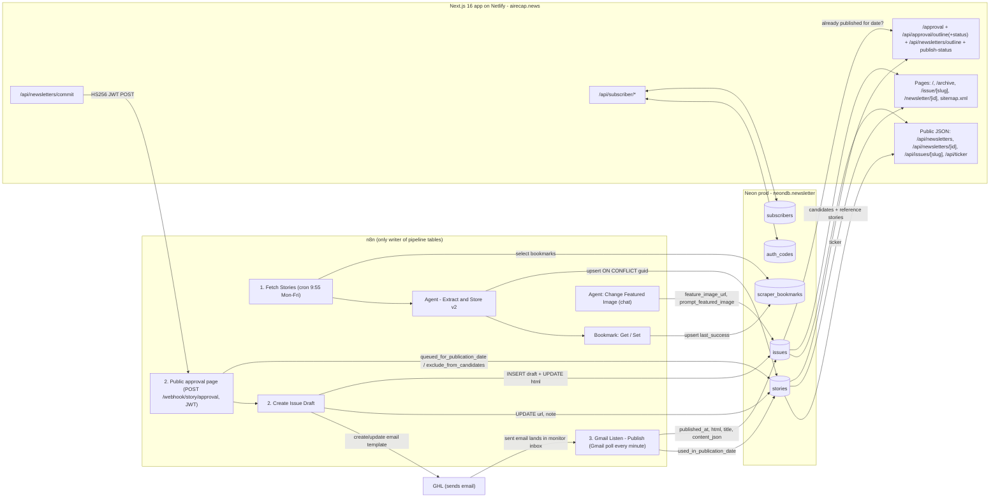

# 50: Website and Neon database (the shared data model)

Scope: the Neon Postgres database that n8n and the Next.js app share (schemas `newsletter` and `public`), the live schema compared with `prisma/`, which workflow or route touches each table, and how airecap.news renders published issues and stories. It also maps the app code (`app/`, `src/`) and says where a native pipeline would plug in.

Evidence used: read-only queries against the prod and dev branches on 2026-11-03 (`db_ro.sh`), the repo at the current `main` commit, the workflow JSON exports, `executions.json`, `credentials.json` (names and types only), and one error execution payload. No writes, no webhook calls, no git commands.

---

## At a glance

- **One Neon project, two branches.** Project `damp-boat-84187674`, database `neondb`, Postgres 17.11, server TimeZone `GMT`. The prod branch is `br-still-night-ahm61f86` and dev is `br-proud-rice-ahqxhx5i`. Dev was forked from prod around **2026-06-29 16:17 UTC** and has received no pipeline data since then. The two branches have identical schema and grants.
- **Five app tables in `newsletter`, and no foreign keys anywhere.** `stories` (6,788 rows), `issues` (185), `scraper_bookmarks` (9), `subscribers` (38), `auth_codes` (3). There are no views, no enums and no FKs. There is one CHECK, on `subscribers.status`. `issues.slug` is a STORED generated column computed by `newsletter.slugify_issue_title(title)`.
- **Who writes what.** n8n is the only writer of `stories`, `issues` and `scraper_bookmarks`. The app only reads those three. It writes only `subscribers` and `auth_codes`. Every n8n Postgres node uses the same credential id, `uc4xRng0SsLcVsOO`. Most nodes label it "Newsletter Neon Production". The two Bookmark workflows still show its old cached name, "Newsletter Production Bot".
- **The site renders `content_json`, never `issues.html`.** An issue is listed only when `published_at IS NOT NULL AND content_json IS NOT NULL`. `content_json` is written at publish time by an LLM (`gpt-5.4`) that parses the sent email's HTML back into JSON (`3. Gmail Listen - Publish`).
- **No join table between issues and stories.** The link lives only in `content_json.<section>[].story_id` and in `stories.used_in_publication_date`. That column is a **date** set to `CURRENT_TIMESTAMP` in UTC, not an issue id.
- **Prisma migration drift.** On both branches `_prisma_migrations` records only `0_init`. `20260630000000_add_story_paywall_note_error` was applied by hand, and its columns exist. `prisma migrate deploy` will fail with "column already exists", and `migrate dev` may offer to reset the dev database.
- **Caching never invalidates.** Issue-by-slug, issue-by-id and the sitemap use `unstable_cache` for 1 h. The ticker caches for 5 min. There are no cache tags and no revalidation calls. Lists are uncached (`no-store`). Nothing tells the site that an issue was published.
- **App to n8n contract.** `POST /api/newsletters/commit` signs an HS256 JWT and POSTs the approved outline to `https://n8n.velocityalpha.com/webhook/story/approval`. n8n never calls the app's API. It only sends a Telegram link to `/approval?date=` and builds email images through `https://airecap.news/.netlify/images`.
- **Data quirks a rebuild must handle.** Source keys drift (`rundown` / `rundown_ai` / `Rundown`, `aloa` / `aloa_ai`). `guid = md5(day || url)`, so the same URL on a new day becomes a new story (369 URLs repeat). 247 stories were queued but never published. 10 issue dates have only abandoned drafts.
- **Schema the native pipeline is missing.** A source registry, job runs, a raw-ingest log keyed by message id, an issue status field and an `issue_stories` table, a persisted approval outline, an LLM call log, an audit log, an index on `stories(day)`, and a rule allowing one published issue per day.



---

## 1. Neon topology, roles and credentials

### 1.1 Branches

| | prod | dev |
|---|---|---|
| `neon.project_id` | `damp-boat-84187674` | `damp-boat-84187674` (same) |
| `neon.tenant_id` | same | same |
| `neon.branch_id` | `br-still-night-ahm61f86` | `br-proud-rice-ahqxhx5i` |
| Database / owner | `neondb` / `neondb_owner` (20 MB) | `neondb` / `neondb_owner` |
| Latest story `createdAt` | 2026-11-03 14:56 UTC | 2026-06-29 16:17 UTC |
| Rows: stories / issues / subscribers / auth_codes / bookmarks | 6788 / 185 / 38 / 3 / 9 | 3377 / 101 / 28 / 9 / 8 |
| Used by | n8n (all pipeline workflows), Netlify app, local `PRODUCTION_DATABASE_URL` | local `.env.local` `DATABASE_URL` only |

**Is dev a Neon branch of prod? Yes, a child branch.** The evidence:

- Same project and tenant, different branch and timeline.
- Dev's `_prisma_migrations` row has the same UUID as prod's (`61fc4611-…`) and the same `started_at` (2026-04-04 19:03:36).
- Prod rows with `createdAt <= 2026-06-29 16:17:03Z` match dev exactly: 3,377 stories with max id 7,267, and 101 issues with max id 181.

No workflow uses the "Newsletter Neon Development" credential, so dev has been frozen since the fork. Dev also lacks the `tldr` bookmark row, which was added to prod later.

### 1.2 Roles (identical on both branches)

| Role | Login | Notable attributes | Privileges in `newsletter` | Probable owner/user |
|---|---|---|---|---|
| `neondb_owner` | yes | CREATEROLE, CREATEDB, BYPASSRLS. Member of `neon_superuser`, `newsletter_bot`, `newsletter_web`, `borna`, `franca` | Owns every object | Admin. Local `.env.local` uses it for both `DATABASE_URL` (dev) and `PRODUCTION_DATABASE_URL` (prod); verified with `current_user` |
| `newsletter_web` | yes | none | USAGE on schema. SELECT/INSERT/UPDATE/DELETE on all 5 tables. `rwU` on sequences | Netlify app runtime, per README and `prisma/bootstrap/001_grant_newsletter_web.sql`. Not verifiable from SQL |
| `newsletter_bot` | yes | none | **USAGE + CREATE** on schema. SELECT/INSERT/UPDATE/DELETE on all 5 tables. `U` only on sequences | Most likely the n8n credential (see 1.3) |
| `borna`, `franca` | yes | none | USAGE on schema, DML on all tables, `rwU` on sequences | Humans |
| `cloud_admin`, `neon_service`, `neon_superuser` | - | Neon-managed | - | Neon internals. `pg_stat_activity` shows a `pg_cron scheduler` worker, but the `pg_cron` extension is **not** installed in `neondb` |

Default privileges set by `neondb_owner` in `newsletter`: tables `arwd` to `newsletter_bot`, `newsletter_web`, `borna` and `franca`. Sequences `U` to `newsletter_bot` and `rwU` to the other three. Any new table is automatically writable by all four roles, **including access to subscriber PII**.

### 1.3 Credential to role mapping

| n8n credential (name / id) | Type | Used by | DB role |
|---|---|---|---|
| "Newsletter Neon Production" / `uc4xRng0SsLcVsOO` (created 2026-01-30 22:20, renamed 22:28) | postgres | Every Postgres node in all 18 Neon-touching workflows: Fetch Stories, Extract and Store (v1/v2/Generic), Public approval page, Create Issue Draft, Compile Draft Stories, Gmail Listen - Publish, Change Featured Image, Backfill Article, and the legacy Fetch Newsletters / Upload to GHL variants | **Unresolved.** No metadata exposes the user. Best inference is `newsletter_bot`: the credential's original name was "Newsletter Production Bot", and that role is the only non-owner one with CREATE on the schema. To confirm, read the credential's User field in the n8n UI. |
| "Newsletter Production Bot" | (same id `uc4xRng0SsLcVsOO`) | `Bookmark: Get`, `Bookmark: Set` | Same credential. The name is stale and cached in the node JSON. It is **not** a separate credential and does not appear in `credentials.json`. |
| "Newsletter Neon Development" / `DHUSjAAqTaDgWzVE` (created 2025-11-13) | postgres | **No workflow** | Unknown. It may predate the current dev branch. |
| App `DATABASE_URL` (Netlify) | - | Prisma via `pg.Pool` + `@prisma/adapter-pg` (SSL with `rejectUnauthorized:false`) | `newsletter_web` per docs (unverified) |

`pg_stat_statements` is not installed, so queries cannot be attributed to roles after the fact.

---

## 2. Live schema (prod; dev identical)

Prod and dev were diffed on `information_schema.columns`, `pg_constraint`, `pg_indexes`, the md5 of each `pg_get_functiondef`, `information_schema.triggers`, the relation ACLs and the default ACLs. **There are no differences.**

### 2.1 `newsletter.stories` (6,788 rows; sequence last value 11,034)

| # | Column | Type | Null | Default | Meaning / writer |
|---|---|---|---|---|---|
| 1 | `id` | int4 | NO | `nextval('newsletter.stories_id_seq')` | PK `stories_pkey`. 32-bit sequence |
| 2 | `guid` | text | yes | - | UNIQUE `stories_guid_key`. MD5 hex (32 chars, 100% of rows) of the string `"{story.published_at} \|\| {story.cleanedUrl}"`, computed by the n8n `Crypto` node in *Agent - Extract and Store v2*. It is the upsert conflict key |
| 3 | `day` | date | yes | - | Story date taken from the source item's `published_at`. Drives the candidate window and the ticker. **No index** |
| 4 | `headline` | text | yes | - | Average 43 chars, max 117 |
| 5 | `url` | text | yes | - | Canonical/cleaned source URL. 137 rows are null or empty. Overwritten by *Create Issue Draft* when the editor overrides a URL |
| 6 | `summary` | text | yes | - | Average 200 chars, max 409 |
| 7 | `category` | text | yes | - | Free text with no CHECK. Observed values: Tools, Research, Industry, Launches, Analysis, Funding, Policy, Community, Culture, Headlines |
| 8 | `source` | text | yes | - | Source key, matching `scraper_bookmarks.source` (see 4.1). No CHECK and no FK |
| 9 | `"createdAt"` | timestamptz | yes | `now()` | **Quoted camelCase** |
| 10 | `"updatedAt"` | timestamptz | yes | `now()` | Maintained by trigger `stories_updatedat` |
| 11 | `story_details` | text | yes | - | LLM-extracted detail. Average 399 chars, max 1,852 |
| 12 | `importance_score` | int2 | yes | - | LLM score from 1 to 5 |
| 13 | `used_in_publication_date` | date | yes | - | Set by *3. Gmail Listen - Publish* to `CURRENT_TIMESTAMP`, cast to a UTC date |
| 14 | `queued_for_publication_date` | date | yes | - | Set by *2. Public approval page* to the approval `date`. Index `queued_for_publication_date_idx`. The app never reads it |
| 15 | `exclude_from_candidates` | bool | yes | `false` | Set to true for editor-excluded stories. 114 rows are true and none are null |
| 16 | `note` | text | yes | - | Editor note from the approval board. *Create Issue Draft* writes `''` when there is no note: 1,679 rows are empty and 3 have real text |
| 17 | `paywall_detected` | text | yes | - | Values `yes`, `no`, `unknown` or `error`, enforced by n8n only. Populated from 2026-06 onward |
| 18 | `error` | text | yes | - | Format `"<httpStatus>+<code>"` from *Check for Paywalls*, e.g. `403+ERR_BAD_REQUEST` (600 rows), or `''` |

### 2.2 `newsletter.issues` (185 rows; sequence last value 268, so 74 rows have been deleted)

| # | Column | Type | Null | Default | Meaning / writer |
|---|---|---|---|---|---|
| 1 | `id` | int8 | NO | `nextval('newsletter.issues_id_seq')` | PK. Embedded in the email as `data-issue-id`. It is the join key used at publish |
| 2 | `title` | text | NO | - | Set at draft from the LLM title. **Overwritten at publish** with the title parsed from the email, emoji stripped |
| 3 | `published_at` | timestamptz | yes | - | The `Date` header of the email received in the monitor inbox. NULL means draft |
| 4 | `created_at` | timestamptz | NO | `now()` | Index `issues_created_at_idx` (DESC) |
| 5 | `html` | text | yes | - | Email HTML. The draft holds GHL's "clean HTML email". At publish it is replaced by the received email's HTML. **The site never renders it** |
| 6 | `feature_image_url` | text | yes | - | Raw S3 URL, `https://velocity-alpha-public-assets.s3.amazonaws.com/newsletter/gemini-<ISO>.jpeg` |
| 7 | `excerpt` | text | yes | - | **Always NULL** (0 of 185) |
| 8 | `content_json` | jsonb | yes | - | Render model. NULL for every unpublished draft. v2 has `schemaVersion: 2`; v1 is legacy |
| 9 | `issue_date` | date | yes | - | The approval date, set by *Create Issue Draft* |
| 10 | `prompt_featured_image` | text | yes | - | Image prompt used for the featured image |
| 16 | `slug` | text | yes | **`GENERATED ALWAYS AS (COALESCE(newsletter.slugify_issue_title(title), (id)::text)) STORED`** | UNIQUE `issues_slug_key` |
| 18 | `note` | text | yes | - | Never set (0 of 185) |

Attribute numbers 11–15 and 17 are dropped columns: six were dropped before the Prisma baseline, and their names are not recoverable. Constraints: `issues_pkey`, `issues_slug_key UNIQUE(slug)`, `issues_title_published_unique UNIQUE(title, published_at)`. Indexes: `issues_created_at_idx (created_at DESC)`, `issues_published_at_idx (published_at DESC)`. **No `updated_at`, no trigger, and nothing stops two published issues having the same `issue_date`.**

### 2.3 `newsletter.scraper_bookmarks` (9 rows)

| Column | Type | Null | Notes |
|---|---|---|---|
| `source` | text | NO | PK |
| `last_success` | timestamptz | NO | Set to `$now` by *Bookmark: Set* after each *Extract and Store v2* run for that source |

Current prod rows:

| source | last_success (UTC) |
|---|---|
| ai_breakfast | 2026-11-03 14:55:43 |
| aloa_ai | 2026-04-27 13:45:23 (stale) |
| alphasignal | 2026-11-03 14:56:04 |
| huggingface | 2026-11-03 14:56:15 |
| product_hunt_ai | 2026-11-03 14:55:56 |
| rundown_ai | 2026-11-03 14:55:20 |
| the_signal | 2026-06-29 13:45:24 (stale) |
| tldr | 2026-11-03 14:55:51 (written, but *Fetch Stories* has no `Get Bookmark` node for `tldr`) |
| tldr_ai | 2026-11-03 14:55:28 |

The table has had 11,119 updates and 14 deletes since stats began.

### 2.4 `newsletter.subscribers` (38 rows; app-owned)

| Column | Type | Null | Default |
|---|---|---|---|
| `id` | int8 | NO | `GENERATED ALWAYS AS IDENTITY` (`subscribers_id_seq`) |
| `email` | text | NO | - (UNIQUE `subscribers_email_key`) |
| `status` | text | NO | `'active'`, with CHECK `subscribers_status_check`: `status = ANY (ARRAY['active','unsubscribed'])` |
| `source` | text | NO | `'article_gate'` |
| `subscribed_at` | timestamptz | NO | `now()` |
| `last_seen_at` | timestamptz | yes | - |
| `created_at` | timestamptz | NO | `now()` |
| `updated_at` | timestamptz | NO | `now()`, maintained by trigger `subscribers_updatedat` |
| `first_name` | text | yes | - |

Index `subscribers_status_idx (status)`. One column was dropped (attnum 5). Aggregates: `active/homepage` 19, `active/ghl_import` 9, `active/article_gate` 3, `unsubscribed/homepage` 6, `unsubscribed/ghl_import` 1. This table only gates article access. GHL and Beehiiv hold the real mailing list.

### 2.5 `newsletter.auth_codes` (3 rows; app-owned OTP)

`id int8 GENERATED ALWAYS AS IDENTITY`, `email text NOT NULL`, `code_hash text NOT NULL`, `purpose text NOT NULL DEFAULT 'sign_in'`, `expires_at timestamptz NOT NULL`, `consumed_at timestamptz`, `request_ip text`, `request_user_agent text`, `created_at timestamptz NOT NULL DEFAULT now()`. Index `auth_codes_email_expires_idx (email, expires_at DESC)`. Expired codes are deleted by the app (19 deletes so far).

### 2.6 `public` schema

| Object | Notes |
|---|---|
| `public._prisma_migrations` | Prisma's own table. One row: `0_init`, applied_steps_count 0, written by `migrate resolve --applied` on 2026-04-04 and inherited by dev through the branch |
| `public.schema_migrations(filename text PK, applied_at timestamptz NOT NULL DEFAULT now())` | Empty legacy tracker from before Prisma. Still modelled in `schema.prisma` as `model schema_migrations` |
| `public.show_db_tree()` | A plpgsql helper that prints the database tree. It is Neon's sample/console function and is **not** in any migration |

### 2.7 Functions, triggers, sequences, extensions

`newsletter.slugify_issue_title`, verbatim from the live database:

```sql
CREATE OR REPLACE FUNCTION newsletter.slugify_issue_title(input text)
 RETURNS text
 LANGUAGE sql
 IMMUTABLE STRICT
AS $function$
  SELECT NULLIF(
    trim(both '-' FROM
      regexp_replace(
        regexp_replace(
          regexp_replace(
            lower(input),
            '[''’‘`´]+', '', 'g'      -- Apple's -> apples
          ),
          '\s*&\s*', ' and ', 'g'     -- A & B -> A and B
        ),
        '[^a-z0-9]+', '-', 'g'        -- collapse everything else to hyphens
      )
    ),
    ''
  );
$function$
```

Trigger functions. There are two, one for each column-naming convention:

```sql
CREATE OR REPLACE FUNCTION newsletter.update_updated_at_column() RETURNS trigger LANGUAGE plpgsql AS $function$
BEGIN
    NEW.updated_at = NOW();
    RETURN NEW;
END;
$function$;

CREATE OR REPLACE FUNCTION newsletter.update_updatedat_column() RETURNS trigger LANGUAGE plpgsql AS $function$
BEGIN
    NEW."updatedAt" = NOW();
    RETURN NEW;
END;
$function$;
```

| Trigger | Table | Timing | Function |
|---|---|---|---|
| `stories_updatedat` | stories | BEFORE UPDATE, FOR EACH ROW | `update_updatedat_column()` |
| `subscribers_updatedat` | subscribers | BEFORE UPDATE, FOR EACH ROW | `update_updated_at_column()` |

Sequences (all start 1, increment 1, cache 1):

| Sequence | Type | Last value (prod) | Last value (dev) |
|---|---|---|---|
| `issues_id_seq` | bigint | 268 | 181 |
| `stories_id_seq` | **integer** | 11,034 | 7,271 |
| `subscribers_id_seq` (identity) | bigint | 50 | 35 |
| `auth_codes_id_seq` (identity) | bigint | 22 | 16 |

Extensions in `neondb`: **`plpgsql` only**. `pgvector`, `pg_trgm`, `pgcrypto`, `pg_cron` and `pg_stat_statements` are not installed. There are no views, no materialized views, no enums, no RLS, and no SECURITY DEFINER functions.

---

## 3. Drift: live database vs `prisma/schema.prisma`, migrations, bootstrap and docs

| # | Item | Live | Repo | Impact / fix |
|---|---|---|---|---|
| 1 | Migration `20260630000000_add_story_paywall_note_error` | Columns `stories.note`, `paywall_detected`, `error` and `issues.note` exist on prod and dev | Committed migration, **not recorded** in `_prisma_migrations` on either branch | `npm run prisma:migrate:prod:deploy` will try `ALTER TABLE … ADD COLUMN "note"` and fail, because the migration has no `IF NOT EXISTS`. `prisma migrate dev` against dev will see an unapplied migration or drift and may suggest **resetting the database**. Fix this per branch with `prisma migrate resolve --applied 20260630000000_add_story_paywall_note_error` before any new migration. That is the owner's call: it is a write. |
| 2 | `issues.slug` | `GENERATED ALWAYS … STORED` | `String? @unique @default(dbgenerated("COALESCE(newsletter.slugify_issue_title(title), (id)::text)"))` | Prisma has no generated-column support, so `slug` appears as a writable optional field. Any `create`/`update` that sets it fails at runtime with "cannot insert a non-DEFAULT value into column slug". **Never write `slug`.** Run `prisma migrate diff` before relying on Migrate here. |
| 3 | `subscribers.id`, `auth_codes.id` | `GENERATED ALWAYS AS IDENTITY` | `@default(autoincrement())` | Explicit id inserts fail. Normal Prisma creates are fine. `0_init` reproduces these correctly. |
| 4 | Naming | `stories."createdAt"`/`"updatedAt"` (camelCase) vs snake_case everywhere else | Prisma fields `createdAt`/`updatedAt` without `@map` | Two trigger functions exist for the two conventions. Renaming needs an expand/contract migration, because n8n nodes reference the column names. |
| 5 | CHECK on `subscribers.status` | present | Prisma comment only | Prisma cannot model it. It is preserved in `0_init`. |
| 6 | `public.schema_migrations`, `public.show_db_tree()` | present | Model exists for `schema_migrations`; the function is not tracked | Legacy and harmless. Candidates for cleanup. |
| 7 | Dropped columns | 6 on issues, 1 on subscribers | not in migrations (pre-baseline) | None. Just explains the attnum gaps. |
| 8 | Bootstrap grants | `newsletter_web` matches `001_grant_newsletter_web.sql`. `newsletter_bot`, `borna` and `franca` have grants that **no repo script** creates | Bootstrap covers only `newsletter_web` | Grants for the n8n and human roles are unmanaged manual state. Reproduce them if the database is ever rebuilt. |
| 9 | Env var docs | Code reads `OPENAI_API_KEY` (`openai` SDK, Responses API, `gpt-4o-mini`) | README and `.env.local.example` list `OPENROUTER_API_KEY` and `OPENROUTER_DEDUP_TIMEOUT_MS`. The `@openrouter/sdk` dependency is unused | If Netlify only has `OPENROUTER_API_KEY`, dedup submission throws. It is caught, so the outline comes back undeduplicated (`status: "ready"`). Open question below. |
| 10 | `.agents/AGENTS.md` | - | Says "Netlify Functions backend" | Outdated. The README says hand-written Netlify Functions are gone. |
| 11 | n8n vs app curation logic | - | n8n *Compile Draft Stories* filters `url NOT ILIKE '%beehive%'` (a typo that never matches); the app filters `beehiiv`. n8n's reference lookback is always 2 days; the app uses 3 on Mondays. n8n *Build Final Stories* allows `tools: 6`; the app's `section-config.ts` allows `tools: 3` | The live path is app curation followed by n8n *Public approval page*, so the n8n tools limit of 6 is what gets enforced at commit. *Compile Draft Stories* has 0 recorded runs: it only runs when `from_telegram` is false. |
| 12 | `0_init` header | "Dumped from database version 17.8" | - | Live is 17.11. Harmless. |

---

## 4. Data profile (prod, 2026-11-03)

### 4.1 Stories by source

| source | rows | first `day` | last `day` | avg importance | used in an issue |
|---|---|---|---|---|---|
| tldr_ai | 1,192 | 2025-09-01 | 2026-11-03 | 3.03 | 523 |
| tldr | 1,055 | 2026-02-23 | 2026-11-03 | 2.92 | 297 |
| rundown_ai | 949 | 2026-02-02 | 2026-11-03 | 3.16 | 464 |
| product_hunt_ai | 927 | 2026-03-27 | 2026-11-03 | 2.13 | 99 |
| ai_breakfast | 826 | 2026-03-18 | 2026-11-02 | 3.14 | 331 |
| alphasignal | 596 | 2026-05-31 | 2026-11-03 | 2.92 | 212 |
| huggingface | 464 | 2026-05-07 | 2026-11-02 | 3.02 | 147 |
| aloa_ai | 217 | 2026-03-01 | 2026-04-24 | 3.18 | 49 |
| aloa | 190 | 2026-02-18 | 2026-03-17 | 3.20 | 89 |
| rundown | 158 | 2026-02-06 | 2026-03-19 | 3.35 | 84 |
| beehiiv | 79 | 2026-02-27 | 2026-03-16 | 3.57 | 28 |
| the_signal | 59 | 2026-02-22 | 2026-06-28 | 3.73 | 30 |
| beehiiv_ai_breakfast | 34 | 2026-01-31 | 2026-02-25 | 3.68 | 21 |
| bytesizedata | 27 | 2026-02-12 | 2026-02-19 | 3.48 | 15 |
| Rundown | 15 | 2026-02-17 | 2026-02-20 | 3.33 | 11 |

Seven sources are active now: tldr_ai, tldr, rundown_ai, product_hunt_ai, ai_breakfast, alphasignal and huggingface. The other keys are historical aliases. A source registry should map aliases to one canonical source.

Since 2026-08-01, each source tends toward a few categories:

- huggingface is about 98% Research.
- product_hunt_ai is about 82% Tools and 16% Launches.
- alphasignal is mostly Tools and Research.
- tldr, rundown_ai and ai_breakfast are mixed.

### 4.2 Categories and importance

| category | rows | avg importance |
|---|---|---|
| Tools | 2,383 | 2.33 |
| Research | 1,357 | 3.10 |
| Industry | 934 | 3.74 |
| Launches | 729 | 3.63 |
| Analysis | 429 | 2.17 |
| Funding | 362 | 3.82 |
| Policy | 301 | 3.77 |
| Community | 166 | 2.01 |
| Culture | 91 | 2.10 |
| Headlines | 36 | 3.58 |

| importance_score | rows | used | used % |
|---|---|---|---|
| 1 | 283 | 0 | 0% (filtered out by `>= 2`) |
| 2 | 2,438 | 388 | 16% |
| 3 | 1,850 | 716 | 39% |
| 4 | 1,794 | 1,036 | 58% |
| 5 | 423 | 260 | 61% |

App bucket mapping (`curation.service.ts`): `research`/`analysis` go to the Research bucket, `tools`/`tool` to Tools, and everything else to "general", which feeds both headlines and quick hits.

### 4.3 Flags and state combinations

- Null counts: `guid`, `day`, `headline`, `summary`, `story_details`, `importance_score` and `category` are never null. `url` is null or empty on 137 rows.
- `paywall_detected`: `unknown` 2,540, `error` 695, `yes` 171, `no` 134, NULL 3,248. The NULLs are all stories created before 2026-06.
- Non-empty `error` on 695 rows. Values:

  | error | rows |
  |---|---|
  | `403+ERR_BAD_REQUEST` | 600 |
  | `undefined+undefined` | 59 |
  | `400+ERR_BAD_REQUEST` | 12 |
  | `undefined+HPE_HEADER_OVERFLOW` | 12 |
  | `404+ERR_BAD_REQUEST` | 4 |
  | `undefined+ETIMEDOUT` | 2 |
  | others | 1 each |

- `note` has real text on 3 rows.

| exclude_from_candidates | used | queued | rows |
|---|---|---|---|
| f | f | f | 4,065 (never selected) |
| f | f | t | **210 (approved, issue never published; these remain candidates)** |
| f | t | f | 631 (published before the queue column existed) |
| f | t | t | 1,768 |
| t | f | f | 76 |
| t | f | t | 37 |
| t | t | t | 1 |

`queued_for_publication_date - used_in_publication_date`: 0 days for 1,704 rows. The rest range from -27 to +6 days, from re-drafts, late publishes and the UTC date cast.

### 4.4 Volume and timing

| month (by `day`) | days with stories | avg per day | min | max | avg used per day |
|---|---|---|---|---|---|
| 2026-08 | 28 | 26.1 | 1 | 59 | 7.3 |
| 2026-09 | 29 | 28.5 | 1 | 67 | 7.3 |
| 2026-10 | 30 | 29.0 | 1 | 57 | 7.8 |

- Since 2026-06-01, stories per calendar day average Mon 35.9, Tue 29.6, Wed 40.5, Thu 32.6, Fri 36.2, Sat 1.7 and Sun 2.4. The weekend `day` values come from weekend emails ingested on Monday.
- Monthly totals: Feb 630, Mar 779, Apr 796, May 547, Jun 606, Jul 884, Aug 732, Sep 826, Oct 869.
- Ingest lag (`createdAt` in Toronto time minus `day`, since Aug) is 0 days for 1,801 rows, 1 day for 354, and 2–20 days for the rest.
- Publication lag (`used_in_publication_date - day`) is 0–3 days for 98% of rows.
- 369 URLs appear on more than one story row (901 rows; max 21 rows for one producthunt.com URL), because `guid` includes the day. 71 URLs were published on more than one date.
- Top hosts since August:

  | host | stories |
  |---|---|
  | producthunt.com | 415 |
  | huggingface.co | 377 |
  | github.com | 140 |
  | arxiv.org | 134 |
  | x.com | 99 |
  | openai.com | 95 |
  | anthropic.com | 67 |
  | techcrunch.com | 66 |

- `stories` write stats since stats began: 6,822 inserts, 12,770 updates and 34 deletes. Half of all rows (3,281) were updated more than 1 minute after insert, by upserts or state changes.

### 4.5 Issues

| month | rows | published | html | content_json | image | prompt | excerpt | note |
|---|---|---|---|---|---|---|---|---|
| 2026-02 | 7 | 6 | 7 | 7 | 7 | 1 | 0 | 0 |
| 2026-03 | 27 | 23 | 25 | 23 | 27 | 24 | 0 | 0 |
| 2026-04 | 24 | 21 | 22 | 21 | 24 | 24 | 0 | 0 |
| 2026-05 | 21 | 17 | 21 | 17 | 21 | 21 | 0 | 0 |
| 2026-06 | 24 | 21 | 24 | 21 | 24 | 24 | 0 | 0 |
| 2026-07 | 22 | 18 | 22 | 18 | 22 | 22 | 0 | 0 |
| 2026-08 | 17 | 14 | 17 | 14 | 17 | 17 | 0 | 0 |
| 2026-09 | 19 | 18 | 19 | 18 | 19 | 19 | 0 | 0 |
| 2026-10 | 22 | 19 | 22 | 19 | 22 | 22 | 0 | 0 |
| 2026-11 | 2 | 2 | 2 | 2 | 2 | 2 | 0 | 0 |

- **159 published issues and 26 unpublished drafts.** Every draft has `content_json` NULL (one exception: id 32 has v1 JSON but no `published_at`).
- Issues per `issue_date`: 154 dates have 1 row, 14 have 2 and 1 has 3. **No date has two published issues**, but no constraint enforces that. 10 dates have only drafts.
- Schema versions: v1 on 25 issues (2026-02-23 to 2026-03-25, keys `topStories`, `research`, `tools`, `quickHits`, `overview{summary,highlights}`, `caption`, `imageUrl`, `data-issue-id`). v2 on 135 issues (2026-03-14 onward).
- v2 integrity: `date = issue_date`, `issue_id = id` and `title = title` on all 135. Average items per issue:

  | section | avg items |
  |---|---|
  | headlines | 2.9 |
  | research_and_analysis | 3.3 |
  | tools | 2.8 |
  | quick_hits | 4.3 (max 6) |

  All 1,794 referenced `story_id`s exist in `stories` and have `used_in_publication_date` set. 57 of them carry a different date from `issue_date`.
- Publish time (Toronto, from the `Date` header): mostly 10:00–12:59 (110 of 159), 8 at 20:00. Publish date minus `issue_date`: 0 days for 149, -1 for 8 (backfills; for those 8, `published_at` is earlier than `created_at`). The median gap from draft creation to publish is 24 minutes.
- Sizes: `html` averages 44.7 KB (max 59.9 KB). `content_json` averages 9.3 KB (max 23.9 KB).
- Images: the `feature_image_url` column holds raw S3 URLs (178 under the `/newsletter/` prefix). `content_json.featured_image_url` holds the Netlify Image CDN URL for all 135 v2 issues: `https://airecap.news/.netlify/images?w=600&q=70&url=<s3>`.
- Write stats: 267 inserts, 478 updates and 74 deletes.

---

## 5. Who reads and writes each table

### 5.1 Matrix

| Table | n8n writers (active) | n8n readers (active) | App readers | App writers |
|---|---|---|---|---|
| `stories` | *Agent - Extract and Store v2* (`Upsert Stories`). *2. Public approval page* (`Update Stories: Queue for Publication`, `Update Stories: Mark stories as excluded`). *2. Create Issue Draft* (`Update Stories`: url, note). *3. Gmail Listen - Publish* (`Update stories table`). *2.1 Sub: Compile Draft Stories* (queue/exclude; 0 runs). *Agent - Extract and Store* v1 (`Upsert Stories`, **disabled node**) | *2.1 Sub: Compile Draft Stories* (two SELECTs; 0 runs) | `curation.service.ts` (candidates + references: `/api/approval/outline`, `/status`, `/api/newsletters/outline`). `repository.fetchTickerFeed` (`/`, `/api/ticker`) | none |
| `issues` | *2. Create Issue Draft* (`Insert to Issues Table`, `Update to Issues Table1`; `Update to Issues Table` is wired to an orphan branch and dead). *3. Gmail Listen - Publish* (`Update Issue`). *Agent: Change Featured Image* (`Update Issue Image URL…` plus **free-form LLM SQL**) | *Agent: Change Featured Image* (`$fromAI('sql_query')`) | `repository.ts` (list, sitemap entries, by id, by slug, last-published-on-or-before) | none |
| `scraper_bookmarks` | *Bookmark: Set* (upsert on `source`) | *1. Fetch Stories* (8 `Get Bookmark:` selects), *Bookmark: Get* | none | none |
| `subscribers` | none | none | `features/subscriber/server.ts` | upsert, touch `last_seen_at`, mark unsubscribed |
| `auth_codes` | none | none | `features/subscriber/server.ts` | create, consume, delete, cleanup |

Inactive workflows that also touch these tables: *1. Fetch Newsletters* and its copies, *Fetch Stories - Product Hunt Branch* (bookmarks), *Backfill Article* (stories select/update plus LLM SQL), *2. Sub: Create Issue (Upload to GHL)* (issues upsert/update), and *Agent - Extract and Store - Generic Source* (stories upsert).

### 5.2 n8n SQL against the tables (active workflows, verbatim)

Every active n8n Postgres node has `onError`, `retryOnFail` and `continueOnFail` unset, so any SQL error fails the execution. `alwaysOutputData: true` is set on the bookmark selects and on the queue and exclude updates. No workflow has an `errorWorkflow`.

**Agent - Extract and Store v2 → `Upsert Stories`.** Postgres node `upsert`, matching column `guid`, `queryBatching: single`. Column mapping:

```
guid             = {{ $json.guid }}                      -- md5("{published_at} || {cleanedUrl}") from Crypto node
day              = {{ $json.story.published_at }}
headline         = {{ $json.story.headline }}
url              = {{ $json.story.cleanedUrl }}
summary          = {{ $json.story.summary }}
category         = {{ $json.story.category }}
source           = {{ $('When Executed by Another Workflow').first().json.source }}
story_details    = {{ $json.story.story_detail }}
importance_score = {{ $json.story.importance_score }}
paywall_detected = {{ $json.story.hasPaywall === null ? 'unknown' : $json.story.hasPaywall === 'error' ? 'error' : $json.story.hasPaywall ? 'yes' : 'no' }}
error            = {{ $json.story.error }}
```

This is effectively `INSERT … ON CONFLICT (guid) DO UPDATE SET <all mapped columns>`. A re-ingest overwrites the LLM fields. It does not touch `used_in_publication_date`, `queued_for_publication_date`, `exclude_from_candidates` or `note`.

**Bookmark: Set.** Upsert on `source`, setting `source = {{ $json.source }}` and `last_success = {{ $now.toISO() }}`.

**1. Fetch Stories / Bookmark: Get.** Postgres `select` on `newsletter.scraper_bookmarks WHERE source = <literal>`. The literals are `the_signal`, `aloa_ai`, `rundown_ai`, `ai_breakfast`, `tldr_ai`, `product_hunt_ai`, `alphasignal` and `huggingface`. *Bookmark: Get* uses `{{ $json.source }}`.

**2. Public approval page → `Grab all story ids` (Code)** builds
`UPDATE newsletter.stories SET queued_for_publication_date = <date>::timestamptz WHERE id IN (<ids>) RETURNING id;`
(or `SELECT 0::int AS updated_count` when there are no ids). The ids are coerced to positive integers. Then `Update Stories: Queue for Publication` runs `{{ $json.queue_query }}`. `Update Stories: Mark stories as excluded` is an `update` with `exclude_from_candidates = true` matching `id = {{ $json.excluded_id.id }}`.

**2. Create Issue Draft:**

- `Insert to Issues Table` inserts `feature_image_url = s3_image_url.trim()`, `prompt_featured_image = image_prompt_dynamic`, `issue_date = <input date>` and `title = <LLM 'Reformat Stories for Issue' title>`, returning `id`.
- `Update to Issues Table1` updates `html` (from `Build Clean HTML Email`), `title` and `issue_date` where `id` equals the inserted id.
- `Update Stories` updates `url` and `note` where `id` matches, once per approved story.

**3. Gmail Listen - Publish → `Update Issue`.** The values are base64 so the SQL can be fully parameterised:

```sql
WITH
params AS (
  SELECT
    $1::text        AS email_html_b64,
    $2::text        AS issue_title_b64,
    $3::text        AS content_json_b64,
    $4::timestamptz AS email_received_at,
    $5::integer     AS issue_id
),
target AS (
  SELECT i.id
  FROM newsletter.issues i
  CROSS JOIN params p
  WHERE i.id = p.issue_id
  ORDER BY
    ABS(EXTRACT(EPOCH FROM (i.published_at - p.email_received_at))) NULLS LAST,
    i.created_at DESC
  LIMIT 1
)
UPDATE newsletter.issues i
SET
  published_at = p.email_received_at,
  html = convert_from(decode(p.email_html_b64, 'base64'), 'UTF8'),
  title = convert_from(decode(p.issue_title_b64, 'base64'), 'UTF8'),
  content_json = (convert_from(decode(p.content_json_b64, 'base64'), 'UTF8'))::jsonb
FROM target t
JOIN params p ON TRUE
WHERE i.id = t.id
RETURNING i.*;
```

The `queryReplacement` parameters are `html_b64`, `title_b64`, `content_json_b64`, the Gmail `headers.date` converted with `toISO()`, and `issue_id`. `issue_id` comes from the LLM-parsed `data-issue-id`. If the LLM gets it wrong, the wrong issue is updated, or zero rows are updated silently. The `ORDER BY` is redundant because `id` is unique.

**3. Gmail Listen - Publish → `Update stories table`.** Runs once per `story_id` found in the parsed JSON:

```sql
UPDATE newsletter.stories
SET used_in_publication_date = CURRENT_TIMESTAMP
WHERE id = $1::INTEGER
RETURNING *;
```

**2.1 Sub: Compile Draft Stories** (active, but never runs in the current path):

```sql
-- Get Recently Published Stories
SELECT DISTINCT ON (guid)
    id, guid, day, headline, url, summary, category, source, story_details, importance_score
FROM newsletter.stories
WHERE used_in_publication_date <= $1::date
  AND exclude_from_candidates is FALSE
  AND used_in_publication_date >= $1::date - INTERVAL '2 days'

-- Get Recent Unpublished Stories
SELECT DISTINCT ON (guid)
    id, guid, day, headline, url, summary, category, source, story_details, importance_score
FROM newsletter.stories
WHERE
    importance_score >= 2
    AND day <= $1::date
    AND day >= $1::date - INTERVAL '3 days'
    AND url NOT ILIKE '%tldr%'
    AND url NOT ILIKE '%rundown%'
    AND url NOT ILIKE '%beehive%'
    AND url IS NOT NULL
    AND url != ''
    AND used_in_publication_date IS NULL
    AND exclude_from_candidates is FALSE ;
```

**Agent: Change Featured Image.** This is a chat-triggered agent. Its `Execute a SQL query in Postgres` tool runs `{{ $fromAI('sql_query') }}`, which is **arbitrary LLM-written SQL** under the production credential. The tool description says "read only queries", but the credential can write every table, including `subscribers`. Its `Update Issue Image URL…` tool updates `feature_image_url` and `prompt_featured_image` by `id`. It does **not** update `content_json.featured_image_url` or the sent email. The site prefers the column, so the new image appears on the site after the 1 h cache expires.

### 5.3 App SQL against the tables

From `src/features/newsletter/repository.ts`. List page (`GET /api/newsletters`, `/`, `/archive`), uncached, page size capped at 100, default 6:

```sql
WITH filtered AS (
  SELECT id, slug, title, excerpt, feature_image_url, issue_date, published_at, created_at
  FROM newsletter.issues
  WHERE content_json IS NOT NULL
    AND published_at IS NOT NULL
),
total AS (SELECT COUNT(*)::int AS total_count FROM filtered)
SELECT paged.id, paged.slug, paged.title, paged.excerpt, paged.feature_image_url,
       paged.issue_date, paged.published_at, total.total_count
FROM total
LEFT JOIN LATERAL (
  SELECT * FROM filtered
  ORDER BY COALESCE(issue_date, published_at::date) DESC, published_at DESC
  LIMIT ${validLimit} OFFSET ${offset}
) paged ON true;
```

The sitemap entries (`fetchPublishedNewsletterEntries`) use the same filter and order, selecting `id, slug, published_at, issue_date`.

By id or slug, via Prisma `issue.findUnique({ where: { id } | { slug } })`. The selected fields are `id, slug, title, excerpt, featureImageUrl, contentJson, issueDate, publishedAt`. **There is no `published_at` filter, so drafts are reachable** at `/issue/<draft-slug>`, `/newsletter/<id>`, `/api/issues/<slug>` and `/api/newsletters/<id>`. They render a title and image with an empty body, because `content_json` is NULL.

Publish status (`fetchLastPublishedIssueDateOnOrBefore`): `issue.findFirst` where `publishedAt IS NOT NULL AND issueDate IS NOT NULL AND issueDate <= :date`, ordered by `issueDate DESC, publishedAt DESC`. The result has `has_exact_match = (issue_date == date)`.

Ticker (`fetchTickerFeed`, cached 300 s):

```sql
SELECT
  COUNT(*) FILTER (WHERE category ILIKE '%research%' OR category ILIKE '%paper%')::int AS papers,
  COUNT(*) FILTER (WHERE category ILIKE '%tool%')::int AS tools,
  COUNT(*) FILTER (
    WHERE (category NOT ILIKE '%research%' AND category NOT ILIKE '%paper%' AND category NOT ILIKE '%tool%')
       OR category IS NULL
  )::int AS stories
FROM newsletter.stories
WHERE day >= CURRENT_DATE - INTERVAL '7 days';

SELECT headline, day, category, randomized_created_at AS "createdAt"
FROM (
  SELECT DISTINCT ON (TRIM(REGEXP_REPLACE(headline, '\(\d+\s*minute\s*read\)', '', 'gi')))
    TRIM(REGEXP_REPLACE(headline, '\(\d+\s*minute\s*read\)', '', 'gi')) AS headline,
    day, category,
    "createdAt" + (random() * 24 - 12) * interval '1 hour' AS randomized_created_at
  FROM newsletter.stories
  WHERE day >= CURRENT_DATE - INTERVAL '7 days'
    AND LENGTH(headline) <= 80
    AND headline NOT ILIKE '%tldr%'
    AND headline NOT ILIKE '%rundown%'
    AND headline NOT ILIKE '%morning%'
  ORDER BY TRIM(REGEXP_REPLACE(headline, '\(\d+\s*minute\s*read\)', '', 'gi')), day DESC, "createdAt" DESC
) sub
ORDER BY randomized_created_at DESC
LIMIT 20;
```

Curation (`src/features/newsletter/curation.service.ts`) uses Prisma. Equivalent SQL:

```sql
-- candidates
SELECT id, guid, day, paywall_detected, error, headline, url, summary, category, source, story_details, importance_score
FROM newsletter.stories
WHERE importance_score >= 2
  AND day IS NOT NULL AND day BETWEEN :date - 3 AND :date
  AND used_in_publication_date IS NULL
  AND exclude_from_candidates = false
  AND url IS NOT NULL AND url <> ''
  AND NOT (url ILIKE '%tldr%' OR url ILIKE '%rundown%' OR url ILIKE '%beehiiv%')
ORDER BY day DESC, id DESC;          -- then JS de-dup by guid, first row wins

-- reference ("previously used") stories
SELECT id, guid, day, used_in_publication_date, paywall_detected, error, headline, url, summary,
       category, source, story_details, importance_score
FROM newsletter.stories
WHERE used_in_publication_date BETWEEN :date - (CASE WHEN dow(:date)=Monday THEN 3 ELSE 2) AND :date
  AND exclude_from_candidates = false
ORDER BY used_in_publication_date DESC, id DESC;
```

`:date` is the UTC calendar date of the `?date=` query parameter, defaulting to now in UTC.

---

## 6. Implicit lifecycles encoded in columns

Story (there is no status column; state is derived):

```
ingested ──(day within 3d, score>=2, url ok, not tldr/rundown/beehiiv url)──▶ candidate (app approval board)
candidate ──editor excludes──▶ exclude_from_candidates=true   (permanent; also drops it from "reference" lookups)
candidate ──commit──▶ queued_for_publication_date=<approval date>   (app ignores this column; story stays a candidate)
queued ──email received & parsed──▶ used_in_publication_date=<UTC date of publish run>
```

Issue (there is no status column):

```
(none) ──Create Issue Draft──▶ draft: title, issue_date, feature_image_url, prompt; then html   [published_at NULL, content_json NULL]
draft ──GHL template sent to list + monitor inbox──▶ (no DB change)
draft ──Gmail Listen - Publish──▶ published: published_at, html (received), title (parsed), content_json (LLM-parsed)
published ──visible on site when content_json NOT NULL──▶ list, sitemap, /issue/<slug>
abandoned drafts stay forever (26 today); 74 rows have been deleted manually over time
```

Idempotency today:

- Stories: upsert on `guid = md5(day || url)`.
- Commit: the app refuses (409) only if an issue for that date is already **published**. Re-committing before publish creates another draft, which is why some dates have 2–3 rows.
- Publish: keyed on the LLM-parsed `issue_id`. A second identical email overwrites the same row.

---

## 7. The website

### 7.1 Route map

| Route | Kind | Auth | Data and DB access | Caching |
|---|---|---|---|---|
| `/` | page (dynamic, reads cookies) | none | `getSafeNewsletterListPage(1,6)` (direct SQL), `getSafeCachedTickerFeed()`, subscriber session lookup | List uncached. Ticker 300 s |
| `/archive?page=` | page | none | `getSafeNewsletterListPage(page,6)`. Past the last page it clamps to the last page | Uncached |
| `/issue/[slug]` | page | Content gated (7.7) | `fetchNewsletterIssueBySlug` → `getCachedNewsletterIssueApiResponseBySlug` → parser → V1/V2 renderer. JSON-LD `NewsArticle`. Canonical `/issue/<slug>` | `unstable_cache` 3600 s, key `newsletter-issue-by-slug` |
| `/newsletter/[id]` | page (legacy) | gated | By id; **redirects to `/issue/<slug>`** when a slug exists | 3600 s, key `newsletter-issue-by-id` |
| `/sitemap.xml` | `app/sitemap.ts` | none | Published entries; `lastModified = issue_date ?? published_at`; `changeFrequency: never` | 3600 s |
| `/robots.txt` | `app/robots.ts` | none | Allows all; sitemap at `${NEXT_PUBLIC_SITE_URL}/sitemap.xml` | - |
| `/approval`, `/approval/login`, `/approval/submitted` | pages (client) | `proxy.ts` cookie check | Calls publish-status, approval outline, status poll, commit | - |
| `/for-brands` | page (marketing sections) | none | No DB | static |
| `/privacy`, `/terms`, `/unsubscribe?token=` | pages | token for unsubscribe | unsubscribe → `subscribers` | - |
| `GET /api/newsletters?page=&limit=` | API | none | List SQL | `Cache-Control: no-store` |
| `GET /api/newsletters/[id]` | API | none | Issue by id | `public, max-age=3600, stale-while-revalidate=300` plus 1 h data cache |
| `GET /api/issues/[slug]` | API | none | Issue by slug | same |
| `GET /api/ticker` | API | none | Ticker SQL | `public, max-age=300` plus 5 min data cache |
| `GET /api/approval/outline?date=` | API | approval cookie | Curation, then submits an OpenAI background dedup job. Returns `{status: pending/ready, response_id, outline}` | none |
| `GET /api/approval/outline/status?response_id=&date=` | API | approval cookie | Polls OpenAI. On completion it **recomputes** the outline from the DB and filters it to `kept_story_ids` | none |
| `GET /api/newsletters/outline?date=` | API | approval cookie | Outline without dedup (legacy) | none |
| `GET /api/newsletters/publish-status?date=` | API | approval cookie | `fetchLastPublishedIssueDateOnOrBefore` | none |
| `POST /api/newsletters/commit` | API | approval cookie | Publish-status check (409 if already published), then signs a JWT and POSTs to n8n | none |
| `POST /api/approval/login` | API | password | Sets `approval_session` cookie (httpOnly, `sameSite=strict`, 24 h) | - |
| `POST /api/subscriber/{subscribe,request-code,verify-code,sign-out}` | API | none / OTP | `subscribers`, `auth_codes`, Beehiiv or GHL, Resend | - |
| `GET\|POST /api/subscriber/unsubscribe?token=` | API | signed token | `subscribers` | - |
| `POST /api/subscriber/unsubscribe/webhook` | API (GHL → app) | `Authorization: Bearer <GHL_UNSUBSCRIBE_WEBHOOK_SECRET>` or `x-webhook-secret` | `subscribers` | - |
| `POST /api/for-brands` | API | none | Forwards the lead to a GHL inbound webhook. No DB. **The default webhook URL is hardcoded in `app/api/for-brands/route.ts`**; override with `FOR_BRANDS_WEBHOOK_URL` | - |

All API routes declare `runtime = "nodejs"` and use `src/server/observability.ts` for structured `[observability]` console logs with request ids. `/api/approval/*` returns `NextResponse.json` directly.

### 7.2 How an issue is rendered

1. `app/issue/[slug]/page.tsx` calls `fetchNewsletterIssueBySlug(slug)` in `src/features/newsletter/server.ts`. That calls the cached repository lookup and then `parseNewsletterIssue()`.
2. `parsers/index.ts` uses v2 when `content_json.schemaVersion === 2`. Anything else, including NULL, goes to v1. Parsers are defensive: items without a headline or link_text are dropped, strings are trimmed, and `bullets` needs a `highlight`. v2 also accepts a nested `sections.{headlines,research_and_analysis,tools,quick_hits}` shape.
3. `createIssueBase()` builds the shared fields:
   - **Title:** v2 `content_json.title`, v1 `caption`, falling back to `issues.title`.
   - **Image:** `issues.feature_image_url` (raw S3), falling back to `content_json.featured_image_url`, `imageUrl`, `heroImageUrl`, `hero.imageUrl` or `image.url`.
   - **Description:** `overview.summary`, falling back to `excerpt`, which is always empty.
   - **Display date:** `issue_date ?? published_at`.
4. `app/newsletter/[id]/NewsletterContent.tsx`, re-exported for `/issue/[slug]`, renders `NewsletterIssueV2` or `NewsletterIssueV1` inside `ArticlePreviewLock` when the reader has no active subscriber session.
5. `NewsletterIssueV2` renders these sections:
   - date line and serif `<h1>` title
   - `next/image` hero (16:10, `object-contain`)
   - "Today's Overview"
   - "Top Stories" (`headlines`: linked headline, `story_detail`, highlight bullets)
   - "Research & Analysis" (same layout)
   - "Trending AI Tools" (`tools`: `link_text` plus `detail`)
   - "Quick Hits" (`quick_hits`: `link_text` plus `text`)

   Every link uses the item's `url` with `target="_blank"`.

`issues.html` is **never** read by the site. It exists for GHL and the publish parser only.

`next.config.mjs` `images.remotePatterns` allows only `velocity-alpha-public-assets.s3.amazonaws.com` and `velocity-alpha-public-assets.s3.us-east-1.amazonaws.com`. Any other image host on `feature_image_url` would break `next/image`.

### 7.3 `content_json` v2 contract (the website's render model)

This schema is enforced only by the n8n publish parser's structured output, not by the database. A native pipeline should produce this JSON directly when it builds the draft, rather than re-parsing the email.

<details><summary>JSON Schema used by "3. Gmail Listen - Publish" → node "V2 Parser" (model gpt-5.4, structured output name <code>ai_recap_issue_v2</code>, verbosity low)</summary>

```json
{
  "$schema": "https://json-schema.org/draft/2020-12/schema",
  "$id": "https://velocity-alpha.com/schemas/newsletter-issue-v2.schema.json",
  "title": "Newsletter Issue V2",
  "type": "object",
  "additionalProperties": false,
  "required": ["schemaVersion","featured_image_url","title","date","issue_id","overview","headlines","research_and_analysis","tools","quick_hits"],
  "properties": {
    "schemaVersion": { "const": 2, "type": "number", "description": "Schema version for backwards-compatible parsing." },
    "featured_image_url": { "type": "string", "description": "Full URL of the Hero image for the issue." },
    "title": { "type": "string", "minLength": 1, "description": "Header title of the HTML page. The title/subject of the newsletter issue" },
    "date": { "type": "string", "format": "date", "description": "Issue date as ISO date-only in YYYY-MM-DD format." },
    "issue_id": { "type": "number", "description": "Value taken from the issue-level HTML data attribute, renamed from data-issue-id." },
    "overview": { "$ref": "#/$defs/overview_item" },
    "headlines": { "type": "array", "description": "Main headline stories for the issue.", "items": { "$ref": "#/$defs/feature_item" } },
    "research_and_analysis": { "type": "array", "description": "Deeper research, analysis, and context-rich stories.", "items": { "$ref": "#/$defs/feature_item" } },
    "tools": { "type": "array", "description": "Tool launches, product updates, and useful links.", "items": { "$ref": "#/$defs/link_list_item" } },
    "quick_hits": { "type": "array", "description": "Shorter stories and brief updates.", "items": { "$ref": "#/$defs/compact_list_item" } }
  },
  "$defs": {
    "overview_item": { "type": "object", "additionalProperties": false, "required": ["summary"],
      "properties": { "summary": { "type": "string", "minLength": 1, "description": "Concise editorial summary of the issue in plain text." } } },
    "feature_item": { "type": "object", "additionalProperties": false, "required": ["story_id","url","headline","story_detail","bullets"],
      "properties": {
        "story_id": { "type": "number", "description": "Stable internal identifier for the story, extracted from data-story-id." },
        "url": { "type": "string", "description": "Canonical source URL for the story." },
        "headline": { "type": "string", "minLength": 1, "description": "Clear human-readable headline." },
        "story_detail": { "type": "string", "minLength": 1, "description": "Richer story detail for rendering. Markdown is allowed when useful." },
        "bullets": { "description": "Optional highlighted bullet points that drive frontend emphasis styling. Must contain at least 3 items when present.",
          "anyOf": [ { "type": "array", "minItems": 3, "items": { "$ref": "#/$defs/highlight_bullet" } }, { "type": "null" } ] } } },
    "link_list_item": { "type": "object", "additionalProperties": false, "required": ["story_id","url","link_text","detail"],
      "properties": {
        "story_id": { "type": "number", "description": "Stable internal identifier for the story, extracted from data-story-id." },
        "url": { "type": "string", "description": "Canonical source URL for the story." },
        "link_text": { "type": "string", "minLength": 1, "description": "Short linked title text." },
        "detail": { "type": "string", "minLength": 1, "description": "Brief supporting context for the link in plain text." } } },
    "compact_list_item": { "type": "object", "additionalProperties": false, "required": ["story_id","url","link_text","text"],
      "properties": {
        "story_id": { "type": "number", "description": "Stable internal identifier for the story, extracted from data-story-id." },
        "url": { "type": "string", "description": "Canonical source URL for the story." },
        "link_text": { "type": "string", "minLength": 1, "description": "Short linked title text." },
        "text": { "type": "string", "minLength": 1, "description": "Compact summary text in plain text." } } },
    "highlight_bullet": { "type": "object", "additionalProperties": false, "required": ["before","highlight","after"],
      "properties": {
        "before": { "type": "string", "description": "Text before the highlighted phrase." },
        "highlight": { "type": "string", "minLength": 1, "description": "Key phrase to emphasize." },
        "after": { "type": "string", "description": "Text after the highlighted phrase." } } }
  }
}
```

</details>

<details><summary>Prompt of the "V2 Parser" node (verbatim; covered in full by the publishing area doc)</summary>

```
You are an expert HTML parser. Extract information from the following HTML into JSON that exactly matches the provided JSON Schema.

Rules:
1. Output valid JSON only. No explanations or extra text.
2. Use only information present in the HTML. Do not invent or infer missing content.
3. Always set "schemaVersion" to 2.
4. Normalize "date" to ISO date-only format: YYYY-MM-DD.
5. Use the page header title for "title".
7. For all URL fields, use data-src-url instead of href. If data-src-url is missing, return "".
8. All returned stories must have a story_id, extracted as a number from data-story-id on the wrapper element for that story.
9. Remove the emojis from the titles if present. The title should contain no emojis.

HTML:
{{$json["html"]}}
```

</details>

Sample shape from the latest issue (id 268, 2026-11-03):

- `{date: "2026-11-03", title: "ChatGPT's Workspace Gets Simpler", issue_id: 268, schemaVersion: 2, featured_image_url: "https://airecap.news/.netlify/images?w=600&q=70&url=https://velocity-alpha-public-assets.s3.amazonaws.com/newsletter/gemini-…jpeg", overview: {summary: "Good morning, OpenAI is trying to make ChatGPT feel less like a maze, …"}, …}`
- `headlines[3]`: `{story_id: 11023, url: "https://alignment.anthropic.com/2026/anthropic-residency", headline: "Anthropic Opens Paid AI Safety Residency", story_detail: "…", bullets: [{before, highlight: "professors, founders, and staff engineers", after}]×3}`
- `research_and_analysis[4]`: same shape as `headlines`.
- `tools[3]`: `{story_id: 11009, url, link_text: "Docusign MCP Server", detail}`.
- `quick_hits[3]`: `{story_id: 10998, url, link_text: "South Korea's sovereign AI budget", text}`.

### 7.4 How stories and sources appear publicly

- **The ticker on the homepage hero.** It shows up to 20 de-duplicated headlines from the last 7 days, with each `createdAt` jittered by ±12 h so items look staggered. It also shows counts of stories, tools and papers. It is server-rendered from the 5-minute cache, and the `NewsTicker` component has no client polling. When the DB fails it falls back to built-in stories. `/api/ticker` exposes the same data as JSON.
- **Issue pages.** Each item links to the story `url`, the `data-src-url` the editor approved. **Newsletter sources are deliberately hidden**:
  - Candidate URLs containing tldr, rundown or beehiiv are excluded.
  - `cleanText()` strips mentions of "tldr", "ai breakfast", "rundown", sponsor phrases, "source:" and "via".
  - The ticker excludes headlines containing tldr, rundown or "morning".
  - `stories.source` is never shown publicly. It appears only on the approval board.

### 7.5 Slugs

- `slug` is generated in the database from `title`, and falls back to `id::text` when the slugified title is empty. Every current slug comes from a title, for example `apples-ai-glasses-race-agents-everywhere-and-more` and `chatgpts-workspace-gets-simpler`.
- **The slug changes whenever the title changes.** The publish step overwrites `title` with the emoji-stripped title parsed from the email, so a draft's slug can differ from the published slug. Old slugs are not redirected.
- **Collision hazard.** `UNIQUE(slug)` means a second issue whose title slugifies the same way fails to insert (draft) or update (publish). Nothing in n8n handles that error.
- `/newsletter/<id>` redirects to `/issue/<slug>`. `NewsletterCard` links to `/issue/<slug>`, falling back to `/newsletter/<id>`.

### 7.6 Caching and revalidation

The README and the recent commit "Serve fresh newsletter lists without changing other caches" describe this behaviour, and the code matches:

- `fetchNewsletterListPage` is called directly with no `unstable_cache`, and `/api/newsletters` sends `Cache-Control: no-store`. The homepage and archive are dynamic anyway, because they read cookies. A newly published issue appears in lists on the next request.
- `unstable_cache` with `revalidate: 3600` applies to `newsletter-issue-by-id`, `newsletter-issue-by-slug` and `newsletter-published-entries` (sitemap). `newsletter-ticker-feed` uses 300.
- **There are no cache tags and no `revalidateTag` or `revalidatePath` calls anywhere.** `unstable_cache` also caches `null`, so if anyone opens an issue URL before it exists or is published, that result is served for up to an hour. Edits such as image swaps or title fixes also show up only after an hour.
- `unstable_cache` is the legacy API in Next 16. The modern equivalent is `"use cache"` with `cacheLife` and `cacheTag`.

### 7.7 Access gating

`hasActiveSubscriberSession()` verifies the signed `SESSION_SECRET` cookie and loads `subscribers` by id, requiring `status = 'active'` and a matching email. Each gated page view therefore costs one DB query.

The gate itself is client-side. `ArticlePreviewLock` clips the fully rendered article with CSS (`maxHeight` of 960, 1,120 or 1,320 px by viewport) and overlays the sign-up and OTP form. **The full content is in the HTML**, which helps SEO but is not access control.

### 7.8 Netlify, `proxy.ts`, config and env vars

- **`netlify.toml`** sets only `NEXT_PUBLIC_GA_MEASUREMENT_ID` per deploy context (`production`, `staging`). Netlify's Next.js runtime is auto-detected, and the repo has no hand-written functions. Node 20 comes from `.nvmrc`.
- **Netlify Image CDN coupling.** The n8n email builder in *Create Issue Draft* builds image URLs as `https://airecap.news/.netlify/images?w=600&q=70&url=<s3>`. Emails therefore depend on the website's domain and Netlify's image endpoint.
- **`proxy.ts`** is Next 16's middleware. Its matcher is `/approval/:path*`. It lets `/approval/login` through. Otherwise it compares the `approval_session` cookie to `sha256("approval:" + APPROVAL_PASSWORD)` and redirects to `/approval/login?redirect=…` on mismatch. When the password is unset it allows everyone. API routes repeat the check in `hasValidApprovalSession`; with no password they are open only when not in production. The token is static: it is the same for every session and never expires server-side.
- **`next.config.mjs`** configures image formats (avif, webp), the S3 remote patterns and the turbopack root.
- **Env var names used by code:**

  | Area | Names |
  |---|---|
  | Database | `DATABASE_URL`, `PRODUCTION_DATABASE_URL`, `NEWSLETTER_RUNTIME_DB_ROLE` |
  | Sessions and approval | `SESSION_SECRET`, `APPROVAL_PASSWORD`, `N8N_WEBHOOK_JWT_SECRET`, `OUTLINE_COMMIT_WEBHOOK_URL` |
  | Email and subscriptions | `RESEND_API_KEY`, `RESEND_FROM_NAME`, `RESEND_FROM_EMAIL`, `SUBSCRIBER_PROVIDER`, `BEEHIIV_API_KEY`, `BEEHIIV_PUBLICATION_ID`, `GHL_SUBSCRIBE_WEBHOOK_URL`, `GHL_UNSUBSCRIBE_WEBHOOK_SECRET` |
  | Other services | `OPENAI_API_KEY`, `FOR_BRANDS_WEBHOOK_URL` |
  | Site and platform | `NEXT_PUBLIC_SITE_URL`, `NEXT_PUBLIC_GA_MEASUREMENT_ID`, `URL` (Netlify-provided), `NODE_ENV` |

  The docs-only names `OPENROUTER_API_KEY` and `OPENROUTER_DEDUP_TIMEOUT_MS` are not read by code.

### 7.9 Tests

- **Setup.** `vitest.config.ts` uses the node environment, `globals: true` and the alias `@` for the repo root. `npm run verify` runs lint, `vitest run` and `next build`.
- **Location.** 26 test files sit next to the code under `app/api/**` and `src/**`.
- **Mocking.** Every DB test mocks Prisma with `vi.mock("@/src/server/prisma", () => ({ prisma: prismaMock }))` plus `vi.hoisted`. There are **no integration tests against a real database or a Neon branch**, and no tests touch the n8n contract except `commit/route.test.ts`, which checks JWT signing and the outgoing fetch.
- **Not run here.** The worktree has no `node_modules`, so the tests were not run.

### 7.10 README API inventory vs code

The README's route list matches `app/api/**` except for three omissions:

- `GET /api/approval/outline/status`, the dedup poll.
- `POST /api/approval/login`.
- `GET /api/newsletters/publish-status`.

The README env list names OpenRouter where the code uses OpenAI (§3 #9).

### 7.11 Interfaces between the app and n8n (and other services)

| Direction | Mechanism | Contract |
|---|---|---|
| App → n8n | `POST https://n8n.velocityalpha.com/webhook/story/approval` (default; override with `OUTLINE_COMMIT_WEBHOOK_URL`) | Header `Authorization: Bearer <JWT>`, HS256 with `N8N_WEBHOOK_JWT_SECRET`, claims `{scope:"story-approval", payloadType:"object", issuedFor:"n8n-story-approval-webhook"}`, expiry 1 h. The secret must equal n8n credential "AI Recap JWT Secret". Body: `{date, approved_ids_by_section{headlines,research,tools,quickHits}, excluded_stories[{id,…}], newsletter_headline, candidate_sections, candidate_map, selected_story_ids, stories[{id,guid,day,headline,url(override),summary,note,source,story_details,importance_score,keyword_score,combined_score,source_category,newsletter_category}], queue_update_count}`. n8n acknowledges straight away; generating the draft takes about 4 min (median 247 s). |
| n8n → app | none (no HTTP calls to `/api`) | n8n writes Neon directly. Telegram messages link to `https://airecap.news/approval?date=…`. Emails reference `https://airecap.news/.netlify/images`. |
| App → OpenAI | Responses API, `background: true`, `store: true`, `gpt-4o-mini`, strict JSON schema `{kept_story_ids: integer[]}` | Approval dedup (approval area doc). |
| App → GHL | for-brands lead webhook; subscribe webhook in `SUBSCRIBER_PROVIDER=ghl` mode | - |
| GHL → app | `POST /api/subscriber/unsubscribe/webhook` with a shared secret | - |
| App → Beehiiv / Resend | Subscriber create and status check / OTP and welcome emails | - |

---

## 8. Code architecture (`src/`) and where a native pipeline plugs in

```
src/
  server/
    prisma.ts            PrismaClient singleton on globalThis; pg.Pool + @prisma/adapter-pg; lazy Proxy export `prisma`
    observability.ts     createRequestLogContext / logRequestStart|Success|Warning|Error / jsonWithRequestId / logServerInfo|Error / maskEmail
    approval-auth.ts     static sha256 cookie token for /approval
  generated/prisma/      prisma generate output (postinstall; not committed)
  features/
    newsletter/
      repository.ts      Data access: Prisma model queries + $queryRaw (list, sitemap, by id/slug, publish status, ticker)
      server.ts          unstable_cache wrappers + "safe" variants (swallow errors -> empty) + parse to ParsedNewsletterIssue
      curation.service.ts  Approval candidate/reference queries, cleanText, keyword scoring, section blueprints
      openai-dedup.ts    submitDeduplication / checkDeduplicationStatus (OpenAI Responses background)
      approval-outline-cache.ts  client localStorage cache of outlines (7-day TTL, key approval_outline_<date>)
      section-config.ts  CANDIDATE_SECTION_CONFIGS: headlines 3 / research 4 / tools 3 / quickHits 6
      parsers/{index,shared,v1,v2}.ts  content_json -> view model (versioned)
      types/{shared,v1,v2,index}.ts
      render/NewsletterIssueV1.tsx, NewsletterIssueV2.tsx
    subscriber/          service.ts (use cases) / server.ts (Prisma + crypto + cookies) / provider.ts (beehiiv|ghl) / beehiiv.ts / ghl.ts / email.ts (Resend)
  components/            UI (Header, Hero, NewsTicker, NewsletterCard, ArticleAccessGate, ArticlePreviewLock, approval/ApprovalBoard.tsx …)
  lib/, utils/, types/   helpers (cn, getTrimmedImageUrl, date formatting, legacy type re-exports)
app/                     thin route handlers and pages that call src/features/*
```

Patterns in use:

- Feature folders, each with a `repository` for data access and a `service`/`server` for use cases, called from thin route handlers. The code uses plain exported functions, not classes or dependency injection.
- Prisma models for simple reads; tagged `$queryRaw` for window, `LATERAL` and `DISTINCT ON` queries.
- Prisma `$transaction` is used only in subscriber code.
- Errors on public pages are swallowed into empty fallbacks (`getSafe*`).
- Dates are handled as UTC date-only strings.
- Tests mock the Prisma singleton.

Where a native pipeline would plug in:

1. **Data access.** Add `src/features/pipeline/` or per-domain folders (`sources/`, `ingest/`, `stories/`, `issues/`, `publishing/`), each with a `repository.ts` on the shared `prisma` from `src/server/prisma.ts`. This replaces every n8n Postgres node in §5.2. Keep `issues.content_json` v2 as the render contract (§7.3), so the parsers and renderers in `src/features/newsletter` keep working unchanged.
2. **Curation is already native.** `curation.service.ts` plus `section-config.ts` replace n8n *Compile Draft Stories* and are the path in use today. Reuse them. Align `Build Final Stories` limits, currently tools 6, with `section-config.ts`.
3. **Commit.** Replace the webhook POST in `app/api/newsletters/commit/route.ts` with an in-process enqueue of a "create draft" job. Keep the 409 check, and add a check for an existing draft or in-flight job.
4. **Publish.** Write `content_json` at draft time from the same structured LLM output that produces the email HTML. Set `published_at` when the send is confirmed: from GHL's API or webhook, or keep the monitor-inbox check. Then call `revalidateTag` for the issue, the lists and the sitemap. This removes the LLM re-parse.
5. **Runtime for long jobs.** Netlify request functions are capped at seconds to tens of seconds; check current Netlify limits. The draft step takes about 4–5 min of LLM and image work today. That needs a queue or worker: Netlify Background Functions (15 min), Scheduled Functions for the 9:55 weekday ingest, or an external durable job runner. The repo has no job runner, no cron route and no background function today.
6. **Admin.** The approval board's auth is a static password hash. A native backend with jobs, retries and source management needs real admin auth and an audit trail.

---

## 9. Error handling and observability (app side)

- **Public reads fail soft.** `getSafeNewsletterListPage`, `getSafeCachedPublishedNewsletterEntries` and `getSafeCachedTickerFeed` return empty data on DB errors. `fetchNewsletterIssueBy*` returns `null`, which renders "Newsletter not found", **and caches that `null` for 1 h**.
- **APIs return 500 with error details.** `details: error.message` is returned to the client on `/api/newsletters` and `/api/ticker`.
- **Logging is console-only.** `[observability] <event>` lines with `requestId`, route, ip and user agent go to Netlify function logs. There is no external error tracker, and no metrics on publish freshness or cache hits.
- **No runtime logs were inspected.** Netlify logs were not available to this investigation, so website runtime behaviour is unobserved.
- **n8n run stats for the DB writers**, from `executions.json` (last 655 runs across the instance):

  | Workflow | Runs | Median duration |
  |---|---|---|
  | Fetch Stories | 10 success, 1 waiting | 59 s |
  | Extract and Store v2 | 63 success | 8.6 s |
  | Bookmark: Set | 63 success | 0.07 s |
  | Public approval page | 10 success, 1 error | 249 s |
  | Create Issue Draft | 10 success, 1 error | 247 s |
  | Gmail Listen - Publish | 13 success | 30 s |

  The one draft error, execution 21270 on 2026-10-30, was `NodeOperationError: The connection was aborted, perhaps the server is offline` in `Call Create Image Prompt` (OpenAI `gpt-5.4-pro`). It was not a database error. **No database errors were seen** in the recorded runs.

---

## 10. Migration notes

### 10.1 Schema gaps the native pipeline will need

Suggestions, ordered roughly by value:

1. **`sources`** (source registry): `key` (canonical, e.g. `tldr_ai`), `aliases[]` (`rundown`, `Rundown` → `rundown_ai`), `kind` (gmail | rss | api | web_search | query), `config jsonb` (sender filter, feed URL, query), `enabled`, `schedule`, `default_category`, `trust_weight`, `last_success_at`, `cursor`. Fold `scraper_bookmarks` into it, or keep that table as a view. Add an FK from `stories.source`, or a new `source_id`.
2. **`job_runs`**: `id`, `job` (ingest_source, extract, paywall_check, build_outline, dedup, create_draft, generate_image, send, publish), `params jsonb`, `status`, `started_at`, `finished_at`, `attempt`, `error`, counters, `cost_usd`, `tokens`. This replaces n8n execution history, which is the only run log today and is pruned.
3. **`raw_items`** (ingest log): `source_id`, `external_id` (Gmail message id, RSS guid, Product Hunt id), `received_at`, `content_hash`, `raw` or a storage pointer, `status`, `job_run_id`. Add `UNIQUE (source_id, external_id)`. This gives idempotent re-runs and replays, replacing the timestamp bookmarks.
4. **`stories` hardening**:
   - `normalized_url`, with a unique or partial index chosen for the dedup policy you want, instead of `md5(day||url)`.
   - `raw_item_id`, `extraction_model` and `prompt_version`.
   - An embedding column for semantic dedup, which needs `pgvector`, not installed today.
   - A CHECK or enum on `paywall_detected`.
   - An index on `(day)` and a partial candidate index (`WHERE used_in_publication_date IS NULL AND NOT exclude_from_candidates`).
   - `bigint` ids if the volume plans call for it; int4 is fine for decades at 30 rows a day.
5. **`issue_stories`**: `issue_id` FK, `story_id` FK, `section`, `position`, `url_override`, `editor_note`, `is_headline`. Derive `used`/`queued` from it, removing the UTC-date and LLM-parsed `story_id` coupling.
6. **Issue status and provenance**: `status` (draft → approved → generating → ready → scheduled → sent → published | failed | abandoned), `approved_at`, `sent_at`, `email_provider_ids` (GHL template id), `subject`, `preheader`, separate `email_html` and `web_html`, `updated_at` with a trigger. Add a **partial unique index for one published issue per `issue_date`**, and a stable `slug` column set at publish with collision handling, instead of generating it from the mutable title.
7. **`approval_outlines`**: persist the outline snapshot per date, the dedup `response_id` and result, the editor's selections, `committed_at` and who committed. Today this lives only in browser `localStorage` and the webhook payload.
8. **`llm_calls`** (or fold into `job_runs`): model, prompt key and version, input/output tokens, latency, error, linked entity. The prompts live in n8n today; move them into versioned files in the repo.
9. **`audit_log`**: actor, action, entity, before/after JSON. This covers editor overrides, image swaps and manual SQL (today there is LLM-driven SQL via *Agent: Change Featured Image*).
10. **`issue_images`**: prompt, model, S3 key, chosen flag. Today only the last image URL and prompt are kept, on `issues`.

### 10.2 Neon branching and migration practice (current state)

- **Current practice.** Prisma Migrate with a `0_init` baseline marked applied using `migrate resolve`. `npm run prisma:migrate:prod:deploy` runs `prisma migrate deploy` against `PRODUCTION_DATABASE_URL` and then reapplies the `newsletter_web` grants. Local development points `DATABASE_URL` at the Neon dev branch as `neondb_owner`.
- **No branch automation.** There is no Neon CLI, preview-branch or CI automation. The `.agents/skills/neon-postgres` reference exists but isn't used by any script. The dev branch is a one-off fork from 2026-06-29 that has never been reset.
- **Before the first native migration:**
  1. Resolve `20260630000000_add_story_paywall_note_error` on prod and dev (§3 #1).
  2. Reset dev from its parent, or create a fresh branch, so it has current data.
  3. Put the `newsletter_bot`, `borna` and `franca` grants into a bootstrap script.
- **Recommended practice:**
  - Create a Neon branch per PR or feature from prod, and run `migrate deploy` and the integration tests against it.
  - Use expand/contract for anything n8n touches while n8n and the native pipeline run side by side. Add new columns as nullable, and never rename or drop a column an active workflow writes (§5.2) until the matching workflow is retired.
  - Keep `slug` untouched by Prisma writes.

### 10.3 Risks

- **Running in parallel with n8n.** Both systems writing `stories` and `issues` at once would double-ingest, because guids collide only on the same day and URL. Concurrent publishes would race the LLM `issue_id` parse. Cut over one flow at a time, and use `scraper_bookmarks` and the source registry as the switch.
- **Over-broad DB privileges.** Every role, including the n8n credential and the web runtime, has full DML on every table, including `subscribers`. Give the native pipeline its own least-privilege role.
- **Security findings** for the app and n8n are kept in private notes and private GitHub security advisories, because this repo is public.
- **UTC everywhere** in the app and database, while the editor and cron work in Toronto time. Approving after about 19:00–20:00 local time selects tomorrow's UTC date. `used_in_publication_date` uses the UTC date of the publish run.
- **Stale caches after publish or edit** (1 h, including cached `null`), with no invalidation hook.
- **Slug collisions** on similar titles fail the insert or update with no handling. A title change at publish moves the URL.
- **Emails depend on the site's domain** (`airecap.news/.netlify/images`). Changing the domain or host breaks images in sent emails.
- **`stories.url` is overwritten** by editor overrides with no history.
- **210 approved-but-unpublished stories** remain candidates. Re-drafting a day can re-offer stories that were in an abandoned draft.

### 10.4 Open questions

1. Which database user does the n8n credential `uc4xRng0SsLcVsOO` log in as: `newsletter_bot` or `neondb_owner`? And what does the unused "Newsletter Neon Development" credential point at?
2. Which role and which env vars does Netlify production actually use? Is `DATABASE_URL` `newsletter_web`? Is `OPENAI_API_KEY` set, or only `OPENROUTER_API_KEY`, which would silently disable dedup?
3. Should `prisma migrate resolve --applied 20260630000000_add_story_paywall_note_error` be run on both branches? (Owner action.)
4. Is the `staging` deploy context in `netlify.toml` in use, and which Neon branch does it point to?
5. Who deletes issues? There have been 74 deletes, none from any workflow node, so presumably by hand. Should abandoned drafts be cleaned up or marked `abandoned`?
6. Should the site trust GHL's send confirmation (API or webhook) instead of the Gmail monitor inbox to set `published_at`?
