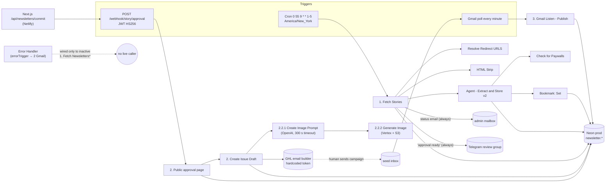

# 60 — Operations: error handling, reliability, schedules, secrets, instance

> **Historical.** This describes the n8n system that native code replaced in November 2026 ([ADR 0003](../adr/0003-n8n-retired-kept-as-record.md)). It is not the current system: see [../architecture.html](../architecture.html).

Scope: how the AI Recap n8n system behaves operationally as a whole. Per-flow business logic lives in the other
`docs/n8n-backend/*` files; this file covers the cross-cutting concerns. Sources: workflow JSON exports
(draft `nodes` and published `activeVersion`), `executions.json` (655 runs), live execution payloads pulled with
`includeData=true`, `credentials.json`, read-only queries against Neon prod, and the app repo.

All timestamps are UTC unless marked ET. Snapshot taken 2026-11-03.

## At a glance

- **No live AI Recap workflow has an error workflow.** `settings.errorWorkflow` is set only on the 4 *inactive*
  `1. Fetch Newsletters*` workflows. The `Error Handler` [kmX0qX1GOqSfPmjD] is active but nothing that runs today
  points at it, and it has 0 executions in the retained window. When a production run fails, nobody gets an alert.
- **Errors are mostly swallowed rather than surfaced.** Ingestion nodes use `onError: continueRegularOutput`
  plus `alwaysOutputData`, so `1. Fetch Stories` always ends with status "success". The two human-facing signals
  are a per-run "Newsletter Stats Update" Gmail to one configured address and a Telegram "approval ready" message.
  The Telegram message is sent unconditionally, including when zero stories were extracted.
- **One real pipeline failure in the 14-day window (2026-10-30).** In `2.2.1 Sub: Create Image Prompt`, the OpenAI
  `gpt-5.4-pro` call was aborted after 300,014 ms (`ECONNABORTED`, "The connection was aborted, perhaps the server
  is offline"). The error cascaded up through `2. Create Issue Draft` to `2. Public approval page`. Because the
  webhook had already replied 200, the app showed the commit as successful. A human recovered it about 50 minutes
  later: they switched the model to `gpt-6-luna`, added a retry, and manually replayed the pinned webhook payload.
- **Execution retention is 14 days.** The oldest prunable run is 2026-10-20T21:00:10Z and the newest is
  2026-11-03T21:00:10Z. That matches n8n's default 336 h pruning. Anything older is gone, except one zombie
  "waiting" run from March and 3 VAPI runs from July 2025.
- **Schedules use the instance timezone `America/New_York`.** No workflow overrides it. Only two automatic
  triggers matter: `1. Fetch Stories` runs on cron `0 55 9 * * 1-5` (09:55 ET Mon–Fri, which is 13:55 UTC in
  summer and 14:55 UTC in winter), and the `3. Gmail Listen - Publish` Gmail trigger polls every minute. The
  approval webhook in between is fired by a human.
- **Secrets are hardcoded in a live workflow.** `2. Create Issue Draft` (active) has a GHL Private Integration
  Token as a literal `Authorization: Bearer` header in 2 nodes. The legacy `2. Sub: Create Issue (Upload to GHL)`
  has a different hardcoded token. The existing `Newsletter GHL: Header Auth` credential is not used. The pinned
  data on `2. Public approval page` holds a real (now expired) signed JWT and a full approval payload.
- **Idempotency is weak where it matters most.** `stories.guid` (MD5 of LLM-extracted `published_at || cleanedUrl`)
  and `scraper_bookmarks.source` are protected by unique keys. Issue drafts are not: every approval commit inserts
  a new `issues` row and a new GHL template. Prod has **15 dates with duplicate issue rows (16 extra rows)**.
  `issues.slug` is a UNIQUE generated column built from `title`, so two issues with the same title would make the
  INSERT/UPDATE fail.
- **Draft and published versions differ.** 6 active AI Recap workflows have unpublished drafts. Executions show
  that trigger-started workflows run the **published** version, while sub-workflows called via Execute Workflow
  ran the **latest saved draft**. For example, `2.2.2` ran draft `b4f31fe5…`, not published `77bd0231…`.
- **The instance is shared.** About 10 non-AI-Recap active workflows run on it (KAI, VA, Upwork, VAPI). That
  includes an **unauthenticated MCP server at `/mcp/serve`** (deactivated 2026-11-04, together with `Telegram MCP`) that exposes an Airtable "Find User" tool over a KAI
  Users table. The noisy `Health Check (VA)` (234/338 errors) was a staging-readiness 503 that was fixed on
  2026-10-30.

---

## 1. Instance facts

| Fact | Value / evidence |
|---|---|
| Base URL | `https://n8n.velocityalpha.com`. Self-hosted behind **Caddy** (`via: 1.1 Caddy` in a captured webhook request). The app calls it from Netlify functions (`cdn-loop: netlify`, `user-agent: node`). |
| Webhook base | `https://n8n.velocityalpha.com/webhook/<path>`. The app default is `https://n8n.velocityalpha.com/webhook/story/approval` (`app/api/newsletters/commit/route.ts`, overridable via `OUTLINE_COMMIT_WEBHOOK_URL`). |
| MCP endpoint | `https://n8n.velocityalpha.com/mcp/serve` (workflow `MCP` [ii0EBe3DzhfnHURQ], **no authentication configured**). |
| n8n version | Not exposed by the public REST API. Feature evidence points to **n8n 2.x**: draft/publish (`versionId` vs `activeVersionId` + `activeVersion` object), `nodeGroups`, `settings.availableInMCP`, `settings.binaryMode: "separate"`, execution fields `storedAt: "db"`, `deduplicationKey` on schedule runs, `runtimeData.redaction`, `tracingContext`. Node typeVersions in use: webhook 2.1, scheduleTrigger 1.3, httpRequest 4.3–4.4, postgres 2.6, merge 3.2, if 2.3, switch 3.4, gmail 2.1–2.2, gmailTrigger 1.1, LangChain openAi 2.1. |
| Instance timezone | `America/New_York`. No workflow sets `settings.timezone`. Confirmed by the schedule trigger output `"Timezone": "America/New_York (UTC-05:00)"` on 2026-11-03 and by Fetch Stories running at 13:55Z before DST ended (2026-11-01) and 14:55Z after. |
| Execution storage / retention | Execution data is stored in the n8n DB (`storedAt: "db"`). Retained window: **2026-10-20T21:00:10Z → 2026-11-03T21:00:10Z (exactly 14 days)**, consistent with default pruning (`EXECUTIONS_DATA_MAX_AGE` = 336 h). Survivors outside the window: 3 `VAPI Incoming Events` runs from 2025-07-04 (cause unknown, possibly exempt/annotated) and waiting run 12947 from 2026-03-26 (waiting runs are not pruned). **History older than 2026-10-20 is unavailable.** |
| Workflow-level save settings | No workflow sets `saveDataErrorExecution`, `saveDataSuccessExecution`, `saveManualExecutions`, `saveExecutionProgress` or `executionTimeout`, so all use instance defaults. Defaults are not visible via API. Observed: success, error and manual runs are all saved. |
| Projects / variables | `projects.json` and `variables.json` are empty: no n8n Variables, and everything is in one personal project. Every credential has a single owner. |
| Tags | `Newsletter` (on most AI Recap workflows), `N8N Course`, `Youtube`. |
| Totals | 71 workflows. 34 are AI Recap-related (20 active). 37 are others (10 active). |
| Schedule dedup | Schedule executions carry `deduplicationKey = <workflowId>:<triggerNodeId>:<scheduledTimeUTC>`, e.g. `hdEUV8VFZbI13VpV:3cf46815-…:2026-11-03T14:55:00.000Z`. n8n uses this to avoid firing the same tick twice. |

### 1.1 Draft vs published versions (affects what actually runs)

| Workflow | Active | Draft == published? | Difference |
|---|---|---|---|
| 1. Fetch Stories | yes | yes | – |
| 2. Public approval page | yes | yes | – |
| 2. Create Issue Draft | yes | yes | – |
| 2.2.1 Sub: Create Image Prompt | yes | yes | – |
| 3. Gmail Listen - Publish | yes | yes | – |
| Agent - Extract and Store v2, Check for Paywalls, Bookmark: Get/Set, HTML Strip, Resolve Redirect URLS, Scrape Beehiiv, Extract Page for LLM, Agent: Change Featured Image | yes | yes | – |
| 2.1 Sub: Compile Draft Stories | yes | **no** (published 2026-04-23, draft 2026-04-29) | node content identical, only the version id differs |
| 2.1.1 Request Approval | yes | **no** (published 2026-04-21, draft 2026-05-06) | published version has 3 extra **orphan** nodes (`Develop JSON form1` → `Send a text message1` → `Parse Approval Response1`, the latter using credential `franca-test-bot`) |
| 2.2 Sub: Generate Issue Featured Image | yes | **no** | `Call Create Image Prompt` differs only in cached display name |
| 2.2.2 Sub: Generate Stylized Image From Prompt | yes | **no** (published 2026-08-25, draft 2026-10-20) | node content identical |
| Agent - Extract and Store (v1) | yes | **no** | draft has `Upsert Stories` **disabled**; published has it enabled |
| Error Handler | yes | **no** | only the sticky note differs |

Observed rule (from execution `workflowVersionId`):
- Trigger, webhook and poll executions run the **published** version.
- Sub-workflows run via Execute Workflow ran the **draft**. Execution 21440 of `2.2.2` ran `b4f31fe5…`, which is
  the draft, not the published `77bd0231…`.

In practice, saving a sub-workflow in the editor changes production immediately, even without publishing.

### 1.2 Other active workflows sharing the instance (noise and risk)

| Workflow | Project | Trigger / exposure | Notes |
|---|---|---|---|
| Health Check (VA) [oKngWoNEVNmoNODf] | VA | schedule, every hour at :00 | Calls GET `/healthz` and `/healthz/readiness` on two **Render-hosted n8n instances** (`n8n-prod-hgl9.onrender.com`, `n8n-staging-jcbw.onrender.com`). These are *not* this instance. If any of the four answers is not `ok`, it POSTs to a Slack workflow-trigger webhook (hardcoded URL). **234/338 errors:** every hourly run from 2026-10-20 21:00Z to 2026-10-30 14:00Z failed with `NodeApiError 503 - {"status":"error"}` ("Service unavailable - try again later or consider setting this node to retry automatically") on `Staging Readiness`. The node had no `onError`, so the run died **before** the Slack alert. In other words, staging was down for at least 10 days and the monitor never alerted. Fixed 2026-10-30T14:19Z (`onError: continueRegularOutput` on all 4 HTTP nodes); 103 consecutive successes since. Unrelated to AI Recap. |
| MCP [ii0EBe3DzhfnHURQ] | KAI | `mcpTrigger` path `serve`, **no auth** | Exposes an `airtableTool` "Find User" over the KAI Dev `Users` table (search by phone, ID, names). **Public PII lookup endpoint on the shared host.** |
| Telegram MCP [2IA2fRXEZx6Nr1ye] | VA demo | Telegram webhook (bot `borna_va_test_bot`) | Groq `moonshotai/kimi-k2-instruct` agent with a jokey "business jargon" system prompt, and the MCP client pointed at `/mcp/serve`. Anyone who messages the bot can drive the Airtable lookup. |
| POST /call/start [i3e03uSou7Rd6QlO] | KAI | webhook `/call/start` (no auth) + sub-workflow | Vapi call start, Airtable. |
| Sub - Send SMS, Sub: Generate OTP, Sub: Phone Input Validation, Sub: Verify OTP | KAI | sub-workflows | Twilio + Airtable. |
| Upwork Callback [HF4YCZnWtOMpsxkw] | VA | webhook `upwork/callback` (GET default, no auth) | Webhook node only (no downstream nodes). |
| VAPI Patience Test [9NZysVCCNhAVFlk9] | KAI | webhook (UUID path, no auth) + **public** chat trigger | – |

---

## 2. Triggers, schedules, and the daily timeline

### 2.1 Every trigger across the 34 AI Recap workflows

| Workflow | Active | Trigger | Config | Effective TZ |
|---|---|---|---|---|
| 1. Fetch Stories | **yes** | scheduleTrigger 1.3 | cron `0 55 9 * * 1-5` (6-field, seconds first: 09:55:00 Mon–Fri) | America/New_York |
| 3. Gmail Listen - Publish | **yes** | gmailTrigger 1.1 | `pollTimes: everyMinute`, `simple: false`, filter `q: "to:<seed address 1> OR to:<seed address 2>"` (two configured company-domain addresses) | n/a |
| 2. Public approval page | **yes** | webhook 2.1 | `POST /webhook/story/approval`, `authentication: jwtAuth` (credential `AI Recap JWT Secret`), `responseMode` default = **onReceived** (replies immediately) | n/a |
| Error Handler | **yes** | errorTrigger | fires only for workflows that name it as their errorWorkflow | n/a |
| Agent: Change Featured Image | **yes** | chatTrigger 1.4 | not public (editor-only chat), `responseMode: streaming` | n/a |
| 2. Create Issue Draft, 2.1, 2.1.1, 2.2, 2.2.1, 2.2.2, Agent - Extract and Store (v1/v2), Bookmark Get/Set, Check for Paywalls, Extract Page for LLM, HTML Strip, Resolve Redirect URLS, Scrape Beehiiv | yes | executeWorkflowTrigger | called by other workflows | – |
| 1. Fetch Newsletters | no | schedule cron `30 10 * * *` (node named "Every Day at 8 ET") | daily 10:30 | America/New_York |
| 1. Fetch Newsletters - Borna / copy - Franca / copy 2 | no | schedule cron `0 8 * * *` | daily 08:00 | America/New_York |
| 1. Fetch Stories - Product Hunt Branch | no | schedule `triggerAtHour 9, triggerAtMinute 45` | daily 09:45 | America/New_York |
| Daily AI Content Report Automation | no | schedule `triggerAtHour 8` | daily 08:00 | America/New_York |
| Backfill Article | no | chatTrigger + manual | – | – |
| Check for Paywalls | (active) | also has a manualTrigger | editor testing | – |

Notes:
- **Poll trigger state.** The Gmail trigger keeps `staticData["node:Gmail Trigger - Check Email"].lastTimeChecked`
  plus a `possibleDuplicates` list. After n8n downtime the next poll catches up from `lastTimeChecked`. A stale
  `staticData` entry for a deleted node `Gmail Trigger - Check Email2` (last checked 2026-05-14) is still stored.
  Executions are created **only when new mail matches**, so you see 13 runs in 14 days, not 1,440 per day.
- **Schedule triggers do not catch up.** If n8n is down at 09:55 ET, that day's Fetch Stories run never happens.
- **Pinned data on triggers:**
  - `1. Fetch Stories` has pinData on `Schedule Trigger` (a 2026-08-26 timestamp).
  - `2. Public approval page` has pinData on `Webhook` (the full 2026-10-30 approval request).
  - Pinned data is used only for **manual** editor runs. A manual "Execute workflow" on the approval page would
    **replay the 2026-10-30 approval**: it would requeue stories, insert a new issue row and create a new GHL
    template for that date.

### 2.2 Daily timeline (weekdays)

| ET | UTC (EDT, Mar–Oct/Nov) | UTC (EST, Nov–Mar) | What runs | Typical duration |
|---|---|---|---|---|
| every minute | every minute | every minute | Gmail trigger poll for `3. Gmail Listen - Publish` (creates an execution only when mail arrives) | – |
| hh:00 | hh:00 | hh:00 | `Health Check (VA)` (not AI Recap) | ~0.6 s |
| 09:55 Mon–Fri | 13:55 | 14:55 | `1. Fetch Stories` → 8 sources in parallel branches → `Agent - Extract and Store v2` once per newsletter (sequential, `mode: each`, ~6–7 per day) → `Check for Paywalls` + `Bookmark: Set` per call | 52–157 s (median 62 s) |
| ~09:56–09:58 | | | end of Fetch Stories: "Newsletter Stats Update" email to the admin mailbox + Telegram "approval ready" link `https://airecap.news/approval?date=YYYY-MM-DD` | – |
| human; observed 09:58–13:43 | 13:58–17:43 | 15:38–17:39 | Editor approves on the website → `/api/newsletters/commit` → webhook → `2. Public approval page` → `2. Create Issue Draft` → `2.2.1` (image prompt) → `2.2.2` (Vertex image + S3) → GHL template create/update → `issues` row | 51–337 s (median ~248 s before the 10-30 model change, ~60 s after) |
| human/GHL; observed 11:31–17:21 | 16:31–21:21 | | Campaign sent from GHL. Two seed copies arrive → next Gmail poll → `3. Gmail Listen - Publish` sets `issues.published_at` and `stories.used_in_publication_date` | 5–48 s |

Observed approval commits (ET): 10-21 10:25, 10-22 12:11, 10-23 09:58, 10-26 11:51, 10-27 11:41, 10-28 13:03,
10-29 13:43, 10-30 10:05 (failed) / 10:56 (manual replay), 11-02 10:38, 11-03 12:39.

Observed publish emails (ET): 10-21 15:57, 10-23 13:09, 10-26 12:46, 10-27 17:21, 10-28 14:24, 10-29 14:18,
10-30 13:10, 11-02 11:31, 11-03 12:48.

**2026-10-22 (issue 260) never published.** No seed email arrived and no Gmail Listen run happened. Issue 256
(10-15) is also unpublished. Nothing alerted on either.

---

## 3. Error handling inventory

### 3.1 Workflow settings (all 34 AI Recap workflows)

None of the 34 sets `timezone`, `executionTimeout`, `saveDataErrorExecution`, `saveDataSuccessExecution`,
`saveManualExecutions` or `saveExecutionProgress`, so all inherit instance defaults. `executionOrder` is `v1`
everywhere. "pub" means the active (published) version exists.

| Workflow [id] | Status | Updated | errorWorkflow | callerPolicy | binaryMode | availableInMCP | Runs in window (executions.json) |
|---|---|---|---|---|---|---|---|
| 1. Fetch Stories [hdEUV8VFZbI13VpV] | **ACTIVE** | 2026-10-20 | **none** ⚠ | default | separate | false | 10 success (trigger) + 1 waiting (manual, March) |
| 2. Public approval page [RB9M8RWAYozoWapB] | **ACTIVE** | 2026-10-30 | **none** ⚠ | workflowsFromSameOwner | separate | false | 9 success webhook, 1 success manual, 1 error |
| 2. Create Issue Draft [QLPaj244TM7azSAH] | **ACTIVE** | 2026-10-16 | **none** ⚠ | workflowsFromSameOwner | separate | false | 10 success, 1 error |
| 2.1 Sub: Compile Draft Stories [rsHDKdELUG59wZzX] | **ACTIVE** | 2026-04-29 | **none** ⚠ | workflowsFromSameOwner | separate | false | 0 (not on the live path) |
| 2.1.1 Request Approval [m6oCt1cUcJHuPgeR] | **ACTIVE** | 2026-05-06 | **none** ⚠ | workflowsFromSameOwner | separate | false | 0 |
| 2.2 Sub: Generate Issue Featured Image [OPjiGtzSNgCkQdG8] | **ACTIVE** | 2026-03-25 | **none** ⚠ | default | – | – | 0 |
| 2.2.1 Sub: Create Image Prompt [j2B4f4kFJs6sBdog] | **ACTIVE** | 2026-10-30 | **none** ⚠ | default | separate | false | 10 success, 1 retry-success, 1 error, 1 canceled |
| 2.2.2 Sub: Generate Stylized Image From Prompt [0Gd3lzvwITBnd8om] | **ACTIVE** | 2026-10-20 | **none** ⚠ | default | separate | false | 10 success |
| 3. Gmail Listen - Publish [Tqon5VyPBEv9juF4] | **ACTIVE** | 2026-05-25 | **none** ⚠ | default | separate | – | 13 success |
| Agent - Extract and Store [KSuYi2U9fYllUK9E] | **ACTIVE** | 2026-06-24 | **none** ⚠ | default | separate | – | 0 (superseded by v2) |
| Agent - Extract and Store v2 [vVPv9aMjTwYBFKqb] | **ACTIVE** | 2026-06-30 | **none** ⚠ | default | separate | false | 63 success |
| Agent: Change Featured Image [Ixc1D30eBAT0Mauf] | **ACTIVE** | 2026-03-25 | **none** ⚠ | default | separate | false | 0 |
| Bookmark: Get [rAkhmEe8L07nYMfq] | **ACTIVE** | 2026-01-30 | **none** ⚠ | default | – | – | 0 |
| Bookmark: Set [AL1bSOW4DwLHcStx] | **ACTIVE** | 2026-01-30 | **none** ⚠ | default | – | – | 63 success |
| Check for Paywalls [NbNTNmXoOJ81jYlf] | **ACTIVE** | 2026-06-29 | **none** ⚠ | default | separate | false | 63 success |
| Error Handler [kmX0qX1GOqSfPmjD] | **ACTIVE** | 2026-03-26 | none (n/a) | default | – | false | 0 |
| Extract Page for LLM [VOZgpsTDYAPJCDuR] | **ACTIVE** | 2026-01-30 | **none** ⚠ | default | – | – | 0 (no live caller) |
| HTML Strip [QizlCbiLwCn4fGRf] | **ACTIVE** | 2026-07-02 | **none** ⚠ | default | separate | – | 26 success |
| Resolve Redirect URLS from Emails [ELtnV1av7bg8hxCz] | **ACTIVE** | 2026-07-02 | **none** ⚠ | default | – | false | 30 success |
| Scrape Beehiiv [9zFfV1JG2zJsXmYS] | **ACTIVE** | 2026-02-09 | **none** ⚠ | default | – | – | 0 (callers inactive) |
| 1. Fetch Newsletters [Yr3QvLYQSXS5PGna] | inactive | 2026-03-18 | **Error Handler** | workflowsFromSameOwner | – | false | – |
| 1. Fetch Newsletters - Borna [KPvLFPWwu7J90oIr] | inactive | 2026-02-25 | **Error Handler** | workflowsFromSameOwner | – | false | – |
| 1. Fetch Newsletters copy - Franca [YoFOrZFMdpSitMm0] | inactive | 2026-02-25 | **Error Handler** | workflowsFromSameOwner | – | false | – |
| 1. Fetch Newsletters copy 2 [0VuQ5YC2uO4Jiayq] | inactive | 2026-02-25 | **Error Handler** | workflowsFromSameOwner | – | false | – |
| 1. Fetch Stories - Product Hunt Branch [jK8cKjTO3R7LmDd0] | inactive | 2026-03-27 | none | workflowsFromSameOwner | – | false | – |
| 2. Sub: Create Issue (Upload to GHL) [EOmzdknnvWLmyV48] | inactive | 2026-03-18 | none | default | – | – | – |
| 2.1.1 Request Approval v2 [013WaHICXxBPpZUA] | inactive | 2026-03-27 | none | default | – | false | – |
| AI Newsletter Generation tryout [OzThGPexbrlPlfbk] | inactive (0 nodes) | 2026-01-30 | none | default | – | false | – |
| Agent - Extract and Store - Generic Source [JOxd0E2V906MdhDS] | inactive | 2026-03-27 | none | workflowsFromSameOwner | – | false | – |
| Backfill Article [0NDtfZf7giQs88Oz] | inactive | 2026-03-18 | none | default | separate | false | – |
| Daily AI Content Report Automation [uhQsWPnrVDndEf7g] | inactive | 2026-03-30 | none | default | separate | false | – |
| My workflow 3 [36UlFATMCT7LQfBM] | inactive | 2026-03-16 | none | default | separate | false | – |
| Repair Broken Link [Ek8YWb3czluc06tc] | inactive | 2026-03-02 | none | default | separate | false | – |
| Test [7T9eYpWk1LKlv5RB] | inactive | 2026-08-25 | none | default | separate | – | – |

⚠ **All 20 active AI Recap workflows have no error workflow.** The three entry points (`1. Fetch Stories`,
`2. Public approval page`, `3. Gmail Listen - Publish`) are the ones that matter, since n8n only fires the
errorWorkflow of a failing production execution. `callerPolicy` is irrelevant in practice because every workflow
has the same owner.

### 3.2 Node-level flags

n8n semantics, for rebuilding:

| Flag | Meaning |
|---|---|
| `onError: continueRegularOutput` | The error becomes a normal output item with an `error` field and the flow continues. |
| `onError: continueErrorOutput` | The item is routed to the node's second ("error") output. |
| default (no onError) | Stop the workflow, mark the execution `error`, and propagate to the parent Execute Workflow node. |
| `retryOnFail` | Re-runs the **whole node** (all input items). Default `maxTries` = 3, default `waitBetweenTries` = 1000 ms. No AI Recap node sets `maxTries` explicitly, and no node anywhere uses the legacy `continueOnFail`. |
| `alwaysOutputData` | Emits one empty item when the node returns zero items, so downstream merges never stall. |
| `executeOnce` | Runs only for the first input item. |

HTTP Request nodes have no explicit `timeout`. The n8n default seen in error contexts is `timeout: 300000` ms.
The LangChain OpenAI node shows the same effective 300 s abort.

**Active, live path:**

| Workflow | Node | Type | onError | retryOnFail / wait | alwaysOutputData | Other |
|---|---|---|---|---|---|---|
| 1. Fetch Stories | `Rundown`, `Aloa`, `the_signal`, `beehiiv_aibreakfast`, `tldr`, `alphasignal` | gmail getAll | continueRegularOutput | – | true | – |
| 1. Fetch Stories | `Get Bookmark: rundown/aloa/the_signal/beehiiv_aibreakfast/tldr_ai/product_hunt_ai/alphasignal/huggingface` | postgres select | – (fails the run if Neon is down) | – | true | – |
| 1. Fetch Stories | `Product Hunt AI Feed` | rssFeedRead | continueRegularOutput | – | true | – |
| 1. Fetch Stories | `Get Hugging Face URL` | httpRequest | – | – | – | `neverError: true`, `followRedirects: false` |
| 1. Fetch Stories | `Agent - Extract and Store` (→ v2) | executeWorkflow `mode: each`, `waitForSubWorkflow: true` | continueRegularOutput | **true** (3 × 1 s) | true | Retrying re-runs **all** newsletters. |
| 1. Fetch Stories | `route by fetch success` | switch | – | – | false | Outputs `up_to_date` and `fail` are unconnected (dropped). |
| 1. Fetch Stories | `Call Parse Redirect URLS…` ×3, `Call 'HTML Strip'` ×3, `Send Emails to admin…`, `Send a text message to inform of approval readiness`, Code/Set/Merge nodes | – | – | – | – | Any failure here kills the run. |
| Agent - Extract and Store v2 | `Extract Stories` (OpenAI `gpt-5.4-mini`) | openAi | **continueErrorOutput** → `Output Error` | **true** (3 × 1 s) | – | executeOnce |
| Agent - Extract and Store v2 | `output`, `Output Error` | set | – | – | – | executeOnce. `Output Error` emits `num_stories_extracted: 0` but **no `error` field**, so Fetch Stories reports the source as `success`. |
| Agent - Extract and Store v2 | `Limit` | limit | – | – | – | **disabled** |
| Agent - Extract and Store v2 | `Upsert Stories`, `Call Check for Paywalls`, `Call 'Bookmark: Set'`, `Crypto`, `Clean Data`, `Split Stories` | – | – | – | – | Failure errors the sub-run, then the parent retries. |
| Check for Paywalls | `Read URL content1` (Jina) | jinaAi | continueRegularOutput | – | – | – |
| Check for Paywalls | `HTTP Request` (GET story URL) | httpRequest | continueRegularOutput | – | – | `fullResponse: true`. Default 300 s timeout; observed max run 74.5 s. |
| Check for Paywalls | `Edit Fields` | set | – | – | – | **disabled** |
| Resolve Redirect URLS from Emails | `HTTP Request` | httpRequest | – | – | – | `neverError: true`, `fullResponse: true`, `followRedirects: false` |
| 2. Public approval page | `Grab all story ids`, `Join all`, `Join all1`, `Extract Excluded Story IDs` | code | – | – | true | – |
| 2. Public approval page | `Update Stories: Queue for Publication`, `Update Stories: Mark stories as excluded` | postgres | – | – | true | – |
| 2. Public approval page | `Build Final Stories` | code | – | – | – | **Throws** on: section over its limit (headlines 3, research 4, tools 6, quickHits 6); a story approved in multiple sections; an approved id missing from `candidate_map`. |
| 2. Public approval page | `Call '2. Create Issue Draft'` | executeWorkflow (once) | – | – | – | Errors propagate here; this is where the 10-30 failure surfaced. |
| 2. Create Issue Draft | *all 21 nodes* | – | **none** | **none** | – | No error handling at all: OpenAI `Reformat Stories for Issue` (`gpt-5.5`, reasoning effort low), GHL `Create_Email_Template` / `Update_Email_Template`, Postgres inserts and updates. |
| 2.2.1 Sub: Create Image Prompt | `Analyze and Select Best Prompt1` (OpenAI `gpt-6-luna`, was `gpt-5.4-pro` until 2026-10-30 14:27Z) | openAi | – | **true**, wait 5000 ms (added 10-30) | – | Worst case: 3 × 300 s + 10 s ≈ 15 min before failing. |
| 2.2.2 Sub: Generate Stylized Image | `HTTP Request Gemini Generate Image` (Vertex `gemini-3.1-flash-image`) | httpRequest | – | **true**, wait 5000 ms | – | batching 1 item / 5000 ms |
| 2.2.2 Sub: Generate Stylized Image | `S3: Upload Image` | awsS3 | – | – | – | Filename `newsletter/gemini-<UTC ISO>.jpeg`, so every attempt creates a new object. |
| 3. Gmail Listen - Publish | `V2 Parser` (OpenAI `gpt-5.4`) | openAi | – | **true**, wait 5000 ms | – | – |
| 3. Gmail Listen - Publish | `Update Issue`, `Update stories table` | postgres executeQuery (parameterised `$1..$5`) | – | – | – | – |
| Bookmark: Set / Get | postgres upsert / select | – | – | – | – | – |
| HTML Strip, Scrape Beehiiv, Extract Page for LLM | – | – | – | – | – | none |
| Error Handler | `Workflow Activation Error Email`, `Node Error Email` | gmail | – | **true** (3 × 1 s) | – | – |

**Active but not on the live path** (no executions in the window; listed for completeness):

| Workflow | Node | Flags |
|---|---|---|
| 2.1 Sub: Compile Draft Stories | `Get the headlines and summaries`, `Grab all story ids`, `Join all`, `Join all1`, `Extract Excluded Story IDs` | alwaysOutputData |
| 2.1 Sub: Compile Draft Stories | `Get Recently Published Stories` | alwaysOutputData, executeOnce |
| 2.1 Sub: Compile Draft Stories | `Update Stories: Queue for Publication`, `Update Stories: Mark stories as excluded` | alwaysOutputData |
| 2.1 Sub: Compile Draft Stories | `Deduplicate` (OpenAI `gpt-5.4-mini`, effort high) | none |
| Agent - Extract and Store (v1) | `Extract Stories` | continueErrorOutput, retryOnFail, executeOnce; `Limit` disabled; `Upsert Stories` disabled **in the draft** (enabled in published) |
| 2.1.1 Request Approval, 2.2, Agent: Change Featured Image | – | none |

**Inactive workflows** (draft):

| Workflow | Nodes with flags |
|---|---|
| 1. Fetch Newsletters | `Call 'Scrape Beehiiv'` (continueRegularOutput, retry, wait 5000, alwaysOutputData); `Agent - Extract and Store AI Breakfast` / `…Text - TLDR` / `…ByteSizedAi` (continueRegularOutput, retry); `Agent - Extract and Store JSON` (retry); `Rundown RSS`, `Keep post-bookmark`, `TLDR` (continueRegularOutput; TLDR also alwaysOutputData, fullResponse); `Get many messages` (gmail: continueRegularOutput, retry, alwaysOutputData); `Get Bookmark:*` (alwaysOutputData, except beehiiv=false); `Get Unscraped Dates` (alwaysOutputData); `Call 'Create Issue (Upload to GHL)'` (executeOnce) |
| 1. Fetch Newsletters - Borna / copy - Franca | `TLDR` (**continueErrorOutput**, alwaysOutputData); `Call 'Scrape Beehiiv'` (retry, wait 5000, alwaysOutputData); `Agent - Extract and Store *` (retry); bookmarks/filter/code (alwaysOutputData); `Call 'Create Issue (Upload to GHL)'` (executeOnce) |
| 1. Fetch Newsletters copy 2 | same pattern as `1. Fetch Newsletters` (continueRegularOutput + retry on scrapes and extracts) |
| 1. Fetch Stories - Product Hunt Branch | same flags as live Fetch Stories on gmail, bookmark and Agent nodes; `Call '2. Create Issue Draft'` executeOnce |
| 2. Sub: Create Issue (Upload to GHL) | `Get Recently Published Stories` (alwaysOutputData, executeOnce), `Get Recent Unpublished Stories` (executeOnce) |
| Agent - Extract and Store - Generic Source | `Extract Stories` (continueErrorOutput, retry); `Limit` disabled |
| Backfill Article | code/postgres alwaysOutputData; executeOnce on the two story selects |
| Repair Broken Link | `Groq Chat Model` retry; HTTP nodes neverError / fullResponse |
| Test | 3 HTTP nodes neverError |
| Daily AI Content Report, 2.1.1 Request Approval v2, My workflow 3, AI Newsletter Generation tryout | none |

### 3.3 Dead or unreachable nodes on the live path (ops-relevant)

- `2. Create Issue Draft`: `Build Clean HTML for Beehiiv` → `Save HTML template to file` → `Send HTML file to telegram`
  → `Update to Issues Table` has **no incoming connection**, so it never runs (confirmed by run 21438). The intended
  "HTML file to Telegram" notification after drafting does not happen. Once the draft is created, the only
  signal is the GHL template itself.
- `1. Fetch Stories`: the `route by fetch success` outputs `up_to_date` and `fail` are unconnected. Failed sources
  are not routed anywhere; they appear only in the status email.
- `2. Create Issue Draft` false branch of `From Telegram?` → `Compile Draft Stories` (2.1 → 2.1.1). This is the
  legacy Telegram-approval path. The website path always passes `from_telegram: true`.

---

## 4. The Error Handler workflow [kmX0qX1GOqSfPmjD]

| Item | Detail |
|---|---|
| Status | Active. Created 2026-02-04. Draft updated 2026-03-26 (sticky note only). **0 executions** in the retained window. |
| Trigger | `Error Trigger` (n8n-nodes-base.errorTrigger v1). n8n invokes it when a production execution of a workflow that names it in `settings.errorWorkflow` fails. |
| Used by | Only the 4 inactive workflows `1. Fetch Newsletters`, `- Borna`, `copy - Franca`, `copy 2`. **No active workflow uses it.** |
| Routing | Switch `Mode of workflow  error a Workflow Activation Error or Node Error?` (v3.4, first match wins). Output 0 "Workflow Activation Error" if `{{ $json.trigger }}` exists (object exists). Output 1 "Node Error" if `{{ $json?.execution }}` exists. The `rightValue` strings "trigger" / "manual" are ignored by the `exists` operator. |
| Activation-error email | Gmail node `Workflow Activation Error Email` (credential `Gmail account`, retryOnFail) to **two configured company-domain addresses**. Subject: `An Error Occured in AI Recap Workflow`. HTML body fields: `workflow.name`, `workflow.id`, `trigger.error.name`, `trigger.mode`, `trigger.error.timestamp`, `trigger.error.message`, `trigger.error.cause.stack`. |
| Node-error email | Gmail node `Node Error Email` (same credential and recipients, retryOnFail). Subject: `An Error Occured in AI Recap ´ s Workflow`. Fields: `workflow.name`, `workflow.id`, `execution.error.message`, `execution.lastNodeExecuted`, `execution.mode`, `execution.id`, `execution.error.description`, `execution.error.stack`, `execution.url`. Minor bug: the `<pre>` block prints the literal word "Stacktrace" instead of the stack. |
| Gaps | (1) Not wired to anything live. (2) Even if wired, most ingestion errors are swallowed by `continueRegularOutput`, so the run ends "success". (3) No dedup or rate limit. (4) Gmail is both an alerting channel *and* the ingestion source; if the Gmail OAuth breaks, alerts break too. |

---

## 5. Failure history (retained window 2026-10-20T21:00Z → 2026-11-03T21:00Z)

The API listing (`status=error|canceled|waiting`) matches `executions.json` exactly: 237 errors (234 Health Check +
3 AI Recap), 1 canceled, 1 waiting. Every AI Recap failure is listed below.

### 5.1 2026-10-30: image-prompt LLM timeout cascades and blocks the issue draft

| Exec | Workflow | Mode | Start → stop (UTC) | Failing node | Error (verbatim) |
|---|---|---|---|---|---|
| 21271 | 2.2.1 Sub: Create Image Prompt | integrated | 14:05:50 → 14:10:50 | `Analyze and Select Best Prompt1` (OpenAI `gpt-5.4-pro`), ran 300,014 ms | `NodeApiError`, httpCode `ECONNABORTED`: "The connection was aborted, perhaps the server is offline" |
| 21270 | 2. Create Issue Draft | integrated | 14:05:20 → 14:10:50 | `Call Create Image Prompt`, ran 300,052 ms | `NodeOperationError`: "The connection was aborted, perhaps the server is offline" |
| 21269 | 2. Public approval page | webhook | 14:05:17 → 14:10:50 | `Call '2. Create Issue Draft'`, ran 329,693 ms | "The connection was aborted, perhaps the server is offline" |
| 21273 | 2.2.1 Sub: Create Image Prompt | manual | 14:26:34 → 14:28:11 | – | **canceled**: `ManualExecutionCancelledError` "The execution was cancelled manually" (operator testing) |
| 21274 | 2.2.1 Sub: Create Image Prompt | retry of 21271 | 14:28:18 → 14:28:33 | – | success in 15 s, running the *new* version (model `gpt-6-luna`, retryOnFail) |
| 21275–21278 | Public approval page (manual) → Create Issue Draft → 2.2.1 → 2.2.2 | manual / integrated | 14:56:26 → 14:57:17 | – | success. Issue 266 created 14:57:15 and published 17:10:06. |

**Root cause.** The OpenAI node's ~300 s client-side request timeout was hit by a slow reasoning model
(`gpt-5.4-pro`). The risk was visible beforehand: successful runs of 2.2.1 in the window took median 205.7 s and up
to **294.1 s**. The failure was 6 s away on every run.

**What was already committed when it failed:**
- From 21269: `stories.exclude_from_candidates = true` for excluded ids, and `stories.queued_for_publication_date`
  set for the selected ids.
- From 21270: `Update Stories` wrote `url` and `note` for the 19 candidates.
- One `Reformat Stories for Issue` LLM call (~28 s) had run.
- No `issues` row and no GHL template had been created yet, because the failure came before `Insert to Issues Table`.

**Visibility.** The webhook replies in `onReceived` mode, so `/api/newsletters/commit` had already returned
`success: true` to the editor. With no errorWorkflow, no alert fired. Someone noticed manually.

**Recovery steps (inferred from executions and version timestamps):**
1. 14:27: edited and saved 2.2.1 (model changed, `retryOnFail` plus 5 s wait added).
2. 14:28: "retry" of 21271. This re-ran only the sub-workflow and did **not** resume the parents.
3. 14:56:25: `2. Public approval page` saved with the failed request pinned as pinData.
4. 14:56:26: manual execution replayed the full chain.

Steps 1–2 took about 23 minutes and steps 3–4 another 28, roughly 50 minutes in total. Replaying was safe here
because the earlier writes are idempotent for the same payload. It would **not** have been safe after
`Insert to Issues Table`, which would have produced a duplicate issue and GHL template.

### 5.2 2026-03-26: zombie waiting execution

- Exec 12947: `1. Fetch Stories`, mode manual, status **waiting**, `waitTill: 3000-01-01T00:00:00Z` (n8n's
  "wait forever").
- Parent node `Call '2. Create Issue Draft'` is waiting on sub-execution 12954, which no longer exists. This dates
  from the older design, where Fetch Stories called Create Issue Draft and the Telegram approval path waited for a
  reply.
- Harmless, but it never prunes. Delete it by hand during cleanup (not done; this audit is read-only).

### 5.3 Silent failures (no execution error, found in data)

| Signal | Evidence |
|---|---|
| Issues drafted but never published | `issues` 256 (2026-10-15) and 260 (2026-10-22) have `published_at IS NULL`. No seed email arrived and there was no Gmail Listen run on 10-22. Cause unknown (campaign not sent in GHL?). No alert. |
| Sources silently dead | `scraper_bookmarks.last_success`: `the_signal` 2026-06-29, `aloa_ai` 2026-04-27. The other 7 sources updated 2026-11-03. Fetch Stories reports these as `up_to_date`, not as a problem. |
| LLM extraction failure reported as success | `Agent - Extract and Store v2` → `Output Error` has no `error` field, so the status email shows "success, 0 stories". |
| Telegram says "successfully extracted" regardless | `Send a text message to inform of approval readiness` hangs off `Consolidate Sources` with no condition. |
| Monitor that never alerted | `Health Check (VA)` died before its Slack step on 234 runs (see 1.2). |

---

## 6. Credentials and secrets

### 6.1 Credential map

The effective credential is the one selected by the node's `authentication` / `genericAuthType`. Nodes sometimes
carry leftover credentials that are not used.

| Credential (name) | Type | Used by: active workflows → nodes | Used by: inactive | External account (inferred) | Scope | App pairing |
|---|---|---|---|---|---|---|
| **Gmail account** | gmailOAuth2 (updated 2026-11-03) | 1. Fetch Stories → `Rundown`, `Aloa`, `the_signal`, `beehiiv_aibreakfast`, `tldr`, `alphasignal`, `Send Emails to admin on status message`; 3. Gmail Listen → `Gmail Trigger - Check Email`; Error Handler → both email nodes | all 1. Fetch Newsletters*, Product Hunt Branch; **KAI**: `POST /schedule-call` (2 nodes), `My workflow 4` | One company Google Workspace mailbox. It subscribes to the source newsletters, receives the GHL seed copies, and sends admin/alert mail. | **Shared** (AI Recap + KAI-era). **Single point of failure** for ingestion, publish detection *and* alerting. | none |
| **Newsletter Neon Production** (id uc4x…; some nodes show the stale label "Newsletter Production Bot") | postgres | Fetch Stories (8 bookmark selects), Public approval page (2 updates), Create Issue Draft (4), 2.1 (4), 3. Gmail Listen (2), Agent v1/v2 `Upsert Stories`, Agent: Change Featured Image (2 postgresTool), Bookmark: Get/Set | legacy flows | Neon prod DB. Role likely `newsletter_bot` (inferred from the old label; unverified). Every role (`newsletter_bot`, `newsletter_web`, `borna`, `franca`) has full DML on all 5 `newsletter.*` tables, including `subscribers` and `auth_codes`. | AI Recap | `DATABASE_URL` / `PRODUCTION_DATABASE_URL` (app uses `newsletter_web` via pgbouncer) |
| Newsletter Neon Development | postgres | – | – | Neon dev branch | AI Recap, **unused** | `DATABASE_URL` (dev) |
| **Newsletter OpenAI Key** | openAiApi | Create Issue Draft `Reformat Stories for Issue`; 2.1 `Deduplicate`; 2.2.1 `Analyze and Select Best Prompt1`; 3. Gmail Listen `V2 Parser`; Agent v1/v2 `Extract Stories`; Agent: Change Featured Image `OpenAI Chat Model` | Generic Source, Daily AI Content Report (6) | OpenAI API key | AI Recap | The app has its own `OPENAI_API_KEY` (approval dedup, `src/features/newsletter/openai-dedup.ts`). It may or may not be the same key. |
| **AI Recap JWT Secret** | jwtAuth (HS256 passphrase) | 2. Public approval page → `Webhook` | – | Shared HMAC secret | AI Recap | **`N8N_WEBHOOK_JWT_SECRET`** must equal it. The app signs `{scope:"story-approval", payloadType:"object", issuedFor:"n8n-story-approval-webhook"}` with `expiresIn: 1h`. |
| **AI Recap Review Telegram Bot** | telegramApi | Fetch Stories (approval-ready msg), Create Issue Draft (`Send HTML file to telegram`, unreachable), 2.1.1 Request Approval | Request Approval v2, My workflow 3 | Telegram bot posting to the review group chat (chat id hardcoded) | AI Recap | none |
| franca-test-bot | telegramApi | 2.1.1 Request Approval **published** orphan node `Send a text message1` (never runs) | – | test bot | AI Recap test | – |
| **Vertex AI Image Gen API Key (header)** | httpHeaderAuth | 2.2.2 `HTTP Request Gemini Generate Image` (**effective**) | – | Google Cloud API key for `aiplatform.googleapis.com` | AI Recap | none |
| Newsletter Gemini Bearer | httpBearerAuth | same node, attached but **not selected** | – | old Gemini/Vertex bearer | AI Recap, dormant | – |
| "Google Vertex AI Key" (id ARxk…) | httpQueryAuth | same node, attached but not selected. **Not present in credentials.json** (deleted or hidden). | – | API key in query string (old) | AI Recap, dormant | – |
| **AWS velocity-alpha-n8n user** | aws | 2.2.2 `S3: Upload Image` (bucket `velocity-alpha-public-assets`, prefix `newsletter/`) | – | IAM user in the Velocity Alpha AWS account. The bucket name suggests a shared public-assets bucket. | Shared by name, used only by AI Recap | none. The app renders images through `https://airecap.news/.netlify/images?url=<s3 url>`. |
| **Jina AI account** | jinaAiApi | Check for Paywalls `Read URL content1`; Scrape Beehiiv `Read URL content` | Repair Broken Link, Test | Jina Reader API | AI Recap | none |
| Bright Data: Bearer Auth | httpBearerAuth | Extract Page for LLM `Extract Web Content` (effective; workflow has no live caller) | – | Bright Data Web Unlocker | AI Recap, effectively unused | – |
| "Brightdata Header Auth" (id 3rb1…) | httpHeaderAuth | same node, not selected. Not in credentials.json. | – | – | dormant | – |
| Newsletter GHL: Header Auth | httpHeaderAuth | **unused**: Create Issue Draft hardcodes the token instead | – | GHL | AI Recap | GHL app-side: `GHL_SUBSCRIBE_WEBHOOK_URL`, `GHL_UNSUBSCRIBE_WEBHOOK_SECRET`, `FOR_BRANDS_WEBHOOK_URL` |
| Groq account | groqApi | **Telegram MCP** (VA demo) | 2. Sub: Create Issue (Upload to GHL) (3), Backfill Article (2), Repair Broken Link, Guardrails (11), My workflow 2 | Groq | **Shared** | – |
| Beehiiv MCP | mcpOAuth2Api | unused | – | Beehiiv | AI Recap-adjacent, unused | `BEEHIIV_API_KEY`, `BEEHIIV_PUBLICATION_ID` (app, separate) |
| KAI Airtable | airtableTokenApi | MCP, POST /call/start, Sub: Generate OTP, Sub: Verify OTP | ~20 KAI nodes | Airtable (KAI) | KAI | – |
| KAI Twilio, KAI Vapi Bearer Token, KAI JWT Secret, OpenRouter Kai Test, VAPI Incoming Webhook Auth Header | various | Sub - Send SMS, POST /call/start | KAI flows | – | KAI | – |
| borna_va_test_bot | telegramApi | Telegram MCP | – | test bot | VA | – |
| GrowMagnet Supabase account | supabaseApi | – | Supabase Keepalive | Supabase | GrowMagnet | – |
| Apify account | apifyApi | – | Amazon Reviews | Apify | other | – |
| Slack account, Gmail account 2, IMAP account, Bearer Auth account | – | unused | – | – | other / unused | – |

### 6.2 Hardcoded secrets in workflow JSON (location and kind only; no values)

| # | Workflow | Status | Location | Kind |
|---|---|---|---|---|
| 1 | 2. Create Issue Draft [QLPaj244TM7azSAH] | **ACTIVE** (draft and published) | node `Create_Email_Template`, header `Authorization` | **hardcoded GHL Private Integration Token (Bearer)** |
| 2 | 2. Create Issue Draft [QLPaj244TM7azSAH] | **ACTIVE** | node `Update_Email_Template`, header `Authorization` | same GHL PIT as #1 |
| 3 | 2. Sub: Create Issue (Upload to GHL) [EOmzdknnvWLmyV48] | inactive | nodes `Create_Email_Template`, `Update_Email_Template` | hardcoded GHL PIT, a **different** token from #1 (may still be valid) |
| 4 | 2. Public approval page [RB9M8RWAYozoWapB] | ACTIVE | `pinData.Webhook[0].json.headers.authorization` | captured **signed JWT** (HS256; claims `scope, payloadType, issuedFor, iat, exp`; expired 2026-10-30T15:05Z), plus client IP forwarding headers and the full 10-30 approval payload |
| 5 | 1. Fetch Newsletters copy 2 [0VuQ5YC2uO4Jiayq] | inactive | `pinData."Call 'Scrape Beehiiv'"…newsletter_text` | beehiiv click-tracking URLs with base64 tokens. Not a credential, but personalised tracking links. |

Hardcoded **config** (not secret, but should become env/config):
- GHL `locationId` and `updatedBy` user id (`Set GHL API Fields`, `Update_Email_Template`).
- Telegram review group chat id (Fetch Stories, Create Issue Draft, Request Approval).
- Seed mailbox addresses in the Gmail trigger filter, and recipients of the admin status email and Error Handler.
- S3 bucket name.
- `https://airecap.news` image proxy prefix.

Other workflows on the instance (hygiene, not AI Recap):
- `Health Check (VA)`: Slack workflow-trigger URL with its secret path in `Post to Slack (Workflow Webhook)`.
- `Fathom.ai test`: literal `X-Api-Key` header in `get meetings` and `HTTP Request`.
- `Social Scraper (For AI Mates)`: Apify token in the URL query string of `HTTP Request9` and `HTTP Request10`.
- `Guardrails`: code node `Samples: Secret Keys` contains key-shaped strings (an OpenAI-style key and a postgres
  URL). These are probably test fixtures; verify.

App-side (for completeness): `app/api/for-brands/route.ts` hardcodes a default GHL inbound-webhook URL (a
capability URL) as the fallback for `FOR_BRANDS_WEBHOOK_URL`.

**Rotation recommendation.** Rotate the GHL PIT(s) when migrating. They appear in plain text in every workflow
export and backup, and in these local JSON dumps.

### 6.3 App-side env var names and n8n pairing

Read by code (`process.env.*` in `app/`, `src/`, `scripts/`) and/or listed in `.env.local.example`:

| Env var | Purpose | Pairs with n8n |
|---|---|---|
| `N8N_WEBHOOK_JWT_SECRET` | Sign the approval JWT | **AI Recap JWT Secret** (must match) |
| `OUTLINE_COMMIT_WEBHOOK_URL` | Override the approval webhook URL | webhook path `story/approval` |
| `DATABASE_URL`, `PRODUCTION_DATABASE_URL`, `NEWSLETTER_RUNTIME_DB_ROLE` | Neon access / grants | Newsletter Neon Production / Development (separate roles) |
| `OPENAI_API_KEY` | Approval outline dedup | Newsletter OpenAI Key (possibly the same account) |
| `GHL_SUBSCRIBE_WEBHOOK_URL`, `GHL_UNSUBSCRIBE_WEBHOOK_SECRET`, `FOR_BRANDS_WEBHOOK_URL` | GHL subscriber/lead flows | GHL token hardcoded in Create Issue Draft (different GHL auth surface) |
| `SUBSCRIBER_PROVIDER`, `BEEHIIV_API_KEY`, `BEEHIIV_PUBLICATION_ID` | Subscriber provider switch | (Beehiiv MCP credential unused) |
| `APPROVAL_PASSWORD` | Protects `/approval` | none (the human gate before the webhook) |
| `SESSION_SECRET` | Subscriber session cookies | none |
| `RESEND_API_KEY`, `RESEND_FROM_NAME`, `RESEND_FROM_EMAIL` (code also references `RESEND_FROM_MAIL`) | OTP emails | none |
| `NEXT_PUBLIC_SITE_URL`, `NEXT_PUBLIC_GA_MEASUREMENT_ID`, `URL`, `NODE_ENV` | Site config (GA ids set in `netlify.toml` per context) | none |
| `OPENROUTER_API_KEY`, `OPENROUTER_DEDUP_TIMEOUT_MS` | Listed in `.env.local.example` but **not read by code** any more (stale) | – |

---

## 7. Data integrity safeguards

### 7.1 Keys the pipeline relies on (prod constraints, `newsletter` schema)

| Table | Constraint | Used by | Effect |
|---|---|---|---|
| `stories` | `stories_guid_key UNIQUE (guid)` | Agent v2 `Upsert Stories` (`operation: upsert`, `matchingColumns: ["guid"]`) | Re-extracting the same story updates the row instead of duplicating it. **But** `guid` = Crypto node default **MD5(hex)** of the string `"{{published_at}} \|\| {{cleanedUrl}}"`, and both parts come from the LLM extraction (URL then normalised by `Clean Data`). Non-deterministic LLM output (a different date or link variant) creates a new guid, so you get duplicate stories. The same URL on a different day is a new story by design. Cross-day dedup happens later (LLM dedup in the app / 2.1). |
| `scraper_bookmarks` | `PRIMARY KEY (source)` | Bookmark: Set upsert `{source, last_success: $now}` | One cursor per source. |
| `issues` | `PRIMARY KEY (id)`, `UNIQUE (title, published_at)`, **`UNIQUE (slug)`** where `slug` is `GENERATED ALWAYS AS COALESCE(newsletter.slugify_issue_title(title), id::text)` | Create Issue Draft insert/update, Gmail Listen update | **No uniqueness on `issue_date`.** `(title, published_at)` does not protect drafts (NULL `published_at`). The UNIQUE generated slug means **any two issues with the same title fail with a unique violation**. A re-run that yields an identical title would error at `Insert to Issues Table`, after image generation. A publish email whose title equals an older issue's would error at `Update Issue`. |
| `stories` | trigger `stories_updatedat` (BEFORE UPDATE) | – | Keeps `updatedAt` current. |

### 7.2 Double-trigger and partial-failure behaviour, per flow

**1. Fetch Stories (cron)**
- *Duplicate scheduler fire:* prevented by n8n's schedule `deduplicationKey`.
- *Manual run plus scheduled run on the same day:* Gmail sources read `receivedAfter = max(last_success, now − 3 days)`.
  If the first run has finished, bookmarks have moved and the second run sees `up_to_date`. If they overlap, both
  extract the same newsletters: double LLM cost, possible duplicate stories (see the guid caveat), and two status
  emails plus two Telegram messages.
- *Partial failure:*
  - Each source branch is isolated by `continueRegularOutput`.
  - A failed newsletter does not advance its bookmark, so the next run (within 3 days) retries it.
  - Bookmark is set per v2 call to **`$now`** (processing time), not the email's received time. Two consequences:
    if one newsletter fails and a later one from the same source succeeds in the same run, the failed one is
    skipped for good; and an email that arrives between the Gmail fetch (~09:55:0x) and the bookmark write
    (~09:56) is missed.
  - Outages longer than 3 days silently drop newsletters, because of the 3-day lookback cap.
  - If v2 throws (e.g. the Neon upsert fails), the parent's `retryOnFail` re-runs **all** newsletters up to 3
    times, then continues with an error item.

**2. Public approval page → 2. Create Issue Draft (webhook)**
- *App-side guard:* `/api/newsletters/commit` returns **409** only when an issue for that date is **already
  published** (`fetchLastPublishedIssueDateOnOrBefore`). Before publish, every commit goes through.
- *Effect of re-commit before publish:*
  - `queued_for_publication_date` and `exclude_from_candidates` updates repeat harmlessly. Stories selected in an
    earlier commit but deselected later stay queued, because nothing clears them.
  - Each commit inserts a **new `issues` row** and creates a **new GHL email template** (`POST /emails/builder`).
  - Prod has **15 dates with more than one issue row (16 extra rows)**. 26 issues are unpublished, 15 of them
    superseded by a published sibling for the same date.
  - The website shows only `published_at IS NOT NULL`, so orphans are invisible to readers. They still accumulate
    in the DB and in GHL.
- *Concurrency:* no lock, so two simultaneous commits produce two complete drafts.
- *Partial failure (no try/catch, no transaction):* rows written before the failing node persist.
  - Fail before `Insert to Issues Table` (e.g. the image step): stories updated, no issue row. Replaying is safe.
  - Fail between `Insert to Issues Table` and `Update to Issues Table1` (e.g. GHL 4xx/5xx): an issue row with
    title, image and prompt but **no `html`**, and possibly an empty GHL template.
  - Retrying the sub-workflow alone does not resume the parent. You must replay from the webhook payload.
- *Webhook semantics:* `responseMode: onReceived`, so the caller always gets 200 once the JWT verifies. The app
  cannot see generation failures.
- *Input and token safety:* findings are kept in private notes, because this repo is public. The rebuild uses
  parameterised queries and an in-process job enqueue instead of a cross-service webhook.

**3. Gmail Listen - Publish (poll)**
- Each GHL send reaches **both seed addresses**. In every observed send both copies landed in the same poll, so one
  execution had 2 items, and the code uses `$('Gmail Trigger…').first()`, so only one is processed. If the copies
  straddle a poll boundary there would be two runs. `Update Issue` is idempotent apart from `published_at` moving
  by ~1–2 s; `used_in_publication_date` is reset to `CURRENT_TIMESTAMP`.
- **Any** mail to the seed addresses triggers a run. Observed: GHL marketing mails ("press play, get paid", "Paid
  offers are waiting for AI Recap", "4 ways to improve your deliverability") and "🐝 October Recap - AI Recap".
  The LLM returned `issue_id: 0`, so the UPDATE matched nothing. That is harmless, but each one costs an OpenAI
  call, and **no code guard** stops a hallucinated real id from overwriting another issue's html, title and
  `published_at`.
- `issue_id` comes from the `data-issue-id` attribute that `Build Clean HTML Email` embeds in the GHL HTML, which
  the parser LLM then extracts. If that attribute is missing, the email cannot be matched.
- n8n downtime is caught up via `lastTimeChecked`.

**Agent: Change Featured Image (operator chat)**: an LLM agent with two Postgres tools, including one that writes
the issue image URL and prompt. No guardrails beyond the editor-only chat.

---

## 8. Observed runtime behaviour (ops view)

| Workflow | n (window) | Median | Min–max | Volume per run |
|---|---|---|---|---|
| 1. Fetch Stories | 10 | 62.5 s | 52–157 s | 8 source branches. 6–7 newsletters extracted (`Agent - Extract and Store v2` × ~6.3/run; 63 total). Product Hunt RSS returned 50 items on 11-03. |
| Agent - Extract and Store v2 | 63 | 8.6 s | 3–98 s | stories per newsletter vary |
| Check for Paywalls | 63 | 0.7 s | 0.1–74.5 s | – |
| Resolve Redirect URLS / HTML Strip | 30 / 26 | 0.6 s / 0.0 s | – | – |
| Bookmark: Set | 63 | 0.1 s | – | 1 upsert |
| 2. Public approval page | 11 | 247.7 s | 51–337 s | 19 candidate stories, 13 queued (11-03) |
| 2. Create Issue Draft | 11 | 245.6 s | 51–334 s | on 11-03: Reformat 27.9 s, image prompt 17.6 s, image 12.0 s, GHL 1.2 s |
| 2.2.1 Create Image Prompt | 13 | 205.7 s (before 10-30) / ~10–17 s (after) | 9–294 s | 1 |
| 2.2.2 Generate Image | 10 | 10.0 s | 9.4–11.9 s | 1 image → S3 |
| 3. Gmail Listen - Publish | 13 | 29.6 s | 5.5–47.9 s | 1–2 emails. 10–14 stories marked used per issue. |

The execution payload size of a typical approval run is about 85–135 KB of JSON (`jsonSizeBytes`). Binary data
is not persisted.

---

## 9. Migration notes: ops checklist for the native backend

### 9.1 Mapping current n8n behaviour to native requirements

| Concern | Current n8n behaviour | Native requirement |
|---|---|---|
| **Job scheduler** | Cron `0 55 9 * * 1-5` in instance TZ America/New_York (DST-correct). Schedule dedup key. No catch-up after downtime. | Scheduler with **timezone-aware cron** or a UTC cron that fires at both 13:55 and 14:55 UTC and gates on `America/New_York` local time. Netlify Scheduled Functions are UTC-only and short-lived (check current limits). Fetch takes 1–2.5 min and draft generation up to 6 min, so use background/durable jobs (Netlify Background Functions, Inngest, Trigger.dev, or a worker). Persist a `job_runs` row keyed `(job, scheduled_for)` with a unique constraint to dedupe ticks. Decide a **catch-up policy** for missed ticks (e.g. run if missed by < 2 h). |
| **Mail polling** | Gmail trigger every minute, `lastTimeChecked` cursor. Every matching mail costs an LLM call. | Gmail `users.watch` + Pub/Sub push, or a cron poll with a `historyId` cursor. Better still, drop email-based publish detection: get a send/delivered webhook from GHL, or mark published when the send is scheduled. Pre-filter on sender plus the presence of `data-issue-id` before any LLM call. Use a deterministic parser instead of an LLM to read `data-issue-id`. |
| **Webhook hop** | App → JWT → n8n `story/approval`, `onReceived` reply (the app is blind to failures). | Once native, call the job directly (enqueue) and return a **job id**. The approval UI polls status, so failures are visible. If a cross-service hop stays, bind the JWT to the body (hash claim) and add a `jti` for replay protection. |
| **Retries** | Implicit 3 × 1 s on a few nodes; 3 × 5 s on 2.2.1, 2.2.2 and V2 Parser. Node-wide retries re-run every item. | Per-step retries with exponential backoff and jitter, keyed per item (one newsletter, one story). Retry transient classes only (timeouts, 429, 5xx). Make each step idempotent so a retry cannot duplicate rows, S3 objects or GHL templates. |
| **Timeouts** | Default ~300 s per HTTP/OpenAI call, no workflow `executionTimeout`. 2.2.1 ran up to 294 s before failing at 300 s. | Explicit per-call timeouts sized to the model. For slow reasoning models use OpenAI background mode or streaming, plus a fallback model. Set an overall job deadline and alert when it is exceeded. |
| **Idempotency** | Story guid MD5(LLM date \|\| URL). Bookmark = `$now`. No issue-draft key. | Key raw inputs: store each source item (Gmail message id, RSS guid, URL) **before** LLM extraction, with a unique key. Derive story identity from the normalised URL plus the source item, not LLM-generated dates. Advance the bookmark to the max *received* timestamp of processed items, or better, track per-message processed state. Add `issue_drafts` keyed `(issue_date, version)` with "one active draft per date", and reuse or update the GHL template instead of creating a new one. Take a Postgres advisory lock per `issue_date` during approval → draft. |
| **Transactions / compensation** | None. Partial writes persist. | Wrap the DB writes for one approval in a transaction. Put external side effects (S3 upload, GHL template) behind an outbox, or make them idempotent with stored external ids (`issues.ghl_template_id`). |
| **Alerting** | Error Handler not wired. Status Gmail to 1 address. Telegram "ready" sent regardless of outcome. Health monitor of other instances broke silently. | Alert on: job failure (with step, error and run link); **dead-man checks** (no successful fetch by 10:15 ET on weekdays; no draft by N hours after approval; draft not published by end of day, cf. 10-15 and 10-22; a source with no new items for > N days, cf. `the_signal` and `aloa_ai`; zero stories extracted; LLM extraction error rate). Send the Telegram "ready" only when at least one story was extracted, and include per-source counts. Do not alert through the same Gmail account that ingests. |
| **Secrets** | Single-owner n8n credentials. GHL PIT hardcoded in workflow JSON. JWT secret duplicated in n8n and Netlify. | All secrets in Netlify env / a secret manager, never in code. **Rotate the GHL PIT(s)**, plus the JWT secret if the n8n hop is retired. Least-privilege DB role for the pipeline: it needs `stories`, `issues`, `scraper_bookmarks` and not `subscribers` / `auth_codes`. Separate Gmail OAuth for ingestion vs alerts, with a token-expiry monitor (the Gmail credential was re-authorised 2026-11-03). Delete dormant credentials (Gemini Bearer, query-auth Vertex key, Brightdata header, GHL header, Neon dev, franca-test-bot) or migrate them deliberately. |
| **Observability** | n8n execution log only, pruned after 14 days. No per-run metrics. | `job_runs` and `job_steps` tables (status, timings, item counts, error message and stack, model, token usage, cost) with retention of at least 90 days. Structured logs with request/run ids (the app already has `src/server/observability`). A dashboard of daily pipeline state per date: fetched → extracted → approved → drafted → sent → published. |
| **Config** | Hardcoded chat ids, GHL location/user ids, seed addresses, S3 bucket, source senders and URLs inside nodes. | Typed config module plus env vars; a sources table instead of one hardcoded branch per source. |
| **Versioning / deploy** | Editor saves to sub-workflows go live immediately (draft runs). Publishing only matters for trigger workflows. | Code-reviewed deploys, with model and prompt versions stored per run. |
| **Manual replays** | Pin the payload and "Execute workflow". The pinned 10-30 payload is still on the approval page (replay hazard). | Admin "re-run step for date X" actions that are idempotent and require confirmation. No stored replay payloads containing auth tokens. |

### 9.2 Runbooks the native system needs (each replaces an n8n habit)

1. **Fetch failed or was missed**: re-run fetch for the date. Bookmarks or per-message state must make this safe.
   Check per-source counts.
2. **Approval committed but no draft**: look up the job run for the date, see the failing step, retry from that
   step. Never re-insert an issue if a draft exists; update it.
3. **Image generation slow or failing**: retry with the fallback model. Use the operator tool (today `Agent: Change
   Featured Image`) to regenerate only the image.
4. **Sent but not marked published**: reconcile the GHL send log and seed inbox against `issues` with NULL
   `published_at`. Mark published manually with the received timestamp.
5. **Duplicate drafts for a date**: keep the one whose id appears in the sent email's `data-issue-id`; archive the
   rest along with their GHL templates.
6. **Source went silent**: compare the bookmark age per source against the expected cadence, then check the sender
   address and filters.
7. **Credential expiry** (Gmail OAuth, OpenAI, Vertex, AWS, Jina, GHL): a health check that calls a cheap
   authenticated endpoint for each provider every day.

### 9.3 Cleanup items on the current n8n instance (for whoever owns it; not done here)

- Point `1. Fetch Stories`, `2. Public approval page` and `3. Gmail Listen - Publish` at `Error Handler` now.
- Move the GHL token into the `Newsletter GHL: Header Auth` credential and rotate it.
- Remove the pinData from `2. Public approval page`.
- Delete zombie execution 12947.
- Add auth to `/mcp/serve` (it exposes KAI user lookups).

### 9.4 Open questions

- Exact n8n version and instance env (`EXECUTIONS_DATA_MAX_AGE`, `EXECUTIONS_TIMEOUT`, concurrency limits, queue
  mode): the public API does not expose them. Check the host config.
- Why issues 256 (10-15) and 260 (10-22) were never sent. Was it a human decision in GHL or a delivery failure?
- Whether the n8n "Newsletter OpenAI Key" and the app's `OPENAI_API_KEY` are the same key or account (cost
  attribution).
- Which DB role the "Newsletter Neon Production" credential uses (assumed `newsletter_bot`).
- Whether the GHL PIT in the legacy `2. Sub: Create Issue (Upload to GHL)` is still valid.
- Why the 3 VAPI executions from 2025-07-04 survived pruning.

Cross-area links:
- Ingestion details (sources, bookmark keys, Gmail filters): ingestion doc.
- Approval payload contract and app API: approval doc.
- Prompts and models in Create Issue Draft, 2.2.1 and 2.2.2: drafting/image doc.
- Publish parser schema `newsletter-issue-v2`: publish doc.
