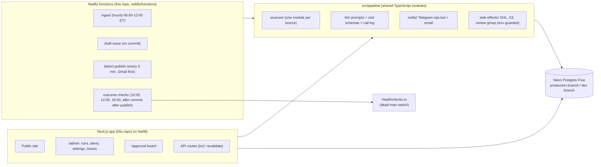

# Migration plan: from n8n to a native AI Recap backend

> **Historical. Finished 2026-11-10.** Every stage moved to native code, and n8n is retired ([ADR 0003](../adr/0003-n8n-retired-kept-as-record.md)). The plan to export and delete the workflows was dropped: they stay in n8n, disabled. The current system: [../architecture.html](../architecture.html).

Status: **agreed with the owner on 2026-11-05** after a full review of the plan. Read [README.md](./README.md)
first for how the system works today.

This doc is the design reference. **The work queue lives in GitHub issues**: one parent issue per phase,
with sub-issues for each task. Each sub-issue has acceptance criteria and a rollback.

| Phase | Parent issue |
|---|---|
| 0. First security fix | #35 |
| 1. Foundation | #36 |
| 2. Better approval board proposals | #37 |
| 3. Native publish detection | #38 |
| 4. Native newsletter ingestion | #39 |
| 5. Native drafting | #40 |
| 6. Retire n8n | #41 |
| Later (unscheduled) | #42 |

The plan moves the AI Recap backend out of n8n one piece at a time. The newsletter keeps going out every
weekday during the whole migration. There is no big-bang launch. At every step, one system owns each
stage in production, the old path stays ready as a fallback, and a switch moves ownership back in minutes.

## 1. Goals and constraints

From the owner:

1. **Sources are easy to add and edit.** For now each source is a code module, built so it can move to a
   database table with an admin page later.
2. **Jobs detect problems and notify.** That covers hard errors and silent failures, such as a source that
   stops sending, a run that "succeeds" with zero stories, or an issue that never appears on the site.
3. **Publishing stays manual.** A person still sends the campaign in GHL. The system detects the send and
   publishes the issue on the site. It never sends email by itself.
4. **Development and production are separate.** Production is the only hosted environment. Non-production is
   the owner's laptop plus Netlify pull-request previews, all on the Neon `dev` branch.
5. **The migration is piecewise.** The current system keeps running while each piece moves.
6. **It costs close to nothing.** Free plans only: the existing Netlify plan, Neon Free, Healthchecks.io Free.

Daily schedule (weekdays, Eastern time), unchanged from today:

| Time | What happens |
|---|---|
| 10:00 | The approval board is ready, and the review group gets the "ready" ping. |
| 12:00 | If nothing is approved yet, the owner gets an alert. |
| 18:00 | If the approved issue is not sent and published yet, the owner gets a reminder. |

An early-morning edition is a later goal. It needs live search sources first, because the newsletters
arrive between about 06:00 and 12:30.

Other decisions:

- `Telegram MCP` and the `MCP` server workflow were deactivated on 2026-11-04.
- `SUBSCRIBER_PROVIDER` is GHL in production.
- GHL token rotation and the n8n approval webhook fix are **postponed**. Phase 5 removes both: it retires
  the webhook and gives native drafting a new GHL token.
- **Aloa is dropped** (nothing sent since April). **Product Hunt stays**: it is the only reliable source for
  tools.
- **Live search sources are postponed** (Perplexity first, Exa as backup, Grok `x_search` for X). See
  [the research](../research/live-news-and-job-runners.md).
- The owner is the only reviewer and operator.
- The repo stays public. Open security findings live in private GitHub security advisories and a private
  notes file outside git, never in issues, commits, or docs.

## 2. Rules that keep production safe

| # | Rule | Why |
|---|---|---|
| R1 | **One owner per stage.** Each stage (ingest per source, approval ping, draft, publish detection) has one owner in production: `n8n`, `native`, or `shadow`. The owner is stored in the `pipeline_settings` table. | Two systems never write the same data. |
| R2 | **Shadow before cutover.** Native code first runs in production in *shadow* mode. It reads real inputs, writes only to `shadow_*` tables, and is compared with what n8n did (section 6). | Proves the native code on real traffic with no effect on subscribers. |
| R3 | **Every cutover has a written rollback, tested in dev.** The rollback is always "flip the owner back and reactivate the n8n workflow". | Recovery takes minutes. |
| R4 | **Additive schema only while n8n uses a table.** New tables and new nullable columns are fine. No renames, drops, type changes, or new NOT NULL constraints on `stories`, `issues`, or `scraper_bookmarks` until the n8n stage that uses them is retired. | n8n uses hand-written SQL that breaks on schema changes. |
| R5 | **n8n is frozen.** No new features or monitoring go into n8n. The only n8n edits are the cutover steps in this plan and emergency fixes. Each emergency fix is also filed as an issue for the native code. | The two systems do not drift apart. |
| R6 | **Retire, don't delete.** Retired n8n workflows are deactivated and kept for 30 days, then exported to the private archive and deleted. | Rollback stays possible. |
| R7 | **Cut over after a successful send.** Flip a stage right after that day's issue is published, with the owner available for the next full cycle. | A full day to catch problems before the next issue. |
| R8 | **Test-first.** Each native module is built test-first (see `AGENTS.md`), using golden fixtures from real n8n runs. | Parity is measured, not assumed. |

Golden fixtures: full payloads of 317 recent runs of the 11 live workflows, plus all workflow exports, are in
a private archive outside git. n8n deletes runs after 14 days, so the archive is the only copy. Strip
personal data and tokens before turning any payload into a committed test fixture.

## 3. Target architecture



### 3.1 Job runner: Netlify functions

Decided in [ADR 0001](../adr/0001-job-runner.md) (2026-11-07). Jobs are TypeScript in this repo, so Claude
Code builds and tests them like the rest of the app.

- **Scheduled functions** run short checks. Netlify stops them at 30 s, and their cron is UTC only, so each
  job checks New York time in code.
- **Background functions** run long work (up to 15 minutes; on all credit-based plans, including Free).
  Today's longest AI steps take 50–160 s, and one image-prompt call hit 300 s. They come with ingestion.
- **Cost:** Netlify credits shared with the site. Estimate 35–55 a month for all jobs, out of 300.
- **Runner-neutral logic.** Jobs live in `src/pipeline/`. `netlify/functions/` and `src/trigger/` are thin
  adapters, and `pipeline.runner` in `pipeline_settings` says which one acts (`netlify` by default).
- **Trigger.dev Free** passed its test in Dev, but Production deploys are blocked by the vendor. Its adapters
  stay in `src/trigger/`, dormant, so it can take over if the block lifts (ADR 0001 lists the steps).

Self-hosting on the Oracle VM is ruled out: it would share a box with n8n, and self-hosted Trigger.dev needs
about 7 vCPU and 14 GB.

### 3.2 Database: Neon Free

The project uses about 80 of the 100 free compute-hours a month at today's pace. Every new job must keep
the database asleep as much as possible:

- Checks run at fixed times, not every few minutes.
- Publish detection polls Gmail, not the database. It touches the database only when a matching email
  arrives.
- The site's home page and archive lists are cached again (Phase 3). Today they skip the cache, which likely
  keeps the database awake.
- No job queue lives in Postgres.

### 3.3 Models

- **GPT-6 Luna for every text step**: extraction, dedup, drafting, and image prompts. Effort is **low** by
  default and higher for dedup.
- **Vertex Gemini** keeps generating the featured image.
- Each step moves to GPT-6 Luna when that step moves to native code, not before.

### 3.4 Code layout

```
src/pipeline/
  sources/            # one module per source (rundown.ts, tldr.ts, ...), plus shared fetchers per type
    types.ts          # SourceDefinition interface; shaped so it can later load from a DB table
  ingest/             # fetch -> raw_items -> clean -> extract -> normalize -> upsert stories
  llm/                # versioned prompt files, zod output schemas, client wrapper, llm_calls logging
  draft/              # outline -> issue content -> HTML template -> image -> GHL template
  publish/            # sent-email parser -> content_json v2, mark published, cache revalidation
  checks/             # outcome checks, incident lifecycle, daily digest
  notify/             # Telegram ops bot + email, dedup, severity routing
  side-effects/       # GHL, S3, review group; dry-run outside production
  settings.ts         # stage owners + thresholds from pipeline_settings
netlify/functions/    # Netlify scheduled and background functions; thin wrappers around src/pipeline
src/trigger/          # dormant Trigger.dev adapters for the same jobs (ADR 0001)
app/approval/...      # admin pages, for now under /approval so the existing login covers them
```

## 4. Environments

| Part | Non-production (laptop and pull-request previews) | Production |
|---|---|---|
| Database | Neon `dev` branch. Reset from production on demand, then a script replaces `subscribers` and `auth_codes` with fake rows. | Neon production branch |
| Website | `next dev` on the laptop, and Netlify deploy previews for pull requests. Both point at the Neon `dev` branch. No separate staging site; the old `staging` branch is not revived. | Netlify production (`main`) |
| Jobs | No schedules. "Run now" on a deploy preview (which uses `dev`), or bundle a function with esbuild and run it locally. | Netlify functions on the production deploy of `main` |
| Gmail | Same mailbox, **read-only** scope (`gmail.readonly`). Nothing is labelled, moved, or marked read. | Same |
| LLM keys | Separate OpenAI project and key with a low budget cap | Production OpenAI project and key |
| Image storage | S3 prefix `newsletter-dev/` | S3 prefix `newsletter/` |
| GHL | **Dry-run:** payloads are saved to the database and shown in the admin pages. Never sent. | Real GHL location, with a new token used only by native code |
| Telegram | Dev ops chat. The review group is never messaged. | Prod ops chat, plus the "AI Recap Review" group |
| n8n | Not used | Legacy owner until each stage is retired |

Guards in the code:

- `APP_ENV` (`development` | `preview` | `production`) is required. The app and jobs refuse to start without it.
- `src/pipeline/side-effects/` is the only place that calls GHL, S3, or the review Telegram group. Outside
  production it routes to the dry-run adapters, whatever the other env vars say.
- `/api/newsletters/commit` stops defaulting to the production n8n webhook. Outside production it returns an
  error unless a non-production target is set. It forwards only a normalised `YYYY-MM-DD` date.
- Local `.env.local` holds development credentials only. Production database work goes through
  `scripts/run-prisma-prod.mjs`, with the URL supplied at run time.

Schema changes always follow the same order: write the Prisma migration, apply it to `dev`, test on the
laptop or a preview, then apply it to production with `scripts/run-prisma-prod.mjs`. Rule R4 limits what a
migration may do.

## 5. Phases

Sizes are rough working effort with Claude Code. Soak means calendar time spent watching, not working.

Pace (owner, 2026-11-08): a missed day is low stakes, so soaks are short and a phase's soak does not block
building the next phase. A missed publish is fixed by hand ("Mark as published"), not prevented by long soaks.

### Phase 0: One security fix (size: S, first pull request)

A small website fix, tracked in a private GitHub security advisory. It ships before anything else, with
route tests. **Rollback:** revert the pull request.

### Phase 1: Foundation (size: M, n8n untouched)

Goal: environments, the job runner, alerts, and outcome checks exist and are proven end to end.

**Revised 2026-11-09 with the owner (the issues hold the details):**

- Alerts: the existing review bot posts to one "AI Recap Ops" chat, in production only, with no email (#48).
  Slack may replace Telegram later (#119).
- Checks: one `run-checks` job runs at 10:05, 12:00, and 18:00 New York time (#50, #52). The check 10 minutes
  after each commit is dropped (#51 closed).
- A "No issue today" button marks a skipped date and silences its checks (#52).
- The admin pages can flip stage switches, with a confirmation step and a log (#54).
- Order: #53, #49, #48, then drafting (#40), then #50 and #52, then #54.

1. **Repair Prisma migration history.** Mark `20260630000000_add_story_paywall_note_error` as applied
   (`prisma migrate resolve --applied ...`) where it was applied by hand. `prisma migrate status` must be
   clean on `dev` and production.
2. **Environments** as in section 4: reset and scrub the `dev` branch, point Netlify deploy previews at it,
   and require `APP_ENV` everywhere.
3. **Job runner.** Trigger.dev Free passed its test in Dev, but Production deploys are blocked by the
   vendor. Jobs run as Netlify functions instead (ADR 0001).
4. **Base tables** (additive):
   - `pipeline_settings` (key, value json, updated_at): stage owners, deadlines, and thresholds.
   - `pipeline_runs` (id, job, trigger, status, started_at, finished_at, stats json, error).
   - `pipeline_events` (run_id, level, step, message, data json): the step log.
   - `alerts` (id, incident_key, severity, status open/resolved, first_seen, last_seen, notified_at,
     message, context json).
5. **Notify module.** A new "AI Recap Ops" Telegram bot posts to a prod ops chat and a dev ops chat.
   Critical alerts are also emailed through Resend. Alerts are de-duplicated by `incident_key`, repeat while
   open, and close with a "resolved" message. The existing review bot is untouched.
6. **Side-effect guard and commit-route guard** from section 4.
7. **Outcome checks.** They read only the database and the public site, never n8n. They catch n8n failures
   today and keep working after each stage moves.

   | When (ET, weekdays) | Check | Severity |
   |---|---|---|
   | 10:05 | Today's stories exist, with a count per source. Under 50% of the 8-week median for that weekday is critical. | Critical / warning |
   | 12:00 | Nothing approved yet: alert the owner. | Warning |
   | 10 min after each commit | A draft row exists for that date, and there is only one unpublished draft for it. Triggered by the commit, not by a schedule. | Critical / warning |
   | 18:00 | The approved issue is not published yet: reminder. If it is published, the issue page returns 200 with the title, and the home page lists it. | Warning / critical |
   | 18:00 | Daily digest: stories per source, approval time, publish time, open alerts. Then it pings Healthchecks.io. | Info |

   From Phase 3 the site check also runs right after each publish.
8. **Healthchecks.io heartbeat** (free plan). It emails the owner if the daily digest does not check in.
   That catches the job runner itself being down.
9. **Website login fixes** tracked in private GitHub security advisories.
10. **Admin shell:** `/admin` behind the approval login, with read-only pages for runs, alerts, and settings.

Exit: a test task in Dev reaches the dev ops chat, and the same task in Production reaches the prod ops chat.
Healthchecks.io alerts when the digest is paused. Migrations are clean on both branches. Two weeks of
outcome checks catch every real problem with no more than one false alarm a week.
**Rollback:** pause the tasks. n8n is untouched.

### Phase 2: Better approval board proposals (size: M, app only)

Goal: the default board is close to what the owner would approve. The data behind each item is in
[80-approval-and-source-analysis.md](./80-approval-and-source-analysis.md). All changes are in the app's
curation code; none needs n8n.

1. **Refill empty slots.** Dedup removes a median 10 of 28 slot stories with no backfill. Refill from the
   remaining pool.
2. **Dedup over the last 7–10 days**, not 2, against published stories and approved-but-unsent drafts.
   8 of 11 exclusions were stories published 2–6 days earlier. The dedup call moves to GPT-6 Luna with
   higher effort.
3. **Propose a lead story** using how many sources covered it. The proposed #1 became the lead in only
   2 of 10 commits.
4. **Prefer a free link** when the chosen link is paywalled, using another source's link for the same story.
   All 4 link edits in the archive did this by hand.
5. **Hold back stories already in a pending, unsent draft** from the next day's board, by default. A
   banner per unsent draft lets the approver put them back in the pool for this issue (skip the missed
   day) or keep holding them (catch up the missed issue). Held stories count as reference stories in the
   duplicate check. Done in #57.

Exit: for 2 weeks, fewer edits per commit than the archive baseline in doc 80. **Rollback:** revert the
pull request.

Target for later: the board proposes a finished issue that the owner accepts as is, or after swapping a
few stories.

### Phase 3: Native publish detection (size: S–M, soak: 1 send, shortened 2026-11-08)

Goal: remove the most fragile step. Today an LLM re-reads the sent email, and if `3. Gmail Listen - Publish`
misses it the issue never appears. Sending stays manual in GHL.

1. **Gmail client** with its own Google Cloud OAuth client and `gmail.readonly` scope. The refresh token is
   stored in secret Netlify env vars. Built: `src/pipeline/publish/gmail-client.ts`.
2. **Deterministic parser** that turns the sent email HTML into `content_json` v2. It reads the
   `data-issue-id`, `data-story-id`, and `data-src-url` attributes the draft HTML already carries. It takes
   the title from the email header, not the subject line, because the website title comes from there
   (the subject has an extra emoji and sometimes other words). There is no LLM in this path. Built
   test-first: `src/pipeline/publish/sent-email-parser.ts`. It matches n8n's AI parse on all 20 archived
   issue emails, apart from quote style and spacing.
3. **`detect-publish` job.** A Netlify scheduled function runs it every 5 minutes from 09:00 to 20:59 ET on
   weekdays (past sends went out 10:00–17:40), and a daily catch-up run at 22:00 ET looks back 3 days. It
   searches Gmail first for mail **from the GHL sending address** to the one monitor seed address
   (`PUBLISH_SEED_RECIPIENTS`) received in the last 20 minutes. Each send also reaches the owner's `+`
   alias in the same inbox; the job ignores that copy (n8n reads both). Only when there is such mail does it
   open the database (§3.2). It handles each Gmail message id once per mode. In one transaction it
   sets `published_at`, `content_json`, `title`, and `stories.used_in_publication_date`, and only if the
   issue is still unpublished. It does **not** overwrite `html` with the received copy, which holds a
   subscriber's name and unsubscribe link. An email with parse problems is held as `needs_review`. Built:
   `src/pipeline/publish/` (logic), `netlify/functions/detect-publish*.mts` (active), and
   `src/trigger/detect-publish.ts` (dormant, see ADR 0001). After a native publish the job calls the
   revalidate route (item 5); a failed call is a warning, not a failed run.
4. **"Mark as published" button** in `/approval/issues` (behind the existing approval login). It publishes
   a chosen draft from its stored HTML through the same store as the task, after an inline confirm. It sends
   no email. Each use is a `manual` row in `publish_events`. Built and tested on dev.
5. **Cache the site lists again.** The home page and archive lists use a tagged cache. The publish step
   refreshes it, with a 1-hour safety expiry. Issue pages are refreshed the same way. n8n does not refresh
   caches, so list caching ships in the cutover window, not before (#62). Built 2026-11-08: one
   `published-issues` tag, `POST /api/revalidate` with a 5-minute token signed from `SESSION_SECRET` (no new
   credential), and a refresh after "Mark as published". Checked on dev with `next start`: the list stays
   cached after a database change and shows it right after the refresh.
6. **Shadow:** with owner `shadow`, the task writes only to `publish_events` (mode `shadow`) and compares
   its content with what Gmail Listen wrote. One table holds shadow, native, and manual rows. On dev, a
   shadow run over 14 real seed emails (issues 264–270) found 0 differences.
7. **Later: a Resend listener.** The owner plans to replace the Gmail seed-inbox check with a Resend
   listener. Only the email source changes: `detectPublish` takes message ids and a reader, so a Resend
   source can feed the same parser, decision, and store.

The owner key is `publish.owner` in `pipeline_settings` (`n8n`, `shadow`, or `native`). A missing or
unknown value means `n8n`, so the job does nothing until the key is set. Shadow mode ran on production
from 2026-11-07 (Gmail env vars set in Netlify, `publish.owner = shadow`). **Since 2026-11-08 22:47 UTC
production is `native`** and `3. Gmail Listen - Publish` is deactivated.

Cutover (revised 2026-11-08; the 5-send soak is dropped):

1. Before: compare the shadow content with n8n's for the latest sends (issues 270, 271, and the next send),
   and rehearse a native publish and the rollback on dev. #62 is ready to merge.
   Done 2026-11-08 except the next send: on the #62 deploy preview (Neon `dev`, owner `native`), the
   catch-up published a draft of issue 271 from the real seed email, set `published_at` 2 s before n8n's,
   and refreshed the preview's lists. Its content had 0 differences from n8n's production 271. The lists
   stayed cached on a later database change. Owner set back to `shadow` afterwards.
2. Right after the next successful n8n publish (R7): merge #62, set `publish.owner = native`, and deactivate
   `3. Gmail Listen - Publish` in the same window. Target: the first send after #62 is ready.
   Done Sunday 2026-11-08, 22:47 UTC, after the owner asked for an aggressive pace: #108 merged (production
   deploy `6af0fbb3`), owner `native`, Gmail Listen off. Its last run (issue 271, 2026-11-06) succeeded. The
   workflow only parsed the email and updated the issue and its stories; the native job does both. The
   "next send" comparison in step 1 is replaced by step 3 on Monday 2026-11-09.
3. After: check the next send appears on the site within 10 minutes. If an email is held as
   `needs_review` or missed, publish it with "Mark as published" in `/approval/issues`.

**Rollback:** reactivate Gmail Listen and set `publish.owner = n8n`. With list caching on, an n8n publish
then reaches the lists within the 1-hour expiry, or at once through the revalidate route.

Exit: 1 week native-only, with every send published within 10 minutes. Phases 4 and 5 do not wait for it.

### Phase 4: Native newsletter ingestion, one source at a time (size: L)

Goal: ingestion moves off n8n source by source, and adding a source becomes a small, tested code change.

**Revised 2026-11-08 (issue #110): all sources at once, n8n's behaviour with its bugs fixed.** The owner
asked to switch "ASAP", so 4a–4d below are replaced by one switch, `ingest.owner` (`n8n` or `native`), and
no shadow week. Extras (raw items, hourly runs, alerts, `ingested_by`, source modules) moved to #111.

- Built: `src/pipeline/ingest/` and `netlify/functions/ingest-stories*.mts`. Same schedule as n8n (09:55 New
  York, weekdays), same prompt, model `gpt-6-luna` (low effort, strict schema, no web search), same `guid`
  formula, same Telegram ping. Aloa is dropped. Bugs fixed: every new email since the bookmark (not `limit 1`),
  The Signal saved as `the_signal`, tracking links followed up to 5 hops, tracking parameters removed but
  other query strings kept, stories without a link dropped, feed stories dated with the run date, a failed
  email tried again, better paywall rules, and a ready message that names failed sources.
- Dev run 2026-11-08 (Neon `dev`, real inbox): 31 s, 68 stories, all 7 sources ok. Against n8n's Friday run:
  Rundown 4 of 5 links the same (the 5th was a sponsor), AlphaSignal 8 of 9, AI Breakfast 18 stories against 9.
  TLDR could not be compared: n8n read Thursday's email, a day behind because of `limit 1`.
- Cutover, after a successful "Run now" on the pull request preview:
  1. Set `TELEGRAM_REVIEW_BOT_TOKEN` (production) in Netlify, then merge.
  2. Set the production `the_signal` bookmark to the `tldr_ai` value (n8n wrote The Signal under `tldr_ai`).
     `tldr_ai` and `aloa_ai` stay unused.
  3. Set `ingest.owner = native`, then deactivate `Agent - Extract and Store` (v1), `1. Fetch Stories`, and its
     helpers: `Resolve Redirect URLS from Emails`, `HTML Strip`, `Agent - Extract and Store v2`,
     `Check for Paywalls`, `Bookmark: Get`, `Bookmark: Set`, and `Scrape Beehiiv`.
  4. After the first run: check the run in `pipeline_runs`, the board, and the Telegram message.
- **Rollback:** set `ingest.owner = n8n` and reactivate the n8n workflows. The bookmarks the native job
  moved are newer than n8n's, so set them back to the native run's start first, or n8n skips that day's mail.
- **Done 2026-11-09 about 04:05 UTC (Sunday night in New York), owner's "go":** the preview "Run now" passed (dev run 6,
  16 s). Then: `TELEGRAM_REVIEW_BOT_TOKEN` set (production, secret), #112 merged (production deploy `6af1462f`,
  `ingest-stories` scheduled `55 13,14 * * 1-5`), production `the_signal` bookmark = `tldr_ai` (2026-11-06
  14:55 UTC), `ingest.owner = native`, and all 9 n8n ingestion workflows deactivated (including
  `Scrape Beehiiv`). The first native run is Monday 2026-11-09 09:55 New York. Known gap: n8n never stored
  Friday 2026-11-06's TLDR email (it was a day behind), and the 72-hour window does not reach it.
- Lesson: Netlify reads a function's `schedule` from its source text. An imported constant deployed the
  function unscheduled on the first preview. `src/pipeline/netlify-functions-bundle.test.ts` now checks it.

**4a. Source modules and the engine.**
- Each source is a module in `src/pipeline/sources/` that exports a `SourceDefinition`: `key` (matches
  `stories.source`), `name`, `type` (`gmail-newsletter`, `product-hunt`, `hugging-face`, ...), `config`,
  `expected_cadence`, `aliases` (for drift such as `rundown`, `rundown_ai`, `Rundown`), and `category_hint`.
  The shape fits a later `sources` table with an admin page.
- Pipeline: fetch → `raw_items` (unique on source + external id, such as the Gmail message id) → clean (port
  of redirect resolution and HTML strip) → extract (GPT-6 Luna, low effort, zod schema) → normalize URLs
  (keep query strings that matter, such as YouTube `v=`) → paywall check → upsert `stories`.
- **Schedule:** hourly from 06:00 to 12:00 ET on weekdays. Each run processes every new email since the
  source's cursor, not just the newest one. That fixes the `limit 1` loss and the missed Monday TLDR.
  Late newsletters, such as AI Breakfast at up to 12:22, still land on the board.
- During coexistence, `guid` uses the same formula as n8n, so both systems hit the same row. A new nullable
  column `stories.ingested_by` is set to `native` by native code. n8n leaves it NULL.
- An LLM schema failure retries once with the error shown to the model. After that the raw item is marked
  failed, and an alert fires.

**4b. Shadow each source.** The engine ingests a source with owner `shadow` into `shadow_stories` for a week,
and is compared with n8n (section 6). Expected improvements, such as the Monday TLDR and the correct
The Signal label, are listed as such.

**4c. Cut over one source at a time.** Order: AlphaSignal, AI Breakfast, Rundown, TLDR, The Signal, then
Product Hunt and Hugging Face. For each Gmail source:
1. Set the source owner to `native`. Native code starts writing real stories.
2. In `1. Fetch Stories`, change that branch's Gmail sender filter to a non-matching address. The branch then
   behaves as on a day with no new mail, which already happens without breaking the run. No node is
   deleted. Do this right after a successful send (R7).
3. An outcome check alerts if a native-owned source still gets rows with `ingested_by IS NULL`.

**Rollback:** put the original sender back in n8n and set the owner to `n8n`.

**4d. Retire n8n ingestion.** Product Hunt and Hugging Face are not Gmail sources, so they move when
`1. Fetch Stories` is deactivated, together with `Resolve Redirect URLS from Emails`, `HTML Strip`,
`Agent - Extract and Store v2`, `Check for Paywalls`, and `Bookmark: Set`. Aloa is not ported. From then on,
native code sends the review group's "ready" ping after the 10:00 run, with each source's status. A short
follow-up goes out for late arrivals only if nothing is approved yet.

**Adding a source afterwards:** ask Claude Code to add a module from the template, with fixture tests. Open a
pull request, try it on the preview, and merge. `docs/pipeline/adding-a-source.md` describes the steps.

Exit: all sources native for 2 weeks, with story volume and board quality equal to or better than n8n.

### Phase 5: Native drafting (size: L, soak: 2 issues in shadow, shortened 2026-11-08)

Goal: commit → draft runs natively, with real status in the UI, one draft per date, and no duplicates.

**Revised 2026-11-09 with the owner. These points replace the steps below where they conflict:**

- One issue per date. Each commit makes a new draft with its own new GHL template, and the latest draft is
  current ([ADR 0002](../adr/0002-new-draft-per-commit.md)).
- No shadow mode and no `draft_previews` table. Testing replays at least 5 past commits on `dev`, and the owner
  reviews the results (#76).
- The writer reads the article of each feature-section story at draft time. How to read articles is investigated
  first, with a real browser screenshot as the ground truth (#115). The reader saves the text per story (#120).
- The writing prompt's contradictions are fixed, and it adds an excerpt. Web search stays off unless #115 shows
  it helps.
- The board shows the draft's live steps, the email preview, an "Open in GHL" link, and every draft for the
  date (#79).
- "New image" replaces the n8n image agent (#116). A full pre-send review in the app comes later (#117).
- Each n8n workflow is switched off the day its native replacement is ready. The duplicate drafts are deleted
  right after the switch (#84).
- Credentials are reused from n8n, and nothing is rotated (#74).

1. **Persist the outline:** `approval_outlines` (date, payload, payload_hash, committed_at, status). The app
   writes it on every commit, while n8n still drafts.
2. **`draft-issue` task**, with the idempotency key `date + payload_hash`. It ports the writing call to
   GPT-6 Luna (same prompt; fix the schema so `excerpt` is allowed), the HTML template as TypeScript (with
   the same `data-*` attributes so Phase 3 detection keeps working), and the image chain (GPT-6 Luna image
   prompt, Vertex Gemini image, S3 upload).
3. **One draft per date:** update the unpublished draft for that date instead of inserting a new row. Store
   `ghl_template_id`, and on re-commit update the same GHL template.
4. **Write `content_json` at draft time** from the structured LLM output. Publish detection then only confirms
   what was sent, and still records any edits made in GHL.
5. **Reuse the existing GHL token** (the one n8n uses for the live templates) in env vars. No rotation.
6. **Commit route switch:** `draft.owner = n8n` posts to the webhook as today. `draft.owner = native` starts
   the task and returns a run id. The approval page shows live progress, real failures, and a retry button.
7. **Shadow:** with `draft.owner = n8n`, every commit also runs the native draft in preview mode. It skips
   GHL, writes to `draft_previews`, and is shown next to the n8n draft in `/admin/issues`.

Cutover: after 2 good previews, set `draft.owner = native`, then deactivate `2. Public approval page`,
`2. Create Issue Draft`, `2.2.1`, `2.2.2`, and `Agent: Change Featured Image`. **Rollback:** set
`draft.owner = n8n` and reactivate them.

Exit: 1 week native-only with no duplicate drafts and no silent draft failures.

### Phase 6: Retire n8n (size: S–M)

**Revised 2026-11-09 with the owner. These points replace the list below where they conflict:**

- n8n stays as a backup for 30 days. The 30 days start after 10 weekday issues in a row go out with no manual fixes.
- After the 30 days, the workflows are exported to the private archive, then the workflows and their credentials
  are deleted from n8n. Nothing is revoked, because native code uses the same keys (#81).
- The schema cleanup is trimmed to these changes (#82):
  - an issue status (draft or published);
  - a unique issue date;
  - an index on `stories(day)`.
- The issue-to-story link and a stable story key need a design first (#118). The separate database role is dropped.
- Per-user login is dropped, because there is one operator (#83 closed). The duplicate drafts are deleted, not
  marked (#84).

- Deactivate the remaining AI Recap workflows. After 30 days (R6), export them to the archive and delete
  them. Remove `N8N_WEBHOOK_JWT_SECRET` and `OUTLINE_COMMIT_WEBHOOK_URL`. Revoke n8n's database credential
  and OpenAI key.
- The R4 schema limits lift:
  - Add `issue_stories` with foreign keys.
  - Replace the implied draft/published state with an issue `status` enum and one published issue per date.
  - Add a stable `story_key` that does not depend on LLM output.
  - Add an index on `stories(day)`.
  - Give the pipeline its own least-privilege database role.
- Use per-user approval login instead of the shared password.
- Clean up the 26 orphan drafts.
- Update `AGENTS.md` with the pipeline architecture, commands, and links to the runbook and the
  adding-a-source guide.

### Later (not scheduled)

- **Live search sources** (Perplexity first, Exa as backup, Grok `x_search`). New sources start in trial mode:
  their stories show in an admin preview, off the board, until switched to live.
- **Early-morning edition**, once search sources make it possible.
- **Sources in the database** with an admin page to add, edit, pause, and test them.
- **"Accept or swap" approval:** a finished proposed issue, sections chosen by editorial role, one-tap accept,
  and reason codes on excludes and moves.
- Group the same story across sources with embeddings.
- Optional, only if the owner chooses: schedule the GHL campaign through the API after approval.

## 6. How native output is compared with n8n

| Output | Rule |
|---|---|
| Made by code: which emails were read, URLs, `guid`, source labels, dates, story ids and order, HTML structure | **Exact match** against golden fixtures and shadow data. Each difference is either a bug or a listed, expected improvement. |
| Written by AI: extracted headlines and summaries, issue copy, image prompts and images | **Side by side over 5 runs**, reviewed by the owner in `/admin`, plus automatic checks: the output passes its schema, every approved story appears once, links match source URLs, section counts are within limits, and text lengths are within bounds. |

## 7. Who owns each stage, phase by phase

| Stage | Today | P1 | P2 | P3 | P4 | P5 | P6 |
|---|---|---|---|---|---|---|---|
| Ingest: newsletters, Product Hunt, Hugging Face | n8n | n8n | n8n | n8n | shadow → native, one source at a time | native | native |
| Approval "ready" ping | n8n | n8n | n8n | n8n | native after 4d | native | native |
| Approval board proposal | app | app | app (improved) | app | app | app | app |
| Draft, image, GHL template | n8n | n8n | n8n | n8n | n8n | shadow → native | native |
| Send the campaign | owner in GHL | owner | owner | owner | owner | owner | owner |
| Publish detection | n8n | n8n | n8n | shadow → native | native | native | native |
| Alerts and outcome checks | none | native | native | native | native | native | native |

## 8. Notifications

- **Severity.** *Critical* (a subscriber-facing step is broken or at risk) goes to the Telegram ops chat and
  by email right away, and repeats every 2 hours until resolved. *Warning* goes to the ops chat once per
  incident. *Info* goes into the daily digest only.
- **One incident, one thread.** Alerts are keyed by `incident_key` (for example `source-stale:tldr`), so a
  repeating failure does not spam. The system posts "resolved" when the check passes again.
- **Every alert says what to do.** Each message names the failing thing, the evidence, and a link to the run
  or admin page and the runbook entry in `docs/pipeline/runbook.md`.
- **Backstop.** Healthchecks.io, if the digest does not arrive.
- **Outcomes matter most.** n8n runs report "success" while losing data, so the checks judge results
  (stories, drafts, publishes, site pages), not job status.

## 9. Owner actions

| When | Action |
|---|---|
| Before Phase 1 | Create the "AI Recap Ops" bot with BotFather, create two private chats (prod ops, dev ops), add the bot, and share the token and chat ids. |
| Before Phase 1 | Approve resetting the Neon `dev` branch from production. Its June data is lost. |
| Before Phase 1 | Create a Healthchecks.io account (Free) and one check. |
| Before Phase 1 | Set the Netlify deploy-preview env vars to the Neon `dev` branch (the site is not visible to the local CLI account). |
| Before Phase 3 | Create a Google Cloud OAuth client for read-only Gmail access, and sign in once to grant it. |
| Before Phase 5 | Create a new GHL Private Integration Token for native code, and an AWS IAM user or role limited to the S3 prefixes. |
| Each cutover | Be available for the next full daily cycle after the switch (R7). |

## 10. Why this order

- **Phase 0** is a small security fix that ships first.
- **Phase 1** gives alerts in the first weeks at zero risk, because it only reads outcomes.
- **Phase 2** cuts the owner's daily editing and needs no n8n changes.
- **Phase 3** is small and removes the single point where a missed email hides an issue. It also builds the
  Gmail client that ingestion needs.
- **Phase 4** is the largest piece. It moves one source at a time.
- **Phase 5** goes last because drafting is one indivisible flow per issue. By then the runner, the LLM module,
  and the side-effect guards are proven.
