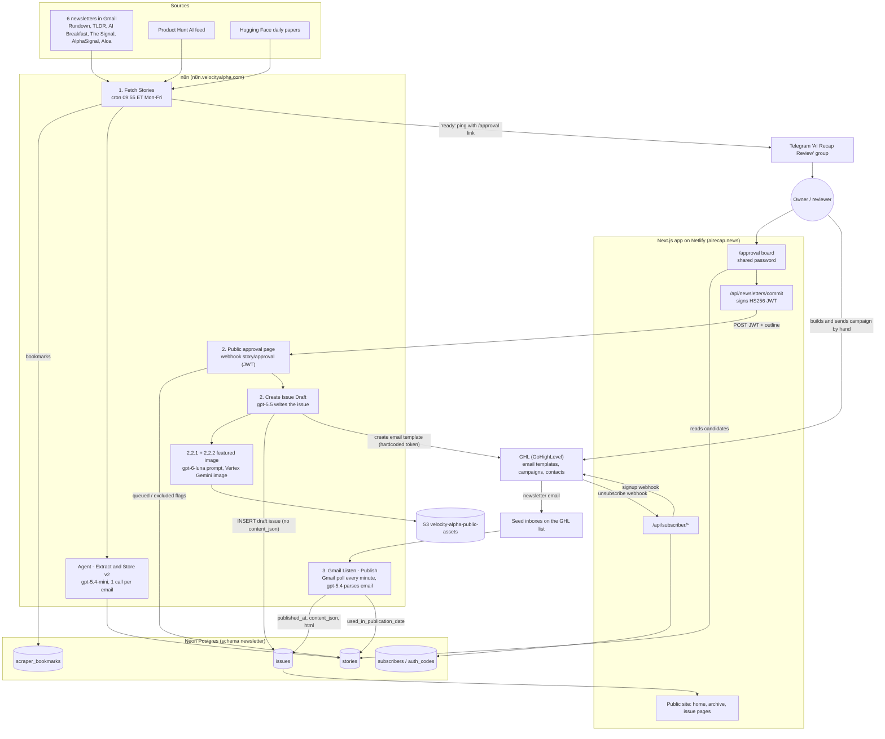

# The old n8n backend (historical)

> **Historical.** Native code in this repo replaced the n8n system in November 2026
> ([ADR 0003](../adr/0003-n8n-retired-kept-as-record.md)). The n8n workflows are disabled and kept as a record.
> Nothing here describes the current system: see [../architecture.html](../architecture.html).

This folder records how the AI Recap backend ran in n8n (`https://n8n.velocityalpha.com`) on 2026-11-03, in
enough detail to look up how any step used to work without opening n8n. The native code was ported from these
docs, so code comments cite them by section.

All facts came from read-only exports of the 71 workflows on the instance, 14 days of execution history, the
Neon database (read-only queries), and this repo. No secret values appear; credentials are named, never shown.

## How to use these docs

| Doc | Covers |
|---|---|
| [10-ingestion.md](./10-ingestion.md) | Daily story ingestion: Gmail newsletters, Product Hunt, Hugging Face, per-email LLM extraction, dedup, bookmarks, paywall checks |
| [15-legacy-and-experiments.md](./15-legacy-and-experiments.md) | 18 inactive or unused workflows: the old automatic pipeline, source experiments (Beehiiv, Jina, Bright Data, Apify, Reddit, X, YouTube, Perplexity), guardrails |
| [20-drafting-and-images.md](./20-drafting-and-images.md) | Issue drafting after approval: the writing LLM call, HTML template, featured image (OpenAI → Vertex Gemini → S3), GHL template creation |
| [30-approval-and-telegram.md](./30-approval-and-telegram.md) | Human approval on the website, the JWT webhook into n8n, story state, every Telegram touchpoint, trust chain |
| [40-publishing-email-subscribers.md](./40-publishing-email-subscribers.md) | How an issue reaches subscribers through GHL, how "published" is detected from a seed inbox, subscriber sync, login, article gate |
| [50-app-and-database.md](./50-app-and-database.md) | Live Neon schema and data, who reads and writes each table, the Next.js site, caching, code structure, schema gaps |
| [60-ops-errors-secrets.md](./60-ops-errors-secrets.md) | Error handling, failures, schedules, credentials map, hardcoded secrets, retention, instance facts, ops checklist |
| [70-migration-plan.md](./70-migration-plan.md) | The migration plan, finished 2026-11-10: safety rules, environments, phases with cutover and rollback steps, outcome checks, alerts |
| [80-approval-and-source-analysis.md](./80-approval-and-source-analysis.md) | Data analysis: what the reviewer edits on the approval board, when each newsletter arrives, and which sources reach published issues |
| [../research/](../research/) | Research on free job runners and live AI-news search APIs (checked 2026-11-04), and on how drafting reads a story's article (checked 2026-11-09) |

Each doc starts with an "At a glance" section and a diagram. LLM prompts, output schemas, SQL, and key
Code-node logic are copied verbatim inside the docs.

## The n8n system in one picture (as of 2026-11-03)

## One day in the life

Times are US Eastern. The n8n instance timezone is `America/New_York`, and no workflow overrides it.

| When | What happens | Where it is documented |
|---|---|---|
| 09:55 Mon–Fri | `1. Fetch Stories` reads 8 sources. Only mail after `max(bookmark, now − 3 days)` counts as new. | 10 |
| 09:55–09:58 | One `gpt-5.4-mini` call per newsletter email extracts about 30–65 stories. They are upserted into `newsletter.stories` with `guid = md5(published_at \|\| cleanedUrl)`. | 10 |
| ~09:58 | A Telegram message goes to the review group with `https://airecap.news/approval?date=<today>`. A stats email goes to the owner. Both are sent even if extraction failed. | 10, 30 |
| Any time after | The reviewer logs in to `/approval` with the shared password. They pick, demote, exclude, reorder, and edit stories, then press **Commit**. Nothing happens if nobody approves. | 30 |
| Commit | The app signs an HS256 JWT (1 h expiry) and POSTs the outline to the n8n webhook `story/approval`. n8n replies 200 at once, then marks stories and calls `2. Create Issue Draft`. | 30 |
| +1 min | `gpt-5.5` (web search on, strict JSON) writes the issue. A Code-node template renders the HTML. The featured image is made and uploaded to S3. A new `issues` row and a GHL email template are created. | 20 |
| 7–330 min later | A person opens GHL, creates a campaign from the template, types the subject line, and sends it. | 40 |
| Send + ~1 min | The seed inboxes receive the email. `3. Gmail Listen - Publish` sends the whole email HTML to `gpt-5.4`, which rebuilds `content_json`. It sets `published_at` and `used_in_publication_date`. | 40 |
| After publish | The site lists the issue, because it now has `published_at` and `content_json`. Lists are uncached. Issue pages are cached for 1 hour. | 50 |

## Which workflows matter

**Live pipeline (11 active workflows that run today):**

| Stage | Workflow | Id |
|---|---|---|
| Ingest | 1. Fetch Stories | `hdEUV8VFZbI13VpV` |
| Ingest | Resolve Redirect URLS from Emails | `ELtnV1av7bg8hxCz` |
| Ingest | HTML Strip | `QizlCbiLwCn4fGRf` |
| Ingest | Agent - Extract and Store v2 | `vVPv9aMjTwYBFKqb` |
| Ingest | Check for Paywalls | `NbNTNmXoOJ81jYlf` |
| Ingest | Bookmark: Set | `AL1bSOW4DwLHcStx` |
| Approve | 2.  Public approval page | `RB9M8RWAYozoWapB` |
| Draft | 2. Create Issue Draft | `QLPaj244TM7azSAH` |
| Draft | 2.2.1 Sub: Create Image Prompt | `j2B4f4kFJs6sBdog` |
| Draft | 2.2.2 Sub: Generate Stylized Image From Prompt | `0Gd3lzvwITBnd8om` |
| Publish | 3. Gmail Listen - Publish | `Tqon5VyPBEv9juF4` |

**Active but never reached (9):** `2.1 Sub: Compile Draft Stories` and `2.1.1 Request Approval`
(the old Telegram-form approval), `2.2 Sub: Generate Issue Featured Image`, `Agent - Extract and Store` (v1),
`Bookmark: Get`, `Extract Page for LLM`, `Scrape Beehiiv`, `Agent: Change Featured Image` (editor chat agent),
and `Error Handler` (only the inactive workflows point to it).

**Inactive (14 AI Recap workflows):** the old automatic pipeline and experiments. See doc 15.

**Not AI Recap, but on the same instance:** about 10 active KAI, VA, Upwork, and VAPI workflows. Two
of them were exposed with no auth: `Telegram MCP` (test bot) and the `MCP` server at `/mcp/serve`, which could
look up KAI Airtable users. Both were deactivated on 2026-11-04. See docs 30 and 60.

## Data model and state

Five tables in schema `newsletter` on one Neon project (prod and dev branches; dev was forked on
2026-06-29 and has no newer data). There are no foreign keys. Production counts on 2026-11-03:
`stories` 6,788, `issues` 185, `scraper_bookmarks` 9, `subscribers` 38, `auth_codes` 3.

- **Writers:** n8n is the only writer of `stories`, `issues`, and `scraper_bookmarks`. The app writes only
  `subscribers` and `auth_codes`.
- **Story state** is spread over three columns:
  `exclude_from_candidates` (set at commit) → `queued_for_publication_date` (set at commit, never read) →
  `used_in_publication_date` (set when the sent email is detected).
- **Issue state** is implied: a row with `published_at IS NULL` is a draft. The site shows an issue only when
  `published_at` and `content_json` are both set.
- **No issue-to-story link table.** The link exists only as `story_id` values inside `content_json` and the
  date in `used_in_publication_date`.
- **Prisma drift:** one migration was applied by hand and is not recorded, so `prisma migrate deploy` will fail
  until this is repaired. Fix it before any schema work. See doc 50.

## Contracts between the parts

| From → To | How | Auth | Doc |
|---|---|---|---|
| App → n8n | `POST https://n8n.velocityalpha.com/webhook/story/approval` with the approval outline | HS256 JWT, secret `N8N_WEBHOOK_JWT_SECRET` ↔ n8n credential "AI Recap JWT Secret" | 30 |
| n8n → reviewer | Telegram text message with the `/approval?date=` link | Bot credential "AI Recap Review Telegram Bot" | 30 |
| n8n → GHL | `POST /emails/builder`, then `POST /emails/builder/data` | Hardcoded GHL Private Integration Token in node headers | 20, 40 |
| GHL → n8n | The real campaign email arrives in seed inboxes, which Gmail Listen polls | Gmail OAuth credential "Gmail account" | 40 |
| App → GHL | Inbound webhook on new subscriber (`GHL_SUBSCRIBE_WEBHOOK_URL`) | URL is the secret | 40 |
| GHL → App | `POST /api/subscriber/unsubscribe/webhook` | `GHL_UNSUBSCRIBE_WEBHOOK_SECRET` | 40 |
| n8n → Neon | Postgres nodes, all with one credential | Credential id `uc4xRng0SsLcVsOO` | 50, 60 |

n8n never calls the app's API. The app never reads n8n state.

## What to fix now, before any migration

These are live risks in today's system. Status as of 2026-11-04:

1. **Rotate the GHL tokens.** *Postponed by the owner.* The token for `2. Create Issue Draft` is stored in
   workflow nodes instead of an n8n credential. Phase 5 of the migration plan gives native drafting a new
   token, and the old ones are revoked then.
2. **Deactivate the exposed endpoints.** *Done 2026-11-04.* `Telegram MCP` and the `MCP` server workflow are
   inactive, and `/mcp/serve` returns 404.
3. **Security findings.** *Tracked privately.* Because this repo is public, open security findings live in
   private GitHub security advisories and a private notes file, not in these docs. Phase 0 and Phase 1 of the
   migration plan fix the website items. Phase 5 retires the n8n approval webhook.
4. **Alert on failures.** *Planned in Phase 1 (outcome checks and alerts).* Today no live failure alerts anyone, and ingestion
   swallows errors so runs always show "success".
5. **Confirm `SUBSCRIBER_PROVIDER` on Netlify production.** *Confirmed by the owner: GHL.*
6. **Deactivate `Agent - Extract and Store` v1.** *Open.* A manual run would move a bookmark and skip a day of
   that source.
7. **Reset the production Neon password** used in `.env.local`. *Owner is doing this.* It was printed once
   into a local Claude Code session log during this research.

## Fragile points the native backend must design out

| Fragility today | Native design | Doc |
|---|---|---|
| "Published" depends on an LLM re-reading the sent email from a polled inbox. A missed email means the issue never appears. | Write `content_json` at draft time from the structured LLM output. Mark published from a GHL send event or API status. Keep a seed inbox only as a canary. | 40, 50 |
| Every commit creates a new draft and a new GHL template (15 dates have duplicates; 26 drafts were never published). | One issue per date with an explicit status (`draft → approved → scheduled → sent`). Make commit idempotent with an idempotency key, and store the GHL template id. | 20, 30 |
| No alerting. A failure after the webhook's 200 reply looks like success in the app. | A job runner with retries, run records in the database, and alerts (Telegram or email) on failure or missing steps, such as no issue sent by a set time. | 60 |
| Ingestion drops data: `limit 1` on three Gmail sources (Monday TLDR is always missed), The Signal saved as `tldr_ai`, URL-less stories share one guid, query strings stripped from URLs. | A source registry, raw-ingest log keyed by Gmail message id, per-source tests, and a stable story key that does not depend on LLM output. | 10, 15 |
| Approval relies on one shared password and posts to the prod webhook from every deploy. | Real accounts, CSRF-safe server actions, and an in-process job enqueue, so there is no cross-service webhook. | 30 |
| Sub-workflows run their latest saved draft, not the published version. An unsaved edit in the editor changes production behaviour. | Versioned code in git, with tests and preview environments. | 60 |
| One Gmail OAuth login feeds ingestion, publish detection, and alerts. | Separate concerns: a dedicated ingest mailbox or forwarding address, and a GHL event for publish. | 60 |
| Issue pages cache for 1 hour and are never revalidated on publish. | Call `revalidateTag` / `revalidatePath` when an issue changes state. | 50 |

## Recommended target shape

**Superseded by [70-migration-plan.md](./70-migration-plan.md)**, which turns this into phases. The plan
orders the work as security fix → foundation and alerts → approval board → publish detection → ingestion
(one source at a time) → drafting → retire n8n, and runs on Trigger.dev Free. The first sketch is kept below for
reference.

- **Keep this Next.js app as the home.** It already owns the approval board, the public site, subscribers, and
  the Prisma models. Add a `src/pipeline/` area with one module per stage: `sources`, `extract`, `curate`,
  `draft`, `image`, `deliver`, `publish`.
- **Use a durable job runner that is not bound by Netlify function limits.** Recommended: **Trigger.dev**.
  Tasks are TypeScript in this repo, have retries and cron, can wait for approval events, and have no
  short timeout. The longest steps today take 50–160 s per run, and one image-prompt call hit 300 s.
  Alternatives: **Inngest**, which needs a host that allows long requests for each step, or a small
  **worker on Render/Fly with pg-boss** on the same Neon database. Netlify scheduled functions (about 30 s)
  and background functions (about 15 min) are too tight or too limited for this on their own. Check the
  current limits before deciding.
- **Add the missing schema first:** `sources`, `pipeline_runs` / `job_steps`, `raw_items` (keyed by message
  id or URL), `issue_stories`, an issue `status` column with a one-published-issue-per-date rule,
  `approval_outlines`, `llm_calls` (prompt, model, tokens, latency), and an audit log. Repair the Prisma
  migration drift before adding these.
- **Cut over in this order, one stage at a time, while n8n keeps running:**
  1. **Draft and publish.** These are the most fragile, and the app already owns the commit step. The native
     draft writes `content_json` directly, creates the GHL template with a stored id, and marks published from
     GHL. Retire `2. Create Issue Draft`, `2. Public approval page`, the image sub-workflows, and Gmail Listen.
  2. **Ingestion.** Run native ingestion in shadow mode against a Neon dev branch and compare its output to n8n
     for a week. Then switch and retire `1. Fetch Stories` and its sub-workflows. New sources (web search,
     Reddit, X, YouTube, Perplexity-style "what's trending") plug into the source registry. Doc 15 keeps the
     endpoints and prompts from earlier experiments.
  3. **Autopilot.** Add auto-curation with confidence scores, approval reminders and timeouts, scheduled
     sending through the GHL API, and a daily health report. Keep human approval as an override.

## Open questions for the owner

1. Who sends the GHL campaign today, and should sending be automated through the GHL API?
2. How does GHL choose the campaign audience (tags, smart list)? Which GHL workflows handle subscribe and
   unsubscribe?
3. Were drafts 256 (2026-10-15) and 260 (2026-10-22) skipped on purpose?
4. Is The Signal stored as `tldr_ai` on purpose? Should Aloa (silent since 2026-04-27) be removed?
5. Is the "no negative AI news" filter in the extraction prompt still wanted?
6. Is `OPENAI_API_KEY` set in Netlify production? (`SUBSCRIBER_PROVIDER` is confirmed as GHL.)
7. Who deleted 74 issue rows by hand (ids 1–27 and others are missing)? Should old orphan drafts be cleaned up?
8. Is the S3 bucket `velocity-alpha-public-assets` shared with other products?

## Source data used

- Workflow exports, credential names, and execution metadata were pulled through the n8n public API with a
  GET-only helper on 2026-11-03. Execution history covers 2026-10-20 to 2026-11-03 only.
- Database facts come from read-only queries on the prod and dev Neon branches on 2026-11-03.
- The raw exports are not committed, because they contain pinned execution data and hardcoded tokens. To
  refresh them, use the `velocity-alpha-n8n-mcp` server (`n8n_get_workflow`, `n8n_executions`), which is
  configured for this project in Claude Code.
